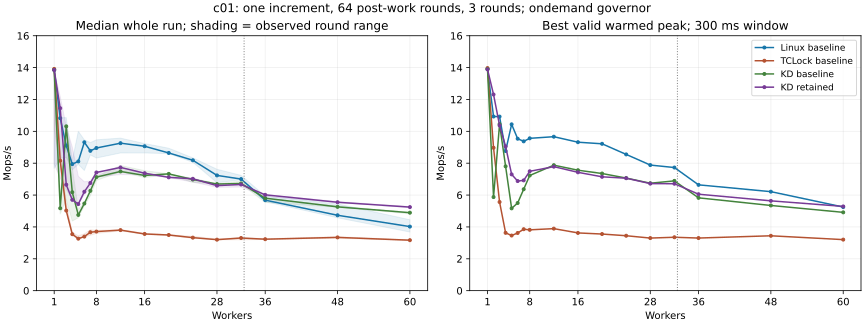

# c01 mutex costs and prefetch study, 2026-10-13

Linux mutex wins most small and medium cohorts because its short acquisition
path and optimistic spinning can cost less than shipping a one-increment
critical section. Delegation becomes more useful as ownership/data transfers
grow expensive. KD is substantially faster than this TCLock mutex port from
four workers onward, despite both delegating almost every operation at sixteen
workers. A high delegation percentage alone does not establish efficiency.

**The requested 97% Native target through 28 workers remains unmet.** Entry-ratio
default 256 is retained. The [previous threshold study](../../mutex_admission/20261013/README.md)
already rejected powers of two from 2 through 256; these experiments investigate
coordination cost rather than retuning that threshold. No failed primary screen
qualifies for the two independent parity confirmation blocks.

## Method and fresh three-way baseline

The starting checkout is `33fde04`, including the previously retained pinned
sampler, outer acquisition cookie and 64 post-work rounds. Every entry below is
a new execution; historical results are not pooled into this baseline.

| Setting | Value |
| --- | --- |
| Execution | Recovery VM on `10.176.26.71`; actual snapshot `mutex-c01-cost-20261013` verified through QEMU |
| Kernel | `6.1.159-kdclobber2`, Build ID `5ca28058e156f34a2c7fe91e8e0fbf92f4e51960` |
| Boot | `nokaslr nopvspin`, native qspinlocks, voluntary preemption |
| Placement | 64 vCPUs pinned to same-numbered physical cores; workers `0..N-1`, collector 63 |
| NUMA | Node 0: CPUs 0–31; node 1: CPUs 32–63; first cross-node cohort 36 |
| Frequency | Host `ondemand` governor; frequency not fixed |
| Payload | c01: one protected increment, 64 dependent post-work rounds |
| Timing | 48,000 warmup operations per worker; two-second measurement; 300 ms settle and warmed-peak window |
| KD | Blocking after 4,096 polling iterations, ratio limit 256, NUMA on, total batch cap 1,024, UBSAN off |
| Repetition | Three rounds at each point, rotating backend order; all samples retained |

Median whole-run Mops/s, with **best valid warmed peak** in parentheses:

| Workers | Linux mutex | TCLock mutex | KD mutex |
| ---: | ---: | ---: | ---: |
| 1 | 13.857 (13.903) | 13.918 (13.970) | 13.857 (13.909) |
| 2 | 10.826 (10.929) | 8.153 (8.967) | 5.172 (5.873) |
| 4 | 7.942 (8.765) | 3.544 (3.629) | 6.179 (7.803) |
| 8 | 8.954 (9.560) | 3.708 (3.817) | 7.126 (7.227) |
| 16 | 9.064 (9.317) | 3.559 (3.623) | 7.230 (7.559) |
| 28 | 7.233 (7.882) | 3.200 (3.300) | 6.690 (6.743) |
| 32 | 7.003 (7.727) | 3.304 (3.351) | 6.727 (6.890) |
| 36 | 5.680 (6.641) | 3.229 (3.302) | 5.804 (5.824) |
| 48 | 4.731 (6.213) | 3.342 (3.443) | 5.258 (5.346) |
| 60 | 4.020 (5.246) | 3.167 (3.203) | 4.893 (4.914) |



[Statistics](statistics.csv) retain all 17 counts, min/median/max/spread, both
throughput measures, CPU ns/op, worker shares and execution classifications.
The baseline's whole-run spread at four workers is 7.2% Native, 5.5% TCLock and
54.3% KD. Initial one-worker Native/TCLock rounds are also unusually slow;
frequency and scheduling contributions are not isolated. Shading denotes
observed round ranges, not confidence intervals. Large changes in the two-to-four
worker cohorts must not be presented as stable optimization gains.

## Why Linux mutex does well

1. **It often avoids sleeping.** Uncontended acquisition is an owner-word CAS.
   Under contention Linux first tries optimistic spinning while the owner runs
   and the spinner need not reschedule. OSQ queues ordinary spinners and limits
   concurrent competition for the owner word; a wait-list head can also spin.
   Sleep is a fallback. These paths fit a very short critical section.
   [Linux design](https://docs.kernel.org/6.1/locking/mutex-design.html),
   [version-matched implementation](https://raw.githubusercontent.com/gregkh/linux/v6.1.159/kernel/locking/mutex.c).
2. **Ownership need not alternate on every operation.** Before explicit handoff,
   an available owner word can be acquired by a contender. Reuse can avoid
   transferring the lock and protected line for each increment. The WAITERS,
   HANDOFF and PICKUP protocol still governs waking and directed handoff.
   This is a plausible contributor, not a measured cache-to-cache causal result.
3. **There is very little useful work to amortize delegation.** Native executes
   the increment in the caller. KD adds admission, routing references, queue
   publication, packet/frame handling and completion traffic. TCLock saves and
   switches native stacks and runs its unlock/next-waiter protocol. On c01 those
   costs can exceed the ownership transfers they avoid.

Worker shares qualify the ownership explanation. At four workers, the median
largest share is 26.48% Native, 26.17% TCLock and 46.26% KD. At sixteen it is
9.41%, 6.29% and 6.27%, respectively. Fresh two-worker Native has a largest-share
median of 55.8%; the earlier archived 97.3% example is not representative of
this run. Every worker progressed, including in every accepted peak window.
Shares do not reveal exact ownership streaks or prove starvation freedom.

Native qspinlock was measured in the immediately preceding
[fresh admission baseline](../../mutex_admission/20261013/README.md#fresh-baseline),
not rerun in this three-arm series. Its pending/queued handoff differs from
mutex acquisition before requested handoff. That explains why a busy-waiting
spinlock need not beat an optimistically spinning mutex on c01; raw throughput
alone cannot assign the difference to a particular cache event.

## Why KD and TCLock differ

The selected TCLock port executes a waiter's native stack using the upstream
six-GPR/RSP context switch and WWJUMP chaining. It retains NUMA selection and
parking, but pre-registers one fixed-affinity context/task per worker CPU.
Every peer must use its TCLock API. KD retains the original Linux mutex and
native-peer exclusion, migration-pinned sleeping waiters, exact task references,
frame retirement and physical-owner ACKs. This comparator is not a test of two
interchangeable general kernel mutex implementations.
[Port scope](../../../../../../tclock_backend/README.md),
[upstream paper](https://www.usenix.org/conference/osdi23/presentation/gupta).

At sixteen workers, returned delegation is 99.65% for TCLock and 99.88% for KD.
TCLock averages 1,016–1,021 bodies per measured batch; KD's lifetime counters,
including warmup, average 885–1,008. Yet TCLock reaches 3.559 Mops/s versus KD's
7.230 and Native's 9.064. Stack/context switching, per-body control flow,
metadata transfers and producer/combiner waiting matter even in a large batch.
The measurements do not isolate one of them as the sole cause of TCLock's gap.

| Workers | Native CPU ns/op | TCLock CPU ns/op | KD CPU ns/op |
| ---: | ---: | ---: | ---: |
| 4 | 503 | 1,128 | 647 |
| 16 | 1,755 | 4,496 | 2,213 |
| 60 | 14,065 | 18,935 | 12,252 |

These are summed worker CPU time per operation, not acquisition latency or
single-core execution cost. Polling CPUs contribute too. At two workers both
KD and TCLock record parking counts `[0, 0, 1]` across the three runs. Parking
calls cannot explain the large low-thread gaps. At sixty, KD still records
300–558 result schedule calls and returns about 97.7% JIT bodies: its gain is
compatible with retaining sleep support.
[Batch and wait observations](batches-and-waits.csv) label their different scopes.

The first baseline whole-run crossover with Native is 36, whereas the best
peak still favors Native at 60. Earlier runs crossed at different counts.
NUMA placement changes at 36; neither 28 nor 32 is a universal crossover.
Ownership behavior, workload size, wait policy, frequency and placement jointly
affect the result.

## Diagnostics and attribution limits

Separate diagnostic series cover 2, 4, 16, 28, 32 and 60 workers for all three
arms. They use the waiter-counter candidate described below, not the final
prefetch variant, and never contribute performance scores.

Flat kernel cycle sampling at 199 Hz records OSQ as 69.0% of Native's weighted
samples at sixteen workers. TCLock's queue slowpath has 90.0%; KD's result
polling helper has 78.8%. These are aggregate worker samples, dominated by
waiters, not the combiner's critical-path latency. All eighteen completed
profiles report zero lost samples. Sampling strongly perturbs the workload:
the sixty-worker Native sample drops to about 0.565 Mops/s from the
uninstrumented 4.020 median. Use the profiles for path presence and optimization
hypotheses, not direct nanosecond attribution. [Flat profiles](cpu-profiles.csv).

Separate `perf stat` runs collect cycles, instructions, generic cache misses,
task-clock, context switches and migrations, all with 100% event running time.
At sixteen workers, TCLock records about 1,572 instructions and 14,194 cycles/op;
KD records 2,259 instructions and 7,275 cycles/op. Fewer instructions do not
necessarily mean less waiting or better throughput. Effective cycles/task-clock
also differ between arms, particularly at sixty workers. Generic cache misses
do not measure coherence transfers. These single diagnostic runs cannot separate
frequency, remote access and scheduler effects. [PMU observations](pmu.csv).

The previous study additionally collected native fast/slow entries, KD admission
decisions, batch histograms and sampled owners. Its probes substantially changed
KD admission, so their rates are also excluded. Exact ownership streaks,
cache-to-cache transfers and frequency-controlled causal estimates remain open.

## Candidate experiments and decision

All variants retain the ABI/cookie, owner flags, native-peer exclusion, sleep,
ACK and retirement contracts. No route uses the benchmark thread count.

| Raw run | Change from the starting KD source | Sessions |
| --- | --- | ---: |
| `baseline` | No provider change; Native/TCLock/KD, full grid | 153 |
| `waiter-screen` | A: replace shared waiter-counter RMWs with exact per-CPU components | 54 |
| `successor-screen` | A + C: defer successor NUMA selection until next loop entry | 54 |
| `prefetch-screen` | A + C + D: split packet hints from saved-SP/stack prefetch | 24 |
| `full-grid` | A + C + D, all 17 counts | 102 |
| `prefetch-only-grid` | C + D only, all 17 counts | 102 |
| `cpu-samples-retry`, `pmu` | A only; independent unscored diagnostics | 36 |

A removes a contended observation line but adds 256 KiB of per-CPU storage on
this VM. Its own sixty-worker whole-run gain is only 0.16%, and the four-worker
median regresses. It is not a sufficient standalone optimization. Each shadow
has an immutable slot; migration-pinned entry/exit update its exact CPU component.
Private gates keep the shared atomic counter. A live sum is diagnostic;
controlled drain checks every component separately, so opposite balances cannot
cancel. Queue publication, ownership and task references remain independent.

C retains the original successor chain while the current body executes,
refuses or releases the outer mutex. It selects the successor's NUMA placement
at the next loop entry, avoiding a serialized metadata read before the current
body. Deferred-chain rejoin, the 64-node scan budget and 128-body fairness
boundary remain intact.

D hints the successor header/packet before the current body and reads its
saved SP for stack hints afterward. It skips that later read after native
handoff or early outer release, when the successor may already be running or
reused. Prefetch grants no ownership. The compiled candidate places the SP load
after the body and both guards; terminal/early-release mutation checks exercise
the lifetime boundary.

The combined full-grid candidate reaches 5.243 Mops/s at sixty workers, versus
the starting 4.893 (+7.16% whole, +7.58% peak), and passes all four high-thread
regression gates. It fails primary parity at 3–28 workers. Even its four-worker
peak exceeds Native while its median is only 71.85% of Native, demonstrating
why both metrics are required. [Independent acceptance checks](acceptance.json).

**Retain A+C+D as a bounded higher-thread optimization, with threshold 256.**
Removing A still improves sixty-worker median/peak by 8.30/9.32%, but reduces
the thirty-two-worker point to 96.61/96.50% of baseline, failing both regression
gates. That smaller variant is rejected; its complete samples remain separate.
The retained source is byte-identical to the measured combined provider.

| Workers | Starting KD median | Retained KD median | Whole / starting KD | Peak / starting KD |
| ---: | ---: | ---: | ---: | ---: |
| 32 | 6.727 | 6.664 | 99.05% | 97.41% |
| 36 | 5.804 | 6.013 | 103.61% | 103.92% |
| 48 | 5.258 | 5.549 | 105.52% | 105.42% |
| 60 | 4.893 | 5.243 | 107.16% | 107.58% |

Every high-thread round returns JIT bodies and every worker progresses. The
separate combined prefetch screen also gains 6.76/8.26% at sixty workers; its
batch size and parking counts do not indicate a gain from disabling sleep or
increasing the batch bound. This corroborates a high-thread benefit but is not
one of the required full-grid parity confirmation blocks.

The retained full-grid four-worker median is 5.702 Mops/s, below the starting
6.179; at sixteen it is 7.371 and at twenty-eight 6.591. Against their fresh
Native controls, median/peak ratios are 71.85/102.60%, 81.21/79.61% and
92.88/85.71%. All primary points from 3 through 28 fail at least one metric.
Thus this change does **not** solve the low-thread problem. The observations
support a narrower cross-NUMA benefit, not broad c01 or Native parity.

## Next optimization priorities

1. Reduce the native-fallback wrapper/admission cost while preserving one
   observation per attempt and exact acquisition routing. The previous forced
   native control shows that routing natively alone does not guarantee parity.
2. Base admission on observed benefit/cost, with bounded sampling and cooling,
   rather than assuming contention implies profitable delegation. Any policy
   needs fresh low-thread and high-thread acceptance; thread-count dispatch is
   inappropriate.
3. Overlap packet/stack transfers and reduce proven redundant per-body work
   without removing reference, ownership, frame or ACK checks. Keep NUMA bypass
   bounded and distinguish latency, CPU consumption and fairness from throughput.

Other mutex payloads and the 64-worker topology require separate acceptance.
This study does not establish universal mutex parity.

## Validation and reproduction

[Validation receipt](validation.json) records normal and SELFTEST `W=1` builds,
55 runner tests, and basic/affected admission, outer-cookie/ABI, frame, task-cache,
parking, balance, terminal and owner/ACK checks. A fourteen-group sequence passed
on the prefetch-only variant; after restoring A, the six basic/counter/combiner
groups passed again on the retained combined source. Earlier component checks
and all source identities remain in the raw test archive. This is not a claim
that every test ran on every variant.

The retained live scheduler probe passes at polling budgets 0, 1,024 and 4,096:
3,072 publications, real result and gate sleepers, same-CPU progress, and admission
cooling while a mapped waiter remains outstanding. The task probe passes across
CPUs 0, 32 and 33, including both owner-unlock orders, four ACKs and concurrent
task-reference/RCU eviction stress. These probes execute zero JIT bodies;
returned JIT execution is established separately by the performance samples.

All **525 complete sessions** (489 uninstrumented, 36 diagnostic) have correct
results, worker progress and complete drain. Offline checks recompute warmed
peaks, verify frozen source/ELF/JIT identities, and check zero reserved nodes,
waiters and frame failures plus balanced physical acquisitions/releases.
The retained probe/provider source matches the measured full-grid implementation.
Final checks find an idle guest with no project modules, unchanged host pins and
governors, and the captured kernel identity. Existing objtool warnings remain
in build logs. No full suite or other-workload acceptance was run.

Failed development attempts are preserved and excluded: the original static
counter array exceeded the kernel module-percpu reserve before initialization;
the replacement uses dynamic per-CPU allocation. A resource-fixture signedness
error and missing opaque wait-queue fixture type were corrected and rerun.
The first perf export lacked CPU records; its cleanup succeeded and a separate
complete retry added `--sample-cpu`. An unnecessary duplicate inline annotation
was removed; a saved comparison of unlike builds is not used as optimization
evidence. None of these failures is counted as a passing sample.

Raw data remain under `bench/results/10.176.26.71/raw/bench/mutex-c01-cost-20261013/`
on the source host and `/root/kdlock-evidence/10.176.26.71/bench/mutex-c01-cost-20261013/`
in the guest. Tests use the corresponding `raw/tests/` and guest `tests/` paths.
[Coverage](coverage.json) records frozen source, binary, environment and plan
manifest hashes. [Archive identities](artifacts.json) preserve raw tarballs,
rejected patches and snapshot evidence. Dates in guest logs use UTC; this report
uses the source host's Asia/Shanghai date.

After the documented snapshot/kernel/idle checks, use a fresh external path:

```sh
export KDLOCK_RECOVERY_CONFIRMED=1 KDLOCK_SNAPSHOT_TAG=YOUR_CONFIRMED_SNAPSHOT
timeout --kill-after=10s 3600s python3 bench/tclock_compare/run_mutex.py \
  --backends native tclock kdlock --cachelines 1 \
  --threads 1 2 3 4 5 6 7 8 12 16 20 24 28 32 36 48 60 \
  --cpus 0-59 --collector-cpu 63 --duration-ms 2000 --repeats 3 \
  --mutex-acceptance adaptive-performance --output /root/kdlock-evidence/NEW-RUN
```

Add `--perf-record --repeats 1` or `--pmu --repeats 1` only for separate
diagnostics. JIT-required acceptance remains the runner default; this study's
explicit adaptive mode labels native execution separately. Reproduce each
candidate using its frozen source. The offline [analyzer](analyze.py) recomputes
raw peaks and verifies source/ELF/JIT hashes, progress and drain; it starts no
workloads. Run it with `--raw` pointing to the extracted benchmark archive root.
