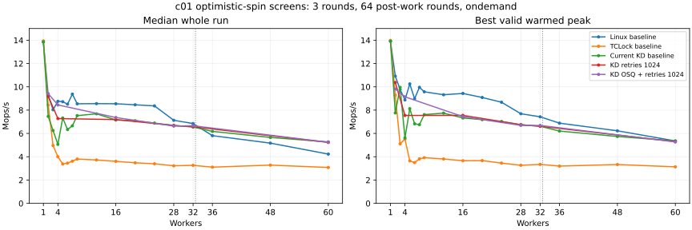

# c01 owner-aware retry and Linux OSQ study, 2026-10-13

Linux mutex combines a short native acquisition path with owner-aware optimistic
spinning and a queue that limits competing spinners. For one protected increment,
this often costs less than moving a continuation through KD or TCLock. The
experiments below improve some low-contention samples, but **none meets the 97%
Native target on both median whole-run throughput and best valid warmed peak**.
The accepted provider and ratio limit 256 remain unchanged from `9b76719`.

The rejected implementation, including its tests and experimental runner controls,
is preserved at `260d330f7e0f58e2d894e5e7ba4bfed0a3244850`, tagged
`archive/perf/mutex-optimistic-c01-20261013`. It was not merged into the accepted
provider. Only the benchmark's stronger original-mutex drain check is retained.
The [previous counter/prefetch optimization](../../mutex_c01_cost/20261013/README.md)
remains in place; this experiment establishes no new accepted throughput gain.

## Fresh baseline and method

The starting checkout is `9b76719`. The recovery VM on `10.176.26.71` uses the
verified snapshot `mutex-optimistic-c01-20261013`, 64 vCPUs on same-numbered physical
cores, workers `0..N-1` and collector 63. The host governor remains `ondemand`.
Kernel `6.1.159-kdclobber2` has Build ID
`5ca28058e156f34a2c7fe91e8e0fbf92f4e51960`; captured source/config/build identity,
`nokaslr nopvspin`, voluntary preemption and native qspinlock policy are verified.
CPUs 0–31 occupy NUMA node 0; the first cross-node cohort is 36 workers.

Each c01 sample has one increment, 64 dependent post-work rounds, 48,000 warmup
operations per worker, a two-second measurement and the existing 300 ms settle
and full-cohort warmed-peak rules. KD retains blocking waits after 4,096 polls,
NUMA selection, batch cap 1,024 and provider UBSAN off. Three rounds alternate
backend order. Raw source, ELF, JIT, commands, progress and retirement evidence
remain archived. No instrumented sample contributes to this study's scores.

Fresh median whole-run Mops/s, with best valid warmed peak in parentheses:

| Workers | Linux mutex | TCLock mutex | Current KD mutex |
| ---: | ---: | ---: | ---: |
| 1 | 13.845 (13.911) | 13.936 (13.981) | 13.862 (13.924) |
| 2 | 9.261 (10.916) | 8.431 (9.286) | 7.458 (7.758) |
| 4 | 8.756 (8.875) | 3.998 (5.518) | 5.063 (5.616) |
| 8 | 8.544 (9.572) | 3.803 (3.919) | 7.528 (7.612) |
| 16 | 8.546 (9.431) | 3.603 (3.657) | 7.155 (7.328) |
| 28 | 7.127 (7.690) | 3.224 (3.267) | 6.683 (6.746) |
| 32 | 6.847 (7.426) | 3.261 (3.345) | 6.555 (6.614) |
| 36 | 5.808 (6.882) | 3.107 (3.197) | 6.176 (6.203) |
| 48 | 5.168 (6.225) | 3.282 (3.331) | 5.654 (5.739) |
| 60 | 4.226 (5.354) | 3.080 (3.135) | 5.270 (5.349) |

Candidate acceptance uses each screen's freshly paired Native control, tabulated
below, rather than the baseline Native curve shown in this figure.

[Statistics](statistics.csv) include all 17 baseline counts, min/median/max/spread,
both throughput measures, CPU cost, worker shares and returned-body fractions.
[Samples](samples.csv) retain every individual scored run. Peak windows require
progress from every worker; a fast interval dominated by a subset is ineligible.
Neither best peak nor a whole-run worker share substitutes for the other metric.

## Why Linux, KD and TCLock differ

Linux first attempts the owner-word CAS. Its optimistic path spins while the
owner runs and the caller need not reschedule; ordinary spinners queue through
OSQ, polling local queue state before the head competes for the mutex. Sleeping
is a fallback. Therefore, labeling mutexes as sleeping locks does not explain
this comparison. [Linux mutex design](https://docs.kernel.org/6.1/locking/mutex-design.html).

Before explicit handoff, Linux can allow a contender to reacquire the lock.
Ownership reuse can preserve the lock and protected data on one core. However,
the fresh largest-worker-share medians are only 51.44% with two workers and
29.16% with four. The earlier archived 97.3% two-worker example is not typical
of these samples. Shares do not measure exact ownership streaks or cache-to-cache
traffic, so reuse remains one plausible contributor rather than the sole cause.
WAITERS/HANDOFF/PICKUP still govern directed handoff.
[Version-matched source](https://raw.githubusercontent.com/gregkh/linux/v6.1.159/kernel/locking/mutex.c).

KD's native fallback already reaches Linux optimistic spinning. Admitted KD
requests instead pay admission and routing work, queue publication, packet/frame
handling, body dispatch and completion traffic. Those costs can exceed the
savings from keeping a one-increment body near its data. At 16 workers, KD returns
99.83% JIT bodies but reaches only 83.72% of Native's median throughput.

TCLock delegates using native stack/context switching and unlock chaining;
KD executes translated continuations. At 16 workers TCLock delegates 99.64% yet
achieves 3.603 Mops/s versus KD's 7.155. High delegation participation is therefore
insufficient: per-body control flow, stack/packet traffic and producer/combiner
waiting also matter. The selected TCLock port pre-registers fixed-affinity worker
contexts and requires its own mutex API; KD retains original Linux-mutex ownership,
native peers, migration-pinned sleeping requests and physical-owner ACKs.
[Port contract](../../../../../../tclock_backend/README.md),
[TCLocks paper](https://www.usenix.org/conference/osdi23/presentation/gupta).

| Workers | Native CPU ns/op | TCLock CPU ns/op | KD CPU ns/op |
| ---: | ---: | ---: | ---: |
| 4 | 457 | 1,001 | 790 |
| 16 | 1,861 | 4,440 | 2,236 |
| 60 | 13,397 | 19,466 | 11,375 |

These are summed worker CPU time per operation, including polling, rather than
single-core instruction cost or acquisition latency. Cross-NUMA transfers make
delegation more attractive at higher counts, but no universal crossover at 28
is established. Here KD's 60-worker median exceeds Native while its best peak
is slightly lower. Frequency is not fixed, and ownership/scheduling variation
remains a confounder.

Earlier [CPU/PMU and intrusive lock diagnostics](../../mutex_c01_cost/20261013/README.md#diagnostics-and-attribution-limits)
show OSQ, TCLock queue waiting and KD result polling as substantial paths. Those
diagnostics used separately identified KD versions, not these new candidates;
their rates are not pooled here. Generic cache misses cannot isolate coherence
transfers. Native qspinlock's separate comparison remains in the
[admission study](../../mutex_admission/20261013/README.md#fresh-baseline).

## Implemented candidates and outcome

The first variant adds bounded owner-aware retries after one admission observation
and shadow lookup, before task references or queue publication. It stops for a
non-running/preempted owner, rescheduling, Linux owner flags, or an active KD
queue/gate. Preemption protects speculative owner pointers; identity is rechecked
before dereference. Only a zero-to-current acquire CAS grants ownership. Success
returns the exact native acquisition cookie. Failed retries enter the existing
sleeping KD protocol without duplicating the entry/contention observation.

The second variant also uses the original mutex's Linux OSQ. The captured kernel's
`osq_lock`/`osq_unlock` helpers are resolved once through its existing symbol
facility; no kernel is modified or rebuilt. Their native reschedule/vCPU
cancellation governs queue waiting, while the explicit budget limits owner
polling. The OSQ is released before any task reference, KD publication, sleeping
fallback or preemption enable. This is version-bound experimental code, not a
new public kernel interface. Both variants preserve ABI, cookies, Linux flags,
native-peer exclusion, sleeping support, ACKs and retirement, and never read a
benchmark worker count.

Each screen covers 2, 4, 16, 28, 32 and 60 workers with three paired Native/KD
rounds: 36 sessions per candidate. Every candidate fails a primary gate, so none
qualifies for the remaining grid points or two fresh confirmation blocks.
All screened 32/60 points stay within 3% of current KD on both metrics and return
JIT bodies in every round. This is not acceptance for the untested 36/48 points.

| Candidate | Four-worker KD median | Four-worker KD / paired Native, whole / peak | Six-count verdict |
| --- | ---: | ---: | --- |
| Independent, 16 retries | 6.871 | 86.26% / 74.14% | Rejected |
| Independent, 64 retries | 6.181 | 73.80% / 78.12% | Rejected |
| Independent, 256 retries | 6.551 | 74.53% / 65.64% | Rejected |
| Independent, 1,024 retries | 7.274 | 86.52% / 73.76% | Rejected |
| Linux OSQ, 64 retries | 7.875 | 101.84% / 96.98% | Rejected |
| Linux OSQ, 1,024 retries | 8.445 | 89.24% / 100.52% | Rejected |

The OSQ/1,024 screen's four-worker JIT share falls from the baseline's 38.64% to
0.066%; it mostly avoids delegation. Its observed throughput increase over the
5.063 baseline is substantial, but paired Native reaches 9.463 Mops/s and the
candidate's three-round spread is 15.29%. The OSQ/64 spread is 21.01%. These are
not stable, accepted gain estimates. At 16 workers, both OSQ variants still
delegate almost every operation and reach only about 79% of their paired Native
medians. A busy KD queue makes the guard decline spinning, while ongoing heat
continues admitting requests. The retry changes entry opportunities without
changing that steady-state policy. [All independent gates](acceptance.json).

## Next optimization priorities

1. Make admission respond to measured benefit and allow a transition out of
   sustained delegation. Evaluate sampled native wait cost against complete KD
   service/completion cost, with hysteresis and a way to drain already-published
   work. Queue occupancy alone is not evidence that delegation is profitable.
2. Keep the successful native path cheap. An ordinary-ABI decision before full
   continuation capture may reduce spills and routing work when execution stays
   native. It must preserve exactly one observation and the existing two-word
   packet/cookie contract; this remains a proposal, not implemented evidence.
3. Retain the existing counter/prefetch gains and target measured per-body
   coordination cost. Additional optimizations must preserve exact ownership,
   task references and ACK/retirement ordering rather than removing those costs
   by dropping correctness requirements.

Simply increasing the spin budget or tuning admission frequency did not achieve
the target. The evidence favors improving the decision between native execution
and delegation, alongside reducing the cost of the chosen path.

## Validation and retained change

There are 369 audited performance sessions: 153 fresh baseline sessions and
216 candidate sessions. All have correct results, per-worker progress, valid
warmed peaks and complete drain; source/ELF/JIT identities and raw peaks are
rechecked by [analyze.py](analyze.py). The retained-source three-backend check is
separate, single-round verification and is not included in performance statistics.

The candidate passes two basic and nine affected unit groups after correcting a
fixture's expected number of native-return sites. The OSQ extension passes its
additional cancellation/unlock cases and 11 deliberate decision mutations.
All 62 runner/auditor checks pass. Normal and SELFTEST builds use `W=1` with
existing objtool warnings retained. Live probes cover 3,072 publications, real
sleeping result/gate waiters, admission cooling with outstanding work, cross-NUMA
task lifetime, two physical-owner orders and four ACKs. These constructed protocol
probes use the default retry-disabled setting and execute no JIT; actual candidate
execution and returned JIT are established by the separate benchmark screens.

The retained change makes `SC_WORKERS_DRAIN` reject any original mutex owner or
flag, nonempty sleeping wait list, or nonempty OSQ after workers return under the
snapshot gate. Its fixture covers both OSQ-enabled and OSQ-disabled builds. A
fresh Native/TCLock/KD check validates the restored provider and stronger drain
check. [Validation receipt](validation.json), [coverage](coverage.json),
[archive hashes](artifacts.json).

Raw evidence is under
`bench/results/10.176.26.71/raw/{bench,tests}/mutex-optimistic-c01-20261013`.
Frozen patches preserve both variants; the archive tag preserves the final
candidate and its controls. The accepted runner has no optimistic-retry options.
No full suite, other payload acceptance, 64-worker topology or parity confirmation
was performed. The 97% through-28 objective remains unmet.
