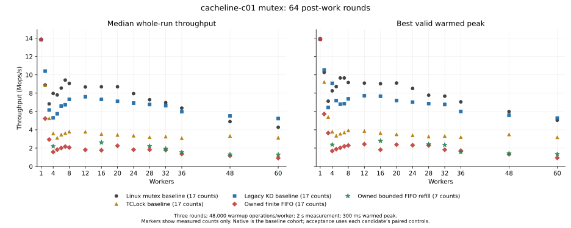

# KD-owned mutex protocol and c01 performance

The new `struct kd_mutex` owns its Linux-derived acquisition, optimistic-spin,
sleeping and delegation protocol. It never routes the owned object through the
original Linux mutex API. Its size, alignment and field offsets match the captured
Linux `struct mutex`. This implements the requested protocol boundary, but **does
not meet the performance target**. It remains an explicit experimental backend;
the benchmark keeps the existing legacy backend by default. Threshold 256 and
finite FIFO remain the owned defaults; bounded refill is opt-in.

The fresh study audits **426 scored sessions and 114 diagnostics**. No candidate
qualifies for the two fresh confirmation blocks. Correctness evidence and rejected
performance evidence are both retained. The earlier user-requested
[eight-round study](../../mutex_protocol/20261013-post8/README.md) is separate;
this study uses 64 post-work rounds throughout.

## Implemented protocol

The [implementation guide](../../../../../../docs/design/mutex_implementation.md#kd-owned-implementation-experimental)
owns the detailed contracts. The changes are:

- A 32-byte, alignment-8 object with `owner`, `wait_lock`, `osq`, and `wait_list`
  at offsets 0, 8, 12 and 16. Compile-time assertions compare every field against
  Linux. Identical geometry does not prove identical cache behavior.
- Private ports of the captured Linux owner flags, optimistic spinning, OSQ,
  uninterruptible wait loop and wake-queue publication. The captured files and
  hashes are in [linux-source.json](../../../../../../kernel_module/owned_mutex/linux-source.json).
  No Linux mutex target, shadow gate or native-peer waiters exist for this object.
- A single typed FIFO for SELF and DELEGATE requests. Failed outer acquisitions
  observe contention once; cold or ineligible callers use KD's own SELF path
  before task references or request publication. Exact-address heat, sampling
  cadence and strict ratio comparison remain intact. Dispatch never uses the
  benchmark worker count.
- Explicit outer cookie ABI2 and a distinct translation identity. Ordinary and
  nested native calls use SELF; translated controls retain exact acquisition,
  physical-owner, task-reference and ACK records. Only explicit outer unlock
  may combine. Task-local ordinary hold tracking prevents combining while a
  native continuation holds another ordinary KD-owned mutex.
- An optional `owned_mutex_refill` policy replenishes an exhausted FIFO snapshot
  without releasing ownership. One cumulative 1,024-body quota applies. SELF,
  HANDOFF, rescheduling, refusal, FULL and early release stop the batch; pending
  older nodes precede new arrivals. It cannot revisit the object after early release.

The old shadow type is explicitly named `kd_mutex_legacy_gate`. Existing callers
of the legacy interface retain their Linux-object protocol. The owned public
interface uses only KD operations for the object's entire lifetime. Unsupported
RT/debug layouts fail compilation rather than silently changing the contract.
Separate target-address probes at 2/4/16/28/32/60 workers record zero original
Linux lock, slow-lock and unlock calls for the owned object, with zero missed
probes. [Lock profiles](lock-profiles.csv) retain those counts alongside KD SELF
and admission activity; they support the source-level separation without being
included in performance scores.

## Measurement and acceptance

All builds, tests and live runs used the recovery VM on `10.176.26.71`, snapshot
`mutex-owned-v1-20261013`, with 64 vCPUs in two NUMA nodes. Scored and diagnostic
benchmarks use workers `0..N-1` and collector 63; correctness probes retain their
own placement (including 0/32/33 for task ACKs). All 64 vCPU pins map to the
same-numbered physical CPU. Kernel
`6.1.159-kdclobber2`, Build ID `5ca28058e156f34a2c7fe91e8e0fbf92f4e51960`,
voluntary preemption and `nokaslr nopvspin` were verified. Host governor remained
`ondemand`; actual frequency was variable, not fixed. Baseline source is checkout
`de01508`, whose provider retains the earlier accepted implementation.

c01 performs one protected increment, then 64 dependent multiply/add rounds.
Each sample retains 48,000 warmup operations per worker, two seconds of measurement,
the 300 ms settling exclusion and 300 ms full-cohort warmed-peak rule. Three rounds
alternate backend order. No diagnostic is scored. Frozen source/ELF/JIT identities,
provider parameters, business results, every worker's progress, retirement and
kernel logs are audited by [analyze.py](analyze.py); the exact invocation is in
[coverage.json](coverage.json). Distinct source or policy cohorts are never pooled.

Primary acceptance requires at least 97% of paired Native separately for median
whole-run throughput and best valid warmed peak at 1–8, 12, 16, 20, 24 and 28
workers. The 32/36/48/60 points must remain within 3% of fresh legacy KD on both
measures and return JIT bodies in every round. A full passing screen must precede
two independent fresh three-round confirmation blocks. Missing points are not
passes. [Acceptance](acceptance.json) records `target_reached=false`.

## Fresh comparison

Values are median whole-run Mops/s, with best warmed peak in parentheses.
The baseline and finite full grid contain all 17 worker counts. Refill has seven
screened counts; its Native controls are recorded separately in the CSVs.

| Workers | Linux mutex | TCLock mutex | Legacy KD | Owned finite | Owned refill |
| ---: | ---: | ---: | ---: | ---: | ---: |
| 4 | 7.967 (8.256) | 3.603 (3.787) | 5.305 (9.075) | 1.579 (1.690) | 2.198 (2.377) |
| 16 | 8.694 (9.026) | 3.525 (3.633) | 7.315 (7.667) | 1.766 (1.822) | 2.614 (2.790) |
| 28 | 7.277 (7.774) | 3.185 (3.253) | 6.764 (6.861) | 1.822 (2.294) | 2.221 (2.408) |
| 32 | 6.962 (7.672) | 3.251 (3.315) | 6.629 (6.764) | 1.784 (1.818) | 1.926 (2.356) |
| 36 | 6.372 (7.049) | 3.087 (3.192) | 5.976 (6.007) | 1.357 (1.724) | 1.540 (1.571) |
| 48 | 4.896 (5.984) | 3.322 (3.488) | 5.521 (5.580) | 1.168 (1.331) | 1.302 (1.424) |
| 60 | 4.274 (5.039) | 3.132 (3.174) | 5.229 (5.278) | 0.910 (0.933) | 1.284 (1.339) |

[Statistics](statistics.csv) include min/median/max/spread and policy;
[samples](samples.csv) preserve every result and execution classification;
[workers](workers.csv) preserve per-worker operations and shares. In particular,
legacy KD's four-worker whole-run samples are 5.305, 5.051 and 9.023 Mops/s:
74.9% spread. Its favorable best peak does not establish sustained parity.
The baseline's first one-worker Native result is 7.690 versus 13.842 and 13.826
in later rounds. These samples remain included; startup/frequency causes were
not isolated.

## Why Linux mutex does well

Linux has a short owner-word CAS path. Under contention it can spin while the
owner runs, with OSQ serializing ordinary spinners; sleeping is the fallback.
A tiny increment can finish before a sleep/wakeup would pay. This is a hybrid
algorithm, so the mutex result cannot be explained as sleeping versus busy
waiting. [Linux mutex design](https://docs.kernel.org/6.1/locking/mutex-design.html)
describes these paths.

Linux permits another acquisition before explicit waiter handoff. That can
reuse ownership on a CPU and reduce movement of lock/protected data. Contended
qspinlock instead uses pending/queued transfer. This is an interpretation of the
[mutex](https://raw.githubusercontent.com/gregkh/linux/v6.1.159/kernel/locking/mutex.c)
and [qspinlock](https://raw.githubusercontent.com/gregkh/linux/v6.1.159/kernel/locking/qspinlock.c)
algorithms, not a measured cache-coherence result. Fresh qspinlock medians at
4/16/28/60 are 6.567/6.824/6.394/4.410 Mops/s; Native mutex leads until the last
of these points. The reversal depends on workload and topology.

Worker distribution is consistent with more flexible service, but does not
measure exact ownership streaks. At 28 workers, the median largest share is
6.44% for Native, 3.59% for legacy KD, 3.79% for TCLock and 3.57% for qspinlock.
At four workers Native's largest share is 27.63%; the historical two-worker
97.3% sample is not representative of this fresh cohort. All measured workers
progress, but neither balanced service nor starvation freedom follows.

TCLock executes native waiter stacks, avoiding KD's register packet and software
JIT frame. It still saves/switches stacks, publishes a queue node, selects a
successor and signals completion. KD additionally pays admission, source/task
references, frame/owner accounting and execution checks. Those fixed costs can
exceed the cost of one increment. Conversely, KD's larger high-thread batches
can amortize coordination and retain the protected data; JIT participation alone
does not measure efficiency. The fixed TCLock port and storage/call paths are
documented in the [implementation guide](../../../../../../docs/design/mutex_implementation.md#tclock-implementation).

CPU work supports this distinction. At sixteen workers, summed worker CPU cost
is about 1,831 ns/op Native, 2,187 legacy KD and 4,539 TCLock. Separate PMU runs
report 6,646/7,127/14,885 aggregate cycles/op respectively, versus 20,877 for
owned finite. Effective frequency differs (2.80/3.28/3.26/3.05 GHz), so these are
not controlled per-body cycle comparisons. [PMU](pmu.csv) and
[flat profiles](flat-profiles.csv) retain the complete diagnostics.

## What the redesign experiments show

The first owned policy detached one finite FIFO snapshot and released after its
eligible prefix. At sixteen workers its median of per-run lifetime mean batches was 13.48
bodies, versus 983.22 for legacy KD. At 28 these were 23.54 versus 942.51.
New arrivals therefore caused much more frequent batch/ownership setup. These
KD counters include warmup; TCLock's batch counters cover measurement only.

Bounded refill directly tests this amortization cost. On identical source
manifests, the three-round refill/off controls give:

| Workers | Refill off, whole / peak | Refill on, whole / peak | Median lifetime mean batch, off / on |
| ---: | ---: | ---: | ---: |
| 4 | 1.553 / 1.807 | 2.198 / 2.377 | 2.99 / 191.44 |
| 16 | 2.152 / 2.468 | 2.614 / 2.790 | 14.35 / 828.62 |
| 60 | 0.913 / 1.239 | 1.284 / 1.339 | 53.95 / 807.22 |

The observed whole-run gains are 41.5%, 21.5% and 40.7%; peak gains are 31.5%,
13.0% and 8.1%. These are separate three-round groups with appreciable control
variation, not independent confirmation blocks. Refill's median JIT share exceeds
99.2% at every screened count, yet remains far below Native and legacy KD. Increasing
batch size helps this prototype without resolving its remaining costs.

The owned queue serializes publication through the object's `wait_lock`, and
each delegated operation still crosses producer/executor completion state.
Those are plausible remaining costs. At the profiled counts from 4 through 60,
flat profiles spend 52–81% in the refill waiter and 11–19% in qspin slowpath,
but cannot identify the critical path or
which spinlock caused contention without callchains. Aggregate generic cache
misses do not identify coherence traffic. Intrusive profile batch sizes can
differ sharply: at 28 workers refill's diagnostic mean is 7.74 versus a scored
lifetime median of 718.57. The profiles must stay unscored.

Finite thresholds 2–128 were screened at four workers, with 256 in the full
grid. All failed. Threshold 2 switched from 1.743 Mops/s with 63.73% JIT to
6.573 and 7.131 with zero JIT; its median/peak reach only 80.68%/83.19% of
paired Native. Refill threshold 2 also fails its 4/16/60 screen: at sixteen it
reaches 85.5%/80.5% of paired Native. These are KD_SELF results when no body is
delegated, never original-Linux routing. Missing grid points and confirmation
blocks remain missing. The default threshold is unchanged.

The separate SELF diagnostic further shows that delegation is expensive for
c01. Its anomalous sixty-worker Native/SELF medians are about 0.51/0.59 Mops/s,
well below scored Native. The cause is unresolved and those sessions are
unscored. Refill also shows substantial service imbalance: its minimum measured worker
share reaches 0.017% at sixteen workers. Progress checks alone are insufficient
to call that fair.

## Verification and retained evidence

[Validation](validation.json), recomputed by [validate.py](validate.py), separates
the source-specific evidence: two basic checks, core/task-cache/compiled outer
ABI/native-after-outer fixtures, owned cooling, legacy waiting, task/ACK probes,
refill queue/runner checks and live nested/early FULL continuation at 4/16 workers.
Earlier admission and terminal logs are archived historical checks; this
validator does not individually re-audit them. The final
core fixture detects seven mutations, refill FIFO detects sixteen, and the
runner/auditor subset has 80 tests. Earlier JIT entry fixtures report 4,359 checks
and 30 mutations. Live cooling exercised a real queued delegate, actual sleeping,
SELF pickup and drain at polling budgets 0/1024/4096; it is an earlier source
receipt, not proof that a JIT body ran in that probe.

Refill nested FULL returns 47,252/7,924,474 JIT bodies at 4/16 workers; early FULL
returns 996,225/3,969,221. Every run checks its business totals, all workers,
retirement and exact FULL started/completed/physical-unlock counts of 1/1/2.
The final ordinary-unlock fix prevents a B unlock from combining a B waiter
while an outer A remains held. These functional runs verify worker placement;
their runner/collector is not pinned and their rates are not scored.

A final legacy c01 compatibility smoke uses the same provider sources after
shared frame factoring. Its 4/16-worker runs return 414,157/7,964,008 JIT bodies
out of 2M/8M operations, with correct results and complete drain. This checks
the retained default's execution path; it is not another legacy performance
baseline.

Initial failures remain archived: an oversized static per-CPU allocation, cold
functional warmup with no JIT, and an early-release deadlock fixed by exact
ordinary-hold tracking and restricting combining to explicit outer boundaries.
A later test wrongly used an intentionally invalid
synthetic CALL exit as a valid FULL continuation, triggering fail-stop; the
replacement diagnostic requests continuation only after a checked control-call
boundary. Recovery followed archived evidence. The initial task-probe affinity
and missing-perf preflights also remain failures, followed by explicit retries.
No guard was weakened. W=1 builds pass with 42 retained warnings; they are not
warning-free builds. Selected test-source preservation limits are explicit in
the receipt. No full suite, other workload, RT/debug or 64-worker acceptance is
claimed.

Three main archives preserve the benchmark/test freezes; separate archives retain
postflight, supplemental unit sources and the final legacy smoke. All six retain
their original regular bytes and symlinks; offline extraction omits absolute
workspace symlinks. Supplemental unit sources are copied only when their hashes
match the original manifests. See
[artifacts.json](artifacts.json) for hashes and physical/source-host paths.
Final guest health verifies idle project state, kernel identity and matching
provider sources. Its broad log pattern also finds one expected userspace mutant
trap; the exact line is retained separately from unexpected kernel errors.

Recompute the correctness receipt with `python3 validate.py --refill --legacy-smoke --output validation.json`
from this directory. For throughput, run the exact repository-root invocation
in `coverage.json`, then `python3 plot.py` here. These scripts read archived
evidence only. The final health and archive-location index in `artifacts.json`
is a separate receipt from the test validator.

## Next optimization boundary

Keep the owned protocol available for further work, with no performance-default
promotion. The next targeted experiment should reduce shared waiter-publication
traffic and completion handshakes within the same 32-byte layout, then measure
the combiner critical path and cache-to-cache transfers under controlled
frequency. Batch policy should use observed useful work and wait cost while
preserving exact queue/owner records; neither worker count nor JIT percentage is
a valid profitability substitute. Ownership reuse and bounded service need a
separate fairness study. Those ideas remain unimplemented and unaccepted here.
