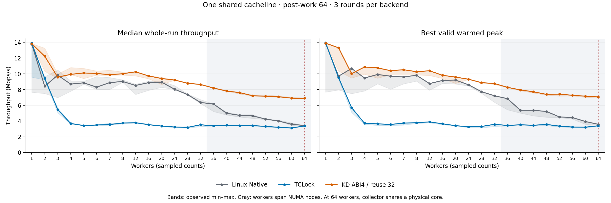

# KD-owned mutex: one cacheline, 1–64 workers

This is a fresh three-way comparison of Linux Native, TCLock and the current
KD-owned ABI4/reuse-32 profile. It measures exactly 22 worker counts:
1–8 in steps of one, then 12–64 in steps of four. The implementation is unchanged
from `585335b555bcf1f694286dba440a191c56fff6b7`; the source checkout before the run
was `ed2108a`. This report keeps the temporary 66-vCPU measurements separate from
the preceding [1–8-worker acceptance study](../20261014-linux-local/README.md).

## Workload and measurement

All workers increment the same counter in one 64-byte payload cacheline under
one mutex. The lock occupies a separate aligned slot. Native and KD both use
32-byte objects with matching field offsets and lock-to-payload placement.
TCLock retains its own lock geometry. This is one shared counter, not independent
per-thread counters packed into one line.

Each backend/count has three rounds, with Native/TCLock/KD order reversed in the
middle round. Every worker first completes 48,000 warmup operations. Measurement
lasts two seconds, with 64 post-work arithmetic rounds outside each critical
section and progress collection every 10 ms. Whole-run throughput is completed
operations divided by measured wall time; the reported value is its three-round
median. Peak is the highest valid warmed window across all three rounds, using
the existing 300 ms window and 300 ms settling exclusion. Every worker must
advance in a qualifying peak window. All samples and observed variation remain
in the statistics.

KD explicitly selects `owned-v1`, ABI4, reuse allowance 32, adaptive-performance
acceptance, finite FIFO batching, batch cap 1,024 and delegation-result polling
limit 4,096. Local acquisition and release use KD's own ported mutex protocol.
Returned JIT bodies are recorded separately from SELF execution. No routing
decision uses the benchmark's worker count. No instrumentation is enabled.

## Placement and recovery

The VM runs `6.1.159-kdclobber2`, Build ID
`5ca28058e156f34a2c7fe91e8e0fbf92f4e51960`, with `nokaslr`, `nopvspin` and voluntary
preemption. Host governors remain `ondemand`. The recovery snapshot
`mutex-owned-c01-full66-20261014` was created and confirmed through the QEMU
monitor before loading benchmark modules.

The temporary VM has 66 vCPUs and 24 GiB RAM across two NUMA nodes. Ordered worker
CPUs are `0–31,33–64`, pinned to distinct physical cores `0–63`. Collector vCPU
65 is outside every worker cohort; vCPU 32 is unused by this benchmark. Counts
through 32 use one NUMA node; 36 and above span both nodes.

**At 64 workers, collector vCPU 65, worker vCPU 64 and QEMU service threads share
physical core 63.** That point includes physical collection contention and is
marked separately in the tables and plot. All 22 points use this same temporary
topology; they are not pooled with the regular 64-vCPU boot.

## Results

All **198 planned samples** completed correctly, every worker made progress,
and every session drained. The independent archive audit passed, including
all 198 recomputed warmed peaks, 320 frozen source files and eight binaries.

KD reaches at least 97% of Native median whole-run throughput at all 22 counts.
Both throughput thresholds hold at **21 of 22 counts in this block**. The
exception is three workers: KD reaches **97.49%** of Native median throughput
but **93.86%** of Native best warmed peak. This fresh block therefore does not
establish full-grid 97% parity. It is also a different topology from the earlier
accepted 1–8-worker study and cannot serve as an interchangeable confirmation.



Values are **median whole-run / best valid warmed peak, Mops/s**.

| Workers | Linux Native | TCLock | KD ABI4 / reuse 32 | KD / Native whole | KD / Native peak |
| ---: | ---: | ---: | ---: | ---: | ---: |
| 1 | 13.784 / 13.888 | 13.920 / 13.954 | 13.840 / 13.903 | 100.40% | 100.11% |
| 2 | 8.425 / 9.710 | 9.418 / 9.512 | 12.243 / 13.312 | 145.32% | 137.10% |
| 3 | 9.830 / 10.688 | 5.462 / 5.711 | 9.583 / 10.032 | 97.49% | 93.86% |
| 4 | 8.697 / 9.474 | 3.697 / 3.710 | 9.934 / 10.874 | 114.22% | 114.77% |
| 5 | 8.863 / 9.923 | 3.426 / 3.650 | 10.116 / 10.760 | 114.14% | 108.44% |
| 6 | 8.312 / 9.706 | 3.499 / 3.570 | 10.051 / 10.404 | 120.92% | 107.19% |
| 7 | 8.888 / 9.607 | 3.559 / 3.741 | 9.891 / 10.525 | 111.29% | 109.55% |
| 8 | 9.032 / 9.819 | 3.753 / 3.792 | 10.015 / 10.277 | 110.89% | 104.66% |
| 12 | 8.527 / 8.763 | 3.787 / 3.895 | 10.263 / 10.393 | 120.36% | 118.61% |
| 16 | 8.886 / 9.163 | 3.542 / 3.654 | 9.735 / 9.818 | 109.55% | 107.14% |
| 20 | 8.947 / 9.211 | 3.364 / 3.414 | 9.407 / 9.590 | 105.15% | 104.11% |
| 24 | 8.044 / 8.616 | 3.246 / 3.283 | 9.217 / 9.321 | 114.58% | 108.18% |
| 28 | 7.366 / 7.733 | 3.191 / 3.313 | 8.805 / 8.884 | 119.54% | 114.89% |
| 32 | 6.359 / 7.215 | 3.535 / 3.588 | 8.652 / 8.772 | 136.06% | 121.58% |
| 36 | 6.169 / 6.847 | 3.383 / 3.443 | 8.196 / 8.291 | 132.86% | 121.08% |
| 40 | 4.997 / 5.370 | 3.475 / 3.530 | 7.816 / 7.956 | 156.40% | 148.16% |
| 44 | 4.727 / 5.368 | 3.434 / 3.464 | 7.619 / 7.725 | 161.19% | 143.91% |
| 48 | 4.665 / 5.223 | 3.424 / 3.576 | 7.220 / 7.393 | 154.78% | 141.53% |
| 52 | 4.254 / 4.528 | 3.326 / 3.353 | 7.158 / 7.431 | 168.29% | 164.10% |
| 56 | 4.006 / 4.449 | 3.206 / 3.242 | 7.095 / 7.275 | 177.13% | 163.53% |
| 60 | 3.599 / 3.946 | 3.123 / 3.224 | 6.913 / 7.164 | 192.10% | 181.52% |
| 64* | 3.433 / 3.581 | 3.378 / 3.404 | 6.898 / 7.074 | 200.95% | 197.52% |

*64 workers include physical collector contention as described above.

KD median throughput is 1.11× Native at eight workers, 1.36× at 32 and
1.92× at 60. The 64-worker result is 2.01×, subject to shared-core collection.
TCLock is slightly faster at one worker, then trails KD at every measured
contended count. These ratios compare freshly measured controls in this
same block; no historical Native denominator is used.

## Execution, CPU cost and variation

Of 66 KD sessions, all 63 sessions with more than one worker return JIT bodies.
The three single-worker sessions are classified `KD_SELF`. Across the whole
run, KD returns 1,198,560 measured JIT bodies, but the largest per-session JIT
share is only 0.4724%: **at least 99.5% of each KD sample executes through SELF**.
The high-thread gains therefore do not demonstrate a gain from bulk delegation.
They are primarily measurements of the local mutex path with occasional delegation.
Provider receipts record zero FULL continuations in this plain workload.

Median aggregate worker CPU cost is below. These are amortized CPU ns/op,
not acquisition latency. JIT and TCLock delegated shares are per-count medians.

| Workers | Native CPU ns/op | TCLock CPU ns/op | KD CPU ns/op | KD JIT share | TCLock delegated share |
| ---: | ---: | ---: | ---: | ---: | ---: |
| 2 | 237 | 212 | 163 | 0.0007% | 0.00% |
| 8 | 884 | 2,132 | 799 | 0.0151% | 99.61% |
| 32 | 4,785 | 9,052 | 3,699 | 0.1461% | 98.85% |
| 60 | 15,389 | 19,201 | 8,675 | 0.2956% | 99.15% |
| 64* | 16,728 | 18,932 | 9,272 | 0.4588% | 99.14% |

At three workers, Native ranges from 6.976 to 10.502 Mops/s whole-run
(35.88% spread), while KD ranges from 9.444 to 9.988 (5.67%). The fastest
Native sample assigns 85.11% of operations to one worker; the largest share
in any three-worker KD sample is 35.27%. This is consistent with ownership
reuse helping Native's peak, but operation shares do not measure ownership
streaks or cache-to-cache transfers. No new PMU or ownership-transition
diagnostics were collected, so that mechanism is not established by this run.

The first one-worker Native sample is 7.656 Mops/s, versus 13.784 and 13.862
in its later rounds. It remains in the archive and min/median/max statistics.
The unchanged ondemand governor permits frequency variation; this run does
not measure frequency well enough to assign that sample's cause. All valid
variation is retained. Every KD worker completes at least 92,928 measured
operations; this is a progress observation, not a starvation-bound guarantee.

- [All 198 samples](samples.csv)
- [Three-round min/median/max/spread and CPU cost](statistics.csv)
- [All worker operation counts and shares](workers.csv)
- [Full comparison ratios](comparison.csv)
- [Independent verification and raw hashes](verification.json)
- [Vector plot](throughput.svg)

## Verification and closeout

The runner verified kernel identity, build metadata, source/binary stability,
matching Native/KD object geometry, business results, worker placement and
complete source/owner/queue/task/frame/ACK drain. No sample failed, no sample
was retried, and no valid sample was excluded. The offline audit independently
checked retained source, binary and JIT bytes, raw progress and kernel logs.
Final guest inspection found no project modules or workers and unchanged
frozen inputs. CPU pins and host governors matched before and after the run.

Raw evidence was archived on both hosts before restoring the regular
64-vCPU recovery boot. The [archive receipt](raw-archive.json) records the
complete file inventory and compressed archive hash. Raw files live under
`bench/results/10.176.26.71/raw/bench/mutex-owned-c01-full-20261014/`.
The two CPU topologies use distinct recovery snapshots; no snapshot was
loaded across topology changes. The regular boot's exact kernel identity,
native qspinlock policy and idle state were rechecked, and its new snapshot
`normal64-after-mutex-owned-full-20261014` was confirmed in the monitor.

## Reproduction and evidence

In a verified recovery guest with the placement and snapshot above:

```sh
KDLOCK_RECOVERY_CONFIRMED=1 KDLOCK_SNAPSHOT_TAG=mutex-owned-c01-full66-20261014 \
  python3 bench/tclock_compare/run_mutex.py \
  --mutex-implementation owned-v1 --owned-mutex-cabi --owned-mutex-reuse-spins 32 \
  --mutex-acceptance adaptive-performance --kd-provider-ubsan off \
  --workload cacheline --cachelines 1 \
  --threads 1 2 3 4 5 6 7 8 12 16 20 24 28 32 36 40 44 48 52 56 60 64 \
  --cpus 0-31,33-64 --collector-cpu 65 --backends native tclock kdlock --repeats 3 \
  --duration-ms 2000 --peak-window-ms 300 --peak-settle-ms 300 --sample-ms 10 \
  --kernel-source /root/linux-6.1.159-kdclobber2 \
  --kernel-baseline /root/kdlock-kernel-baselines/mutex-clobber2-20260919 \
  --output NEW_EXTERNAL_OUTPUT
```

The maintained [offline auditor](analyze.py) verifies source, binary and JIT
hashes, the complete requested grid, exact policy and placement, raw business
results, every worker's progress and owner/queue/task/frame/ACK drain. It also
recomputes every warmed peak through the independent full-matrix calculation.
Run it against the retained archive, without executing workloads:

```sh
python3 bench/results/10.176.26.71/bench/mutex_owned/20261014-full-grid/analyze.py \
  --raw bench/results/10.176.26.71/raw/bench/mutex-owned-c01-full-20261014/matrix \
  --out REPORT_DIRECTORY --plots
```

This is one descriptive three-round comparison block. It does not supply the
two additional fresh confirmation blocks required to accept broader Native
parity, and it does not rerun protocol unit or special nested/FULL tests. Those
unchanged-source checks remain in the preceding study's separate receipt.
