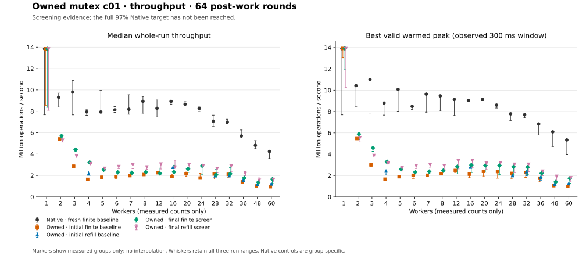

# Owned mutex c01 protocol study — 2026-10-14

The report audits **708 scored samples and 72 separate diagnostics**. Both final
capture-first policies cover the complete 17-count grid and pass every
higher-thread regression gate. Both still fail the Native thresholds at every
primary count from 2 through 28; only one worker passes. **The 97% Native target
is not achieved.** No performance candidate is accepted and no confirmation blocks were run.

The structural changes remain experimental. Capture-first remains the default
entry path, with preflight explicitly opt-in; no measured policy is promoted.
Queued preflight reaches the two Native thresholds at four workers in selected
screens, mostly through SELF execution, but does not close the 16/28-worker gap.
Finite FIFO and bounded FIFO refill have separate owned references. Legacy KD, TClock and
historical qspinlock results are outside this study's scoring; the causal section
uses a clearly labeled historical TCLock comparison.

## Evidence and analysis

Run [analyze.py](analyze.py) after copying the frozen runner directories to the
local raw evidence tree. This reproduces the current report; the
analyzer does not launch workloads or rebuild inputs.

```sh
python3 bench/results/10.176.26.71/bench/mutex_owned/20261014-hybrid/analyze.py \
  --raw bench/results/10.176.26.71/raw/bench/mutex-owned-hybrid-20261014/extracted \
  --baselines finite=bench/mutex-owned-hybrid-baseline64-20261014 \
              refill=bench/mutex-owned-hybrid-baseline-refill64-20261014 \
  --runs outcome=bench/mutex-owned-hybrid-outcome64-20261014 \
         outcome_refill=bench/mutex-owned-hybrid-outcome-refill64-20261014 \
         preflight0=bench/mutex-owned-hybrid-preflight0-refill64-20261014 \
         preflight64=bench/mutex-owned-hybrid-preflight64-refill64-20261014 \
         preflight256=bench/mutex-owned-hybrid-preflight256-refill64-20261014 \
         preflight1024=bench/mutex-owned-hybrid-preflight1024-refill64-20261014 \
         preflight4096=bench/mutex-owned-hybrid-preflight4096-refill64-20261014 \
         queued_control1024=bench/mutex-owned-hybrid-queued-control1024-refill64-20261014 \
         queued64=bench/mutex-owned-hybrid-queued64-refill64-20261014 \
         queued256=bench/mutex-owned-hybrid-queued256-refill64-20261014 \
         queued1024=bench/mutex-owned-hybrid-queued1024-refill64-20261014 \
         queued4096=bench/mutex-owned-hybrid-queued4096-refill64-20261014 \
         single0=bench/mutex-owned-hybrid-single0-refill64-20261014 \
         single1024=bench/mutex-owned-hybrid-single1024-refill64-20261014 \
         single1024_queued=bench/mutex-owned-hybrid-single1024-queued-refill64-20261014 \
         final_finite=bench/mutex-owned-hybrid-final-finite64-20261014 \
         final_refill=bench/mutex-owned-hybrid-final-refill64-20261014 \
  --diagnostics single_profile=bench/mutex-owned-hybrid-single-profile-20261014 \
                single_pmu=bench/mutex-owned-hybrid-single-pmu-20261014
```

Add candidates with `--runs LABEL=relative-path` and separate diagnostic groups
with `--diagnostics LABEL=relative-path` when their archives are available.

The figures show the fresh Native finite baseline, initial owned finite/refill
baselines and final owned finite/refill grids. The Native series belongs to its
named baseline group; candidate acceptance uses each candidate's own paired
controls in the CSV. All other screens remain in the tables and raw evidence.
No marker is drawn at an unmeasured count and no line interpolates between counts.



The [execution and CPU-cost figure](execution.svg) shows measured JIT fractions
and worker CPU cost for the same groups. Reproduce both static SVGs with
`python3 plot.py`; repeat `--series GROUP:ARM:LABEL` to explicitly select different
audited groups. [plot-inputs.json](plot-inputs.json) records the CSV, source-group,
script and output identities. Every plotted point comes from audited evidence.

Each scored directory must contain all three alternating-order rounds for every
declared worker count, with paired Native controls. Candidate counts may form a
short screening grid such as 4, 16, 28 and 60. The analyzer reports missing counts
and compares measured high-thread points only with the fresh baseline having the
same queue policy. It never substitutes a finite baseline for refill or pools
sources, thresholds, protocol controls or confirmation blocks. Both baseline
directories must freeze the same source checkout. Missing baseline primary
counts are reported; the regression baseline must cover all four high-thread
counts because primary comparisons use the candidate's own Native controls.

The audit reuses the previous report's [raw evidence helpers](../20261013/analyze.py)
and the maintained [mutex auditor](https://github.com/hailongeric/kdlock/blob/9a4bf2a/bench/tclock_compare/mutex_study.py).
It checks frozen source, binary and JIT hashes; exact plan/session/raw agreement;
32-byte owned object geometry; every worker's final progress; the observed warmed
peak; execution classification; provider settings; kernel errors and final drain.
Every declared sample is required. A failed audit stops publication instead of
discarding a sample or computing a median from the remaining rounds. The raw
directories, including failed/preflight attempts, must remain archived.

Separate [validation](validation.json) and [artifact identities](artifacts.json),
reproduced by [validation_builder.py](validation_builder.py), check archived
tests, frozen test/provider correspondence, live FULL acknowledgments, actual
waiting/cooling receipts and canonical archive-to-extraction equality. Failed or
unexercised attempts remain explicit. These receipts describe their recorded
scope and environment limits; they do not imply a full test suite or performance
acceptance.

Outputs are `samples.csv`, `statistics.csv`, `workers.csv`, `progress.csv.gz`,
`batches.csv`, `pmu.csv`, `flat-profiles.csv`, `lock-profiles.csv`,
`batch-histograms.csv`, `owned-preflight-profiles.csv`, `coverage.json` and
`acceptance.json`. Statistics retain
whole-run minimum, median and maximum, the best valid warmed peak, both spreads,
worker shares, worker CPU cost and returned JIT counts. `progress.csv.gz` retains
every original sampled worker-counter vector and its CPU order without
interpolation. It contains the same CSV rows compressed with deterministic gzip
(`mtime=0`, no original filename); `gzip -dc progress.csv.gz` reads the CSV.
Diagnostic samples,
including forced SELF routing, remain visibly unscored. Full planned owned
controls and source hashes keep protocol variants distinguishable.
Capture-first archives may omit the newer preflight fields. Their display policy
is `capture_first`, with `owned_preflight_policy_recorded=false`; their original
plan is preserved. A recorded `c_abi_v1` zero-spin preflight remains a separate
candidate because it still moves SELF handling ahead of captured entry.

Optional `profile_owned_preflight` diagnostics keep the ordinary `lock_profile`
unchanged and add the independent `owned_preflight_profile` receipt. The analyzer
requires the exact gate/helper counter fields, zero missed probes and unknown
outcomes, saved/raw equality and valid helper-to-gate count bounds. The ordinary
owned profile still requires zero original Linux target calls. Undeclared extra
preflight receipts are rejected; old records without the flag remain valid.
`owned-preflight-profiles.csv` preserves these intrusive counters separately from
scores, covering the interval after warmup until profile drain. Cold or forced
SELF decisions bypass the optimistic helper, so the two call totals need not
be equal. The single-eligibility diagnostic groups below contain 18 independently
audited owned-preflight receipts.

## Performance gates

The primary grid is 1–8, 12, 16, 20, 24 and 28 workers. Median whole-run throughput
and best valid warmed peak must each reach 97% of that candidate block's paired
Native result. At 32, 36, 48 and 60 workers, both measures must reach 97% of the
fresh owned baseline using the same queue policy, and each candidate sample must
return JIT bodies. Improvements above the baseline are permitted.

A screen cannot establish final acceptance. To evaluate a selected screen and
two independent fresh confirmation blocks, declare all three with `--runs` and
add `--confirmations SCREEN BLOCK1 BLOCK2`. Both confirmations must match the
screen's complete planned policy and frozen source; all three groups must pass
the full grid independently. Both baseline regression grids must also be complete. The
analyzer never recommends or changes a production default. Required correctness,
recovery and host environment checks remain separate evidence.

Measurements retain c01, 64 post-work rounds, 48,000 warmup operations per worker,
two seconds of measurement, 300 ms settling and the existing 300 ms full-cohort
observed peak rule. Collector CPU is 63 and workers use the recorded CPU prefix.
Worker CPU cost excludes collector and other VM/host overhead. Sampled progress
and ownership observations do not establish a bound on fairness, exact ownership
streaks or cacheline-transfer costs.

## Fresh baselines

The finite baseline covers all 17 worker counts, with 102 samples. Refill covers
4, 16, 28, 32, 36, 48 and 60 workers, with 42 samples. Each count has three Native
and three owned samples in alternating order. Both runs use the same frozen
capture-first source and entry-ratio limit 256. Their entire regression grids
are available; refill's other primary counts remain unmeasured. All 144 samples
passed source/binary/JIT hash checks, raw-data and warmed-peak checks, worker
progress, kernel-error and final-drain checks. See [coverage](coverage.json),
[all samples](samples.csv) and [statistics](statistics.csv).

Rates below are **median whole-run / best valid warmed peak**, in Mops/s. Each
Native result comes from the indicated baseline group. JIT share, CPU equivalents
and CPU ns/op are medians of the three owned samples. CPU equivalents are summed
worker CPU time divided by measured wall time; they exclude collector overhead.

| Policy | Workers | Native whole / peak | Owned whole / peak | Owned JIT share | Owned CPU equivalents | Owned CPU ns/op |
| --- | ---: | ---: | ---: | ---: | ---: | ---: |
| finite | 4 | 7.945 / 8.793 | 1.640 / 1.659 | 74.63% | 4.000 | 2439 |
| finite | 16 | 8.928 / 9.040 | 1.895 / 2.130 | 93.31% | 15.996 | 8438 |
| finite | 28 | 7.084 / 7.785 | 2.142 / 2.203 | 96.42% | 27.979 | 13069 |
| finite | 60 | 4.248 / 5.339 | 0.946 / 0.973 | 98.23% | 59.841 | 63245 |
| refill | 4 | 7.946 / 8.051 | 2.147 / 2.427 | 99.29% | 4.000 | 1863 |
| refill | 16 | 8.846 / 9.023 | 2.766 / 2.792 | 99.90% | 15.998 | 5783 |
| refill | 28 | 6.887 / 7.792 | 1.972 / 1.993 | 99.86% | 27.973 | 14190 |
| refill | 60 | 3.997 / 4.928 | 1.211 / 1.259 | 99.83% | 59.865 | 49412 |

High JIT participation does not close the throughput gap in these baseline
samples. At 16 workers, refill uses almost 16 worker CPU equivalents while its
median throughput is 2.766 Mops/s versus its paired Native's 8.846 Mops/s.
This establishes substantial CPU cost but does not isolate queue coherence,
caller capture or frame handling as its cause. The finite/refill measurements
remain separate groups, including their separately measured Native controls.

All samples are retained. The three Native whole-run rates in the refill
four-worker group range from 4.377 to 8.016 Mops/s, a 45.8% min-to-max spread
relative to their median. Finite KD at 28 workers has a 22.6% spread; refill KD at
60 has an 18.1% spread. Every worker completed operations and contributed to each
accepted peak window, but progress was uneven: the lowest worker share in the
refill 28-worker samples was 0.0195% of one run. The complete shares and sampled
counters are retained in [workers.csv](workers.csv) and [progress.csv.gz](progress.csv.gz).

These groups supply the fresh owned regression references. Their Native
measurements are retained separately from each candidate's paired controls.

The local [stage-1 archive](../../../raw/bench/mutex-owned-hybrid-20261014/stage1-owned-baselines.tar.gz)
has SHA256 `7888fcfadad399fdaaf895b9cbf9e225743bfda5b8c5071cbfa391e00a4c4b61`.
The source-manifest SHA256 is
`2fe489a2bbade807c7f44d0460359d678cf26efc82171cf3c869bff1e2c222d2`
for both baseline groups. Archive extraction retained the 5,530 regular files;
absolute workspace symlinks were not materialized locally, while their targets
remain recorded in the archive and extraction receipt. Required JIT artifacts
are regular files and passed the offline audit.

The analyzer was checked offline against 180 previously archived owned/Native
samples, including 18 unscored SELF controls. Source, binary, JIT, raw measurement,
progress and drain checks passed. Those outputs exist only under `/tmp` as audit
tool validation and are not measurements for this study.

## Final complete-grid results and disposition

`final_finite` and `final_refill` each contain 102 scored samples: three Native
and three owned rounds at every primary and regression count. All 204 pass the
offline audit. Both use the same final source-manifest SHA256
`7de337a6f1b895e4af3fa198d51c021d1b8b2a014518e6c8f9f405403062f87a`,
entry-ratio limit 256, `owned_preflight_policy=capture_first`,
`owned_mutex_preflight=false`, zero preflight spins and queueing disabled.
They retain the outcome-word/unlinked-grant structural change. Finite and refill
remain separate policies with their own fresh references and paired Native
controls; the initial source and every intermediate candidate remain archived.

Rates are **median whole-run / best valid warmed peak**, in Mops/s. Native
percentages use the final group's own three paired Native samples for each
measure. Every listed primary point requires at least 97% in both columns.

| Workers | Final finite whole / peak | Finite fraction of Native | Final refill whole / peak | Refill fraction of Native |
| ---: | ---: | ---: | ---: | ---: |
| 1 | 13.836 / 13.922 | 99.9% / 100.2% | 13.845 / 13.903 | 100.0% / 100.0% |
| 2 | 5.688 / 5.889 | 67.9% / 63.7% | 5.296 / 5.538 | 59.7% / 49.9% |
| 3 | 4.415 / 4.595 | 57.9% / 59.1% | 3.816 / 3.882 | 48.7% / 48.8% |
| 4 | 3.227 / 3.306 | 41.6% / 40.3% | 3.105 / 3.162 | 38.0% / 37.3% |
| 5 | 2.541 / 2.595 | 31.6% / 30.1% | 2.671 / 2.724 | 32.8% / 32.3% |
| 6 | 2.294 / 2.312 | 28.2% / 27.1% | 2.839 / 2.913 | 34.3% / 31.1% |
| 7 | 2.249 / 2.370 | 23.5% / 24.5% | 3.011 / 3.028 | 34.9% / 31.9% |
| 8 | 2.308 / 2.460 | 26.3% / 24.7% | 2.792 / 2.924 | 32.8% / 29.8% |
| 12 | 2.185 / 2.824 | 26.4% / 31.4% | 3.070 / 3.398 | 35.1% / 36.5% |
| 16 | 2.325 / 2.985 | 26.6% / 33.1% | 2.785 / 3.430 | 29.9% / 35.8% |
| 20 | 2.619 / 2.952 | 29.8% / 32.3% | 3.032 / 3.156 | 34.4% / 34.4% |
| 24 | 2.909 / 2.945 | 36.5% / 34.1% | 2.924 / 3.209 | 35.9% / 37.0% |
| 28 | 2.070 / 2.820 | 29.2% / 35.8% | 2.638 / 3.060 | 34.5% / 38.7% |

Only the one-worker point passes, using SELF with zero returned JIT bodies.
Every primary point from 2 through 28 fails both measures for both policies.
The 32/36/48/60 gates instead compare with the initial owned baseline using the
same queue policy. All eight policy/count pairs pass both measures and return
JIT bodies in every round:

| Workers | Final finite whole / peak | Change from finite baseline | Final refill whole / peak | Change from refill baseline |
| ---: | ---: | ---: | ---: | ---: |
| 32 | 2.156 / 2.781 | +2.5% / +22.1% | 2.885 / 3.060 | +45.3% / +29.8% |
| 36 | 1.768 / 2.209 | +26.3% / +26.2% | 2.182 / 2.410 | +40.1% / +31.0% |
| 48 | 1.368 / 1.397 | +34.3% / +33.2% | 1.552 / 1.927 | +34.6% / +61.4% |
| 60 | 1.647 / 1.741 | +74.0% / +78.8% | 1.628 / 1.791 | +34.5% / +42.3% |

The partial gains are useful but uneven. Against its initial baseline, final
finite improves whole-run throughput by 96.7% at four workers and 22.6% at 16,
but loses 3.3% at 28 despite a 28.0% peak gain. Its paired Native whole median at
28 is essentially unchanged. Final refill gains 44.7%, 0.7% and 33.8% whole at
4, 16 and 28; its paired Native whole control at 28 also rises 11.1% from the
initial refill control. These control shifts are retained, not used to normalize
the owned gains. [Statistics](statistics.csv), [per-round samples](samples.csv).

Variation and progress remain material limits. Final finite whole-run spreads
at 16, 28 and 32 are 29.7%, 24.7% and 30.5%; refill's 16/28 spreads are 24.2%
and 20.7%. Even one worker has 39.8%/41.6% whole-run spread across the finite/refill
blocks. Every worker makes progress and contributes to each accepted peak, but
final refill's smallest 16-worker share is only 0.0092%. At 16, median JIT shares
are 93.32%/99.90% for finite/refill, with worker CPU costs of 6,879/5,744 ns/op.
High participation and larger batches therefore still coexist with a large
gap to Native; these samples do not establish bounded fairness or isolate a
particular cacheline or frame operation as the cause.

The complete grids remove the missing-count limitation for the final source.
They do not overturn the failed primary gates. No candidate qualified for
confirmation and no two fresh confirmation blocks were declared.
[Acceptance](acceptance.json) therefore records `target_reached=false`, with no
selected candidate or promoted default. The retained implementation is an
experimental structural optimization, with capture-first as the default entry
and preflight opt-in. Entry-ratio limit 256 and the separate finite/refill policy
choices are not presented as an accepted solution to the Native target. No
additional production candidate is part of this phase.

The [final-score archive](../../../raw/bench/mutex-owned-hybrid-20261014/stage8-final-screens.tar.gz)
has SHA256 `f6d045a57a11e930723e594267bee81da4d1830b46967f1f57fc808a869b3614`;
the separate [final-test archive](../../../raw/bench/mutex-owned-hybrid-20261014/stage7-final-tests.tar.gz)
has SHA256 `55c0ccf4a6dd8ef6c7b4fba7b63549fb8ed6f0226f4ac1df312e71c39b74eeb6`.
Final live checks cover nested/early FULL continuations under capture-first at
4 and 16 workers and queued preflight at 16, with actual returned JIT bodies,
owner acknowledgments and drain in all six sessions. Final waiting/cooling
checks cover poll limits 0, 1,024 and 4,096 separately from JIT execution. The
initial unit-fixture failure and exact fixture-only retry remain preserved;
the retry passes all 11 affected groups. Details and source correspondence are
in [validation](validation.json), not inferred from successful performance runs.

## Outcome-word screens

`outcome` and `outcome_refill` each contain 24 samples: three alternating-order
Native/owned rounds at 4, 16, 28 and 60 workers. All 48 pass the offline source,
binary, JIT, raw measurement, progress, peak and drain audit. The candidate keeps
capture-first entry and threshold 256. Its production source differences from
the baseline are confined to the private waiter header, owned core and owned
delegation; matching generated provider copies are also frozen. Both policies
use source-manifest SHA256
`d9cb444fab13822b5692e3bd61c51440ce8f2c343dec2ed1e44de3c3b5df0622`.

The change uses one outcome word for grant/COMPLETE/FULL and unlinks a directed
delegate before publishing its grant. Exact owner/PICKUP consumption then avoids
another acquisition of `wait_lock`. Its mechanism is documented below; these
measurements evaluate the combined change, not each operation independently.

Rates are median whole-run / best warmed peak in Mops/s. Owned changes compare
with the matching fresh finite/refill baseline above. Native changes compare the
candidate's paired Native control with that baseline's Native control; they are
reported as variation context, not used to adjust or normalize the owned score.

| Policy | Workers | Candidate whole / peak | Owned change whole / peak | Paired Native whole / peak | Native change whole / peak |
| --- | ---: | ---: | ---: | ---: | ---: |
| finite | 4 | 3.292 / 3.339 | +100.7% / +101.3% | 8.474 / 8.665 | +6.7% / -1.5% |
| finite | 16 | 2.097 / 2.187 | +10.6% / +2.7% | 8.890 / 9.355 | -0.4% / +3.5% |
| finite | 28 | 1.990 / 2.658 | -7.1% / +20.7% | 7.210 / 7.829 | +1.8% / +0.6% |
| finite | 60 | 1.287 / 1.635 | +36.0% / +68.0% | 3.663 / 4.265 | -13.8% / -20.1% |
| refill | 4 | 2.879 / 2.995 | +34.1% / +23.4% | 7.750 / 8.568 | -2.5% / +6.4% |
| refill | 16 | 3.145 / 3.361 | +13.7% / +20.4% | 8.481 / 9.434 | -4.1% / +4.6% |
| refill | 28 | 2.928 / 3.154 | +48.5% / +58.2% | 7.112 / 7.716 | +3.3% / -1.0% |
| refill | 60 | 1.682 / 1.767 | +38.9% / +40.4% | 3.641 / 4.101 | -8.9% / -16.8% |

The four-worker result includes a large execution-mix change. Median JIT share
falls from 74.63% to 45.82% for finite and from 99.29% to 52.56% for refill.
Refill's median lifetime mean batch falls from 202.78 to 3.30 bodies. The gain
there cannot be described as an isolated increase in delegated-body efficiency.
At 16 workers, refill retains about 99.90% JIT share while its mean-batch median
falls from 870.06 to 732.90 and worker CPU cost falls from 5,783 to 5,087 ns/op.
This is consistent with reduced per-request overhead, but does not identify which
notification or cacheline interaction caused the improvement. [Samples](samples.csv),
[statistics](statistics.csv), [batch records](batches.csv).

The finite 28-worker median falls despite a higher best peak. Its three candidate
whole-run rates span 1.989–2.465 Mops/s, and the separate finite baseline also has
substantial spread. At 60 workers both candidate policies improve while their
Native control medians are lower than the baseline controls. Retaining both
control shifts and the per-round distributions is necessary; these are single
three-round screens, not independent confirmations. Every measured worker
progresses, but the candidate's lowest finite 16-worker share is 0.0122%, so no
fairness improvement is established.

[Acceptance](acceptance.json) rejects both screens on the measured primary
97% Native gates. Their strongest measured primary point is refill at 28 workers,
reaching only 41.2% of paired Native whole-run throughput and 40.9% of its best
peak. Both pass the same-policy regression check at 60 with returned JIT in every
round, but 32, 36 and 48 remain unmeasured for the candidate. Primary counts
1–3, 5–8, 12, 20 and 24 are also missing, and no confirmation blocks exist.
`target_reached=false`; the separate preflight screens follow below.

The [stage-2 archive](../../../raw/bench/mutex-owned-hybrid-20261014/stage2-outcome-screens-tests.tar.gz)
has verified SHA256 `910ab839244a8fa0ffa6fecf5f44fd9452e82e31b2c403fb0981a2d76edf4728`.
Separate correctness receipts are outside these performance scores. The
[wait probe](../../../raw/bench/mutex-owned-hybrid-20261014/extracted/tests/mutex-owned-hybrid-outcome-wait-20261014/result.json)
records actual result sleeping, queued cooling, pickup and drain at polling
limits 0, 1,024 and 4,096; it reports zero JIT bodies and therefore does not itself
validate translated execution. An initial notification fixture failed while
extracting a renamed source marker. Its [failure log](../../../raw/bench/mutex-owned-hybrid-20261014/extracted/tests/mutex-owned-hybrid-outcome-20261014/queue-mutations.log)
and [successful retry](../../../raw/bench/mutex-owned-hybrid-20261014/extracted/tests/mutex-owned-hybrid-outcome-20261014/queue-mutations-retry.log)
are retained, together with the corrected driver input. This was a fixture
extraction failure, not a production lock failure.

## Immediate-head preflight screens

The five budgets each contain 24 samples at 4, 16, 28 and 60 workers, retaining
all three alternating-order Native/owned rounds. All 120 samples pass the offline
source, binary, JIT, measurement, worker-progress, peak, kernel-error and drain
checks. They add the C-ABI gate to the outcome-word refill implementation, retain
entry-ratio limit 256, and share source-manifest SHA256
`5cff3a08a1b93681038be859bd3564515375a254f260389ba46e69eb9b1652ec`.
Positive budgets attempt immediate ownership of private OSQ; they do not join its
spinner queue. Budget zero still moves the cold/refused SELF path before captured
entry. It is a distinct control, not the capture-first baseline. See the frozen
[gate](../../../raw/bench/mutex-owned-hybrid-20261014/extracted/bench/mutex-owned-hybrid-preflight1024-refill64-20261014/source/kernel_module/owned_mutex/delegation.c)
and [bounded helper](../../../raw/bench/mutex-owned-hybrid-20261014/extracted/bench/mutex-owned-hybrid-preflight1024-refill64-20261014/source/kernel_module/owned_mutex/core.c).

Owned rates are **median whole-run / best valid warmed peak**, in Mops/s. The
paired Native results and every per-round value remain in [statistics](statistics.csv)
and [samples](samples.csv).

| Poll budget | 4 workers | 16 workers | 28 workers | 60 workers |
| ---: | ---: | ---: | ---: | ---: |
| 0 | 2.849 / 2.980 | 2.906 / 3.266 | 2.269 / 2.888 | 1.664 / 1.783 |
| 64 | 2.661 / 2.913 | 2.405 / 3.148 | 2.082 / 2.532 | 1.584 / 1.649 |
| 256 | 2.842 / 3.038 | 2.236 / 2.901 | 2.017 / 2.775 | 1.526 / 1.626 |
| 1024 | 2.873 / 3.058 | 2.421 / 3.121 | 2.120 / 2.542 | 1.593 / 1.836 |
| 4096 | 2.749 / 2.992 | 2.639 / 3.122 | 1.948 / 2.778 | 1.558 / 1.688 |

The zero-budget C gate does not establish an improvement over `outcome_refill`:
its whole-run medians change by -1.0%, -7.6%, -22.5% and -1.1% at the four counts.
Its 16- and 28-worker whole-run spreads are 25.9% and 25.4%, so these separate
screens do not isolate a gate instruction cost. Every positive budget has a lower
16- and 28-worker whole-run median than budget zero. All five fail both measured
primary gates; across these screens the largest Native fractions are only 38.2%
whole-run and 37.5% peak, at different budgets. All pass the measured 60-worker
same-refill regression gate and return JIT bodies in each round, but counts
32, 36 and 48 and the other ten primary counts remain missing. No budget is
selected and no confirmation blocks exist. [Acceptance](acceptance.json).

At 60 workers, positive budgets change the execution mix and CPU cost sharply.
Their median JIT shares are 0.98–2.68%, versus 99.88% at budget zero, and their
median worker CPU equivalents are 4.56–6.74, versus 59.87. Median worker CPU cost
falls from 35,884 ns/op to 2,895–4,327 ns/op, while whole-run throughput remains
below budget zero. This is evidence of a different balance of SELF execution and
delegation, not of faster delegated bodies. The code can select SELF when a
reschedule is needed or the owner is not running; the uninstrumented runs do not
count those decisions. Cold admission and changed contention are also possible
contributors. Actual JIT counters, not the final heat-table snapshot, establish
the measured execution mix.

**The Native 60-worker regime change is retained and unresolved.** In every
positive-budget group, Native round 0 precedes KD round 0 and reaches
2.428–3.676 Mops/s with 52.22–56.04 worker CPU equivalents. Native round 1 follows
KD round 1; Native round 2 runs before KD round 2. Both later Native rounds fall
to 0.472–0.519 Mops/s and 21.12–22.63 CPU equivalents. Budget zero's three Native
rounds remain at 3.525–4.055 Mops/s. These are valid, fully drained measurements;
no low round is discarded or replaced. The 4096-budget group illustrates the
associated worker-share change:

| Native round | Whole / peak Mops/s | Worker CPU equivalents | Minimum / median / maximum worker share | Node 0 / node 1 share |
| ---: | ---: | ---: | ---: | ---: |
| 0 | 3.513 / 3.889 | 55.945 | 0.761% / 1.500% / 4.116% | 61.729% / 38.271% |
| 1 | 0.496 / 0.506 | 22.187 | 1.382% / 1.664% / 1.868% | 52.803% / 47.197% |
| 2 | 0.498 / 0.509 | 22.103 | 1.481% / 1.660% / 1.890% | 52.860% / 47.140% |

Every worker advances in the slow runs and their accepted peak windows. Across
the eight slow Native runs, workers complete 13,056–19,712 operations each.
Sampled checkpoint values repeat more often, but counters update every 256
operations; repeated values do not measure an interval without execution or a
sleep duration. The simultaneous drop in CPU use and narrower distribution of
worker shares is consistent with more blocking or directed service. Frequency alone,
ownership history, scheduling and sleep/wakeup behavior are not separated by
these observations. The later diagnostic section adds PMU and acquisition
observations, but none of its Native PMU rounds captures the original 3–4 Mops/s
regime. A controlled capture of both regimes, including preceding-run history
and lock-specific scheduler/ownership events, remains missing. The low medians
cannot support a general claim that owned KD beats Native at 60.
The regression gate at 60 uses the fresh owned refill baseline, not these Native
controls. [Worker records](workers.csv), [progress snapshots](progress.csv.gz).

The [stage-3 archive](../../../raw/bench/mutex-owned-hybrid-20261014/stage3-preflight-screens-tests.tar.gz)
has SHA256 `edacfe4e8ea94e580dfb76469fb79e4d2df0ba42ae490e824fd3ccedaa5dec9f`.
Separate functional evidence retains a failed four-worker nested FULL attempt:
it completed the correct 2,000,000 operations and drained, but returned zero JIT
bodies and did not exercise the required post-control continuation. Its
`NO_JIT` and `cleanup_error` remain in the
[session](../../../raw/bench/mutex-owned-hybrid-20261014/extracted/tests/mutex-owned-hybrid-preflight-full-nested-20261014/c01-t04-r00-direct-kdlock-adaptive-owned-v1-refill-preflight1024/session.json).
A NORMAL translation and final heat count of 1,010 do not establish translated
execution or show that the lock never became hot: that count is residual state,
not the total contention history. Separate 16-worker
[nested](../../../raw/bench/mutex-owned-hybrid-20261014/extracted/tests/mutex-owned-hybrid-preflight-full-nested16-20261014/c01-t16-r00-direct-kdlock-adaptive-owned-v1-refill-preflight1024/session.json)
and [early-release](../../../raw/bench/mutex-owned-hybrid-20261014/extracted/tests/mutex-owned-hybrid-preflight-full-early16-20261014/c01-t16-r00-direct-kdlock-adaptive-owned-v1-refill-preflight1024/session.json)
checks each completed 8,000,000 correct operations, drained, returned 2,456,686
and 34,519 JIT bodies respectively, and recorded FULL owner acknowledgments.
These are correctness receipts, not performance samples. The archived runner
and study checks passed 69 and 15 tests respectively; the affected unit group
receipt is [PASS](../../../raw/bench/mutex-owned-hybrid-20261014/extracted/tests/mutex-owned-hybrid-preflight-20261014/unit-status.txt).

## Queued-preflight screens

This stage adds four queued budgets and a 1024-budget immediate-head control,
each with three alternating-order Native/owned rounds at 4, 16, 28 and 60 workers.
All 120 samples pass the offline audit. They share source-manifest SHA256
`13f2cbe6f2a5fe0c9bef96e45e212fdb19868cc98b315e1f1167324b615f0e61`,
refill and entry-ratio limit 256. `queued_control1024` explicitly records
`owned_mutex_preflight_queue=false`; the four queued groups record `true`.
Their budget covers deliberate observations while waiting in OSQ and polling
the owner. Finishing OSQ unlink/handoff remains mandatory after budget expiry,
so this is not a bound on elapsed time. The shared-source 1024 on/off comparison
isolates the queue switch; comparing other budgets with that control changes
both the budget and queue setting. [Frozen OSQ implementation](../../../raw/bench/mutex-owned-hybrid-20261014/extracted/bench/mutex-owned-hybrid-queued1024-refill64-20261014/source/kernel_module/owned_mutex/osq.c).

Owned rates are **median whole-run / best valid warmed peak**, in Mops/s.

| Policy and poll budget | 4 workers | 16 workers | 28 workers | 60 workers |
| --- | ---: | ---: | ---: | ---: |
| Immediate-head 1024 control | 2.694 / 2.816 | 2.394 / 2.790 | 2.021 / 2.848 | 1.567 / 1.654 |
| Queued 64 | 5.105 / 5.271 | 2.670 / 3.032 | 2.099 / 2.722 | 1.566 / 1.657 |
| Queued 256 | 6.964 / 7.477 | 2.397 / 3.151 | 2.146 / 2.748 | 1.557 / 1.721 |
| Queued 1024 | 8.479 / 9.923 | 2.332 / 3.068 | 2.038 / 2.800 | 1.599 / 1.699 |
| Queued 4096 | 7.877 / 7.986 | 2.674 / 3.180 | 2.094 / 2.697 | 1.612 / 1.702 |

At four workers, queued 1024 reaches 101.6% of paired Native whole-run throughput
and 112.5% of its peak; queued 4096 reaches 100.2% and 101.0%. Their median JIT
shares are only 0.192% and 0.035%, versus 55.73% in the immediate-head control.
Worker CPU cost falls from 1,485 ns/op in that control to 472 and 508 ns/op.
This establishes a useful mostly-SELF result at one worker count. It does not
establish faster delegated execution, a guaranteed benefit at every round, or
full-grid parity. The queued-1024 whole-run samples are 6.953, 9.861 and 8.479
Mops/s, a 34.3% spread, and its smallest observed worker share is 2.599%.
All four workers progress, but the result does not establish equal service.
[Statistics](statistics.csv), [samples](samples.csv), [workers](workers.csv).

At 16 and 28 workers, queueing leaves most execution delegated. Median JIT shares
range from 92.15% to 94.46% at 16 and 88.04% to 93.20% at 28, yet whole-run rates
remain only 26.8–30.8% of paired Native. The same-budget queued-1024 switch changes
whole/peak relative to its immediate-head control by -2.6%/+10.0% at 16 and
+0.9%/-1.7% at 28. Its paired Native controls change by +1.9%/-5.9% and
+2.3%/-1.5%, respectively. Other queued budgets gain up to 11.7% whole at 16
and 6.2% at 28 against the 1024 control, but no queued budget improves the
28-worker best peak. These limited screens do not demonstrate a general gain
over the earlier outcome-only refill candidate, whose corresponding whole-run
rates were 3.145 and 2.928 Mops/s.

At 60, queued whole/peak changes versus the immediate-head control range from
-0.7% to +2.9% / +0.1% to +4.0%. JIT-share medians remain 0.61–2.06%, and the
paired Native whole-run medians remain in the previously observed low regime,
0.497–0.522 Mops/s across control and candidates. The measured same-refill
regression gates pass with returned JIT bodies in every round. All five groups
remain rejected on measured primary gates; 32, 36 and 48 and the other ten
primary counts are absent, and there are no confirmation blocks. The four-worker
passes do not change `target_reached=false`. [Acceptance](acceptance.json).

The corrected [stage-4 archive](../../../raw/bench/mutex-owned-hybrid-20261014/stage4-queued-screens-tests.tar.gz)
has SHA256 `c4b89bb2c624414b5a30ed92663a84e1c04a4f6d8d766c7e7d3f68f18aa64f0e`.
The [initial archive attempt](../../../raw/bench/mutex-owned-hybrid-20261014/stage4-queued-missing-driver-attempt.tar.gz)
is retained: its optional driver filename was wrong, while the original run
directories were complete. The corrected archive includes the functional and
screen drivers. This packaging error discarded no measurement. Separate
16-worker [nested](../../../raw/bench/mutex-owned-hybrid-20261014/extracted/tests/mutex-owned-hybrid-queued-full-nested16-20261014/c01-t16-r00-direct-kdlock-adaptive-owned-v1-refill-preflight1024-queued/session.json)
and [early-release](../../../raw/bench/mutex-owned-hybrid-20261014/extracted/tests/mutex-owned-hybrid-queued-full-early16-20261014/c01-t16-r00-direct-kdlock-adaptive-owned-v1-refill-preflight1024-queued/session.json)
FULL checks each complete 8,000,000 correct operations and drain, with 2,538,084
and 25,221 JIT bodies respectively and recorded owner acknowledgments. The affected
[unit receipt](../../../raw/bench/mutex-owned-hybrid-20261014/extracted/tests/mutex-owned-hybrid-queued-20261014/unit-status.txt)
passes; runner and study logs report 70 and 16 passing tests. They remain
correctness evidence separate from performance scores.

## Single-eligibility screens

This candidate removes the duplicate delegation-eligibility lookup from the
C-ABI gate. A BUSY result permits capture only; the prepared entry still checks
source/task eligibility before acquiring references or publishing a request.
No eligibility lease is inferred from the earlier gate. See the
[frozen entry code](../../../raw/bench/mutex-owned-hybrid-20261014/extracted/bench/mutex-owned-hybrid-single0-refill64-20261014/source/kernel_module/owned_mutex/delegation.c).

The zero-budget, immediate-head 1024 and queued 1024 groups each retain 24 scored
samples and all pass the offline audit. Their shared source-manifest SHA256 is
`aa928f1ef8967004367779bb26db8bb29ea8079bf6252cb8d09b59a60711f9d2`.
Rates remain **median whole-run / best valid warmed peak**, in Mops/s.

| Single-eligibility policy | 4 workers | 16 workers | 28 workers | 60 workers |
| --- | ---: | ---: | ---: | ---: |
| Zero budget | 2.831 / 3.049 | 3.210 / 3.425 | 2.576 / 2.918 | 1.386 / 1.435 |
| Immediate-head 1024 | 2.718 / 2.981 | 2.358 / 3.149 | 2.144 / 2.730 | 1.600 / 1.739 |
| Queued 1024 | 9.254 / 10.179 | 2.473 / 3.214 | 2.087 / 2.757 | 1.566 / 1.685 |

The following changes compare each policy with its last measured predecessor
using the same settings: zero budget with `preflight0`, immediate-head 1024 with
`queued_control1024`, and queued 1024 with `queued1024`. These are separate
source generations and measurement blocks, not pooled rounds or matched control
experiments that isolate a lookup instruction's cost.

| Policy | 16-worker change whole / peak | 28-worker change whole / peak | 60-worker change whole / peak |
| --- | ---: | ---: | ---: |
| Zero budget | +10.5% / +4.9% | +13.5% / +1.1% | -16.7% / -19.5% |
| Immediate-head 1024 | -1.5% / +12.9% | +6.1% / -4.1% | +2.1% / +5.1% |
| Queued 1024 | +6.0% / +4.8% | +2.4% / -1.5% | -2.1% / -0.8% |

Zero budget's higher 16- and 28-worker medians coexist with whole-run spreads
of 26.6% and 20.2%. Its paired Native 16-worker median is 12.4% lower than the
predecessor's Native median, while the 28-worker control is 0.3% higher. Its
60-worker whole/peak regression against the predecessor prevents treating the
change as a general improvement, even though it still passes the measured gate
against the original fresh refill baseline. For the immediate-head/queued
1024 comparisons, paired Native whole medians change by +5.0%/-1.5% at 16 and
+4.3%/+3.7% at 28. [All statistics](statistics.csv).

Queued 1024 again passes the four-worker Native gates: 111.2% whole and 116.1%
peak, with a median JIT share of only 0.107% and worker CPU cost of 432 ns/op.
Its 38.0% whole-run spread remains visible. At 16 and 28 its median JIT shares
are 96.01% and 90.27%, but whole-run rates reach only 28.9% and 28.6% of Native.
All three policies fail both measured gates at 16 and 28. At 60 they return JIT
bodies and pass the same-refill regression gate; the positive-budget Native
medians remain low, 0.488 and 0.525 Mops/s, while zero budget's Native median is
3.773 Mops/s. The missing primary/regression counts and confirmation blocks are
unchanged, so no candidate is selected. [Acceptance](acceptance.json).

The [stage-5 archive](../../../raw/bench/mutex-owned-hybrid-20261014/stage5-single-eligibility-screens-tests.tar.gz)
has SHA256 `389b218af9cf24739ff41646125d3340f04e37d899fb0cae737ba276ee8e605a`.
Unit/runner/study exits are separately recorded in the
[unit-status receipt](../../../raw/bench/mutex-owned-hybrid-20261014/extracted/tests/mutex-owned-hybrid-single-eligibility-20261014/unit-status.txt);
runner and study logs report 72 and 16 passing tests. Separate nested and
early-release 16-worker FULL checks are retained in [validation](validation.json).
They are not performance samples. This stage does not represent the later source
that makes capture-first the default and preflight explicitly opt-in; that source
has its own separate complete grids in the final-results section above.

## Separate profiling and PMU observations

`single_profile` and `single_pmu` each contain 36 diagnostic samples: three
Native/owned rounds at 2, 4, 16, 28, 32 and 60 workers. They use single-eligibility,
queued preflight 1024 and refill, with the same source-manifest SHA256
`aa928f1ef8967004367779bb26db8bb29ea8079bf6252cb8d09b59a60711f9d2`
as the stage-5 scores. All 72 pass raw/source/binary/JIT/progress/peak/drain checks
and remain unscored. All 18 owned lock profiles record zero original Linux
target lock, slow-lock and unlock calls. All 18 independent preflight receipts
match the saved counters and required outcome bounds, with zero missed probes
and unknown outcomes. Disabled Native records contain no undeclared preflight
receipt. The 216 PMU event rows report 100% running time; unsupported or
multiplexed events would fail the audit.

**The profiler changes the execution mix.** The table gives medians of the three
per-run fractions. Gate-capture percentages use gate calls as their denominator;
helper-acquired and helper-SELF percentages use calls to the optimistic helper.
These counters start after warmup and continue until profile drain. Fast outer
acquisitions bypass the gate, and cold or forced SELF can bypass the helper.
The batch column is the median per-run mean from the instrumented batch probe,
not the separate warmup-inclusive provider counter.

| Workers | Gate requests capture | Helper acquires | Helper requests SELF | Measured JIT share: profile / PMU | Profile mean batch |
| ---: | ---: | ---: | ---: | ---: | ---: |
| 2 | 0.000% | 99.991% | 0.009% | 0.000% / <0.001% | No batches |
| 4 | 0.133% | 99.839% | 0.025% | 0.016% / 0.241% | 2.52 |
| 16 | 45.088% | 43.000% | 11.912% | 30.236% / 99.634% | 12.29 |
| 28 | 49.844% | 42.767% | 7.389% | 33.942% / 97.177% | 11.10 |
| 32 | 35.633% | 53.901% | 10.170% | 19.620% / 96.192% | 8.49 |
| 60 | 18.501% | 77.656% | 3.348% | 7.656% / 1.714% | 15.70 |

At 16 workers, for example, the profiler observes 30.24% JIT participation
instead of the scored single-eligibility group's 96.01%; the separate PMU group
observes 99.63%. The measured gate behavior is valid for those instrumented runs,
but its proportions and batch sizes cannot be substituted for uninstrumented
behavior. The helper's SELF result combines a reschedule request and a nonrunning
owner; these counters do not separate the reasons. At 2–32 workers the Native
profiles record median fast-path fractions of roughly 47–60%. A Native slow
entry may acquire through optimistic spinning, so it is not a count of sleeps.
Owner samples are nominally 100 microseconds apart and cannot reconstruct exact
ownership streaks or cacheline transfers. [Gate receipts](owned-preflight-profiles.csv),
[lock profiles](lock-profiles.csv), [batch histograms](batch-histograms.csv),
[frozen profiler](../../../raw/bench/mutex-owned-hybrid-20261014/extracted/bench/mutex-owned-hybrid-single-profile-20261014/source/tests/kernel/mutex/profile/kd_mutex_profile.c).

**PMU cost remains high when delegation dominates.** Each cell below is
Native / owned, with medians computed from per-run values. PMU scope is the
measurement client and inherited workers, excluding the separate setup/warmup
phase; it is not an attribution of every event to a lock instruction. Effective
GHz is aggregate cycles divided by recorded task-clock CPU time, not a direct
measurement of a particular core's clock setting.

| Workers | Cycles / op | Instructions / op | Effective GHz | Context switches / 1,000 ops |
| ---: | ---: | ---: | ---: | ---: |
| 2 | 814 / 866 | 265 / 274 | 3.555 / 3.558 | 0.023 / 0.016 |
| 4 | 1,678 / 1,558 | 394 / 453 | 3.542 / 3.541 | 0.100 / 0.014 |
| 16 | 6,271 / 16,169 | 1,437 / 3,087 | 3.213 / 3.268 | 0.515 / 0.064 |
| 28 | 13,196 / 27,525 | 2,904 / 4,320 | 2.617 / 2.648 | 1.434 / 1.266 |
| 32 | 15,162 / 31,419 | 3,332 / 4,750 | 2.616 / 2.645 | 1.615 / 1.550 |
| 60 | 63,692 / 5,589 | 9,748 / 1,440 | 1.760 / 1.123 | 7.452 / 11.517 |

At 16–32 workers, owned KD spends about 2.1–2.6 times Native's cycles per operation
at similar effective GHz while 96.2–99.6% of operations return through JIT. It also
retires more instructions. This supports investigating active protocol, packet
and frame costs; frequency differences alone do not explain those comparisons.
It still does not locate the serialized bottleneck or establish how many cachelines
moved. PMU runs have their own throughput and execution mix and do not replace
the scored samples. [PMU events](pmu.csv), [diagnostic samples](samples.csv).

At 60, no Native PMU round reproduces the earlier 3–4 Mops/s regime. In run order,
the three Native rates are 1.082, 0.533 and 0.537 Mops/s; worker CPU equivalents
are 21.06, 18.82 and 19.93. Effective GHz is 1.861, 1.760 and 1.759, while cycles
per operation rise from 37,052 to 63,692 and 65,020 and instructions from 7,179
to 9,748 and 10,048. Context switches total 15,144, 8,150 and 8,060; per-operation
values are 6.971, 7.594 and 7.452 per thousand operations. Thus the later slowdown
coincides with changes in instruction cost and clock observations, not merely
more total context switches. The owned PMU runs remain at 1.590–1.604 Mops/s,
8.29–8.65 worker CPU equivalents and 1.55–1.93% JIT participation, with more
context switches per operation than Native despite lower CPU cost. These are
different execution regimes, not a delegation-throughput comparison.

The separate Native 60-worker profiles also change: their observed fast-path
fractions are 36.40%, 0.034% and 0.071%, with rates 1.810, 0.466 and 0.854 Mops/s.
This supports a change in acquisition behavior, while the probes themselves
perturb timing. Scheduler events do not identify each lock's sleep/wakeup or
handoff, and the regime's dependence on preceding runs remains unresolved.
All low runs remain retained. The [stage-6 archive](../../../raw/bench/mutex-owned-hybrid-20261014/stage6-single-diagnostics.tar.gz)
has SHA256 `3be003183468fff7367931f94729b7967d64b68210d9a1f9082e1c2e4c2ad64d`.

## Causal analysis and historical TCLock context

The current optimization scope is the owned protocol. The TCLock comparison
below comes from the **2026-10-13 study on the same machine**, archived with the
`66576d1` implementation phase. These are historical whole-run medians, not new
scores or regression references. Native and TCLock were paired in that study's
baseline; the owned columns came from its separately frozen finite/refill groups.
Their controls and all samples remain in the [historical statistics](../20261013/statistics.csv)
and [coverage receipt](../20261013/coverage.json).

| Workers | Historical Native | Historical TCLock | Historical owned finite | Historical owned refill |
| ---: | ---: | ---: | ---: | ---: |
| 4 | 7.967 | 3.603 | 1.579 | 2.198 |
| 16 | 8.694 | 3.525 | 1.766 | 2.614 |
| 28 | 7.277 | 3.185 | 1.822 | 2.221 |
| 60 | 4.274 | 3.132 | 0.910 | 1.284 |

All values are Mops/s. No historical value enters this report's acceptance
calculation. These results describe the selected port and c01, rather than
establishing a general ranking of the algorithms.

**Why Linux can be fast.** c01 protects one increment; the 64 post-work rounds
run outside the lock. Native can acquire and release using its owner-word fast
path. Under contention it first considers spinning while the owner runs and no
reschedule is needed. OSQ limits ordinary optimistic competition to its head;
the first queued waiter can also spin. Sleeping follows when these paths do not
acquire. Thus mutex performance here cannot be explained by assuming that every
contended acquisition sleeps. See the [Linux design](https://docs.kernel.org/6.1/locking/mutex-design.html),
the [6.1.159 implementation](https://raw.githubusercontent.com/gregkh/linux/v6.1.159/kernel/locking/mutex.c),
and this repository's [captured source identities](https://github.com/hailongeric/kdlock/blob/9a4bf2a/kernel_module/owned_mutex/linux-source.json).

The ordinary owner-word path also permits acquisition before a queued task gets
explicit HANDOFF/PICKUP ownership. Reacquisition on a recently owning CPU can
therefore avoid some ownership and protected-data movement. That is a plausible
cache-locality benefit of the protocol, not a measured explanation of a fixed
fraction of the throughput gap. Worker shares show uneven service but do not
reconstruct ownership streaks or cacheline transfers. The
[local Native mapping](../../../../../../docs/design/mutex_implementation.md#linux-native-implementation)
also records that Native does not enter KD frames or TCLock stack switching.

**Why delegation has a substantial minimum cost.** TCLock publishes a linked
node with a tail exchange, saves six callee-saved registers and executes on the
waiter's native stack. Delegated unlock can jump directly to the next waiter;
the preceding waiter is notified only after its stack is no longer executing.
Its registered task/context references are established outside measurement.
This avoids KD's software JIT frame, but queue publication, stack/cache traffic,
successor selection and completion still occur. These are concrete operations
in the [TCLock trampoline](../../../../../../tclock_backend/mutex/trampoline.inc),
[queue slowpath](../../../../../../tclock_backend/mutex/slowpath.inc),
[combiner](../../../../../../tclock_backend/mutex/combiner.inc) and
[unlock chain](../../../../../../tclock_backend/mutex/unlock.inc). The port's
[fixed-affinity and ordinary-mutex scope](../../../../../../tclock_backend/README.md#selected-comparator-scope)
is narrower than unrestricted kernel callers.

Owned KD adds admission, task-reference acquisition/release, translation-entry
checks, producer packet publication, checked frame setup/retirement and the
producer/executor completion exchange. ABI2 captures IP/SP/BP rather than copying
all register state on every c01 operation, but its broad compiler clobber can
still require register spills. Per-batch source/owner references, executor-stack
setup and physical handoff can be amortized across many bodies; the per-request
work remains. These paths are visible in the
[frozen baseline delegation code](../../../raw/bench/mutex-owned-hybrid-20261014/extracted/bench/mutex-owned-hybrid-baseline64-20261014/source/kernel_module/owned_mutex/delegation.c)
and [frozen caller ABI](../../../raw/bench/mutex-owned-hybrid-20261014/extracted/bench/mutex-owned-hybrid-baseline64-20261014/source/include/kd_owned_mutex_direct.h).

The fresh 16-worker finite and refill groups have median per-run lifetime mean
batches of **13.71 and 870.06 bodies**, respectively. These counters include
warmup, whereas whole-run JIT shares cover measurement. Refill's much larger
batches coexist with 99.90% JIT participation and only 2.766 Mops/s: increasing
batch size does not eliminate its remaining per-request costs. The
[batch records](batches.csv) distinguish this scope from TCLock's historical
measurement-only returned-batch counters. The historical same-source refill/off
comparison likewise supports an amortization benefit, with its variation and
confirmation limits retained in the [earlier report](../20261013/README.md#what-the-redesign-experiments-show).

**Object geometry does not fix protocol traffic.** Native and owned KD use the
same 32-byte public object and c01 cacheline alignment, checked in
[kd_mutex.h](../../../../../../include/kd_mutex.h) and the fresh raw layouts.
Nevertheless, each owned producer publishes under `wait_lock`, sharing the
object's cacheline with the owner word that the executor checks. The baseline
producer also polls both its completion byte and a grant state next to FIFO
links modified by other CPUs. The latter is a specific false-sharing hypothesis;
the former is shared-object traffic inherent in this publication protocol.
Neither is proven to dominate by object size or generic cache-miss counts.
See the [frozen publication/pickup code](../../../raw/bench/mutex-owned-hybrid-20261014/extracted/bench/mutex-owned-hybrid-baseline64-20261014/source/kernel_module/owned_mutex/core.c)
and [waiter layout](../../../raw/bench/mutex-owned-hybrid-20261014/extracted/bench/mutex-owned-hybrid-baseline64-20261014/source/include/kd_owned_mutex_internal.h).

The fresh refill samples at 16 workers have a median of 15.998 worker CPU equivalents and
record only 57–68 delegated-result scheduling calls per sample, while completing
millions of operations. This favors investigating active spinning, coordination
and useful execution costs before blaming frequent parking. Those counters do
not count SELF-path sleeps or measure blocked time, and aggregate CPU time cannot
identify the serialized critical path. Frequency, host scheduling, NUMA traffic
and the retained run variation remain possible influences; the present samples
do not separate them. Positive worker totals and full-cohort peaks establish
progress in these runs, not bounded waiting or fairness. [Fresh samples](samples.csv),
[wait and batch counters](batches.csv).

The current measurement program separates the outcome change, immediate-head
preflight and queued preflight:

- **One outcome word and unlinked directed pickup.** Keep the existing unified
  SELF/DELEGATE FIFO, place grant/COMPLETE/FULL notification in the producer's
  completion line, and unlink a directed delegate before publishing its grant.
  Exact owner/PICKUP consumption can then avoid another `wait_lock` acquisition.
  The purpose is to reduce polling locations and shared-lock traffic without
  changing the public object. [Waiter contract](https://github.com/hailongeric/kdlock/blob/9a4bf2a/include/kd_owned_mutex_internal.h),
  [pickup/release implementation](https://github.com/hailongeric/kdlock/blob/9a4bf2a/kernel_module/owned_mutex/core.c).
- **C-ABI preflight with controlled optimistic spinning.** Move cold and scheduler-directed SELF
  handling before the captured entry, and compare zero-spin preflight with
  bounded running-owner retries using private OSQ. Zero polls still changes the
  caller path and must remain distinct from capture-first. Immediate-head and
  any optional queued-OSQ policy require separate identities. Poll budgets limit
  deliberate polling, not OSQ link completion or elapsed time. Compiler spills
  may remain because the function contains a clobber branch. In the final variant,
  source/task eligibility is checked once after capture, before acquiring resources.
  [Caller interface](https://github.com/hailongeric/kdlock/blob/9a4bf2a/include/kd_owned_mutex_direct.h),
  [preflight and delegation entry](https://github.com/hailongeric/kdlock/blob/9a4bf2a/kernel_module/owned_mutex/delegation.c).

These screens show the gains and limits reported above. Every variant must
preserve exact ownership, queued progress, sleeping
and frame retirement before COMPLETE publication. FULL continuations retain
their required physical-owner and acknowledgment lifetimes.

**Priorities suggested by these measurements.** The outcome-word and direct
pickup change reduces coordination work and helps the measured refill cases,
while queued optimistic spinning shows that four-worker c01 can reach Native
rates mostly through SELF execution. At 16 and 28 workers, the large remaining
gap coincides with predominantly delegated execution. That identifies useful
experiments; it does not allocate a measured fraction of the gap to each source
operation.

1. **Choose delegation by expected benefit, not contention alone.** Sample the
   total acquisition/body/release time and worker CPU cost of bounded SELF and
   delegation trials for the actual lock/entry. Include queue wait, achieved
   batch size, caller data footprint and NUMA placement, plus rescheduling and
   sleep/wakeup behavior. Use sparse observations, hysteresis and exploration
   to avoid oscillating or staying permanently in a bad mode. Make new-entry
   decisions from measured execution cost; preserve all published work and
   never dispatch by benchmark worker count. A highly contended one-increment
   body need not repay packet/frame/notification costs. These are proposed
   measurements and admission rules, not an implemented or validated policy.
2. **Reduce per-request work that batching cannot amortize.** Owned KD still
   takes a request task/routing reference, validates the translated entry,
   publishes a packet, prepares and retires a checked frame, and publishes a
   completion for each body. TCLock's selected port retains registered worker
   references outside measurement, switches to native waiter stacks and may
   chain the next body from unlock; it has no corresponding KD software frame.
   Its queue, stack, successor and delayed-completion traffic remain real costs.
   Compare those paths with sparse timing and PMU/scheduler evidence before
   changing lifetime rules. A batch may share stable metadata, but each request
   still needs exact ownership, retirement and FULL owner acknowledgments.
   [Owned execution path](../../../raw/bench/mutex-owned-hybrid-20261014/extracted/bench/mutex-owned-hybrid-queued1024-refill64-20261014/source/kernel_module/owned_mutex/delegation.c),
   [TCLock worker references](../../../../../../tclock_backend/mutex_provider.c),
   [native-stack execution](../../../../../../tclock_backend/mutex/combiner.inc),
   [unlock chaining](../../../../../../tclock_backend/mutex/unlock.inc).
3. **Measure which packet fields and shared lines matter.** The optimized owned
   producer is 320 bytes, while its Linux-style SELF path uses a 40-byte stack
   waiter; compile-time checks preserve those sizes. This is private storage
   behind the equal 32-byte public object. ABI2 initializes only its required
   minimal state, so 320 bytes is not a per-operation copy or transfer count.
   Queue publication still shares the owner object's cacheline, and request
   publication, execution and completion involve different CPUs. Compare
   isolated field-layout/publication changes with worker CPU cost and controlled
   diagnostics; generic cache misses cannot establish exact cacheline transfers.
   Keep caller ABI and node/frame lifetimes unchanged while testing each change.
   [Packet layout and size check](../../../raw/bench/mutex-owned-hybrid-20261014/extracted/bench/mutex-owned-hybrid-queued1024-refill64-20261014/source/kernel_module/owned_mutex/delegation.c),
   [40-byte SELF waiter](../../../raw/bench/mutex-owned-hybrid-20261014/extracted/bench/mutex-owned-hybrid-queued1024-refill64-20261014/source/include/kd_owned_mutex_internal.h).
4. **Separate WAITERS from directed ownership when probing optimistic retry.**
   The current preflight helper refuses to continue when any of WAITERS,
   HANDOFF or PICKUP is set. WAITERS also remains set while a combiner owns a
   detached or refilled delegation batch. One untested hypothesis is that this
   keeps new hot entrants on the BUSY-to-delegation path, sustaining the queued
   work that keeps WAITERS set. A narrow future experiment could permit bounded
   OSQ waiting with WAITERS alone while retaining the HANDOFF/PICKUP veto. The
   exact owner CAS would remain authoritative: it cannot acquire a word still
   owned by the combiner, preserves WAITERS on acquisition, and cannot steal a
   directed delegate's task-plus-PICKUP grant. Existing SELF already permits
   Linux-style acquisition before explicit handoff. The publication path's
   second ownership check must remain intact. This proposal requires explicit
   flag-transition, publication-race, grant-exclusion and OSQ-cleanup checks;
   it may only increase polling cost if the batch backlog survives. Existing
   BUSY counters combine reasons and do not demonstrate that the WAITERS veto
   causes the measured gap. No such variant was implemented in this phase.
   [Current preflight and exact-owner checks](../../../raw/bench/mutex-owned-hybrid-20261014/extracted/bench/mutex-owned-hybrid-single1024-queued-refill64-20261014/source/kernel_module/owned_mutex/core.c).

The final complete grids support retaining the structural work as experimental:
all higher-thread regression gates pass, while the primary Native gap remains
large and finite still has a 28-worker whole-run regression against its initial
baseline. Capture-first remains the default and preflight stays opt-in. The
future probes above are proposals, not additional candidates or accepted policies
from this phase. Historical TCLock observations remain context, not fresh scores.
