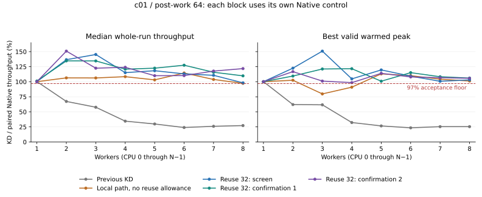

# KD-owned Linux-style mutex: c01, 1–8 workers

This study ports the cheap Linux acquisition path into KD's own mutex and moves
delegation work behind it. It does not call the original Linux mutex API on the
owned target. The ABI4/reuse-32 profile passes the 97% Native target for both throughput
measures at every count in the full screen and both fresh confirmation blocks.
The smallest whole-run ratio is 98.15%; the smallest warmed-peak ratio is 98.51%.
This is acceptance for c01/post64 at 1–8 workers only. General defaults remain
unchanged; the accepted profile is selected explicitly.

Implementation commit: `585335b555bcf1f694286dba440a191c56fff6b7`.
The completed study retains 450 KD/Native screening and confirmation samples,
48 separate Native/TCLock control samples, 72 unscored diagnostic samples and
two functional JIT runs. All completed correctly, progressed and drained;
the rejected throughput candidates and corrected harness failures remain visible.

## Contract and protocol

All workers increment the same `sc_data[0]` counter under one lock. The payload
occupies one 64-byte line; the lock occupies a separate aligned line. This is
not eight separate counters sharing a line. Every comparison keeps 64 post-work
rounds, 48,000 warmup operations per worker, a two-second measurement, 10 ms
sampling, a 300 ms peak window and 300 ms settling exclusion. Workers use CPUs
0 through N−1 and the collector uses CPU 63. The kernel is
`6.1.159-kdclobber2`, Build ID `5ca28058e156f34a2c7fe91e8e0fbf92f4e51960`,
with `nokaslr`, `nopvspin`, voluntary preemption and the unchanged ondemand
governor. The verified recovery snapshot is `mutex-native-first-20261014`.

Each complete block contains three alternating-order rounds at every count
1–8. Both median whole-run throughput and best valid warmed peak must be at
least 97% of the Native control in that same block. A screen and two fresh
source/policy-identical confirmation blocks must pass independently. All valid
samples remain included. Correct results, every worker's progress and complete
owner/queue/task/frame/ACK drain are mandatory. This narrowed scope has no
minimum JIT requirement or higher-thread performance gate. It establishes
nothing about larger payloads, post-work 8, NUMA or workers above eight.

`struct kd_mutex` remains 32 bytes with alignment 8 and field offsets
owner=0, wait_lock=8, osq=12, wait_list=16. Compile-time assertions compare its
size, alignment and every offset with the captured kernel's `struct mutex`.
The public object gains no counter, route table or hidden original mutex.
SELF and DELEGATE nodes share the typed wait list. Unsupported RT/debug layout
configurations fail compilation rather than silently change this contract.

The ABI4 outer entry first executes an owner CAS using ordinary C calling
conventions. A failed CAS enters the ported owner-running check, cancelable OSQ
and optimistic spin loop. That path does no heat-table lookup, entry-counter
update, task-reference acquisition, packet reservation or register capture.
Only failure of local acquisition permits the eight-word continuation capture
and existing delegation eligibility/resource checks. Refusal joins SELF waiting
without repeating the initial OSQ phase. Sleeping remains supported.

The guarded release protocol preserves Linux's release-before-wake behavior
for SELF-only contention. Publishing a DELEGATE sets owned-only owner bit 8
before linking the node. That guard retains physical ownership while a batch
is detached and until directed grant or batch completion is safe. An old
releaser that already cleared ownership may only wake the queue; it cannot
hand off a newer owner's lock. The exact physical/borrowed acquisition cookie,
PICKUP, callee register state, FULL continuation and owner ACK rules remain.

An optional `owned_mutex_reuse_spins` allowance gives the releasing owner one
short opportunity to reacquire before the OSQ head retries. It is consumed at
most once per OSQ turn, only after an unflagged release. First sleeping waiters
and flagged handoff/delegation states bypass it; `need_resched()` interrupts it
before normal OSQ cleanup and scheduling. The tested bounds are 0, 8 and 32;
128 is supported by the control and fixtures but is not implied to be measured.
No routing decision reads benchmark thread count.

## Performance acceptance

[The strict acceptance receipt](c5-reuse32/acceptance.json) audits 192 samples:
48 baseline samples and 144 source/policy-identical screen/confirmation samples.
Every required block passes independently. Values below are whole-run median /
best valid warmed peak; the Native denominator is always from the same block.

| Workers | Screen whole / peak, % Native | Confirmation 1 | Confirmation 2 |
| ---: | ---: | ---: | ---: |
| 1 | 100.22 / 100.09 | 101.20 / 100.09 | 100.13 / 100.09 |
| 2 | 136.65 / 122.56 | 134.66 / 109.46 | 150.87 / 116.79 |
| 3 | 145.24 / 150.86 | 134.57 / 121.18 | 122.52 / 101.10 |
| 4 | 115.10 / 104.75 | 120.88 / 121.66 | 124.00 / 98.51 |
| 5 | 118.30 / 119.64 | 122.54 / 100.88 | 110.04 / 113.97 |
| 6 | 113.07 / 109.25 | 127.46 / 115.09 | 110.21 / 107.99 |
| 7 | 110.68 / 100.83 | 115.76 / 108.31 | 117.76 / 106.70 |
| 8 | 98.15 / 103.04 | 109.79 / 106.10 | 121.83 / 105.71 |

| Workers | Baseline KD median / peak Mops/s | C5 screen KD | C5 confirmation 1 KD | C5 confirmation 2 KD |
| ---: | ---: | ---: | ---: | ---: |
| 1 | 13.864 / 13.924 | 13.870 / 13.914 | 13.876 / 13.913 | 13.864 / 13.912 |
| 2 | 6.108 / 6.218 | 13.174 / 13.364 | 12.233 / 12.774 | 12.404 / 12.941 |
| 3 | 4.229 / 4.769 | 10.113 / 11.013 | 9.965 / 10.218 | 9.870 / 9.935 |
| 4 | 3.087 / 3.117 | 10.076 / 10.987 | 9.976 / 10.734 | 9.957 / 10.525 |
| 5 | 2.503 / 2.592 | 9.891 / 10.802 | 9.962 / 10.099 | 9.875 / 10.765 |
| 6 | 2.225 / 2.265 | 9.717 / 10.153 | 10.215 / 10.562 | 9.740 / 10.580 |
| 7 | 2.355 / 2.419 | 9.826 / 9.871 | 9.643 / 10.146 | 10.228 / 10.350 |
| 8 | 2.440 / 2.520 | 9.653 / 10.245 | 10.019 / 10.411 | 9.964 / 10.056 |

At eight workers, KD rises from 2.440 Mops/s in the fresh baseline to
9.653–10.019 Mops/s across the three accepted blocks. This cross-version gain
is about fourfold; the paired-control ratios above account for Native drift.
No sample is discarded for startup or frequency variation.

## Why Native is fast, and where delegation costs

Linux mutex is not simply a sleeping lock. It has a cheap atomic fast path,
allows local spinning while the owner runs, serializes optimistic spinners
through OSQ and sleeps when optimism fails. Its uncontended/local acquisition
does not create a delegated request. Its ownerless release can permit another
acquisition before an explicit waiter handoff, avoiding mandatory ownership
transfer on every operation. HANDOFF/PICKUP eventually gives a queued waiter
directed ownership. These mechanisms are visible in the
[Linux mutex design](https://docs.kernel.org/6.1/locking/mutex-design.html) and
[captured-version implementation](https://raw.githubusercontent.com/gregkh/linux/v6.1.159/kernel/locking/mutex.c).

For one protected increment, KD's admission, register/frame handling, task
references, request publication and completion traffic can cost more than the
work saved by delegation. In the fresh baseline, eight-worker KD returns about
87.5% of operations through JIT yet reaches only 2.440 Mops/s median, compared
with 8.961 Mops/s for Native. More delegated work is not itself an optimization.
In separate C1 diagnostics, the slow-entry local gate succeeds 22,512,882
times and fails 14,584 times. The final C5 gate succeeds 21,225,341 times and
fails 15,465 times. Neither count includes successful leaf CAS acquisitions.
Both profiles have zero missed probes and zero original Linux target lock/unlock
calls across their nine KD sessions. Most of the new throughput therefore comes
from KD SELF execution. Returned JIT bodies remain separately recorded.

TCLock also begins with a CAS, but contention enters its waiter-node queue,
register trampoline and stack switching before combining native bodies.
It avoids KD's JIT translation and instruction-service machinery, yet still
pays queue, stack, completion and wake costs. Larger populated batches amortize
those costs; a tiny critical section and a small cohort may not. The fresh
TCLock control below has its own paired Native measurements and is not pooled
with KD acceptance. Its private lock geometry differs from the 32-byte object.

Ownership reuse and reduced cache transfers are plausible contributors, not
directly measured ownership streaks or coherence events. Worker shares and
100 µs owner samples cannot establish either. Native's two-worker baseline
actually becomes faster while its largest worker share falls. The matched PMU diagnostics below identify a frequency contribution to the
one-worker startup variation. They do not measure exact coherence transfers or
fully explain all contended variation. Instrumented throughput never contributes
to performance scores.

## Fresh TCLock comparison and CPU cost

These 48 uninstrumented samples have separate Native controls. Values are
median whole-run / best warmed-peak Mops/s.

| Workers | Native | TCLock | TCLock delegated share |
| ---: | ---: | ---: | ---: |
| 1 | 13.826 / 13.903 | 13.928 / 13.972 | 0.00% |
| 2 | 9.222 / 11.678 | 9.057 / 9.457 | 0.00% |
| 3 | 7.698 / 7.880 | 5.025 / 5.592 | 12.64% |
| 4 | 9.247 / 9.362 | 3.312 / 3.642 | 37.69% |
| 5 | 8.612 / 8.834 | 3.533 / 3.552 | 50.15% |
| 6 | 7.672 / 8.908 | 3.369 / 3.527 | 98.51% |
| 7 | 8.746 / 9.352 | 3.728 / 3.771 | 99.49% |
| 8 | 8.409 / 9.001 | 3.563 / 3.837 | 99.63% |

TCLock is close at one and two workers, then loses throughput as queued
delegation becomes common. At eight workers its median worker CPU cost is
2,245 ns/op versus 950 ns/op for its paired Native. Its high delegated share
does not remove the per-body stack/queue/completion costs. See
[control statistics](control-statistics.csv), [samples](control-samples.csv),
[worker shares](control-workers.csv) and [batch counts](control-batches.csv).

For KD, aggregate worker CPU cost falls with the local protocol:

| Workers | Previous KD CPU ns/op | C5 screen KD | Paired screen Native |
| ---: | ---: | ---: | ---: |
| 2 | 327 | 152 | 207 |
| 4 | 1,295 | 397 | 457 |
| 8 | 3,279 | 829 | 812 |

These are medians, not acquisition latency. At eight workers the two
confirmations cost 798/803 KD worker CPU ns/op. Both Native and KD still use
approximately the entire worker cohort under contention. Across the three
accepted blocks every KD worker makes progress; the smallest observed operation
share is 9.52%. A two-worker sample gives one worker 87.95% of operations, so
this is not a fairness or starvation-bound claim. One-worker startup samples
range from about 7.7 to 13.9 Mops/s and remain in all statistics.

## Separate PMU and lock diagnostics

The 36 three-way PMU samples at 1/2/4/8 and 36 lock-profile samples from C1/C5
at 2/4/8 are unscored. PMU collection surrounds the measured client and its
workers; initialization, translation and warmup are excluded. All six requested
events are present with 100% running time.

At one worker, the first Native diagnostic produces 7.664 Mops/s at an
effective 1.963 GHz, while its later rounds produce 13.843/13.847 Mops/s at
3.542/3.540 GHz. Cycles per completed operation remain almost unchanged at
258.67/258.07/258.07. This directly supports frequency as the main cause of
that diagnostic startup difference. Effective GHz here is aggregate PMU
cycles divided by task-clock, not an instantaneous frequency trace. It does
not retrospectively measure frequency in every uninstrumented sample.

At eight workers, median diagnostic costs are:

| Backend | Worker CPU ns/op | Instructions/op | Cycles/op | Cache misses/op |
| --- | ---: | ---: | ---: | ---: |
| Native | 879 | 726 | 3,103 | 0.0019 |
| TCLock | 2,153 | 920 | 7,694 | 0.0042 |
| KD reuse 32 | 791 | 633 | 2,810 | 0.0020 |

This supports a lower coordination cost for the optimized local KD path than
for TCLock delegation in this workload. Generic cache misses do not count
cache-to-cache ownership transfers, so they cannot establish the proposed
protected-line reuse mechanism. Context-switch events and worker CPU time are
retained in [PMU events](pmu-pmu.csv) and [PMU samples](pmu-samples.csv).

The final lock profile records only 344/2,561/8,687 delegation packets across
the three rounds at 2/4/8 workers, alongside millions of local acquisitions.
Native slow acquisition counts are 8.08/13.06/14.32 million in those cohorts.
Probe overhead materially changes throughput, including the Native regime;
only activity/counter evidence is used here. Owner-change samples suggest
less transfer in KD but do not measure exact ownership streaks.

The practical optimization is to keep the local path cheap and make delegation
pay for itself before allocating/capturing/publishing a request. A fixed-frequency
study and direct cache-to-cache measurements could separate remaining causes;
they are not prerequisites already satisfied by these data.

## Candidate sequence and evidence

The fresh baseline is clean `c9db8ad`; the accepted provider in that tree derives
from `d8d14a1`. ABI4 and the delegation guard build on the separately archived
`9a5305e` experiment, whose failed broader acceptance is unchanged.

| Candidate | Change | Screening disposition |
| --- | --- | --- |
| C1 | Ordinary C ABI, Linux local acquisition before KD work, guarded release | Full grid fails at 4/5/6. |
| C2 | Read owner before the leaf CAS | Worse at every screened count 4/5/6/8; rejected and reverted. |
| C3 | Inline trylock and optimistic-spin helpers | Full grid still fails; valid one-worker startup variation retained. |
| C4 | Fuse the C gate with local acquisition, removing another call/frame | All medians pass, but warmed peaks fail at 3/4. |
| C5, reuse 8 | One bounded owner-reuse allowance | Preliminary 3/4/6 passes; full grid fails at 3 peak and 5 median. |
| C5, reuse 32 | Same frozen source, larger allowance | Full screen and both fresh confirmations pass all eight counts. |

Object-code audits confirm removal of the outlined trylock/optimism calls.
They do not isolate all observed throughput differences from run variation.
The C2 regression is retained rather than assumed beneficial from intuition.

[Comparisons](comparisons.csv), [samples](samples.csv) and [worker shares](workers.csv)
retain each stage separately, including min/median/max information reconstructible
from all three raw rounds. [Coverage](coverage.json) ties the groups to frozen
source/binary hashes. [Diagnostics](diagnostics.json) keeps instrumented runs
outside acceptance. The scoped auditor is
[mutex_local_study.py](../../../../../../bench/tclock_compare/mutex_local_study.py).

Raw source snapshots, binaries, JIT images, per-worker progress, kernel logs,
unit logs and rejected patches live under
`bench/results/10.176.26.71/raw/bench/mutex-linux-local-20261014/` on both source
and benchmark hosts. The `extracted/bench` and `extracted/tests` directories
retain original run names. [Candidate patch receipts](candidate-patches.json)
verify 225 source paths for each frozen C1–C5 checkout against its measured
manifest; rejected paths and the pre-fix C4 patch remain preserved. Read-only offline auditors verify those bytes and
recompute warmed peaks; they do not rerun workloads. The
[raw archive receipt](raw-archive.json) records the complete regular-file and
symlink inventory, including rejected attempts.

## Validation and repository organization

[The verification receipt](validation.json) passes. Basic and affected checks cover layout/owner flags, once-only ABI2 admission,
OSQ cancellation/scheduling, ABI4 capture/cookies/COMPLETE/FULL, task references,
terminal handling, delegation publication/guard/retirement and profiler return
ABIs. Live owned waiting probes exercise admission cooling with a DELEGATE
still outstanding, actual sleeping and directed pickup. The task/ACK probe
checks exact RCU task lifetime and both ACK orders. These constructed probes
execute no JIT; scored returned-body counts and separate functional JIT tests
provide that evidence. The final nested/early checks complete 800,000 operations
each and return 490/260 JIT bodies. Each forces one FULL continuation and
completes both owner unlock ACKs. Final normal W=1 build and exact kernel identity
checks pass; the guest is idle with no project modules loaded. The build retains
the same 12 objtool warning categories/sites as C1, plus locale warnings; it is
not a warning-free build or a full-suite pass.

Two test-harness failures were fixed and retained: a `Path.startswith` call in
the runner fixture and a profiler mutation marker that exposed an accidental
change to the ABI2 boolean return mask. Neither was a passing test. The repaired
runner and profiler checks passed before the corresponding live runs.

Documentation now separates current performance status, validation receipts,
implementation contracts and operations. The
[branch inventory](../../../../../../docs/git-branches-20261014.json) preserves
the merged WIP tip and the exact cached remote protocol tip under distinct
archive tags. Dirty historical frozen worktrees remain intact. No remote refs
were changed or published. Accepted implementation `585335b` and report
`c768c23` were fast-forwarded into local `master`; the finished topic is preserved
as `archive/perf/mutex-linux-local-c01-20261014` and its local branch is closed.
