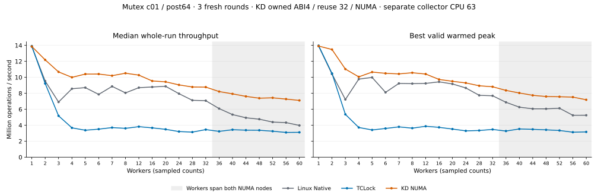

# Fresh c01 mutex comparison: 1–60 workers

All **189 timed sessions** pass the data, worker-progress, returned-body and drain audit. This is
one fresh three-round comparison of **KD NUMA, TCLock and Linux Native** at the requested 21 worker
counts: **1–8 by one, then 12–60 by four**. No earlier measurements are pooled into these scores.

At 60 workers, KD median whole-run throughput is **7.106 Mops/s**, **1.79× Native** and **2.28×
TCLock**. Its best valid warmed peak is **7.188 Mops/s**.



## Configuration

| Setting | Value |
| --- | --- |
| Source | Committed revision `5b50a4afb1d0c948227497ac9a15eb0f69f4a83c`; unrelated workspace edits excluded |
| KD | `owned-v1`, C caller ABI4, reuse allowance 32, adaptive acquisition, origin-spin enabled, bounded NUMA selection enabled |
| KD waiting / selection | 4,096 result polls followed by parking; inspect at most eight delegates; at most four bypasses per waiter |
| Backends | Linux `mutex_lock`/`mutex_unlock`; TCLock mutex; KD owned mutex, all freshly built and measured |
| Workload | One shared 64-bit counter in a 64-byte payload line; lock in a separate aligned slot; 64 arithmetic rounds after unlock |
| Repetitions | Three per backend/count; Native → TCLock → KD, then KD → TCLock → Native, then Native → TCLock → KD |
| Warmup / measurement | 48,000 operations per worker; 2,000 ms timed measurement |
| Peak | 300 ms observed windows after 300 ms settling; 10 ms sampling; all workers must progress |
| Guest placement | Exactly 64 vCPUs; node 0 CPUs 0–31, node 1 CPUs 32–63; each pinned to the same-numbered physical core |
| Workers / collector | Workers CPU 0 through N−1; collector CPU 63, separate at all requested counts; QEMU services also use host CPU 63 |
| Kernel / boot | `6.1.159-kdclobber2`; `nokaslr nopvspin`; live voluntary preemption; native qspinlock dispatch verified |
| Frequency / instrumentation | Host governors `ondemand`; KD provider UBSAN off; no profiles or diagnostic runs in scores |
| Recovery snapshot | `mutex-numa-c01-rerun-20261015`, created and confirmed before loading modules |

At 1–32 workers the cohort is on node 0; at 36–60 it spans both nodes. The plot shades the latter
counts. CPU 63 is never a worker here, so this run has no shared-collector 64-worker point.

The origin-spin switch is enabled, but c01 has no admitted origin-GS accesses: origin claims, claim
failures and preparation requests remain zero. These measurements do not measure GS body throughput.
The new policies remain opt-in; a single comparison without the pre-change KD control and without 64
workers does not replace the earlier screen and confirmation gates.

## Throughput

Rates below are **million operations per second**. Whole-run is the median of three
completed-operation/actual-wall-time rates. Peak is the highest valid warmed window across the same
three rounds. [Statistics](statistics.csv) retain min/median/max and `(max−min)/median × 100%`
spread; [comparisons](comparisons.csv) also retain the whole-run rate from the winning peak session.
Spread describes the observed samples, not a confidence interval.

| Workers | Native whole | TCLock whole | KD whole | Native peak | TCLock peak | KD peak |
| ---: | ---: | ---: | ---: | ---: | ---: | ---: |
| 1 | 13.839 | 13.915 | 13.863 | 13.905 | 13.965 | 13.914 |
| 2 | 9.531 | 9.227 | 12.185 | 10.407 | 10.486 | 13.481 |
| 3 | 6.906 | 5.179 | 10.677 | 7.226 | 5.360 | 11.032 |
| 4 | 8.573 | 3.673 | 9.998 | 9.776 | 3.720 | 10.060 |
| 5 | 8.708 | 3.374 | 10.407 | 9.984 | 3.410 | 10.657 |
| 6 | 7.862 | 3.511 | 10.411 | 8.117 | 3.596 | 10.499 |
| 7 | 8.867 | 3.707 | 10.205 | 9.236 | 3.797 | 10.428 |
| 8 | 8.052 | 3.611 | 10.515 | 9.208 | 3.635 | 10.572 |
| 12 | 8.705 | 3.822 | 10.275 | 9.239 | 3.870 | 10.413 |
| 16 | 8.789 | 3.672 | 9.542 | 9.434 | 3.738 | 9.734 |
| 20 | 8.876 | 3.489 | 9.437 | 9.169 | 3.522 | 9.503 |
| 24 | 7.950 | 3.209 | 9.050 | 8.668 | 3.296 | 9.297 |
| 28 | 7.121 | 3.141 | 8.788 | 7.747 | 3.342 | 8.941 |
| 32 | 7.075 | 3.454 | 8.774 | 7.691 | 3.475 | 8.819 |
| 36 | 6.083 | 3.233 | 8.218 | 6.874 | 3.273 | 8.360 |
| 40 | 5.334 | 3.439 | 7.928 | 6.264 | 3.534 | 8.038 |
| 44 | 4.934 | 3.385 | 7.614 | 6.060 | 3.488 | 7.746 |
| 48 | 4.759 | 3.372 | 7.388 | 6.057 | 3.424 | 7.596 |
| 52 | 4.393 | 3.253 | 7.433 | 6.128 | 3.344 | 7.567 |
| 56 | 4.329 | 3.098 | 7.276 | 5.246 | 3.128 | 7.522 |
| 60 | 3.975 | 3.112 | 7.106 | 5.252 | 3.166 | 7.188 |

KD reaches 97% of Native at every requested 1–8-worker count for median whole-run, best peak and the
matching peak-session whole-run rate in this block.

## Execution, progress and CPU cost

All **60 multithreaded KD sessions** return JIT bodies. The three single-worker KD sessions execute
SELF and provide no positive delegation evidence. KD JIT shares range from 0.00016% to 0.27231%
across multithreaded sessions; most operations execute locally. A nonzero returned body count
establishes execution, not that delegation caused a throughput difference.

| Backend | Minimum completed operations by any worker | Total returned JIT bodies | Total delegated bodies | Measured parking calls |
| --- | ---: | ---: | ---: | ---: |
| Linux Native | 48,896 | 0 | 0 | not collected |
| TCLock | 10,752 | 0 | 347,636,786 | 2,975 |
| KD NUMA | 97,024 | 831,658 | 831,658 | 84 |

KD records **546,351 bypasses** during measurement. KD parking counts cover delegated-result waits
only; Native parking is not instrumented. These counters do not cover every scheduler sleep.

At 60 workers:

| Backend | Median worker CPU ns/op | Median worker CPU equivalents | Worker operation-share range |
| --- | ---: | ---: | ---: |
| Linux Native | 14,257.5 | 56.68 | 0.55–5.00% |
| TCLock | 19,269.4 | 59.97 | 1.54–1.94% |
| KD NUMA | 8,439.5 | 59.99 | 0.68–2.74% |

CPU cost sums measured worker CPU time divided by completed operations; CPU equivalents divide that
worker CPU time by wall time. Collector, daemon and QEMU service CPU time are excluded. [Worker
data](workers.csv) retain every worker’s count, CPU time, placement and share.

## Evidence and reproduction

The independent [audit receipt](verification.json) verifies all raw results, full-cohort warmed
windows, 48,000-operation warmups, source/ELF/JIT hashes, module retirement,
physical-owner/task/frame/ACK drain and execution order. The run exited zero, the final guest is
idle with no project modules, and all committed and built inputs remained unchanged. The kernel
source/config/build/live identity and host CPU placement/governors were verified; the live Build ID
is `5ca28058e156f34a2c7fe91e8e0fbf92f4e51960`.

- [All 189 sessions](samples.csv), [three-round statistics](statistics.csv), [comparison ratios](comparisons.csv), [workers](workers.csv)
- [Environment](environment.json), [control receipts](controls.json), [source identity](source-identity.json), [archive receipt](archive.json)
- [Actual launch script](run.sh), [offline auditor and plot exporter](analyze.py)

Run outputs are preserved outside the checkout in the guest at
`/root/kdlock-evidence/10.176.26.71/bench/mutex-numa-c01-rerun-20261015`. The complete raw archive
on physical host `10.176.26.71` is
`/home/eric/vm/vm-shared/kdlock/bench/results/10.176.26.71/raw/bench/mutex-numa-c01-rerun-20261015`.
It includes source, binaries, plans, commands, module/JIT logs, raw measurements and the launch
script. The run used a private mount namespace to bind the frozen source at `/root/host_fs/kdlock`;
the shared guest checkout was preserved.

For an offline re-audit, point `RAW` at that complete container. Use a separate output directory:

```sh
KDLOCK_AUDIT_SOURCE="$RAW/source" python3 analyze.py --raw "$RAW" --output /tmp/mutex-numa-rerun-audit --plot
```

The exported script verifies the complete 189-session scope and reuses only the historical auditor’s
backend/drain checks, never its grid, CPU topology or throughput scores. Plotting additionally
requires matplotlib.
