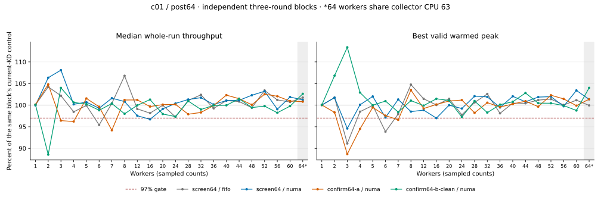

# Owned mutex origin claims and bounded NUMA selection

Origin claims and NUMA selection remain opt-in. The full c01 screen missed the 97%-of-current-KD
regression gate. Immutable owned images, exclusive origin readiness and the
bounded selector are implemented; that protocol work does not establish a
throughput improvement or general GS safety.

## Implementation and correctness

The measured implementation is `20bd721`, following the publication commit
`95bca27`, readiness/admission commit `a761b3c`, selector commit `0a68dcf` and
poll-budget correction `3a542f4`. The public mutex remains 32 bytes and the
two-word wrapper input and acquisition cookie remain unchanged. Published owned
images consume separate blocks in the existing 64-block pool and remain alive
until terminal drain. Frames bind code, requirements and generation together;
old-generation misses cannot change a newer image's status.

The [commit identity receipt](commit-identity.json) accounts for all 330 frozen
inputs: 230 match tracked files at `20bd721`, 97 are prepared provider inputs,
two are unused historical fixture files, and one README differs. All three
accepted blocks use the same frozen bytes, including those auxiliary files.

`owned_mutex_origin_spin` and `owned_mutex_numa` are independent load-time
switches, both defaulting to false. Origin-sensitive execution requires an
atomic READY-to-CLAIMED transition on a different CPU. A claimed producer cannot
schedule until frame retirement or a verified pre-body refusal. Ordinary
sleeping producers remain eligible for GS-independent delegation. NUMA selection
inspects at most eight requests, respects SELF/HANDOFF boundaries, and permits
at most four overtaking dispatches per request across batches.

The GS allowlist is restricted to the verified kernel's CPU-number read and an
audited, private task-only test counter. Exact build/symbol/width/operation checks
and acyclic bodies of at most 256 decoded instructions remain mandatory.
Interrupts and NMIs can still run during a claim; the mutable counter's separate
source audit excludes those users and unsynchronized remote writes. Logical
`current_task` rewriting and the executor's hardware GS register are preserved.

The [validation receipt](validation.json) identifies basic and directly affected
checks, their raw logs, preserved failures and limits. Production C fixtures
keep old generated code executing while a new version is published and verify
distinct old/new return values through bound descriptors. They cover successful
multi-chunk publication, interrupted and invalid uploads, generic dispatch
checks, stale-generation misses and pool exhaustion.
These replacement checks ran in VM userspace, not as live JIT replacement.
Production waiter tests race withdrawal against claiming 10,000 times; live
kernel probes exercise 768 claims with explicit reschedule requests and observe
zero schedules while claimed. These constructed probes execute no JIT bodies.

The separate live GS run with NUMA selection completes 320,000 operations with
zero errors and the expected 160,000 counter increments. It returns 98 CPU-read
and 45 counter bodies under claims, with 50 bypasses. Every worker CPU receives
exactly 20,000 increments and every unused CPU stays at zero. The
[GS receipt](gs-numa-percpu.json) retains all 64 values and each worker's CPU time. Live nested/early-unlock
controls, forced FULL continuations and physical-owner ACKs
also pass and drain. Their returned-body counts are in the receipt. These
functional runs contribute no c01 performance scores.

## Measurement contract

All scored blocks use the regular 64-vCPU recovery guest: node 0 is CPUs 0–31,
node 1 is CPUs 32–63, and each vCPU is pinned to its same-numbered host core.
The collector uses CPU 63; QEMU service threads share physical host CPU 63.
At **64 workers**, the final worker also shares CPU 63 with the collector. That
point is explicitly marked `collector_shared=true` and reported separately.
Smaller cohorts have a separate collector. No scored block uses extra vCPUs.

The live kernel is `6.1.159-kdclobber2`, Build ID
`5ca28058e156f34a2c7fe91e8e0fbf92f4e51960`, with voluntary preemption,
`nokaslr`, `nopvspin` and native qspinlocks. Source/config/build identity and
recovery snapshot `owned-origin-regular64-final-20261015` were verified before
module testing. Host governors remain `ondemand`. Inputs are frozen separately
from concurrent changes in the shared checkout.

The first `confirm64-b` finished 264 individually correct/drained sessions but
failed the cross-block source-identity audit: unrelated rwsem and benchmark
completion-probe changes entered before that block started. It is excluded.
`confirm64-b-clean` uses a private mount namespace containing the original
archived source; every case must match all 330 inputs from the screen. The
shared VM checkout is preserved. The rejection and isolated-source receipts
retain the exact differences and archive identity.

The workload is c01/post64 with owned ABI4/reuse-32, 48,000 warmup operations per
worker, two-second measurements, 10 ms samples, 300 ms settling and 300 ms warmed
peak windows. Worker counts are 1–8 and 12–64 in steps of four. Each block has
three rounds, reversing the complete backend order in the middle round.

Every block measures fresh Native and TCLock controls. `current-kd` uses provider,
daemon and translator built from archived pre-change commit
`b994aefaaf4da8be7b18353fd130818df9b2aba2`; historical throughput is never imported.
The report compares origin/NUMA against these three controls in the screen and
two fresh confirmation blocks. Each reported block contains 264 sessions. The
archived screen also contains 66 sessions from a retired comparison arm; those
are omitted from this report and its exports. The original raw evidence remains
unchanged, and the retained sessions keep their actual execution order.

The NUMA candidate enables origin readiness, but c01 is GS-independent and
records zero origin claims, claim failures and preparation requests. The GS
tests establish correctness separately. This comparison does not establish
the new provider's flags-off performance; `current-kd` is the pre-change build.

Each cohort must reach 97% of current KD for median whole-run throughput and the
highest valid warmed peak. The whole-run rate from that winning peak session is
also retained and checked. The 97%-of-Native target at 1–8 workers is assessed
independently. No blocks, topologies or diagnostic runs are pooled into a score.

## Results

All **792** reported sessions have correct results, progress by every worker and complete drain.
The [independent audit](verification.json) verifies matching frozen inputs across all three blocks.
All **378 multithreaded KD sessions** (control and candidate) return JIT bodies.
The 18 single-worker KD sessions execute SELF and are not positive delegation evidence.



Every regression-gate miss is listed below. Percentages compare against that block's fresh current-KD control.

| Block / policy | Workers | Median whole | Best peak | Whole from peak session |
| --- | ---: | ---: | ---: | ---: |
| Screen / NUMA | 3 | 108.09% | 94.60% | 94.63% |
| Screen / NUMA | 16 | 96.71% | 96.99% | 96.90% |
| Confirmation A / NUMA | 3 | 96.41% | 88.67% | 88.66% |
| Confirmation A / NUMA | 4 | 96.19% | 94.50% | 94.40% |
| Confirmation A / NUMA | 7 | 94.18% | 96.60% | 96.73% |
| Confirmation B (clean) / NUMA | 2 | 88.55% | 106.81% | 106.58% |

The clean confirmation's two-worker median reaches only **88.55%** of current KD,
even though its best peak reaches **106.81%**. A check of only the winning
peak session would hide this median regression. Confirmation A's worst NUMA
peak is **88.67%** at three workers. NUMA does not satisfy the full
screen-plus-confirmations requirement; the provider defaults remain off.

The independent Native target at 1–8 workers has these misses:

| Block / policy | Worker counts below 97% of Native |
| --- | --- |
| Screen / NUMA | 3, 4 |
| Confirmation A / NUMA | 3 |
| Confirmation B (clean) / NUMA | None |

The clean confirmation passes that separate Native target, but this does not
override its current-KD regression or the earlier blocks. All valid variation
remains in the min/median/max and spread fields. Spread is `(max - min) / median`.

### Shared collector at 64 workers

Only these cohorts share guest CPU 63 between a worker and the collector,
with QEMU services on the same physical core. Rates are Mops/s; CPU cost is
the median worker CPU ns/op across the three sessions. Shares span individual
workers in those sessions. This contention is not extrapolated to smaller cohorts.

| Block | Arm | Median whole | Best peak | CPU ns/op | Worker share range |
| --- | --- | ---: | ---: | ---: | ---: |
| Screen | native | 3.322 | 3.667 | 17,379.4 | 0.79–4.40% |
| Screen | tclock | 3.368 | 3.396 | 18,984.1 | 1.54–1.72% |
| Screen | current-kd | 6.812 | 7.038 | 9,390.3 | 0.65–2.19% |
| Screen | numa | 6.894 | 7.132 | 9,279.2 | 0.55–2.26% |
| Confirmation A | native | 3.338 | 3.808 | 17,388.6 | 0.71–4.69% |
| Confirmation A | tclock | 3.312 | 3.342 | 19,303.1 | 1.54–1.68% |
| Confirmation A | current-kd | 6.866 | 7.013 | 9,314.9 | 0.61–2.27% |
| Confirmation A | numa | 6.921 | 7.108 | 9,213.3 | 0.66–2.25% |
| Confirmation B (clean) | native | 3.205 | 3.454 | 17,256.4 | 0.74–4.17% |
| Confirmation B (clean) | tclock | 3.182 | 3.273 | 20,093.2 | 1.53–1.78% |
| Confirmation B (clean) | current-kd | 6.852 | 6.992 | 9,337.2 | 0.70–2.31% |
| Confirmation B (clean) | numa | 7.030 | 7.271 | 9,098.7 | 0.54–2.26% |

### Progress and delegation counters

The following are candidate counts within each block, not pooled throughput
scores. Minimum progress is the smallest completed count of any worker in
any session. JIT share is the maximum observed session share; most c01 work
executes SELF. Claims, failed claims and preparations are zero for every c01
candidate session because these bodies are GS-independent.

| Block / policy | Minimum worker ops | Returned JIT bodies | Max JIT share | Parks | Bypasses |
| --- | ---: | ---: | ---: | ---: | ---: |
| Screen / NUMA | 76,032 | 1,066,528 | 0.647% | 440 | 793,077 |
| Confirmation A / NUMA | 91,648 | 992,793 | 0.409% | 729 | 758,152 |
| Confirmation B (clean) / NUMA | 77,824 | 1,042,994 | 0.396% | 353 | 806,915 |

Per-worker progress/shares, every arm's CPU cost, all rounds and control results
are retained in the complete exports:

| Block | Sessions | Workers | Statistics | Gate ratios |
| --- | --- | --- | --- | --- |
| Screen | [Samples](screen64/samples.csv) | [Workers](screen64/workers.csv) | [Min/median/max/spread](screen64/statistics.csv) | [Comparisons](screen64/comparisons.json) |
| Confirmation A | [Samples](confirm64-a/samples.csv) | [Workers](confirm64-a/workers.csv) | [Min/median/max/spread](confirm64-a/statistics.csv) | [Comparisons](confirm64-a/comparisons.json) |
| Confirmation B (clean) | [Samples](confirm64-b-clean/samples.csv) | [Workers](confirm64-b-clean/workers.csv) | [Min/median/max/spread](confirm64-b-clean/statistics.csv) | [Comparisons](confirm64-b-clean/comparisons.json) |

The [excluded confirmation](rejected-confirm64-b.json) retains all 16 source
manifest differences. The [private source receipt](isolated-source.json)
records the matching archive and all 330 inputs used by the clean rerun.
The [plot receipt](plotting.json) identifies offline rendering from these
audited exports; no host benchmark or protocol test was run.

## Evidence and reproduction

[analyze.py](analyze.py) rechecks every retained raw result, warmed peak, worker's progress,
frozen source/binary identity, returned JIT evidence, ownership/frame/task/ACK
drain and the complete alternating-order grid. Its exports retain each session
and worker, min/median/max throughput, CPU ns/op, JIT/delegation shares, parks,
claims/failures, preparation requests and bypasses. Native parking and counters
unavailable in the old provider remain unavailable rather than being reported
as measured zero. Operation shares do not establish latency or fairness bounds.

The runner and command contract are documented in the
[origin comparison guide](https://github.com/hailongeric/kdlock/blob/9a4bf2a/bench/tclock_compare/README.md#owned-origin-and-numa-comparison).
Use the same command for each confirmation, with a fresh output directory.
The [runner checks](maintenance.json) cover the four-arm plan, rejection of
removed options and the updated score gates. This report was regenerated from
the existing raw records; all retained NUMA ratios are unchanged.
On the guest, an archived audit can be repeated with:

```sh
KDLOCK_AUDIT_SOURCE=/root/kdlock-evidence/10.176.26.71/bench/owned-origin-20261015/frozen-20bd721 \
  python3 analyze.py \
  --raw /root/kdlock-evidence/10.176.26.71/bench/owned-origin-20261015 \
  --output /tmp/owned-origin-audit
```

Guest raw evidence is under
`/root/kdlock-evidence/10.176.26.71/{bench,tests}/owned-origin-20261015`.
The physical-host mirrors are
`/home/eric/vm/vm-shared/kdlock/bench/results/10.176.26.71/raw/{bench,tests}/owned-origin-20261015`.
The [archive check](archive-verification.json) verifies the 3,960 hashed session
files retained in this report, their source/binary manifests and exported results.
The original raw inventory also preserves retired experiments, failed attempts
and frozen sources; symlinks are recorded without following them.
The archives preserve failed attempts, smoke runs, two stopped temporary
66-vCPU screens and the rejected source-drift confirmation; none contributes a
scored sample. A fresh checkout contains
compact reports, not these ignored raw archives. The verification applies to
the frozen implementation and affected checks, not the full project suite or
concurrent edits that were not sent to the guest.

The final [guest](guest-final.json), [kernel identity](kernel-final.json),
[host pins](host-final.json) and [snapshot list](snapshots-final.txt) confirm
complete project drain, no loaded project modules, unchanged voluntary
preemption/topology and recovery availability. The shared checkout retains
concurrent work; the measured 330-input source artifact remains unchanged.
