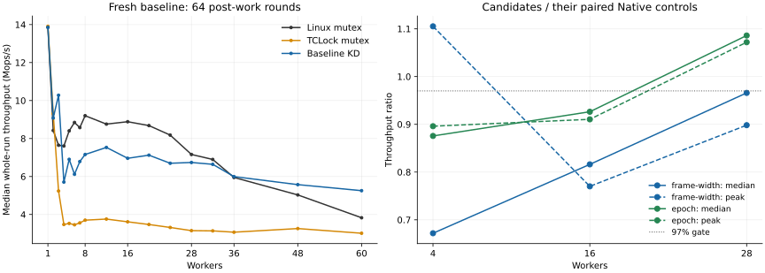

# c01 mutex protocol experiments, 2026-10-13

This study expands the earlier admission and optimistic-spinning work to frame
lifetime reuse, caller register capture, queue-node layout, ordinary-ABI native
preflight, and per-lock native/delegation epochs. All candidates are opt-in.
The accepted provider at the start is `9b76719` (checkout `096f1d4`). It remains
unchanged. Rejected implementations are preserved at exact tip `722ea98`, tag
`archive/perf/mutex-protocol-c01-20261013`; the experimental flags below belong
to that archived source. [Git disposition](git-disposition.json).

The 64-round study below and the separately requested
[8-round study](../20261013-post8/README.md) must be
evaluated independently. Reducing the work outside the critical section changes
offered contention, the opportunities for immediate reacquisition, and the
fraction of time spent in lock machinery. It is not a lock optimization.

**No 64-round candidate meets the full target.** Native epochs are the strongest
follow-up direction, improving 28-worker throughput while preserving higher-thread
gates, but they remain behind Native at 2/4/16. These screens do not justify
changing the accepted default or claiming parity.

## Baseline and method

The recovery VM on `10.176.26.71` has 64 vCPUs, workers `0..N-1`, collector 63,
and matching physical CPU pins. CPUs 0–31 belong to node 0; the first tested
cross-NUMA cohort is 36. All host governors remain `ondemand`. The verified
recovery snapshot is `mutex-protocol-c01-20261013`.
Kernel `6.1.159-kdclobber2`, Build ID
`5ca28058e156f34a2c7fe91e8e0fbf92f4e51960`, captured source/config/build identity,
`nokaslr nopvspin`, and voluntary preemption are fixed.

Each sample performs one protected increment and 64 dependent multiply/add
post-work rounds, after 48,000 warmup operations per worker. Measurement lasts
two seconds. Peak selection retains the existing 300 ms settling exclusion and
300 ms windows with progress by the full worker cohort. Three rounds alternate
backend order. KD uses blocking waits after 4,096 polls, batch cap 1,024, NUMA
selection enabled, admission threshold 256, and provider UBSAN disabled.
Instrumented runs are excluded from scores.

Fresh baseline median whole-run Mops/s, with best valid warmed peak in parentheses:

| Workers | Linux mutex | TCLock mutex | KD mutex |
| ---: | ---: | ---: | ---: |
| 1 | 13.860 (13.903) | 13.909 (13.968) | 13.855 (13.898) |
| 2 | 8.423 (10.895) | 9.312 (9.451) | 9.079 (9.397) |
| 4 | 7.605 (10.110) | 3.473 (3.840) | 5.706 (6.062) |
| 8 | 9.202 (9.866) | 3.701 (3.731) | 7.159 (7.495) |
| 16 | 8.885 (9.111) | 3.614 (3.751) | 6.959 (7.312) |
| 28 | 7.160 (7.601) | 3.149 (3.203) | 6.738 (6.759) |
| 32 | 6.898 (7.543) | 3.137 (3.173) | 6.642 (6.763) |
| 36 | 5.949 (6.896) | 3.067 (3.086) | 5.994 (6.100) |
| 48 | 5.030 (6.047) | 3.259 (3.308) | 5.572 (5.657) |
| 60 | 3.827 (4.864) | 3.012 (3.133) | 5.254 (5.327) |

[Statistics](statistics.csv) retain all 17 baseline counts, whole-run ranges and
spreads, warmed peak, worker shares, returned JIT bodies and CPU cost.
[Samples](samples.csv) retain individual measurements. Corresponding candidate
Native controls, not this baseline Native curve, determine primary acceptance.
Higher-thread comparisons use fresh baseline KD. Both measures must reach 97%;
32/36/48/60 must also return JIT bodies. A full passing screen and two independent
fresh three-round confirmation blocks are required to establish parity.

## Why the three implementations differ

Linux mutex first tries its owner word. Under contention it can spin while the
owner is running and the caller need not reschedule. OSQ organizes ordinary
optimistic spinners; sleeping is the fallback. The wait-list head can also spin.
KD's native fallback already uses this Linux mechanism.
[Linux mutex design](https://docs.kernel.org/6.1/locking/mutex-design.html),
[version-matched source](https://raw.githubusercontent.com/gregkh/linux/v6.1.159/kernel/locking/mutex.c).

Before explicit handoff, a contender may reacquire an available mutex. Keeping
ownership on one CPU can avoid transferring the lock and protected data for
every increment. This is a plausible contribution, not a measured causal share:
worker totals do not reveal exact ownership streaks or cache-to-cache traffic.
The fresh Native four-worker shares span 8.6%–34.7%; the historical 97.3%
two-worker sample is not a universal explanation. Linux WAITERS, HANDOFF and
PICKUP flags still govern waiter and directed-handoff behavior.

For c01, the protected operation is much smaller than delegation machinery.
KD producers sample admission, retain task state, register the continuation,
reserve a node/stack, exchange the shared queue tail and publish predecessor
links. The combiner validates requests, binds an execution frame, calls the JIT
body, retires the frame and publishes completion. Some producer work overlaps;
these costs cannot simply be added into a serialized service-time estimate.
Near-total JIT participation therefore does not imply efficient delegation.

TCLock runs native continuations by switching saved stack/register context and
chaining unlocks. The selected port pre-registers fixed-affinity workers and
uses its own mutex API. KD preserves original Linux owners and native peers,
migration-pinned sleeping requests and owner acknowledgments. TCLock's Native
and TC workload callers have the same 61-byte, 13-instruction shape, differing
in call targets; its cost is inside the backend's context switches, successor
selection and completion, not extra workload instructions. This comparison
applies to the selected port and configuration.

| Workers | Native worker CPU ns/op | TCLock worker CPU ns/op | KD worker CPU ns/op |
| ---: | ---: | ---: | ---: |
| 4 | 526 | 1,152 | 701 |
| 16 | 1,792 | 4,427 | 2,299 |
| 60 | 14,692 | 19,914 | 11,416 |

CPU cost is summed worker CPU time per completed operation, including polling;
it is not acquisition latency or combiner-only execution time. Higher contention
and cross-NUMA transfers make locality-preserving delegation more valuable.
The throughput crossover is workload-dependent, rather than a fixed count of
28 or a universal NUMA threshold. At four workers Native's whole-run spread is
38.3% and KD's 14.9%; ownership/admission phases and frequency variation remain
important sources of uncertainty.

## Implemented candidates and ordering constraints

* **Retired frame reuse:** transfer a token only after a pristine COMPLETE frame
  has fully retired. Rebind only the exact idle CPU slot, matching lock/hook and
  open source. Consume the token even on refusal. FULL, complex/native, and
  early-release paths retain ordinary frame construction. No reference, owner
  acknowledgment or retirement rule is relaxed.
* **Frame access width:** the first reuse implementation wrote packet state as
  32 bits and then compared the combined ABI/state word as 64 bits. Assembly
  confirms this partial-store/large-load hazard. Explicit field-width reads also
  prevent merged role/state checks across narrower retirement stores. The
  corrected variant is distinct from the original rejected frame screen.
* **Node layout:** keep immutable request inputs off the predecessor-link line
  without changing node stride, ABI offsets, completion offsets or publication.
* **Lazy register capture:** save callee-preserved registers only at the relevant
  contended/control call. Both lock and routed unlock capture are required:
  COMPLETE may resume after the unlock call with uncaptured register contents.
* **Ordinary-ABI preflight:** choose the native path before caller register
  capture. A returned shadow pointer is only a stable identity hint. The prepared
  path rechecks eligibility and address before acquiring references or queueing.
* **Locality epochs:** observe eligible failed acquisitions by exact lock identity.
  A local probe may start a bounded native epoch; remote observations veto it
  for a bounded delegation period. Full jiffies and NUMA IDs are retained. Rare
  transitions use CAS plus release publication; an in-progress transition takes
  the conservative KD route without waiting. Policy changes only new admission;
  outstanding KD queues keep all ownership and drain obligations.

No candidate dispatches by benchmark worker count. Every policy remains visibly
recorded separately from JIT execution. A native-routed result is not evidence
that a delegated body ran.

## 64-round screening results

The first `frame` screen predates the field-width fix and preflight implementation.
The seven later screens freeze checkpoint `391dcce`; `control` disables every
experimental option. Each screen retains 48 samples: two arms, eight counts and
three alternating rounds. Together with the 153-sample baseline, all 537 samples
pass the independent archive audit. Policy, source and binary identities are in
[coverage](coverage.json); exact gate calculations are in [acceptance](acceptance.json).

Primary cells below are median whole-run / best peak as percentages of that
screen's paired Native. The last column is the smallest ratio across both
measures at 32/36/48/60, relative to fresh baseline KD. All entries in a row must
reach 97%; an early failed count rejects the candidate without filling the
remaining primary grid or running confirmations.

| Screen | 2 workers | 4 workers | 16 workers | 28 workers | Worst higher-thread ratio |
| --- | ---: | ---: | ---: | ---: | ---: |
| Original frame reuse | 70.5 / 103.7 | 76.8 / 96.8 | 73.0 / 70.1 | 82.9 / 78.2 | 83.2 |
| All options disabled | 89.6 / 97.0 | 121.4 / 105.3 | 84.3 / 79.4 | 95.3 / 87.3 | 98.8 |
| Frame reuse, corrected widths | 82.0 / 80.3 | 67.2 / 110.5 | 81.6 / 77.0 | 96.6 / 89.8 | 100.1 |
| Node layout | 81.7 / 93.0 | 65.1 / 108.1 | 80.5 / 77.1 | 91.7 / 84.7 | 98.4 |
| Lazy capture | 110.1 / 131.4 | 65.0 / 106.6 | 85.2 / 79.4 | 94.2 / 86.4 | 93.1 |
| Preflight with lazy capture | 99.6 / 99.5 | 61.0 / 56.4 | 80.7 / 78.7 | 91.1 / 84.9 | 92.1 |
| Native epochs, 128 ms | 79.4 / 112.7 | 87.6 / 89.6 | 92.6 / 91.0 | 108.6 / 107.2 | 99.7 |
| Epochs plus preflight/lazy | 99.7 / 102.5 | 79.1 / 73.7 | 88.7 / 85.9 | 111.9 / 110.6 | 92.3 |

Ratios displayed as 97.0 may round from below 97%; the JSON uses full precision.
All higher-thread KD samples return JIT bodies, including epoch policies.

The original frame variant regresses median throughput 14.1%, 16.6%, 11.5% and
9.6% at 32/36/48/60. The corrected variant passes these regression gates, but
its remaining gains relative to the same-source disabled control are only
1.4%–2.6% at 28–60, alongside a 4.1% loss at 16. Thus correcting the generated
access widths fixes a regression; it does not establish a broad optimization.
The original construction/rebind paths contained 60/66 static instructions and
24/13 MOV stores respectively. Fewer stores did not imply fewer instructions
or lower latency. Corrected ELF inspection confirms narrow role/state loads
and separate 32-bit ABI/state loads; the stack allocation remains `0x168`.

The epoch-only policy reaches 7.938/8.589 Mops/s at 16 and 7.772/8.191 at 28
(whole/peak). Relative to its paired Native, 16 still fails both metrics while
28 passes both. Returned-body share drops to about 2.5%–2.7% at 16–32 and returns
to 99.2% at 36: its benefit is mainly adaptive native execution, not faster JIT
dispatch. Cross-node observations change admission without abandoning queued
requests. A remote observer during the brief UPDATING state conservatively
delegates but leaves no durable veto; this limits the heuristic's responsiveness,
without changing original-mutex exclusion.

Preflight can save native-side capture work but adds a call and eligibility
recheck on a delegated acquisition. Lazy capture adds explicit saves at both
lock and routed unlock. Their roughly 7% loss at 36, including the combined
epoch variant, rules out accepting only their favorable 28–32 results.
The node layout has no consistent benefit. Low-count screens exhibit large
phase variation: original frame reuse has 64.3%/69.0% whole-run spread at 2/4,
and epoch-only has 71.7% at 2. All samples remain in the report.

## Verification, scope and next directions

The focused verification covers basic control/daemon policy, admission sampling,
actual compiled outer-cookie/JIT ABI, frame reuse/terminal retirement, task
references, parking, owner acknowledgment, execution registry and native return
handling. Production policy fixtures exercise clock wrap, arbitrary NUMA IDs,
concurrent veto, bounded transitions and cooling while queue fields remain live.
Live parking and owner/ACK probes complete and drain; they are protocol probes,
not replacements for actual JIT benchmark bodies. [Validation](validation.json)
retains the initial fixture-extraction/mutation-anchor failures and corrected
reruns, rather than relabeling those original commands as passes.

The 8-round follow-up adds an opt-in exact-address per-CPU policy cache. A hit
may select Linux native while sharing the existing sampler pin; a KD decision
still performs all eligibility and exact-shadow checks. The hint grants neither
ownership nor task references. Its source and verification are distinct from
the measured `391dcce` screens above.

Beyond these implementations, two larger directions remain proposals:

1. Observe native acquisition cost and complete KD request cost sparsely, with
   hysteresis and bounded exploration. Locality, queue depth and JIT share alone
   do not establish that delegation pays. Avoid adding a shared hot counter.
2. Replace repeated shared-tail exchanges and predecessor writes with registered
   per-lock/per-CPU mailboxes and sequence publication. This requires explicit
   owner election, registration lifetime, lost-wakeup protection, bounded fairness,
   FULL/ACK handling and exact drain. A ready bitmap or sparse scanning may
   introduce a new bottleneck; existing request packets should remain borrowed.

Exact ownership streaks, cache-to-cache traffic, frequency effects and the
combiner-only cycle budget are not isolated here. Prior aggregate PMU samples
dominated by waiter polling do not locate the serialized bottleneck. The result
does not cover other critical sections or the separate 64-worker topology.

Raw evidence is preserved under
`bench/results/10.176.26.71/raw/bench/mutex-protocol-c01-20261013`, with test evidence
under the matching `raw/tests` directory. [Artifact hashes](artifacts.json),
[offline audit](analyze.py) and [figure generator](plot.py) make the report
reproducible. An archive audit proves internal consistency with captured inputs;
it is not a fresh execution or authentication of where those inputs originated.
