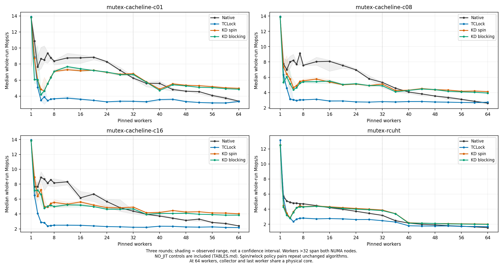
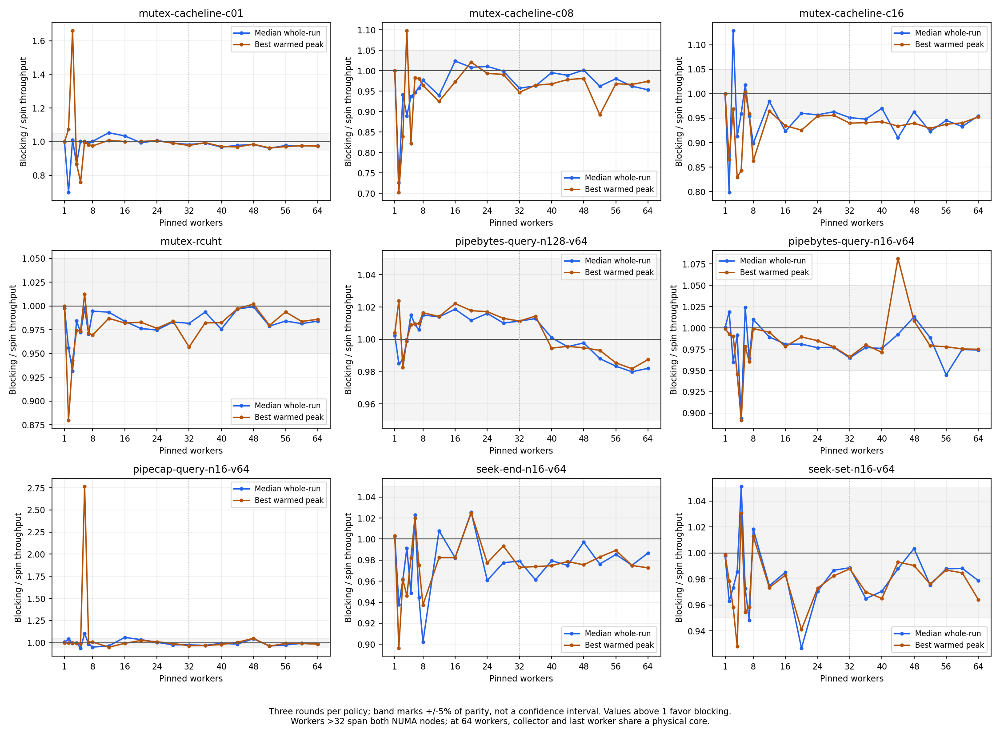

# Full 1–64-worker comparison on 10.176.26.71

All 31 previously selected configurations were rerun on **10.176.26.71**, with
three rounds at **1–8 workers in steps of one, then 12–64 in steps of four**.
The comparison includes KD spin, KD blocking, TCLock and Linux Native; API
cases also retain the original Stock Linux helper. The current lock algorithms
were unchanged during this rerun.

The matrix completed **8,910 drained sessions: 8,908 accepted and two retained
zero-JIT exclusions**. At both 60 and 64 workers, both KD mutex policies exceed
Native and TCLock on median whole-run throughput and best warmed peak in all
nine mutex configurations. Blocking retains **93.3–99.3%** of spin's whole-run
throughput at 60 workers and **95.3–98.7%** at 64. Performance is not uniformly
better: low-thread mutex regressions, OFD gaps and a 64-worker UTS regression
remain visible.

Start with [subjects, locks and measurement contract](METHOD.md), then use
[all 31 subjects at 60/64 workers](HIGHLIGHTS.md), [every thread-count table](TABLES.md)
or the [CSV statistics](statistics.csv). The [comparison CSV](comparison.csv)
contains separate KD/Native, KD/TCLock, KD/Stock and blocking/spin ratios.

## Scope and environment

The 31 configurations comprise nine mutex, eight spinlock and fourteen
reader/writer cases. They cover c01 and hash for every lock family, larger
cacheline payloads, pipe-buffer/capacity queries, shared-file seeks, OFD conflict
queries, close-on-exec bitmap updates and private UTS reads/writes. These are
kernel/API microbenchmarks; variants of an API are not independent applications.
FxMark, mmap and the rejected xattr case are outside this maintained suite.

The physical machine has two 32-core Xeon Gold 6438N sockets, SMT off and the
`ondemand` governor. A temporary 66-vCPU VM provides 64 distinct worker CPUs
and collector CPU 65. Workers above 32 cross NUMA nodes. **At 64 workers, the
collector and final worker share physical core 63 with QEMU services.** This
limits interpretation of that endpoint; 60-worker results are also reported.
The [complete placement](host-environment.json) and [kernel identity](verification.json)
are retained. Measurements ran from 03:40 to 13:01 UTC on 2026-10-12.

Each timed phase targets two seconds. Whole-run rates use the actual wall
interval; the peak is the best valid full-cohort window of at least 300 ms after
settling. Tables retain all three rounds, min/median/max and spread. A strict
comparison here means KD reaches both baselines on **both** median whole-run
and best-peak throughput. It is a descriptive threshold, not a significance test.

Matched Native API modules compile the same protected work as KD/TCLock.
Stock retains the captured kernel's original helper and instrumentation.
UTS also differs in lock type: matched Native uses a private rwsem; KD/TCLock
use bounded reader/writer spinlocks. See [the exact contracts](METHOD.md).

## Overall comparison

These counts exclude single-worker controls. Every workload/count point has
equal weight; no average across unrelated absolute operation rates is used.

| Lock family | KD spin: strict successes / complete points | KD blocking setting: strict successes / complete points |
| --- | ---: | ---: |
| Mutex | 124 / 189 | 119 / 189 |
| Spin | 113 / 168 | 104 / 166 |
| Reader/writer | 282 / 294 | 279 / 294 |
| All | **519 / 651** | **502 / 649** |

The mutex parameter does not change spin/rwlock algorithms. Those two settings
are repeated controls, and their differences cannot be credited to mutex
blocking. Two spin-control cohorts are incomplete because a round executed no
required JIT bodies. At 60 workers, KD spin meets the strict comparison in
29/31 configurations and the blocking setting in 30/31; at 64, both meet it
in 26/31. [HIGHLIGHTS](HIGHLIGHTS.md) gives the complete breakdown.

## C01 and hash results

Median whole-run throughput at 64 workers, in Mops/s. The two KD columns are
distinct waiting policies only for mutexes. Larger cacheline cases and all
other worker counts are in [TABLES](TABLES.md).

| Payload | Native | TCLock | KD spin | KD blocking setting |
| --- | ---: | ---: | ---: | ---: |
| Mutex c01 | 3.387 | 3.345 | 4.987 | 4.868 |
| Mutex hash | 1.542 | 1.674 | 2.015 | 1.983 |
| Spin c01 | 3.806 | 4.747 | 6.932 | 6.936 |
| Spin hash | 1.572 | 2.136 | 2.639 | 2.638 |
| Rwlock c01, 1% writes | 14.248 | 15.198 | 17.412 | 17.191 |
| Rwlock c01, 20% writes | 7.998 | 7.362 | 14.765 | 15.032 |
| Rwlock hash, 1% writes | 13.032 | 14.759 | 14.100 | 14.494 |
| Rwlock hash, 20% writes | 5.233 | 4.928 | 6.573 | 6.586 |

KD's spin c16 reaches 8.111 Mops/s under the spin setting at 64 workers,
versus Native's 2.251 and TCLock's 2.530. Together with the c01/hash results,
this is consistent with amortizing handoffs and keeping shared writes on a
combiner. It does not establish a measured cache-miss reduction: this matrix
collects no PMU cache events. The hash is preallocated and performs no allocation
or RCU service; it is not an application-level hash-table throughput claim.

## Mutex blocking cost and remaining gaps

Across all 189 multithreaded mutex points, the median blocking/spin whole-run
ratio is **0.982×**. It falls within ±5% at 157 points and within ±10% at 180.
Across the 108 points from 16 through 60 workers, every whole-run ratio is
within ±10%, and 99 are within ±5%. Best-peak ratios are within ±10% at 107/108
of those points. This supports close throughput at sustained contention,
not universal parity across the requested grid.

| Workers | Blocking/spin whole-run range across nine mutex cases | Blocking/Native range | Blocking/TCLock range |
| --- | ---: | ---: | ---: |
| 60 | 0.933–0.993× | 1.216–3.176× | 1.179–2.347× |
| 64 | 0.953–0.987× | 1.286–3.263× | 1.185–2.204× |

Low-thread losses are substantial. At two workers, c01 blocking is **6.093**
Mops/s versus spin **8.721**, Native **10.873** and TCLock **8.886**: blocking
loses 30.1% to spin. C08 and c16 lose 27.3% and 20.1% to spin at the same count.
C01 loses 13.3% at four workers; c16 loses 10.2% at eight. The
[largest-loss table](HIGHLIGHTS.md#largest-mutex-blocking-losses-against-spin)
also includes the API regressions.

All six two-worker c01 KD samples recorded **zero result-schedule and gate-wait
calls**. Blocking's three whole-run rates were 5.601, 9.412 and 6.093 Mops/s,
with 62.5% spread. This loss cannot be explained as measured parking overhead.
JIT shares were small and variable, and the cause was not isolated. At four
workers, Native still delivers 8.655 Mops/s versus KD spin's 4.846 and blocking's
4.202. Coordination cost and mixed native/delegated routing remain relevant
limitations for very small critical sections at low contention.

The earlier single-worker blocking/hash slow-start penalty does **not** recur
as a stable policy gap here: the spin median is 12.530 Mops/s and blocking is
12.502. Native's first round is 6.916, followed by 12.515 and 12.502; TCLock's
first whole-run rate is 8.488 with a 13.188 warmed peak. All these hash samples
retain approximately 25% moves, 25% destination conflicts and 50% source misses.
The slow samples remain scored; no frequency or placement trace isolates their
cause. Across all nine single-worker mutex configurations, neither KD policy
beats both baselines on both measures.

## Real API effects and reader/writer limits

The high-contention mutex APIs show useful gains. At 64 workers, blocking
`FIONREAD` with 16 buffers reaches **5.262 Mops/s**, versus Native **1.722** and
TCLock **2.473**. `F_GETPIPE_SZ` reaches **5.599**, versus **1.716** and **2.540**.
Shared-file seeks reach **3.768–3.778**, versus Native **1.313–1.319** and TCLock
**2.470–2.505**. These timings include syscall entry, surrounding work and
userspace result validation. Stock Linux appears separately in the full tables.

Spin APIs are less uniform. The 512-stride bitmap case reaches 7.564 Mops/s
under KD spin at 64 workers, versus Native 2.893 and TCLock 4.713. The 128-range
OFD query is close to TCLock: both KD settings are slightly behind on whole-run
throughput at 60 workers, and the blocking-setting control remains behind on
both measures at 64. Its setting is inactive for that spinlock.

Reader/writer gains must be separated from JIT attribution. At 60 and 64
workers, c01 with 20% writes executes **zero JIT bodies** in every KD round,
despite its throughput lead. The advantage there belongs to the observed KD
reader/writer protocol and native path, not measured delegation. At those counts,
hash JIT shares are approximately 10–11% of writes for the 1% mix and 2–4% for
the 20% mix. Readers execute locally. [Execution-separated statistics](statistics-by-execution.csv)
retain mixed and zero-JIT cohorts.

UTS throughput also does not imply a free blocking-rwsem replacement. At 60
workers, domain-name KD spin reaches 3.250 Mops/s versus Native 0.545 and TCLock
2.073, but uses **18.450 µs of worker CPU per operation**, versus Native's
**3.789 µs**. Only 2.39% of its writes execute through JIT. KD/TCLock use bounded
spinlock bodies; Native's rwsem may sleep. This does not demonstrate general
sleeping rwsem or mmap support.

The UTS hostname case regresses at 64 workers: KD spin/blocking-setting controls
reach **2.082/2.097 Mops/s**, below TCLock's **2.291**. Both KD settings execute
zero JIT bodies in all three rounds there. Compared with 60 workers, their
whole-run rates fall 38.9% and 36.3%. Collector overlap, worker count and routing
all change; this run does not isolate the cause.

## CPU cost, NUMA transitions and variation

CPU cost is summed worker CPU time per operation, not lock latency or energy.
At 60 workers, blocking costs 0.339–0.888× Native across the nine mutex cases,
but 1.007–1.071× KD spin. At 64, those ranges are 0.344–0.873× Native and
1.012–1.047× spin. Thus higher throughput reduces CPU cost relative to Native
in these cases, while blocking costs more CPU per operation than spin at
these two thread counts. The matrix uses one worker per CPU and short critical
sections.

| 64-worker mutex | Native CPU ns/op | TCLock | KD spin | KD blocking |
| --- | ---: | ---: | ---: | ---: |
| C01 | 16,766 | 19,134 | 12,838 | 13,150 |
| Hash | 36,832 | 38,185 | 31,729 | 32,167 |
| FIONREAD, 16 buffers | 32,993 | 25,854 | 11,833 | 12,152 |

Blocking records 106,507 result-schedule calls and 144 gate-wait calls across
594 mutex sessions; 503 sessions have at least one result-schedule call.
At 64 workers, c01 averages 50.3 result-schedule calls per million operations,
hash 573.7, and 16-buffer FIONREAD 34.1. These are call counts, not direct
observations of descheduling. The [implementation's scheduler probes](../20261012/README.md)
separately establish real sleeping and deferred-wake progress. Those probes
were not rerun as part of this unchanged-runtime performance matrix.

Crossing from 32 to 36 workers lowers KD spin's c01 spinlock throughput by
32.1%, mutex c01 by 15.1%, and spin/hash by 10.2%. Native falls by 30.3%, 10.4%
and 20.2%, respectively. These changes coincide with crossing NUMA nodes,
but worker count also changes and payload page placement was not measured.
At 60→64, c01 and hash spinlock rates under the KD spin setting change by less
than 1%, while UTS
hostname falls sharply. The shared collector core is a limitation, not a
proven single explanation for every endpoint change.

Best peaks need particular care. Six-worker `F_GETPIPE_SZ` blocking has a
21.831 Mops/s best peak but an 8.144 whole-run median and 174.2% whole-run spread.
Its blocking/spin ratios are 2.765× for best peak and 1.104× for whole-run median.
At 64 workers, Native rwlock c16 with 20% writes has an 18.031 best peak but a
6.168 whole-run median and 168.6% peak spread; KD therefore loses the strict
peak comparison despite winning the whole-run comparison. All these valid
samples remain included. Three rounds and an unfixed governor do not establish
confidence intervals or isolate frequency effects.

## Retained exclusions

Two c01 spinlock sessions with the blocking parameter set produced correct
results and drained, but returned zero JIT bodies where the direct spin
comparison requires them. Their measured values remain in [samples](samples.csv)
with `accepted=false`; the affected three-round cohorts are incomplete and
unscored in the comparison plots/tables.

| Workers | Repeat, zero-based | Measured whole Mops/s, unscored | Measured peak Mops/s, unscored |
| --- | ---: | ---: | ---: |
| 20 | 2 | 5.223 | 5.257 |
| 32 | 1 | 4.999 | 5.052 |

The separately complete KD spin cohorts remain scored. These exclusions show
variable JIT activation, not failed mutex sleeping: the mutex parameter is
inactive for spinlocks. The adaptive admission path includes hotness and
backlog checks, but no decision trace isolates why these two sessions stayed
on the native path. Neither was replaced with a faster rerun.

## Plots and reproducible evidence

Every subject has a scaling panel. PNG and SVG versions are retained; shading
is the observed three-round range. All plots use the full requested grid;
incomplete cohorts appear as gaps.

| Subjects | Median whole-run | Best warmed peak |
| --- | --- | --- |
| Mutex payloads | [PNG](mutex-micro-whole_ops_s.png) / [SVG](mutex-micro-whole_ops_s.svg) | [PNG](mutex-micro-peak_ops_s.png) / [SVG](mutex-micro-peak_ops_s.svg) |
| Mutex APIs | [PNG](mutex-api-whole_ops_s.png) / [SVG](mutex-api-whole_ops_s.svg) | [PNG](mutex-api-peak_ops_s.png) / [SVG](mutex-api-peak_ops_s.svg) |
| Spin payloads | [PNG](spin-micro-whole_ops_s.png) / [SVG](spin-micro-whole_ops_s.svg) | [PNG](spin-micro-peak_ops_s.png) / [SVG](spin-micro-peak_ops_s.svg) |
| Rwlock payloads | [PNG](rwlock-micro-whole_ops_s.png) / [SVG](rwlock-micro-whole_ops_s.svg) | [PNG](rwlock-micro-peak_ops_s.png) / [SVG](rwlock-micro-peak_ops_s.svg) |
| Spin/rwlock APIs | [PNG](spin-rwlock-api-whole_ops_s.png) / [SVG](spin-rwlock-api-whole_ops_s.svg) | [PNG](spin-rwlock-api-peak_ops_s.png) / [SVG](spin-rwlock-api-peak_ops_s.svg) |

The [frozen exporter](export.py) independently recomputed all 8,910 peak windows
and replayed the frozen runners' validation. It checked business results,
worker progress and placement, drain, 3,376 source hashes, 124 binary hashes,
90 captured kernel-input hashes, 12 TCLock context audits and 12,276 generated
JIT-image hashes. Of 4,092 KD sessions, 2,779 executed JIT bodies and 1,313
did not; the latter include the two exclusions and permitted native-path controls.
Thirty-six KD cohorts mix execution types across rounds.

Before the matrix, basic checks and 85 affected Python checks passed. The final
exporter passed 14 tests after adding checks for retained exclusions, hash
outcome accounting and separate Stock/Native ratios. A separate 15-session
64-worker API acceptance run passed, with actual JIT in all six KD sessions;
it is archived separately and is not pooled into the 8,910 measurements.
See [validation receipts](validation.json) and the [full audit](verification.json).

Runner support is commit `e378642`; runtime implementation remains `f01dce2`
plus required progress fix `dbd9aa5`. Nine pre-existing edits were preserved
and measured as recorded in [source-state.json](source-state.json); Git alone
does not identify every measured byte. Frozen group sources and the raw patch
retain those inputs. [analysis.json](analysis.json) records derived statistics
and their input hashes; [analyze.py](analyze.py) reproduces them.

The raw main/acceptance, test and analysis archives are retained on both hosts
under `bench/results/10.176.26.71/raw/{bench,tests}/full-wait-20261012/`.
[Archive receipts](archives.json) record SHA256, sizes, gzip checks and published
artifact hashes. [verify_archives.py](verify_archives.py) rechecks the copied
evidence offline; it does not run a new benchmark or independently attest the
execution. After archiving, the normal 64-vCPU boot, every physical pin, native
qspinlock boot confirmation, exact kernel identity and idle health were
[verified again](restore64.json). No cross-topology snapshot was loaded.
