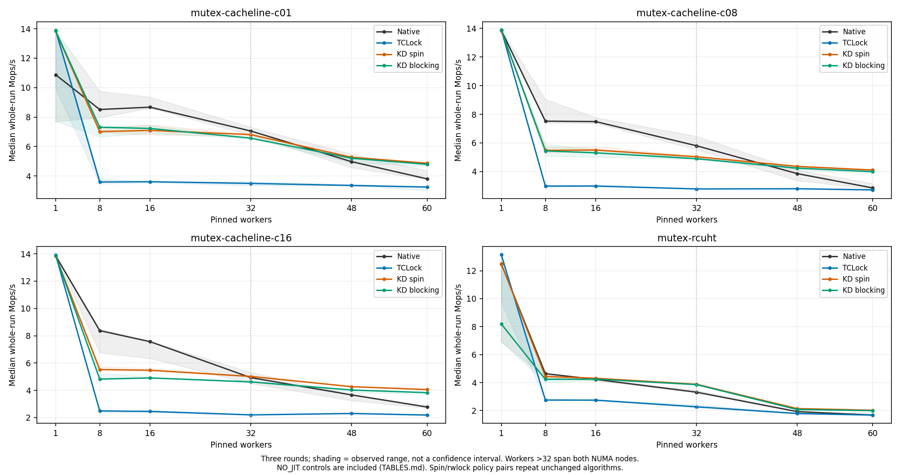
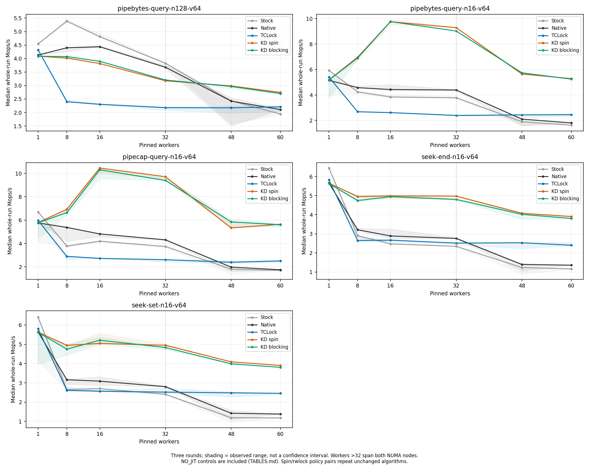

# KD mutex blocking policy: implementation and comparison

KD mutex now offers bounded polling followed by uninterruptible sleep. The
original spin policy remains available and remains the default. Select blocking
with `insmod kdlock_km.ko mutex_blocking=1 mutex_spin_limit=4096`, or use
`--mutex-wait-mode blocking --mutex-spin-limit 4096` with a benchmark runner.
Both parameters are fixed until the provider unloads.
The comparison selects two policies in the new provider source; the spin arm
is the retained policy compiled with the new implementation, not an old binary.

Implementation commits: `f01dce2` and the required deferred-wake progress fix
`dbd9aa5`. Frozen source manifests also contain nine
pre-existing working-tree edits, including the spin post-work and mutex caller
formatting changes; the commit alone does not identify every measured byte.
The raw source and ELF manifests are the identities of the actual experiments.

The completed comparison contains **2,430 accepted, drained sessions** across
31 workload configurations and six worker counts. At 60 workers, blocking retains
**94.5–99.2% of spin's median whole-run throughput** across all nine mutex
configurations. It exceeds both Native and TCLock on that metric in all nine,
and on best warmed peak in eight. Lower-count regressions and a single-worker
hash slow-start discrepancy remain visible below; this is not universal parity.

## Implementation

The wait path polls for at most 4,096 PAUSE iterations, checking scheduler pressure
every 64 iterations. If the result is still pending, it registers an `rcuwait`
waiter and sleeps. Zero selects immediate parking. This budget counts iterations,
not nanoseconds, and does not bound total acquisition time.

Each reserved node has a separate provider-lifetime wait slot. The publisher
captures that slot before publishing completion and never dereferences a released
packet afterwards. Condition/state barriers close the lost-wakeup race; the
existing task-reference cache and RCU grace period protect late wake readers.
A late wake after slot reuse is harmless because waiters recheck their own
completion condition. The gate uses a Linux wait queue; acquiring the original
mutex can also sleep through Linux's native implementation.

The optimized completion path publishes every result immediately, then batches
wake checks for at most 16 completed bodies. One barrier covers the group. It
flushes before a FULL/native service, before gate reacquisition and before batch
exit/handoff. Result waiters additionally use `schedule_timeout(1)`: even if a
later translated body polls for work from an earlier completed caller and cannot
flush its wake, that caller can observe completion on its timer recheck. Ordinary
wakes end the sleep sooner. The tick interval is not a wall-clock latency bound;
scheduler delays still apply. This kernel uses `CONFIG_HZ=250` (4 ms ticks).
Immediate handoffs retain immediate wake checks.

Migration pins, reserved shadow stacks, original physical mutex ownership,
acquisition references, source leases, frame retirement and native unlock ACKs
remain exact. The two-word wrapper ABI is unchanged. Blocking translations
conservatively refuse origin-CPU GS access: another task can use that CPU while
the origin sleeps. Logical task input is separate and remains supported.

The [implementation guide](../../../../../../docs/design/mutex_implementation.md)
describes ordering and lifecycle. This is an ordinary uninterruptible mutex;
interruptible/killable operations and a general sleeping rwsem remain outside
the implemented API. Four slots per CPU and existing same-CPU native fallback
remain in place. The performance grid uses one worker per CPU and does not
establish arbitrary oversubscription or fairness/latency bounds.

## Test subjects and locks

| Subject | Protected work | Native lock | KD/TCLock comparison |
| --- | --- | --- | --- |
| Mutex cacheline c01/c08/c16 | Update one word in each of 1, 8 or 16 shared cachelines | Linux `struct mutex` | KD spin/blocking against the repository TCLock ordinary mutex port |
| Mutex RCUHT | 100% hash updates: lookup and immediate unlink/relink; move/conflict/miss outcomes | Linux `struct mutex` | Same protected payload under both KD wait policies and TCLock |
| Spin cacheline c01/c08/c16 and RCUHT | Shared counter or hash payload | Native qspinlock | KD/TCLock spin backends; two KD mutex settings are regression controls |
| Rwlock cacheline c01/c02/c04/c08/c16 and RCUHT | Reads mixed with 1% or 20% writes | Native reader/writer spinlock | KD/TCLock reader/writer backends; readers local, contended writers can delegate |
| `ioctl(FIONREAD)` | Sum lengths of 16 or 128 real occupied pipe buffers | `pipe_inode_info.mutex` | Both KD mutex policies and TCLock mutex |
| `fcntl(F_GETPIPE_SZ)` | Read a shared pipe's `max_usage`; 16-page capacity | The same pipe mutex | Short mutex control |
| Shared-file `lseek(SEEK_SET/SEEK_END)` | Check bounds and update real file position/version | `file.f_pos_lock` | Both KD mutex policies and TCLock mutex |
| `fcntl(F_OFD_GETLK)` tail conflict | Traverse 16 or 128 real OFD ranges and copy the conflict | `file_lock_context.flc_lock` | Spin backends; mutex-policy regression control |
| `F_SETFD` plus validating `F_GETFD` | Toggle preallocated per-worker descriptor flags, FD strides 16/512 | `files_struct.file_lock` | Spin backends; one operation includes both syscalls |
| 80% `uname()` / 20% `sethostname()` or `setdomainname()` | Copy or update real private-namespace UTS metadata | Matched private Linux rwsem; stock global `uts_sem` | Existing KD/TCLock reader/writer spinlocks, not a new blocking rwsem |

The syscall cases retain the syscall, security/descriptor work, result copying
and userspace validation in timing. A scoped module substitutes only the bound
private object's selected helper. Matched Native/TCLock/KD compile the same
protected work with selected lock calls. Stock executes the original kernel
helper and retains its instrumentation; it is a separate control. The captured
kernel has UBSAN enabled, while all timed replacement/provider modules disable
UBSAN. The [API contract](../../../../../real_api/README.md) documents object
lifetime, specialized callbacks and excluded independent users.

RCUHT uses the maintained preallocated 1,024-bucket / 4,096-node / 8,192-key
payload. Spin/mutex operations update it; rwlock tests add concurrent read
lookups. There is no per-operation allocation or RCU service, and the name does
not imply lock-free readers. Data structure snapshots check structure and exact
move/conflict/miss totals. Register-only post-work is outside the critical
section and remains timed: 64 multiply/add rounds for spin/mutex and four for
rwlock. Each suite uses the same configuration across its compared arms.

UTS matched arms use private locks and move proc notification after unlock on
the original caller; Stock keeps the global rwsem and original notification
placement. KD/TCLock UTS bodies are bounded non-sleeping copies. This comparison
does not establish general mmap/rwsem support. FxMark and mmap are not in the
maintained runnable suite, and xattr's existing admission refusal is not a
performance result. Variants of one API are not independent applications.

The benchmark choice follows the contended shared kernel-state principle of
[TCLocks](https://www.usenix.org/system/files/osdi23-gupta.pdf), without claiming
to reproduce its published FxMark or will-it-scale results. TCLock uses the
repository port of upstream `bbfb9f00a12af51dff6ca291cb9829a82960c2ef`, with the
emitted context-switch audit, NUMA policy and 1,024 batch setting retained.

## Measurement

| Setting | Value |
| --- | --- |
| Host | `10.176.26.71`, two Xeon Gold 6438N sockets, 32 cores/socket, SMT off, `ondemand` |
| VM | Regular 64-vCPU / 24 GiB recovery VM, two NUMA nodes, vCPU N pinned to physical core N |
| Placement | Worker prefixes 0–59; counts 1, 8, 16, 32, 48, 60; collector 63 shares QEMU services |
| Kernel | `6.1.159-kdclobber2`, Build ID `5ca28058e156f34a2c7fe91e8e0fbf92f4e51960`, `nokaslr nopvspin`, voluntary preemption |
| Snapshot | Verified `mutex-blocking-20261012-v1`, current 64-vCPU topology |
| Matrix | 20 microbench payload/mix combinations × 6 counts × 4 arms × 3 rounds, plus 11 API combinations × 6 counts × 5 arms × 3 rounds = 2,430 sessions |
| Warmup | Microbench: 48,000 operations/worker; API: at least 48,000 operations and one second/worker |
| Timed phase | Two-second target; whole throughput uses the recorded actual wall interval |
| Peak | Highest valid full-cohort window of at least 300 ms, after 300 ms settling; 10 ms samples and 256-operation progress checkpoints |
| Waiting policies | KD spin and blocking both record spin limit 4,096; ignored by spin mode |

Each family runs its Native/TCLock/KD-spin group, then its KD-blocking group.
Baseline order changes between rounds inside the first group. The KD policies
are **not interleaved** within rounds; run order and `ondemand` frequency changes
can affect close ratios. Every score retains all three rounds. No randomization,
confidence interval or fixed-frequency claim is made.
Workers and collector have verified affinity. Preparation uses the runner's
normal allowed CPU set; payload page placement at module load is not recorded.

A separate 36-session diagnostic alternates the two KD policies within each
round for mutex c01/c16 at 16/60 workers and the unchanged spin c16 control.
Its source matches the final kernel/translator implementation. It remains
separate from the main grid and helps assess the variation behind close ratios.
An initial attempt to pin the runner itself to CPU 0 was rejected by the
placement guard before building or measuring; the successful diagnostic uses
the standard validated worker/collector placement. No guard was bypassed.
A further six-session single-worker hash diagnostic investigates the large
whole-run discrepancy in the main grid. Neither diagnostic replaces main samples.

Main throughput statistics are the median whole-run rate and highest valid
warmed peak. Exports retain min/median/max and `(max-min)/median × 100%` spread,
CPU time per operation and each worker's progress. CPU time is summed worker
CPU time, not hardware package energy or acquisition latency. Wait statistics
count calls to `schedule_timeout()`, successful result wakes and gate wait calls; they
do not by themselves establish an actual deschedule.

JIT evidence counts returned bodies only in the measured phase. Rwlock/UTS
shares use writes as the denominator. A publication without returned bodies is
a NO_JIT native-path control where the runner permits one; a missing required
JIT body is retained as an unscored exclusion. TCLock spin/rwlock delegation shares are unmeasured;
API mutex delegation counts are retained. Throughput differences alone do not
prove a cache-locality cause; this campaign collects no hardware cache counters.

## Results

The [complete tables](TABLES.md) show whole-run and peak rates for every backend
at every point. [Individual samples](samples.csv), [statistics](statistics.csv)
and [ratios](comparison.csv) retain all rounds and min/median/max/spread. The
[execution-separated statistics](statistics-by-execution.csv) distinguish
returned-body JIT observations from native-path controls.

At **60 workers**, rates below are median whole-run **Mops/s**. B/S means KD
blocking divided by KD spin; the peak ratio compares each arm's best valid
warmed window. Stock is an additional original-kernel control for APIs.

| Mutex subject | Stock | Native | TCLock | KD spin | KD blocking | B/S whole | B/S peak |
| --- | ---: | ---: | ---: | ---: | ---: | ---: | ---: |
| Cacheline c01 | — | 3.807 | 3.249 | 4.870 | 4.790 | 0.984× | 0.992× |
| Cacheline c08 | — | 2.855 | 2.717 | 4.107 | 3.992 | 0.972× | 0.981× |
| Cacheline c16 | — | 2.781 | 2.188 | 4.056 | 3.832 | 0.945× | 0.943× |
| RCUHT | — | 1.679 | 1.676 | 2.024 | 1.995 | 0.986× | 0.983× |
| FIONREAD, 16 buffers | 1.630 | 1.803 | 2.451 | 5.285 | 5.244 | 0.992× | 0.998× |
| FIONREAD, 128 buffers | 1.943 | 2.107 | 2.210 | 2.745 | 2.702 | 0.984× | 0.989× |
| F_GETPIPE_SZ | 1.689 | 1.750 | 2.503 | 5.643 | 5.600 | 0.992× | 0.987× |
| SEEK_SET | 1.182 | 1.380 | 2.457 | 3.903 | 3.806 | 0.975× | 0.970× |
| SEEK_END | 1.162 | 1.358 | 2.402 | 3.907 | 3.803 | 0.974× | 0.978× |

Across the **45 contended mutex points** (nine configurations × 8/16/32/48/60
workers), whole-run B/S is within ±5% at 39 points and ±10% at 43. Peak B/S is
within ±10% at all 45. Blocking exceeds both Native and TCLock on both metrics
at 28 points. These counts weight each configuration/count equally; variants
of one API are not independent applications.

The largest contended whole-run losses are c16 at eight workers (−12.6%) and
16 workers (−10.3%). At 60 workers, Native's c01 peak is **5.006 Mops/s**, above
blocking's **4.847**, despite its lower whole-run median. Native also remains
faster for FIONREAD/128 at 8–32 workers. The single-worker mutex controls do not
beat both baselines. The target of matching every alternative everywhere remains
unmet.





| All plotted comparisons | Median whole run | Best warmed peak |
| --- | --- | --- |
| Mutex payloads | [PNG](mutex-micro-whole_ops_s.png) · [SVG](mutex-micro-whole_ops_s.svg) | [PNG](mutex-micro-peak_ops_s.png) · [SVG](mutex-micro-peak_ops_s.svg) |
| Mutex APIs | [PNG](mutex-api-whole_ops_s.png) · [SVG](mutex-api-whole_ops_s.svg) | [PNG](mutex-api-peak_ops_s.png) · [SVG](mutex-api-peak_ops_s.svg) |
| Spin payload controls | [PNG](spin-micro-whole_ops_s.png) · [SVG](spin-micro-whole_ops_s.svg) | [PNG](spin-micro-peak_ops_s.png) · [SVG](spin-micro-peak_ops_s.svg) |
| Rwlock payload controls | [PNG](rwlock-micro-whole_ops_s.png) · [SVG](rwlock-micro-whole_ops_s.svg) | [PNG](rwlock-micro-peak_ops_s.png) · [SVG](rwlock-micro-peak_ops_s.svg) |
| Spin/rwlock API controls | [PNG](spin-rwlock-api-whole_ops_s.png) · [SVG](spin-rwlock-api-whole_ops_s.svg) | [PNG](spin-rwlock-api-peak_ops_s.png) · [SVG](spin-rwlock-api-peak_ops_s.svg) |

The unchanged spin/rwlock algorithms show substantial run variation: contended
whole-run B/S ranges from 0.889× to 1.661×. OFD/16 at eight workers is the largest
example, with 3/3 JIT-positive spin rounds versus 2/3 blocking rounds and very
different delegation shares. A mutex parameter cannot explain a speedup in that
spinlock algorithm. These controls and the sequential run order limit causal
interpretation of close ratios.

Of 1,116 KD sessions, **771 executed JIT bodies and 345 were NO_JIT controls**;
1,314 sessions used other backends. All 270 contended mutex KD sessions executed
JIT bodies. Nineteen KD configuration/policy cohorts mix JIT-positive and NO_JIT
rounds; their all-round performance describes the selected configuration, not
JIT-only performance. The separate execution export preserves that distinction.
There were no failed sessions or required-JIT exclusions in the final matrix.

### CPU cost and parking

Median summed worker CPU **µs per operation** at 60 workers:

| Mutex subject | Native | TCLock | KD spin | KD blocking |
| --- | ---: | ---: | ---: | ---: |
| Cacheline c01 | 14.790 | 18.459 | 12.318 | 12.518 |
| Cacheline c08 | 19.528 | 22.064 | 14.604 | 15.017 |
| Cacheline c16 | 20.057 | 27.396 | 14.785 | 15.648 |
| RCUHT | 33.422 | 35.757 | 29.625 | 30.017 |
| FIONREAD, 16 buffers | 30.912 | 24.460 | 11.347 | 11.432 |
| FIONREAD, 128 buffers | 26.796 | 27.124 | 21.847 | 22.185 |
| F_GETPIPE_SZ | 31.866 | 23.946 | 10.622 | 10.709 |
| SEEK_SET | 40.518 | 24.399 | 15.367 | 15.750 |
| SEEK_END | 41.137 | 24.955 | 15.340 | 15.758 |

Blocking uses 0.7–5.8% more CPU time per operation than spin at these nine points.
The 4,096-iteration budget intentionally keeps short waits polling. For c01,
the three blocking rounds make only 367 / 361 / 382 result schedule calls,
about 39 calls per million completed operations. RCUHT makes about 387 per
million. These are calls, not guaranteed deschedules, and neither CPU time nor
throughput is a power measurement. The live held-wait probe separately proves
that a long pending wait releases its CPU.

### Single-worker hash discrepancy

The main RCUHT spin rounds are 12.510 / 12.511 / 12.493 Mops/s; blocking rounds
are 6.911 / 8.193 / 12.505. Their whole-run medians therefore give **0.655× B/S**,
although best peaks are 12.560 / 12.555 Mops/s. The first Native round also runs
at 6.921 before later rounds reach about 12.49. All samples remain accepted
native-path controls, with no JIT bodies or result/gate schedule calls.

A separate alternating-policy follow-up reproduces the slow start with **spin
first**: spin/blocking round 0 is 6.839 / 7.893 Mops/s, followed by approximately
12.5 for both policies in rounds 1 and 2. Including all three rounds gives
12.495 / 12.501 Mops/s medians. This supports a run-start effect and does not
establish its frequency, placement or other underlying cause. It does not erase
the main-grid regression or justify silently discarding early rounds. See
[paired samples](paired-samples.csv) and [paired statistics](paired-statistics.csv).

## Validation and retained tuning

The timed-wait implementation passed ten basic/affected unit groups, 49 direct-runner
checks, 13 rwlock-runner checks, six API-report checks and seven exporter checks. The live scheduler
probe passed 1,024 publications at each of spin limits 0, 1,024 and 4,096. It
observed result and gate tasks in uninterruptible sleep, progress while the
completion wake was deliberately withheld, same-CPU work progress, proper
original-mutex ownership and exact final drain. The separate cross-NUMA
task/ACK probe was repeated on the final timed implementation using CPUs 0, 32
and 33; both release orders, four ACKs and the three-worker registry stress
passed. These constructed-packet probes execute
no JIT bodies. Six FIONREAD/128 acceptance sessions at 16/60 workers executed
JIT bodies and drained.

The timed scheduler probe observed 2,054 / 1,078 / 1,031 voluntary switches at
spin limits 0 / 1,024 / 4,096. These include synchronization in the probe and
are not benchmark context-switch rates. Each limit passed the withheld-wake
progress test, with zero recorded errors and no remaining wait registration.

Unit checks cover completion before and during registration, spurious wakes,
packet reuse after result publication, bounded polling, registered-sleeper drain
and wake flushing before services and batch exit. Existing destructive-stack
resume, task-cache/RCU, terminal/refusal and early outer-release tests remain.
No maintained live nested/early mutex benchmark exists; fixtures and owner/ACK
probes are not a substitute for such a workload.

The initial immediate-wake implementation and the atomic-result variants lost
roughly one third of short-body throughput. Their raw runs remain retained.
The following pilot medians are Mops/s; each cell is **spin / blocking** from
three rounds of c01. The variants have separate frozen inputs and are not one
source-controlled ablation. Full rounds, peaks and CPU costs remain in
`pilot-samples.csv` and `pilot-statistics.csv`.

| Retained candidate | Spin budget | 16 workers | 60 workers |
| --- | ---: | ---: | ---: |
| v1, immediate notification | 1,024 | 7.403 / 4.683 | 4.927 / 3.165 |
| v3, combined result publication | 1,024 | 7.147 / 4.503 | 4.922 / 3.197 |
| v3, larger polling budget | 4,096 | 7.147 / 4.436 | 4.922 / 3.657 |
| v4, immediate RCU notification | 4,096 | 7.159 / 4.695 | 4.918 / 3.693 |
| v5, preliminary batched notification | 4,096 | 7.038 / 7.340 | 4.844 / 4.786 |

The preliminary 16-completion wake batching recovered the c01 pilot performance:
at 60 workers, three-round whole-run medians were 4.844 Mops/s spin and
4.786 Mops/s blocking (−1.2%). At 16 workers, they were 7.038 and 7.340 Mops/s;
the best peaks were 7.503 and 7.448 Mops/s, showing why the whole-run difference
should not be treated as a robust speedup. Tuning and acceptance samples are
excluded from the final matrix statistics.

That preliminary batching version was superseded after review found a progress
dependency: a later translated body could poll for work by an earlier completed
caller before flushing that caller's wake. Flushing before sleeping services
alone was insufficient. The first matrix was stopped at a drained case boundary;
its samples remain archived separately. The final implementation uses the timed
result recheck described above and repeats the comparison from new frozen inputs.
The stopped campaign contains 832 executed, accepted and drained sessions;
1,598 planned sessions did not execute. Its driver records `FAILED` because the
STOP leaves an incomplete group. That original status and both STOP files remain
in the archive.

The separate alternating-policy diagnostic uses that final timed-recheck
implementation. Whole rates are three-round medians in Mops/s; peak ratios use
each policy's highest valid warmed peak. Its unchanged spinlock control shows
why a close ratio alone is insufficient to isolate the mutex policy's cost.

| Subject | Workers | KD spin whole | KD blocking whole | B/S whole | B/S peak |
| --- | ---: | ---: | ---: | ---: | ---: |
| Mutex c01 | 16 | 7.053 | 7.210 | 1.022× | 1.017× |
| Mutex c01 | 60 | 4.816 | 4.794 | 0.995× | 0.985× |
| Mutex c16 | 16 | 5.427 | 5.090 | 0.938× | 0.967× |
| Mutex c16 | 60 | 4.014 | 3.803 | 0.948× | 0.943× |
| Unchanged spin c16 | 16 | 9.921 | 9.893 | 0.997× | 0.904× |
| Unchanged spin c16 | 60 | 8.324 | 8.870 | 1.066× | 1.048× |

Lower budgets allow earlier parking, with the throughput losses shown in the
pilots above. Their CPU costs and wait observations remain in the pilot exports;
the CPU table above uses the final implementation. The appropriate budget
depends on the target workload and its latency/CPU requirements.

Early compile/test failures are also retained: the external-module build could
not use `preempt_enable_no_resched`; the implementation uses `preempt_enable`.
Fixture import/extraction and notification mocks needed updates as the wait
layout evolved. Their original failures remain separate from later passes.

## Evidence and archives

The matrix ran from **2026-10-11 18:27:12 to 21:09:43 UTC** (2026-10-12 local
time). All 24 groups returned zero, and final checks found no project workload,
provider or daemon left running. The final guest sources still matched every
approved matrix input. The [environment receipt](environment.json) records the
physical host and all CPU pins; [validation](validation.json) identifies the
final scheduler and cross-NUMA owner/ACK probes and the saved unit-check logs.

The [main audit receipt](verification.json) records 2,430 independently recomputed
peaks, 5,848 per-group source-hash checks, 198 binary-hash checks, 3,348 JIT-image
checks, 180 captured kernel-input checks and 18 emitted TCLock context audits.
[Evidence identities](evidence.json) retain every group's kernel, source and
binary manifests. The [pilot](pilot-verification.json),
[paired](paired-verification.json) and [superseded](superseded-verification.json)
receipts cover 78, 42 and 832 separate sessions respectively.

Raw archives are retained on both `380G10` and `10.176.26.71`, beneath the same
checkout path `bench/results/10.176.26.71/raw/{bench,tests}/mutex-wait-20261012/`.
The benchmark archive includes the final matrix, deliberately stopped matrix,
pilots, acceptance runs, initial paired diagnostics and failed setup directory.
The follow-up archive adds the single-worker hash diagnostic, both report
generations, audit logs, preflight analysis and final health receipt. Test
archives retain early failed candidates and the final passing checks.

| Archive | Directory | Bytes | SHA256 |
| --- | --- | ---: | --- |
| `bench-evidence.tar.gz` | `raw/bench` | 384,891,730 | `9e2f6aac548d80140ee8afb0d6c102478df00ad0867806b1b11a585e9731ccef` |
| `tests-evidence.tar.gz` | `raw/tests` | 10,847,772 | `2133047965f6d8d8a9c6f0e1064dea022ae2fd32c9c100ce116002de3a95710c` |
| `followup-analysis.tar.gz` | `raw/bench` | 14,937,218 | `f3e99b2198fc0ba765afdf50c86c7933dbc9f3cf6a5df4a30b324a30ff866aa3` |

[Archive identities](archives.json) include member roots, copy locations and
metadata hashes. [The offline checker](verify_archives.py) verifies archive
hashes/CRCs, published artifacts and frozen probe inputs. This establishes
internal consistency; it is neither a fresh test execution nor independent
attestation. The [failed-affinity note](setup-failure-note.json) is explicitly
a post-run transcription of tool output, not a captured guest log.

## Reproduce

After the required guest/snapshot/placement verification and source sync:

```sh
export PATH=/root/kdlock-evidence/clobber-20260918/venv/bin:$PATH
export LC_ALL=C KDLOCK_RECOVERY_CONFIRMED=1
export KDLOCK_SNAPSHOT_TAG=YOUR_VERIFIED_SNAPSHOT
python3 bench/mutex_wait_compare/run.py \
  --output /root/kdlock-evidence/10.176.26.71/bench/mutex-wait-NEW
python3 bench/mutex_wait_compare/export.py \
  --input /root/kdlock-evidence/10.176.26.71/bench/mutex-wait-NEW \
  --output /root/kdlock-evidence/10.176.26.71/analysis/mutex-wait-NEW --plots
```

The exporter requires a complete grid and rechecks source/binary/JIT hashes,
raw full-cohort peaks, worker placement, results, immutable policy and exact
retirement. It keeps policy, workload, repeat and execution status explicit.
Run it after measurement; Matplotlib is needed only for plots.

To reproduce this report from the archived guest roots, append these options
to the export command, using a new output directory:

```sh
--pilots /root/kdlock-evidence/10.176.26.71/bench \
--paired \
  /root/kdlock-evidence/10.176.26.71/bench/mutex-blocking-paired-mutex-timed-v2 \
  /root/kdlock-evidence/10.176.26.71/bench/mutex-blocking-paired-spin-timed \
  /root/kdlock-evidence/10.176.26.71/bench/mutex-blocking-paired-rcuht-single-timed \
--superseded /root/kdlock-evidence/10.176.26.71/bench/mutex-wait-20261012-final
```

Use `mutex-wait-20261012-timed` as the main input. The frozen report builder is
[export.py](export.py), byte-identical to the maintained exporter used for this
audit. Plots used Matplotlib 3.9.4. Archive paths can be relocated while keeping
their group/session directory names. On either host, the copied evidence can
be checked without running kernel code:

```sh
python3 bench/results/10.176.26.71/bench/mutex_wait/20261012/verify_archives.py
```
