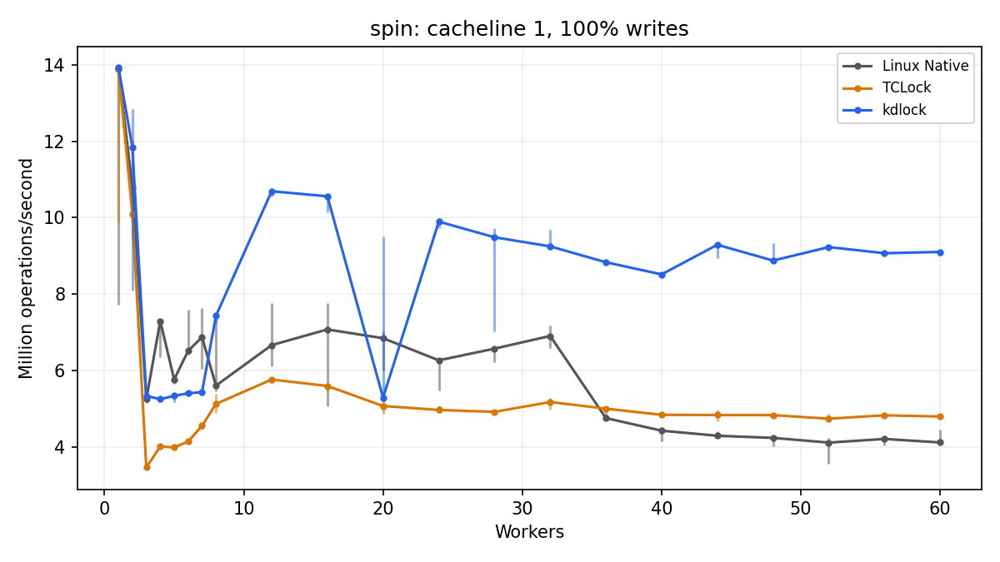
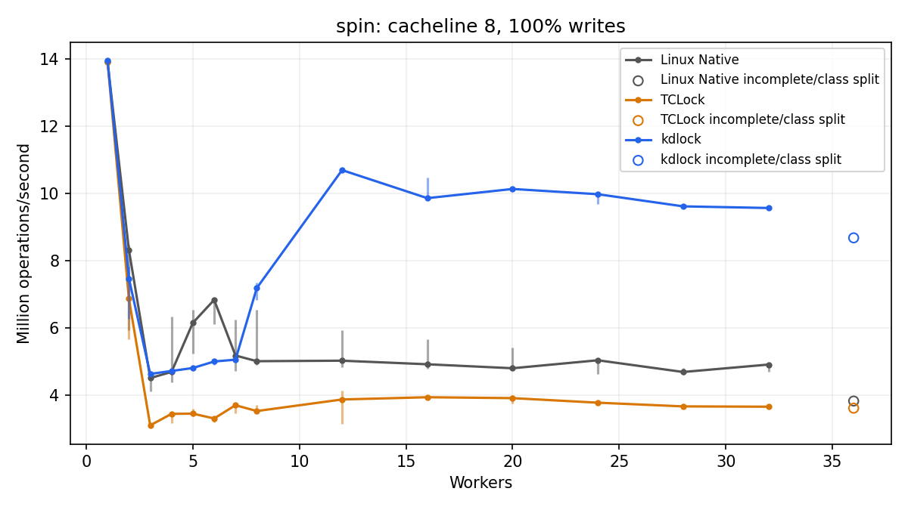

# Nano benchmark: first results

Measured runs: 320 completed, 1 failed, 6735 missing; 882 unsupported repetition slots.

This report contains only this collection. Missing points are not passes. The earlier 40-vCPU campaign is a separate historical dataset. No performance acceptance is claimed outside completed configurations.

Throughput is completed operations divided by measured wall time. Plots show the median of three repetitions with minimum–maximum whiskers. Open points have fewer than three repetitions in an execution class. Coefficient of variation (CV) is sample standard deviation divided by the mean. Speedup is kdlock median divided by the matching control median; values below one are regressions.

Delegation means another lock holder executes the caller’s critical section. Just-in-time (JIT) entry counts and matching completed bodies are recorded separately. Zero-entry runs remain local baselines. A published NORMAL image is not proof of execution. Counts exclude warmup and cover the full measured interval, not the selected peak window. The no-generated-entry count includes local rwlock/rwsem readers; it is not an exact count of admission failures. Mixed execution classes remain separate, with no three-repeat ratio fabricated.

## Observed comparisons

- spin cacheline size 8, 100% writes, 12 workers: 2.76× TCLock
- spin cacheline size 8, 100% writes, 24 workers: 2.64× TCLock
- spin cacheline size 8, 100% writes, 28 workers: 2.62× TCLock
- spin cacheline size 8, 100% writes, 32 workers: 2.62× TCLock
- spin cacheline size 8, 100% writes, 20 workers: 2.59× TCLock

- spin cacheline size 1, 100% writes, 4 workers: 0.72× Linux Native
- spin cacheline size 8, 100% writes, 6 workers: 0.73× Linux Native
- spin cacheline size 1, 100% writes, 20 workers: 0.77× Linux Native
- spin cacheline size 8, 100% writes, 5 workers: 0.78× Linux Native
- spin cacheline size 1, 100% writes, 7 workers: 0.79× Linux Native

These are the largest observed ratios among complete matched groups, not statistical significance claims. All valid repetitions remain in the data files.

## Failed cases retained

- spin cacheline size 8, 36 workers, native, repetition 2: finished worker progress differs from exact total. Drained: True. No throughput score.

Saved audit: spin-cacheline/c08-t36-r01-direct-native/session.json, sample 200, worker 16: progress lagged by 256 operations, 343 ns after the worker’s recorded finish time. Client data check: True; client completed: True.

For a post-finish progress mismatch, publication/timestamp ordering is a possible explanation, not an established cause. The check remains enabled; failed evidence is not converted into a passing sample. Raw client results and the audit retain the exact discrepancy.

## Environment and method

The existing VM at 10.176.26.71:2222 runs 6.1.159-kdclobber2 with nokaslr, nopvspin and voluntary preemption. It has 64 vCPUs and 24 GiB RAM: CPUs 0–31 on NUMA node 0, 32–63 on node 1. NUMA means memory access cost depends on the CPU and memory node. Workers use CPUs 0 through N−1; collector CPU 63 is separate. No requested point oversubscribes the guest. Host vCPUs are pinned one-to-one; the observed host governor is ondemand, so clock frequency is not fixed.

The 1–32-worker points stay on node 0; the 36–60-worker points span both nodes. At 60 workers the split is 32 on node 0 and 28 on node 1. QEMU service threads share host CPU 63 with the collector. This placement is part of the result identity, not a claim that every possible placement has the same scaling.

All arms use 48,000 warmup operations per worker and a 2,000 ms measured interval. A separate secondary peak uses the highest valid 300 ms window after 300 ms settling, sampled every 10 ms. Conclusions and ratios use whole-run medians. Spin/mutex have 64 dependent arithmetic rounds after unlock; rwlock/rwsem have four. Do not compare rates across these different lock-family workloads as though they were equivalent.

Cacheline c01/c08 update one/eight padded 64-byte counters. Lists visit 16/128 resident nodes in a fixed permutation; prefetch/no-prefetch are separate variants. RCUHT has 1,024 buckets, 4,096 preallocated nodes and 8,192 possible keys. Its exclusive operations attempt moves, including misses and conflicts; it performs no per-operation allocation or RCU reclamation.

Each fresh workload module starts cacheline/list values at zero. A list node occupies 64 bytes, so the selected list footprints are 1 KiB and 8 KiB. List links advance five array slots. Hash nodes begin with keys 0–4,095, inserted into bucket key modulo 1,024; bucket and node strides are 64 bytes. Hash random streams use the same CPU-derived seed in every arm. All workers complete warmup before the measured snapshot; timed hash interleavings can produce different valid table states. The captured owner uses ordinary time-sharing scheduling with nice value 5, inherited by its clients.

Spinlocks wait by spinning; mutexes can sleep. Reader/writer spinlocks (rwlocks) allow concurrent readers or an exclusive writer. Reader/writer semaphores (rwsems) offer those ownership modes with sleeping waits. Spin/mutex operations here are exclusive writes. For rwlock/rwsem every worker mixes local shared readers and exclusive writers at 1% or 20% writes; there are no dedicated writer threads. Readers compare cacheline/list values or search a hash bucket. KD writers may delegate. TCLock has no sleeping rwsem implementation.

Public mutex macros use the current unified binary calling interface, ABI2. The existing private KD observation provider has UndefinedBehaviorSanitizer (UBSAN) instrumentation disabled; actual compiler commands and source/binary hashes are retained per block. Completion probes are enabled for every KD payload. No lock or workload tuning occurred.

Each three-backend block rotates order across the three repetitions. With two backends, three repetitions necessarily leave one order occurring twice. Each session validates data, every worker’s completed work, source/frame retirement and module cleanup. Failures stop the affected collection and remain in raw evidence. Zero-delegation strict-JIT refusals are explicitly retained as local throughput only when data, completed work and cleanup all pass.

## Artifacts and reproduction

See `runs.csv`, [raw runs.json](../../raw/bench/nano-20261022/exports-first/runs.json), `aggregate.csv`, `coverage.csv` and `coverage.json`. The raw JSON and original archives are retained in the ignored raw-evidence area; fresh Git checkouts need those artifacts separately. Exact source revision, artifact locations, commands, recovery snapshot, validation logs and hashes belong in `reproducibility.json`. Raw session paths in runs.csv are relative to the collection root. Retained build logs contain exact compiler settings. No p95 latency or MM performance is measured.

Run the frozen `bench/nano/run.py --output NEW_EXTERNAL_DIRECTORY` in the verified idle recovery VM with the recorded translation environment and confirmed recovery variables. The exact expanded commands are retained in commands.json. Generate this report using the plotting environment: `python3 bench/nano/report.py COLLECTION OUTPUT`. Never reuse an existing output directory for a fresh collection.

## Throughput plots

