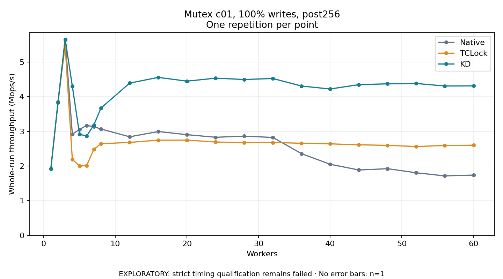

# Mutex c01, 100% writes, post256

One timed repetition per point; no repeat variability estimate.
EXPLORATORY: strict timing qualification remains failed. Rates include post-lock work. Failed, unrun or score-ineligible cases have no plotted rate.

| Workers | Native Mops/s | TCLock Mops/s | KD Mops/s | KD execution |
| ---: | ---: | ---: | ---: | --- |
| 1 | 1.917 | 1.919 | 1.916 | NO_JIT |
| 2 | 3.854 | 3.838 | 3.834 | NO_JIT |
| 3 | 5.645 | 5.485 | 5.659 | NO_JIT |
| 4 | 2.920 | 2.192 | 4.310 | RETURNED_JIT |
| 5 | 3.055 | 2.003 | 2.918 | RETURNED_JIT |
| 6 | 3.173 | 2.011 | 2.865 | RETURNED_JIT |
| 7 | 3.136 | 2.480 | 3.183 | RETURNED_JIT |
| 8 | 3.069 | 2.644 | 3.674 | RETURNED_JIT |
| 12 | 2.844 | 2.682 | 4.393 | RETURNED_JIT |
| 16 | 2.996 | 2.746 | 4.559 | RETURNED_JIT |
| 20 | 2.906 | 2.747 | 4.450 | RETURNED_JIT |
| 24 | 2.830 | 2.694 | 4.536 | RETURNED_JIT |
| 28 | 2.862 | 2.671 | 4.498 | RETURNED_JIT |
| 32 | 2.825 | 2.680 | 4.526 | RETURNED_JIT |
| 36 | 2.356 | 2.657 | 4.308 | RETURNED_JIT |
| 40 | 2.050 | 2.641 | 4.224 | RETURNED_JIT |
| 44 | 1.886 | 2.612 | 4.350 | RETURNED_JIT |
| 48 | 1.923 | 2.598 | 4.372 | RETURNED_JIT |
| 52 | 1.806 | 2.564 | 4.383 | RETURNED_JIT |
| 56 | 1.715 | 2.592 | 4.310 | RETURNED_JIT |
| 60 | 1.739 | 2.602 | 4.313 | RETURNED_JIT |

[Full receipt table](table.csv)

