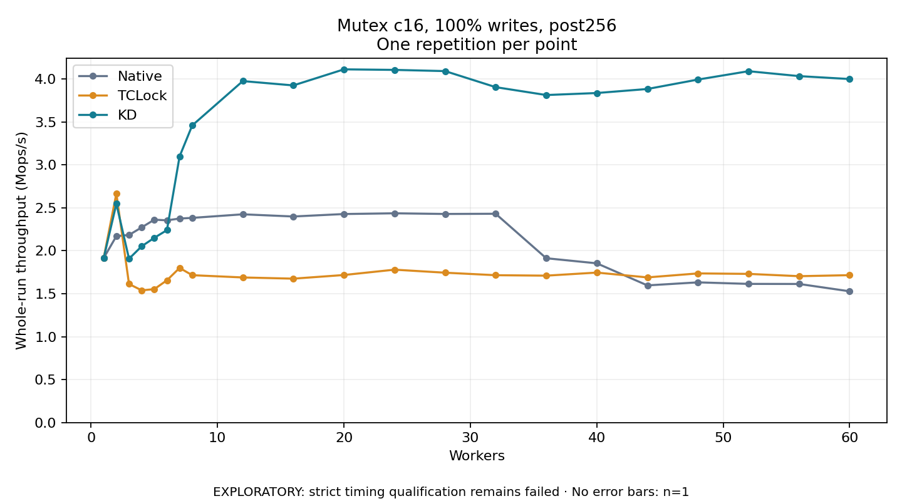

# Mutex c16, 100% writes, post256

One timed repetition per point; no repeat variability estimate.
EXPLORATORY: strict timing qualification remains failed. Rates include post-lock work. Failed, unrun or score-ineligible cases have no plotted rate.

| Workers | Native Mops/s | TCLock Mops/s | KD Mops/s | KD execution |
| ---: | ---: | ---: | ---: | --- |
| 1 | 1.916 | 1.918 | 1.917 | NO_JIT |
| 2 | 2.171 | 2.667 | 2.547 | NO_JIT |
| 3 | 2.184 | 1.614 | 1.907 | RETURNED_JIT |
| 4 | 2.272 | 1.539 | 2.052 | RETURNED_JIT |
| 5 | 2.362 | 1.554 | 2.151 | RETURNED_JIT |
| 6 | 2.355 | 1.657 | 2.240 | RETURNED_JIT |
| 7 | 2.375 | 1.800 | 3.099 | RETURNED_JIT |
| 8 | 2.383 | 1.716 | 3.460 | RETURNED_JIT |
| 12 | 2.425 | 1.690 | 3.976 | RETURNED_JIT |
| 16 | 2.399 | 1.676 | 3.926 | RETURNED_JIT |
| 20 | 2.428 | 1.718 | 4.113 | RETURNED_JIT |
| 24 | 2.437 | 1.780 | 4.106 | RETURNED_JIT |
| 28 | 2.429 | 1.745 | 4.092 | RETURNED_JIT |
| 32 | 2.431 | 1.716 | 3.905 | RETURNED_JIT |
| 36 | 1.913 | 1.711 | 3.814 | RETURNED_JIT |
| 40 | 1.854 | 1.746 | 3.837 | RETURNED_JIT |
| 44 | 1.597 | 1.690 | 3.884 | RETURNED_JIT |
| 48 | 1.632 | 1.737 | 3.994 | RETURNED_JIT |
| 52 | 1.615 | 1.731 | 4.091 | RETURNED_JIT |
| 56 | 1.614 | 1.704 | 4.034 | RETURNED_JIT |
| 60 | 1.528 | 1.716 | 4.000 | RETURNED_JIT |

[Full receipt table](table.csv)

