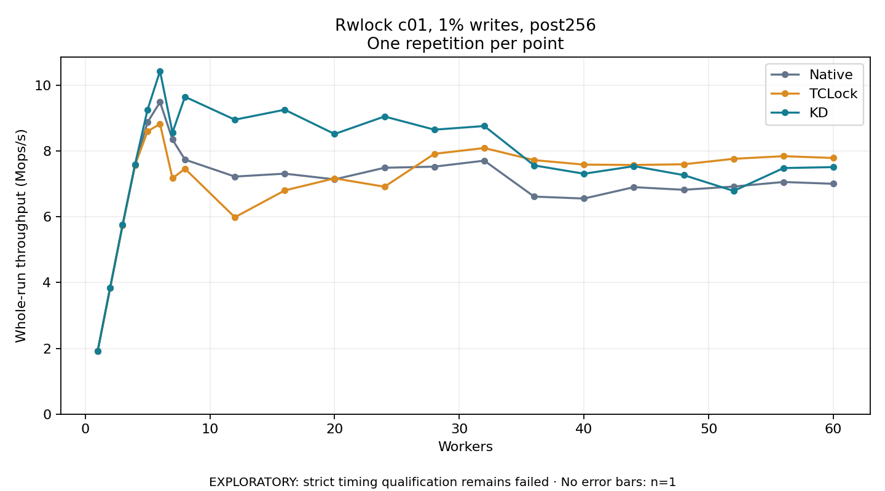

# Rwlock c01, 1% writes, post256

One timed repetition per point; no repeat variability estimate.
EXPLORATORY: strict timing qualification remains failed. Rates include post-lock work. Failed, unrun or score-ineligible cases have no plotted rate.

| Workers | Native Mops/s | TCLock Mops/s | KD Mops/s | KD execution |
| ---: | ---: | ---: | ---: | --- |
| 1 | 1.916 | 1.915 | 1.917 | NO_JIT |
| 2 | 3.848 | 3.832 | 3.839 | NO_JIT |
| 3 | 5.749 | 5.751 | 5.752 | NO_JIT |
| 4 | 7.571 | 7.571 | 7.596 | NO_JIT |
| 5 | 8.874 | 8.597 | 9.255 | NO_JIT |
| 6 | 9.488 | 8.822 | 10.429 | NO_JIT |
| 7 | 8.347 | 7.170 | 8.561 | NO_JIT |
| 8 | 7.738 | 7.460 | 9.648 | NO_JIT |
| 12 | 7.222 | 5.985 | 8.952 | NO_JIT |
| 16 | 7.311 | 6.801 | 9.254 | NO_JIT |
| 20 | 7.137 | 7.168 | 8.516 | NO_JIT |
| 24 | 7.490 | 6.914 | 9.049 | RETURNED_JIT |
| 28 | 7.524 | 7.914 | 8.648 | RETURNED_JIT |
| 32 | 7.706 | 8.090 | 8.759 | RETURNED_JIT |
| 36 | 6.613 | 7.722 | 7.562 | RETURNED_JIT |
| 40 | 6.554 | 7.586 | 7.308 | RETURNED_JIT |
| 44 | 6.900 | 7.575 | 7.539 | RETURNED_JIT |
| 48 | 6.820 | 7.596 | 7.267 | RETURNED_JIT |
| 52 | 6.919 | 7.762 | 6.785 | RETURNED_JIT |
| 56 | 7.057 | 7.842 | 7.481 | RETURNED_JIT |
| 60 | 7.002 | 7.787 | 7.510 | RETURNED_JIT |

[Full receipt table](table.csv)

