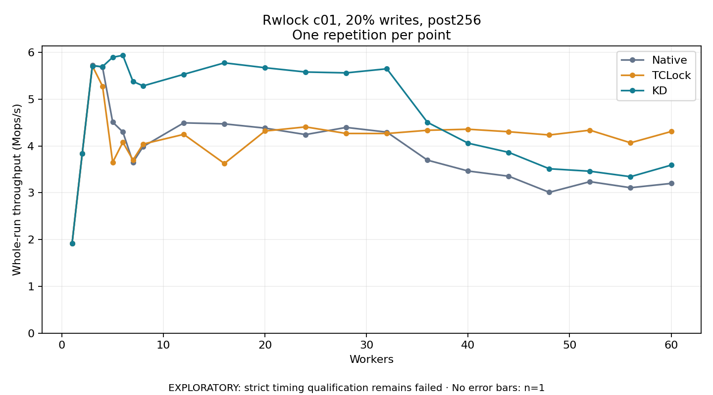

# Rwlock c01, 20% writes, post256

One timed repetition per point; no repeat variability estimate.
EXPLORATORY: strict timing qualification remains failed. Rates include post-lock work. Failed, unrun or score-ineligible cases have no plotted rate.

| Workers | Native Mops/s | TCLock Mops/s | KD Mops/s | KD execution |
| ---: | ---: | ---: | ---: | --- |
| 1 | 1.915 | 1.916 | 1.915 | NO_JIT |
| 2 | 3.833 | 3.834 | 3.837 | NO_JIT |
| 3 | 5.730 | 5.710 | 5.711 | NO_JIT |
| 4 | 5.682 | 5.278 | 5.697 | NO_JIT |
| 5 | 4.510 | 3.651 | 5.897 | NO_JIT |
| 6 | 4.301 | 4.080 | 5.938 | NO_JIT |
| 7 | 3.652 | 3.701 | 5.379 | NO_JIT |
| 8 | 3.988 | 4.041 | 5.284 | NO_JIT |
| 12 | 4.495 | 4.249 | 5.532 | RETURNED_JIT |
| 16 | 4.473 | 3.626 | 5.777 | RETURNED_JIT |
| 20 | 4.382 | 4.319 | 5.673 | RETURNED_JIT |
| 24 | 4.244 | 4.408 | 5.581 | RETURNED_JIT |
| 28 | 4.397 | 4.268 | 5.563 | RETURNED_JIT |
| 32 | 4.297 | 4.267 | 5.650 | RETURNED_JIT |
| 36 | 3.698 | 4.336 | 4.506 | RETURNED_JIT |
| 40 | 3.466 | 4.359 | 4.060 | RETURNED_JIT |
| 44 | 3.354 | 4.305 | 3.864 | RETURNED_JIT |
| 48 | 3.010 | 4.235 | 3.514 | RETURNED_JIT |
| 52 | 3.238 | 4.338 | 3.461 | RETURNED_JIT |
| 56 | 3.109 | 4.069 | 3.344 | RETURNED_JIT |
| 60 | 3.200 | 4.309 | 3.591 | RETURNED_JIT |

[Full receipt table](table.csv)

