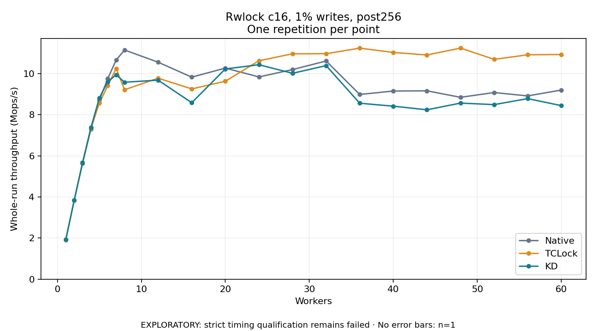

# Rwlock c16, 1% writes, post256

One timed repetition per point; no repeat variability estimate.
EXPLORATORY: strict timing qualification remains failed. Rates include post-lock work. Failed, unrun or score-ineligible cases have no plotted rate.

| Workers | Native Mops/s | TCLock Mops/s | KD Mops/s | KD execution |
| ---: | ---: | ---: | ---: | --- |
| 1 | 1.917 | 1.917 | 1.918 | NO_JIT |
| 2 | 3.829 | 3.830 | 3.829 | NO_JIT |
| 3 | 5.634 | 5.667 | 5.669 | NO_JIT |
| 4 | 7.307 | 7.344 | 7.378 | NO_JIT |
| 5 | 8.714 | 8.567 | 8.819 | NO_JIT |
| 6 | 9.753 | 9.413 | 9.599 | NO_JIT |
| 7 | 10.660 | 10.246 | 9.942 | NO_JIT |
| 8 | 11.145 | 9.215 | 9.579 | NO_JIT |
| 12 | 10.552 | 9.775 | 9.680 | NO_JIT |
| 16 | 9.827 | 9.253 | 8.582 | NO_JIT |
| 20 | 10.266 | 9.627 | 10.226 | NO_JIT |
| 24 | 9.837 | 10.623 | 10.429 | NO_JIT |
| 28 | 10.195 | 10.962 | 10.013 | RETURNED_JIT |
| 32 | 10.611 | 10.967 | 10.387 | RETURNED_JIT |
| 36 | 8.984 | 11.237 | 8.557 | RETURNED_JIT |
| 40 | 9.150 | 11.027 | 8.414 | RETURNED_JIT |
| 44 | 9.161 | 10.902 | 8.238 | RETURNED_JIT |
| 48 | 8.845 | 11.240 | 8.564 | RETURNED_JIT |
| 52 | 9.078 | 10.691 | 8.490 | RETURNED_JIT |
| 56 | 8.913 | 10.913 | 8.781 | RETURNED_JIT |
| 60 | 9.199 | 10.928 | 8.442 | RETURNED_JIT |

[Full receipt table](table.csv)

