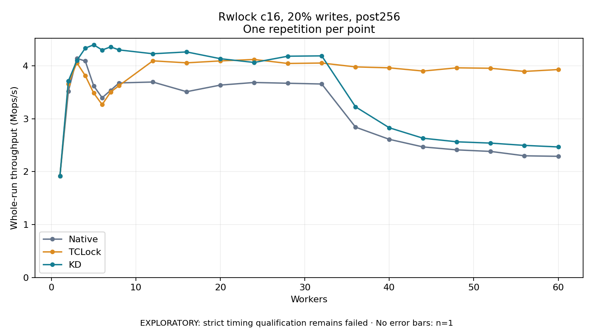

# Rwlock c16, 20% writes, post256

One timed repetition per point; no repeat variability estimate.
EXPLORATORY: strict timing qualification remains failed. Rates include post-lock work. Failed, unrun or score-ineligible cases have no plotted rate.

| Workers | Native Mops/s | TCLock Mops/s | KD Mops/s | KD execution |
| ---: | ---: | ---: | ---: | --- |
| 1 | 1.917 | 1.917 | 1.918 | NO_JIT |
| 2 | 3.522 | 3.660 | 3.715 | NO_JIT |
| 3 | 4.143 | 4.060 | 4.100 | NO_JIT |
| 4 | 4.091 | 3.815 | 4.336 | NO_JIT |
| 5 | 3.622 | 3.485 | 4.398 | NO_JIT |
| 6 | 3.398 | 3.268 | 4.300 | NO_JIT |
| 7 | 3.538 | 3.506 | 4.359 | NO_JIT |
| 8 | 3.678 | 3.627 | 4.302 | NO_JIT |
| 12 | 3.695 | 4.095 | 4.229 | RETURNED_JIT |
| 16 | 3.512 | 4.058 | 4.264 | RETURNED_JIT |
| 20 | 3.637 | 4.094 | 4.136 | RETURNED_JIT |
| 24 | 3.686 | 4.121 | 4.065 | RETURNED_JIT |
| 28 | 3.672 | 4.046 | 4.183 | RETURNED_JIT |
| 32 | 3.658 | 4.054 | 4.189 | RETURNED_JIT |
| 36 | 2.842 | 3.981 | 3.227 | RETURNED_JIT |
| 40 | 2.612 | 3.963 | 2.830 | RETURNED_JIT |
| 44 | 2.468 | 3.903 | 2.633 | RETURNED_JIT |
| 48 | 2.412 | 3.964 | 2.565 | RETURNED_JIT |
| 52 | 2.383 | 3.955 | 2.540 | RETURNED_JIT |
| 56 | 2.300 | 3.895 | 2.497 | RETURNED_JIT |
| 60 | 2.291 | 3.931 | 2.468 | RETURNED_JIT |

[Full receipt table](table.csv)

