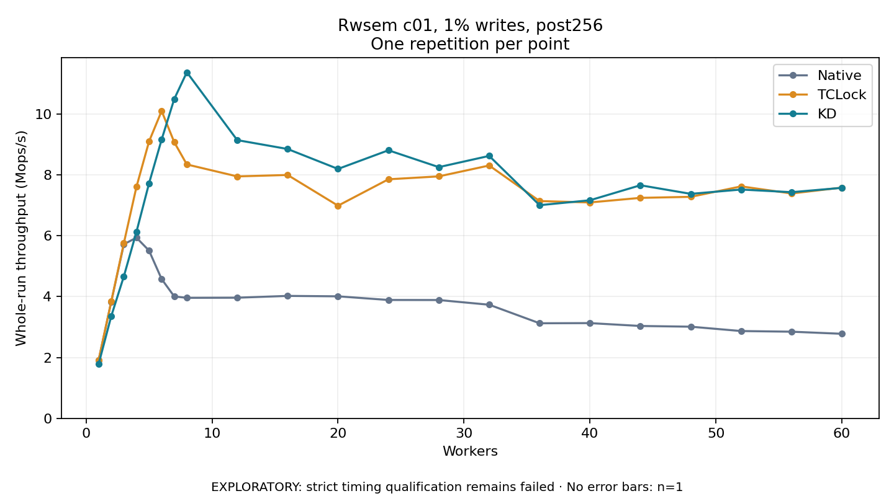

# Rwsem c01, 1% writes, post256

One timed repetition per point; no repeat variability estimate.
EXPLORATORY: strict timing qualification remains failed. Rates include post-lock work. Failed, unrun or score-ineligible cases have no plotted rate.

| Workers | Native Mops/s | TCLock Mops/s | KD Mops/s | KD execution |
| ---: | ---: | ---: | ---: | --- |
| 1 | 1.915 | 1.917 | 1.788 | NO_JIT |
| 2 | 3.832 | 3.835 | 3.357 | NO_JIT |
| 3 | 5.716 | 5.752 | 4.663 | NO_JIT |
| 4 | 5.933 | 7.601 | 6.123 | NO_JIT |
| 5 | 5.508 | 9.092 | 7.717 | NO_JIT |
| 6 | 4.574 | 10.094 | 9.156 | NO_JIT |
| 7 | 4.003 | 9.068 | 10.486 | NO_JIT |
| 8 | 3.957 | 8.337 | 11.365 | NO_JIT |
| 12 | 3.962 | 7.945 | 9.137 | NO_JIT |
| 16 | 4.021 | 7.992 | 8.844 | NO_JIT |
| 20 | 4.007 | 6.983 | 8.190 | NO_JIT |
| 24 | 3.887 | 7.850 | 8.802 | NO_JIT |
| 28 | 3.885 | 7.945 | 8.249 | NO_JIT |
| 32 | 3.731 | 8.303 | 8.618 | NO_JIT |
| 36 | 3.122 | 7.135 | 7.000 | NO_JIT |
| 40 | 3.127 | 7.090 | 7.161 | NO_JIT |
| 44 | 3.033 | 7.240 | 7.654 | RETURNED_JIT |
| 48 | 3.010 | 7.274 | 7.371 | RETURNED_JIT |
| 52 | 2.867 | 7.617 | 7.514 | NO_JIT |
| 56 | 2.845 | 7.384 | 7.426 | NO_JIT |
| 60 | 2.777 | 7.577 | 7.569 | NO_JIT |

[Full receipt table](table.csv)

