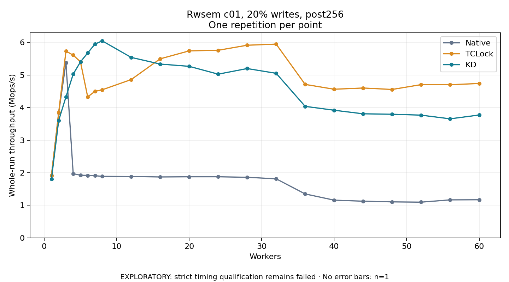

# Rwsem c01, 20% writes, post256

One timed repetition per point; no repeat variability estimate.
EXPLORATORY: strict timing qualification remains failed. Rates include post-lock work. Failed, unrun or score-ineligible cases have no plotted rate.

| Workers | Native Mops/s | TCLock Mops/s | KD Mops/s | KD execution |
| ---: | ---: | ---: | ---: | --- |
| 1 | 1.914 | 1.914 | 1.809 | NO_JIT |
| 2 | 3.843 | 3.850 | 3.605 | NO_JIT |
| 3 | 5.377 | 5.735 | 4.327 | NO_JIT |
| 4 | 1.972 | 5.610 | 5.028 | RETURNED_JIT |
| 5 | 1.922 | 5.406 | 5.402 | NO_JIT |
| 6 | 1.918 | 4.329 | 5.678 | RETURNED_JIT |
| 7 | 1.908 | 4.497 | 5.948 | RETURNED_JIT |
| 8 | 1.889 | 4.546 | 6.049 | RETURNED_JIT |
| 12 | 1.883 | 4.860 | 5.541 | RETURNED_JIT |
| 16 | 1.870 | 5.497 | 5.336 | RETURNED_JIT |
| 20 | 1.875 | 5.741 | 5.266 | RETURNED_JIT |
| 24 | 1.876 | 5.759 | 5.026 | RETURNED_JIT |
| 28 | 1.859 | 5.915 | 5.198 | RETURNED_JIT |
| 32 | 1.813 | 5.948 | 5.052 | RETURNED_JIT |
| 36 | 1.348 | 4.711 | 4.038 | RETURNED_JIT |
| 40 | 1.158 | 4.563 | 3.918 | RETURNED_JIT |
| 44 | 1.125 | 4.601 | 3.809 | RETURNED_JIT |
| 48 | 1.105 | 4.556 | 3.795 | RETURNED_JIT |
| 52 | 1.096 | 4.705 | 3.768 | RETURNED_JIT |
| 56 | 1.166 | 4.702 | 3.655 | RETURNED_JIT |
| 60 | 1.170 | 4.740 | 3.772 | RETURNED_JIT |

[Full receipt table](table.csv)

