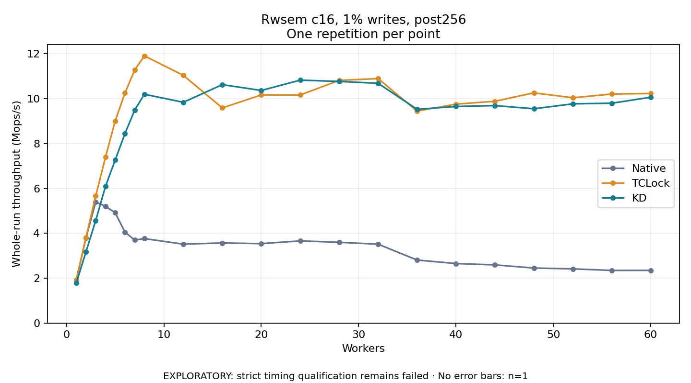

# Rwsem c16, 1% writes, post256

One timed repetition per point; no repeat variability estimate.
EXPLORATORY: strict timing qualification remains failed. Rates include post-lock work. Failed, unrun or score-ineligible cases have no plotted rate.

| Workers | Native Mops/s | TCLock Mops/s | KD Mops/s | KD execution |
| ---: | ---: | ---: | ---: | --- |
| 1 | 1.913 | 1.918 | 1.781 | NO_JIT |
| 2 | 3.798 | 3.822 | 3.175 | NO_JIT |
| 3 | 5.392 | 5.669 | 4.571 | NO_JIT |
| 4 | 5.205 | 7.389 | 6.088 | NO_JIT |
| 5 | 4.914 | 9.008 | 7.267 | NO_JIT |
| 6 | 4.053 | 10.249 | 8.440 | NO_JIT |
| 7 | 3.698 | 11.276 | 9.492 | NO_JIT |
| 8 | 3.764 | 11.906 | 10.196 | NO_JIT |
| 12 | 3.516 | 11.038 | 9.838 | NO_JIT |
| 16 | 3.568 | 9.587 | 10.625 | NO_JIT |
| 20 | 3.539 | 10.167 | 10.366 | RETURNED_JIT |
| 24 | 3.661 | 10.163 | 10.826 | RETURNED_JIT |
| 28 | 3.598 | 10.814 | 10.768 | RETURNED_JIT |
| 32 | 3.514 | 10.895 | 10.686 | RETURNED_JIT |
| 36 | 2.809 | 9.446 | 9.526 | RETURNED_JIT |
| 40 | 2.651 | 9.755 | 9.652 | RETURNED_JIT |
| 44 | 2.591 | 9.884 | 9.691 | RETURNED_JIT |
| 48 | 2.451 | 10.259 | 9.550 | RETURNED_JIT |
| 52 | 2.415 | 10.041 | 9.769 | RETURNED_JIT |
| 56 | 2.345 | 10.206 | 9.797 | RETURNED_JIT |
| 60 | 2.348 | 10.230 | 10.064 | RETURNED_JIT |

[Full receipt table](table.csv)

