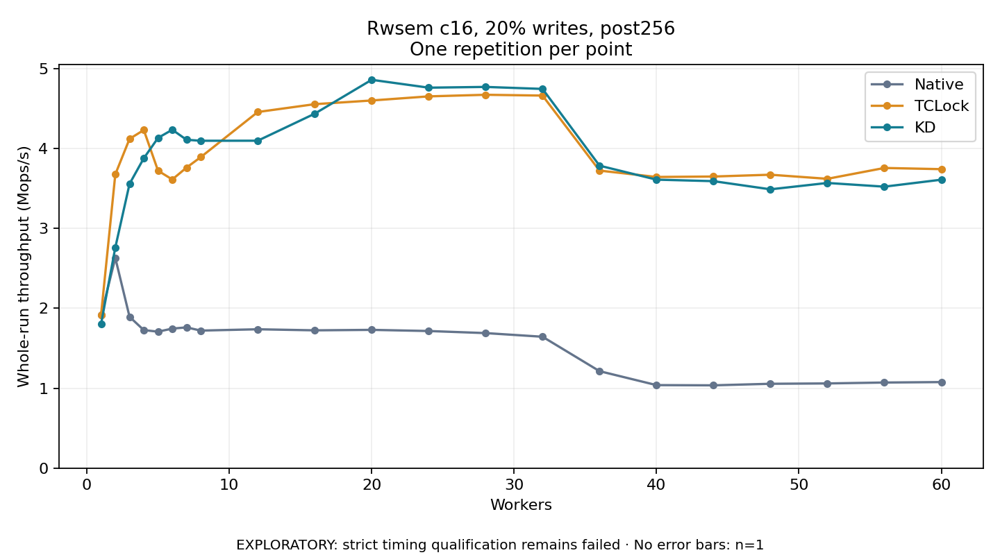

# Rwsem c16, 20% writes, post256

One timed repetition per point; no repeat variability estimate.
EXPLORATORY: strict timing qualification remains failed. Rates include post-lock work. Failed, unrun or score-ineligible cases have no plotted rate.

| Workers | Native Mops/s | TCLock Mops/s | KD Mops/s | KD execution |
| ---: | ---: | ---: | ---: | --- |
| 1 | 1.914 | 1.917 | 1.803 | NO_JIT |
| 2 | 2.630 | 3.675 | 2.760 | NO_JIT |
| 3 | 1.893 | 4.119 | 3.557 | NO_JIT |
| 4 | 1.727 | 4.230 | 3.877 | RETURNED_JIT |
| 5 | 1.707 | 3.721 | 4.131 | RETURNED_JIT |
| 6 | 1.745 | 3.611 | 4.233 | RETURNED_JIT |
| 7 | 1.761 | 3.760 | 4.108 | RETURNED_JIT |
| 8 | 1.720 | 3.891 | 4.096 | RETURNED_JIT |
| 12 | 1.737 | 4.455 | 4.096 | RETURNED_JIT |
| 16 | 1.724 | 4.553 | 4.434 | RETURNED_JIT |
| 20 | 1.730 | 4.599 | 4.858 | RETURNED_JIT |
| 24 | 1.715 | 4.651 | 4.760 | RETURNED_JIT |
| 28 | 1.689 | 4.671 | 4.769 | RETURNED_JIT |
| 32 | 1.644 | 4.661 | 4.744 | RETURNED_JIT |
| 36 | 1.213 | 3.722 | 3.784 | RETURNED_JIT |
| 40 | 1.038 | 3.642 | 3.609 | RETURNED_JIT |
| 44 | 1.036 | 3.648 | 3.590 | RETURNED_JIT |
| 48 | 1.055 | 3.671 | 3.488 | RETURNED_JIT |
| 52 | 1.059 | 3.619 | 3.568 | RETURNED_JIT |
| 56 | 1.071 | 3.755 | 3.521 | RETURNED_JIT |
| 60 | 1.076 | 3.740 | 3.608 | RETURNED_JIT |

[Full receipt table](table.csv)

