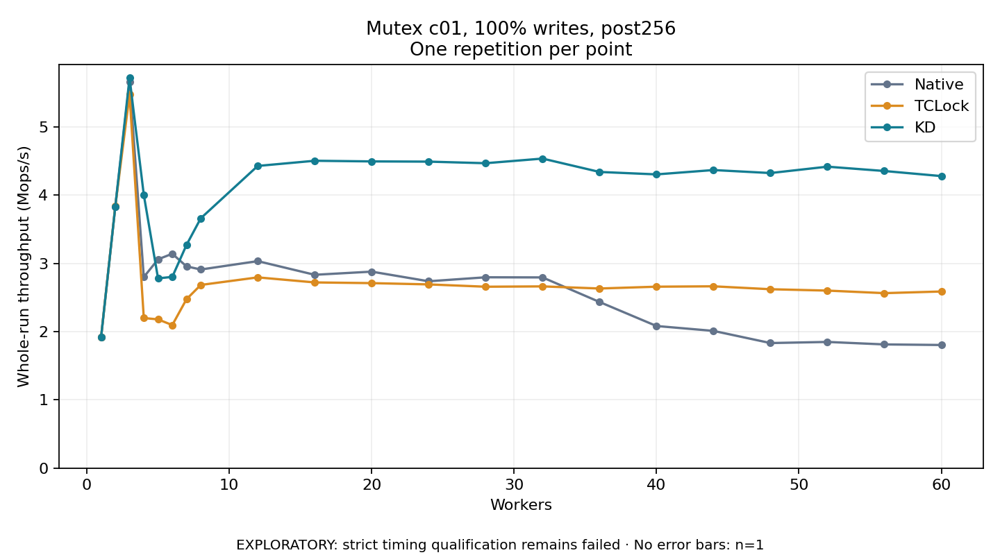

# Mutex c01, 100% writes, post256

One timed repetition per point; no repeat variability estimate.
EXPLORATORY: strict timing qualification remains failed. Rates include post-lock work. Failed, unrun or score-ineligible cases have no plotted rate.

| Workers | Native Mops/s | TCLock Mops/s | KD Mops/s | KD execution |
| ---: | ---: | ---: | ---: | --- |
| 1 | 1.916 | 1.918 | 1.916 | NO_JIT |
| 2 | 3.834 | 3.839 | 3.834 | NO_JIT |
| 3 | 5.663 | 5.474 | 5.718 | NO_JIT |
| 4 | 2.800 | 2.199 | 4.004 | RETURNED_JIT |
| 5 | 3.060 | 2.180 | 2.781 | RETURNED_JIT |
| 6 | 3.141 | 2.096 | 2.802 | RETURNED_JIT |
| 7 | 2.956 | 2.475 | 3.271 | RETURNED_JIT |
| 8 | 2.910 | 2.684 | 3.661 | RETURNED_JIT |
| 12 | 3.033 | 2.795 | 4.428 | RETURNED_JIT |
| 16 | 2.833 | 2.721 | 4.504 | RETURNED_JIT |
| 20 | 2.879 | 2.711 | 4.494 | RETURNED_JIT |
| 24 | 2.738 | 2.692 | 4.491 | RETURNED_JIT |
| 28 | 2.796 | 2.658 | 4.468 | RETURNED_JIT |
| 32 | 2.794 | 2.663 | 4.536 | RETURNED_JIT |
| 36 | 2.434 | 2.632 | 4.340 | RETURNED_JIT |
| 40 | 2.082 | 2.659 | 4.304 | RETURNED_JIT |
| 44 | 2.011 | 2.664 | 4.368 | RETURNED_JIT |
| 48 | 1.833 | 2.621 | 4.324 | RETURNED_JIT |
| 52 | 1.849 | 2.601 | 4.417 | RETURNED_JIT |
| 56 | 1.813 | 2.564 | 4.354 | RETURNED_JIT |
| 60 | 1.804 | 2.588 | 4.279 | RETURNED_JIT |

[Full receipt table](table.csv)

