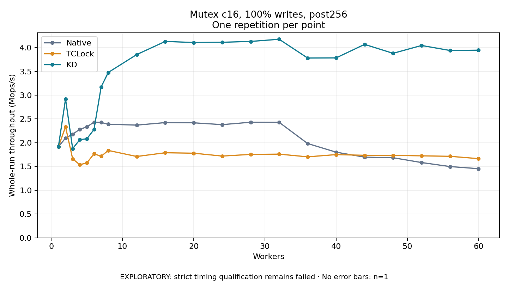

# Mutex c16, 100% writes, post256

One timed repetition per point; no repeat variability estimate.
EXPLORATORY: strict timing qualification remains failed. Rates include post-lock work. Failed, unrun or score-ineligible cases have no plotted rate.

| Workers | Native Mops/s | TCLock Mops/s | KD Mops/s | KD execution |
| ---: | ---: | ---: | ---: | --- |
| 1 | 1.916 | 1.917 | 1.917 | NO_JIT |
| 2 | 2.098 | 2.335 | 2.920 | NO_JIT |
| 3 | 2.179 | 1.661 | 1.876 | RETURNED_JIT |
| 4 | 2.282 | 1.538 | 2.064 | RETURNED_JIT |
| 5 | 2.334 | 1.576 | 2.084 | RETURNED_JIT |
| 6 | 2.433 | 1.767 | 2.279 | RETURNED_JIT |
| 7 | 2.426 | 1.715 | 3.173 | RETURNED_JIT |
| 8 | 2.389 | 1.838 | 3.478 | RETURNED_JIT |
| 12 | 2.370 | 1.711 | 3.854 | RETURNED_JIT |
| 16 | 2.423 | 1.789 | 4.130 | RETURNED_JIT |
| 20 | 2.419 | 1.780 | 4.108 | RETURNED_JIT |
| 24 | 2.380 | 1.720 | 4.112 | RETURNED_JIT |
| 28 | 2.431 | 1.754 | 4.130 | RETURNED_JIT |
| 32 | 2.429 | 1.760 | 4.175 | RETURNED_JIT |
| 36 | 1.983 | 1.703 | 3.781 | RETURNED_JIT |
| 40 | 1.802 | 1.750 | 3.784 | RETURNED_JIT |
| 44 | 1.697 | 1.736 | 4.068 | RETURNED_JIT |
| 48 | 1.684 | 1.734 | 3.880 | RETURNED_JIT |
| 52 | 1.583 | 1.724 | 4.045 | RETURNED_JIT |
| 56 | 1.499 | 1.714 | 3.939 | RETURNED_JIT |
| 60 | 1.454 | 1.665 | 3.946 | RETURNED_JIT |

[Full receipt table](table.csv)

