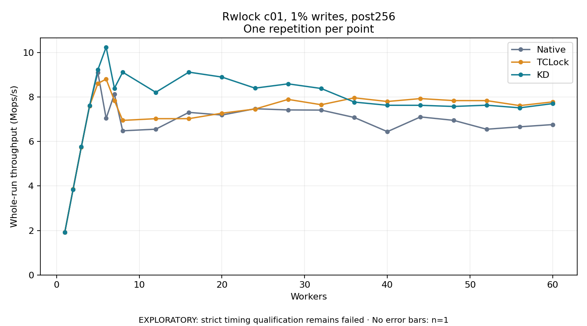

# Rwlock c01, 1% writes, post256

One timed repetition per point; no repeat variability estimate.
EXPLORATORY: strict timing qualification remains failed. Rates include post-lock work. Failed, unrun or score-ineligible cases have no plotted rate.

| Workers | Native Mops/s | TCLock Mops/s | KD Mops/s | KD execution |
| ---: | ---: | ---: | ---: | --- |
| 1 | 1.916 | 1.917 | 1.917 | NO_JIT |
| 2 | 3.836 | 3.852 | 3.839 | NO_JIT |
| 3 | 5.753 | 5.752 | 5.757 | NO_JIT |
| 4 | 7.605 | 7.606 | 7.608 | NO_JIT |
| 5 | 9.097 | 8.608 | 9.223 | NO_JIT |
| 6 | 7.040 | 8.805 | 10.240 | NO_JIT |
| 7 | 8.130 | 7.836 | 8.394 | NO_JIT |
| 8 | 6.480 | 6.948 | 9.116 | NO_JIT |
| 12 | 6.553 | 7.025 | 8.211 | NO_JIT |
| 16 | 7.309 | 7.026 | 9.117 | NO_JIT |
| 20 | 7.189 | 7.273 | 8.895 | NO_JIT |
| 24 | 7.471 | 7.458 | 8.398 | RETURNED_JIT |
| 28 | 7.418 | 7.892 | 8.591 | RETURNED_JIT |
| 32 | 7.411 | 7.652 | 8.382 | RETURNED_JIT |
| 36 | 7.079 | 7.963 | 7.771 | RETURNED_JIT |
| 40 | 6.442 | 7.797 | 7.628 | RETURNED_JIT |
| 44 | 7.104 | 7.929 | 7.626 | RETURNED_JIT |
| 48 | 6.951 | 7.838 | 7.575 | RETURNED_JIT |
| 52 | 6.551 | 7.837 | 7.631 | RETURNED_JIT |
| 56 | 6.659 | 7.613 | 7.513 | RETURNED_JIT |
| 60 | 6.761 | 7.780 | 7.704 | RETURNED_JIT |

[Full receipt table](table.csv)

