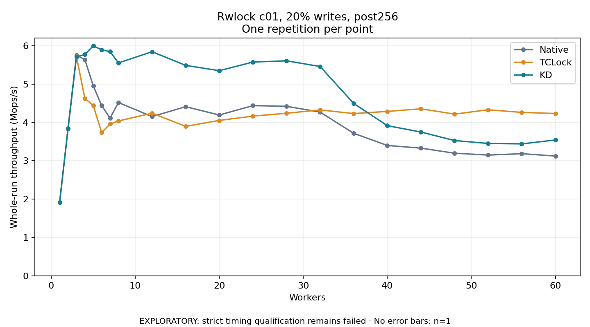

# Rwlock c01, 20% writes, post256

One timed repetition per point; no repeat variability estimate.
EXPLORATORY: strict timing qualification remains failed. Rates include post-lock work. Failed, unrun or score-ineligible cases have no plotted rate.

| Workers | Native Mops/s | TCLock Mops/s | KD Mops/s | KD execution |
| ---: | ---: | ---: | ---: | --- |
| 1 | 1.917 | 1.917 | 1.919 | NO_JIT |
| 2 | 3.852 | 3.837 | 3.839 | NO_JIT |
| 3 | 5.756 | 5.723 | 5.714 | NO_JIT |
| 4 | 5.643 | 4.629 | 5.774 | NO_JIT |
| 5 | 4.958 | 4.444 | 6.000 | NO_JIT |
| 6 | 4.441 | 3.738 | 5.895 | NO_JIT |
| 7 | 4.115 | 3.961 | 5.852 | NO_JIT |
| 8 | 4.521 | 4.040 | 5.554 | NO_JIT |
| 12 | 4.155 | 4.243 | 5.847 | RETURNED_JIT |
| 16 | 4.412 | 3.899 | 5.490 | RETURNED_JIT |
| 20 | 4.195 | 4.054 | 5.353 | RETURNED_JIT |
| 24 | 4.440 | 4.167 | 5.577 | RETURNED_JIT |
| 28 | 4.423 | 4.241 | 5.610 | RETURNED_JIT |
| 32 | 4.271 | 4.328 | 5.461 | RETURNED_JIT |
| 36 | 3.718 | 4.233 | 4.497 | RETURNED_JIT |
| 40 | 3.401 | 4.290 | 3.918 | RETURNED_JIT |
| 44 | 3.331 | 4.357 | 3.751 | RETURNED_JIT |
| 48 | 3.199 | 4.219 | 3.529 | RETURNED_JIT |
| 52 | 3.150 | 4.332 | 3.453 | RETURNED_JIT |
| 56 | 3.186 | 4.263 | 3.442 | RETURNED_JIT |
| 60 | 3.125 | 4.235 | 3.544 | RETURNED_JIT |

[Full receipt table](table.csv)

