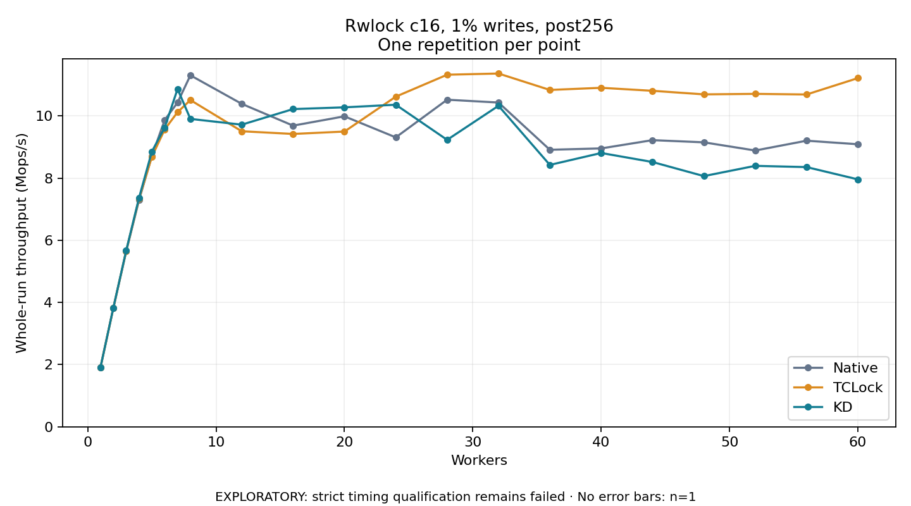

# Rwlock c16, 1% writes, post256

One timed repetition per point; no repeat variability estimate.
EXPLORATORY: strict timing qualification remains failed. Rates include post-lock work. Failed, unrun or score-ineligible cases have no plotted rate.

| Workers | Native Mops/s | TCLock Mops/s | KD Mops/s | KD execution |
| ---: | ---: | ---: | ---: | --- |
| 1 | 1.917 | 1.918 | 1.918 | NO_JIT |
| 2 | 3.825 | 3.825 | 3.830 | NO_JIT |
| 3 | 5.644 | 5.659 | 5.668 | NO_JIT |
| 4 | 7.297 | 7.339 | 7.367 | NO_JIT |
| 5 | 8.709 | 8.688 | 8.853 | NO_JIT |
| 6 | 9.873 | 9.567 | 9.627 | NO_JIT |
| 7 | 10.430 | 10.121 | 10.868 | NO_JIT |
| 8 | 11.308 | 10.511 | 9.905 | NO_JIT |
| 12 | 10.389 | 9.507 | 9.719 | NO_JIT |
| 16 | 9.688 | 9.421 | 10.221 | NO_JIT |
| 20 | 9.988 | 9.498 | 10.277 | NO_JIT |
| 24 | 9.311 | 10.620 | 10.361 | RETURNED_JIT |
| 28 | 10.522 | 11.326 | 9.231 | RETURNED_JIT |
| 32 | 10.431 | 11.365 | 10.327 | RETURNED_JIT |
| 36 | 8.912 | 10.837 | 8.425 | RETURNED_JIT |
| 40 | 8.956 | 10.905 | 8.808 | RETURNED_JIT |
| 44 | 9.222 | 10.809 | 8.518 | RETURNED_JIT |
| 48 | 9.151 | 10.694 | 8.065 | RETURNED_JIT |
| 52 | 8.888 | 10.710 | 8.394 | RETURNED_JIT |
| 56 | 9.203 | 10.690 | 8.355 | RETURNED_JIT |
| 60 | 9.089 | 11.217 | 7.959 | RETURNED_JIT |

[Full receipt table](table.csv)

