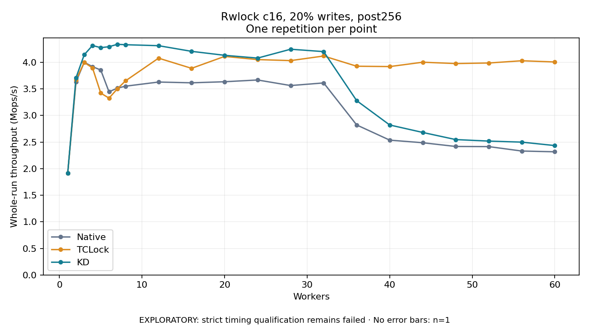

# Rwlock c16, 20% writes, post256

One timed repetition per point; no repeat variability estimate.
EXPLORATORY: strict timing qualification remains failed. Rates include post-lock work. Failed, unrun or score-ineligible cases have no plotted rate.

| Workers | Native Mops/s | TCLock Mops/s | KD Mops/s | KD execution |
| ---: | ---: | ---: | ---: | --- |
| 1 | 1.917 | 1.917 | 1.918 | NO_JIT |
| 2 | 3.632 | 3.671 | 3.710 | NO_JIT |
| 3 | 4.002 | 3.998 | 4.144 | NO_JIT |
| 4 | 3.919 | 3.896 | 4.317 | NO_JIT |
| 5 | 3.856 | 3.422 | 4.277 | NO_JIT |
| 6 | 3.446 | 3.328 | 4.295 | NO_JIT |
| 7 | 3.515 | 3.500 | 4.339 | NO_JIT |
| 8 | 3.552 | 3.652 | 4.332 | NO_JIT |
| 12 | 3.630 | 4.079 | 4.314 | RETURNED_JIT |
| 16 | 3.615 | 3.888 | 4.207 | RETURNED_JIT |
| 20 | 3.636 | 4.112 | 4.133 | RETURNED_JIT |
| 24 | 3.669 | 4.052 | 4.081 | RETURNED_JIT |
| 28 | 3.564 | 4.033 | 4.247 | RETURNED_JIT |
| 32 | 3.613 | 4.120 | 4.202 | RETURNED_JIT |
| 36 | 2.822 | 3.928 | 3.279 | RETURNED_JIT |
| 40 | 2.537 | 3.921 | 2.822 | RETURNED_JIT |
| 44 | 2.488 | 4.003 | 2.681 | RETURNED_JIT |
| 48 | 2.418 | 3.978 | 2.547 | RETURNED_JIT |
| 52 | 2.415 | 3.988 | 2.519 | RETURNED_JIT |
| 56 | 2.332 | 4.030 | 2.499 | RETURNED_JIT |
| 60 | 2.317 | 4.007 | 2.435 | RETURNED_JIT |

[Full receipt table](table.csv)

