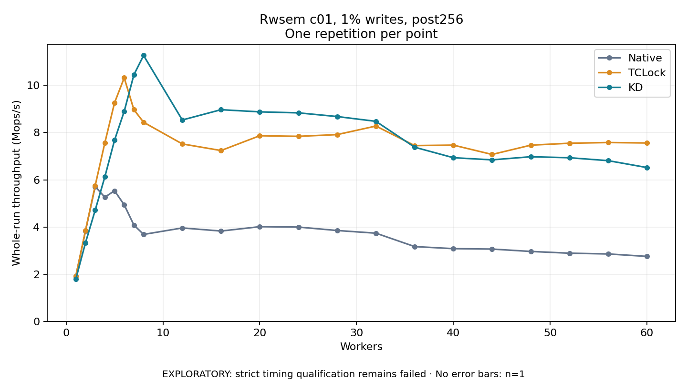

# Rwsem c01, 1% writes, post256

One timed repetition per point; no repeat variability estimate.
EXPLORATORY: strict timing qualification remains failed. Rates include post-lock work. Failed, unrun or score-ineligible cases have no plotted rate.

| Workers | Native Mops/s | TCLock Mops/s | KD Mops/s | KD execution |
| ---: | ---: | ---: | ---: | --- |
| 1 | 1.915 | 1.916 | 1.789 | NO_JIT |
| 2 | 3.831 | 3.853 | 3.332 | NO_JIT |
| 3 | 5.714 | 5.752 | 4.710 | NO_JIT |
| 4 | 5.263 | 7.570 | 6.127 | NO_JIT |
| 5 | 5.537 | 9.265 | 7.680 | NO_JIT |
| 6 | 4.939 | 10.323 | 8.902 | NO_JIT |
| 7 | 4.082 | 8.972 | 10.453 | NO_JIT |
| 8 | 3.684 | 8.440 | 11.270 | NO_JIT |
| 12 | 3.959 | 7.521 | 8.536 | NO_JIT |
| 16 | 3.828 | 7.241 | 8.971 | NO_JIT |
| 20 | 4.013 | 7.868 | 8.881 | NO_JIT |
| 24 | 3.996 | 7.842 | 8.838 | NO_JIT |
| 28 | 3.851 | 7.916 | 8.681 | NO_JIT |
| 32 | 3.738 | 8.279 | 8.478 | NO_JIT |
| 36 | 3.170 | 7.450 | 7.382 | NO_JIT |
| 40 | 3.082 | 7.470 | 6.936 | NO_JIT |
| 44 | 3.064 | 7.074 | 6.846 | NO_JIT |
| 48 | 2.963 | 7.469 | 6.978 | NO_JIT |
| 52 | 2.889 | 7.550 | 6.935 | NO_JIT |
| 56 | 2.857 | 7.580 | 6.811 | NO_JIT |
| 60 | 2.753 | 7.561 | 6.519 | NO_JIT |

[Full receipt table](table.csv)

