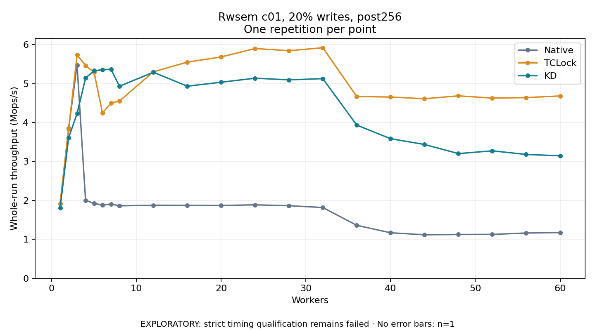

# Rwsem c01, 20% writes, post256

One timed repetition per point; no repeat variability estimate.
EXPLORATORY: strict timing qualification remains failed. Rates include post-lock work. Failed, unrun or score-ineligible cases have no plotted rate.

| Workers | Native Mops/s | TCLock Mops/s | KD Mops/s | KD execution |
| ---: | ---: | ---: | ---: | --- |
| 1 | 1.916 | 1.917 | 1.810 | NO_JIT |
| 2 | 3.848 | 3.835 | 3.609 | NO_JIT |
| 3 | 5.473 | 5.733 | 4.231 | NO_JIT |
| 4 | 2.002 | 5.465 | 5.140 | RETURNED_JIT |
| 5 | 1.925 | 5.289 | 5.330 | NO_JIT |
| 6 | 1.880 | 4.246 | 5.354 | RETURNED_JIT |
| 7 | 1.906 | 4.498 | 5.367 | RETURNED_JIT |
| 8 | 1.862 | 4.551 | 4.931 | NO_JIT |
| 12 | 1.877 | 5.301 | 5.290 | RETURNED_JIT |
| 16 | 1.875 | 5.550 | 4.932 | NO_JIT |
| 20 | 1.871 | 5.683 | 5.034 | NO_JIT |
| 24 | 1.887 | 5.899 | 5.137 | NO_JIT |
| 28 | 1.864 | 5.842 | 5.095 | NO_JIT |
| 32 | 1.818 | 5.920 | 5.126 | NO_JIT |
| 36 | 1.361 | 4.668 | 3.934 | RETURNED_JIT |
| 40 | 1.169 | 4.654 | 3.584 | RETURNED_JIT |
| 44 | 1.118 | 4.610 | 3.436 | RETURNED_JIT |
| 48 | 1.125 | 4.684 | 3.202 | NO_JIT |
| 52 | 1.128 | 4.626 | 3.273 | NO_JIT |
| 56 | 1.163 | 4.639 | 3.180 | NO_JIT |
| 60 | 1.175 | 4.682 | 3.146 | NO_JIT |

[Full receipt table](table.csv)

