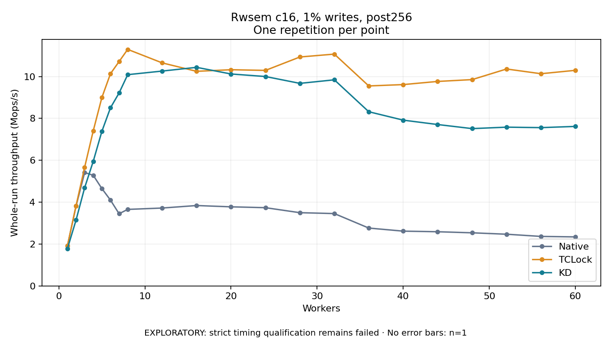

# Rwsem c16, 1% writes, post256

One timed repetition per point; no repeat variability estimate.
EXPLORATORY: strict timing qualification remains failed. Rates include post-lock work. Failed, unrun or score-ineligible cases have no plotted rate.

| Workers | Native Mops/s | TCLock Mops/s | KD Mops/s | KD execution |
| ---: | ---: | ---: | ---: | --- |
| 1 | 1.914 | 1.917 | 1.781 | NO_JIT |
| 2 | 3.811 | 3.830 | 3.144 | NO_JIT |
| 3 | 5.418 | 5.669 | 4.691 | NO_JIT |
| 4 | 5.282 | 7.410 | 5.954 | NO_JIT |
| 5 | 4.651 | 8.997 | 7.382 | NO_JIT |
| 6 | 4.099 | 10.137 | 8.508 | NO_JIT |
| 7 | 3.448 | 10.716 | 9.216 | NO_JIT |
| 8 | 3.656 | 11.298 | 10.091 | NO_JIT |
| 12 | 3.720 | 10.654 | 10.262 | NO_JIT |
| 16 | 3.840 | 10.250 | 10.440 | NO_JIT |
| 20 | 3.778 | 10.327 | 10.123 | NO_JIT |
| 24 | 3.737 | 10.295 | 10.002 | NO_JIT |
| 28 | 3.498 | 10.935 | 9.675 | NO_JIT |
| 32 | 3.456 | 11.073 | 9.845 | NO_JIT |
| 36 | 2.764 | 9.552 | 8.320 | NO_JIT |
| 40 | 2.617 | 9.617 | 7.919 | NO_JIT |
| 44 | 2.588 | 9.768 | 7.709 | NO_JIT |
| 48 | 2.537 | 9.854 | 7.514 | NO_JIT |
| 52 | 2.470 | 10.362 | 7.583 | NO_JIT |
| 56 | 2.365 | 10.136 | 7.561 | NO_JIT |
| 60 | 2.342 | 10.298 | 7.619 | NO_JIT |

[Full receipt table](table.csv)

