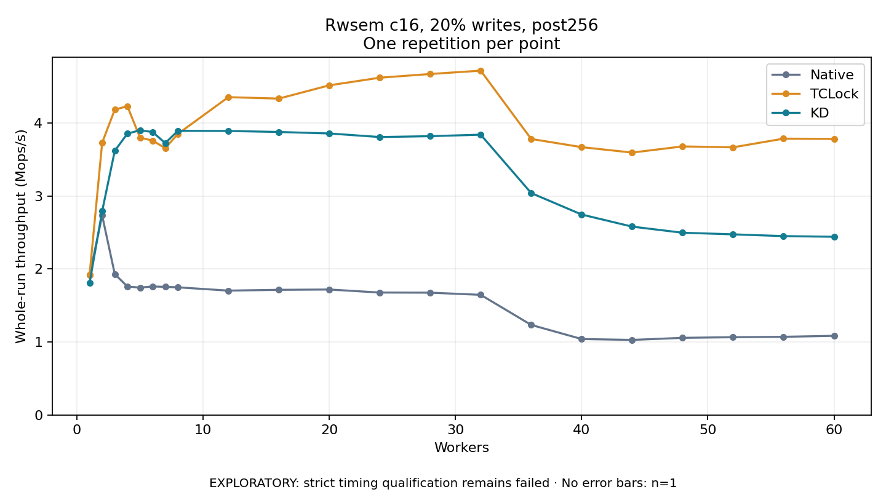

# Rwsem c16, 20% writes, post256

One timed repetition per point; no repeat variability estimate.
EXPLORATORY: strict timing qualification remains failed. Rates include post-lock work. Failed, unrun or score-ineligible cases have no plotted rate.

| Workers | Native Mops/s | TCLock Mops/s | KD Mops/s | KD execution |
| ---: | ---: | ---: | ---: | --- |
| 1 | 1.914 | 1.916 | 1.805 | NO_JIT |
| 2 | 2.732 | 3.729 | 2.792 | NO_JIT |
| 3 | 1.929 | 4.182 | 3.619 | NO_JIT |
| 4 | 1.759 | 4.229 | 3.853 | RETURNED_JIT |
| 5 | 1.744 | 3.799 | 3.900 | RETURNED_JIT |
| 6 | 1.760 | 3.758 | 3.875 | RETURNED_JIT |
| 7 | 1.755 | 3.654 | 3.724 | RETURNED_JIT |
| 8 | 1.748 | 3.849 | 3.892 | RETURNED_JIT |
| 12 | 1.703 | 4.353 | 3.890 | RETURNED_JIT |
| 16 | 1.714 | 4.333 | 3.876 | RETURNED_JIT |
| 20 | 1.718 | 4.515 | 3.855 | RETURNED_JIT |
| 24 | 1.677 | 4.619 | 3.807 | RETURNED_JIT |
| 28 | 1.675 | 4.670 | 3.818 | RETURNED_JIT |
| 32 | 1.645 | 4.715 | 3.839 | RETURNED_JIT |
| 36 | 1.233 | 3.780 | 3.039 | RETURNED_JIT |
| 40 | 1.040 | 3.668 | 2.745 | RETURNED_JIT |
| 44 | 1.028 | 3.594 | 2.580 | RETURNED_JIT |
| 48 | 1.056 | 3.678 | 2.496 | RETURNED_JIT |
| 52 | 1.065 | 3.666 | 2.474 | RETURNED_JIT |
| 56 | 1.071 | 3.784 | 2.450 | RETURNED_JIT |
| 60 | 1.084 | 3.781 | 2.441 | RETURNED_JIT |

[Full receipt table](table.csv)

