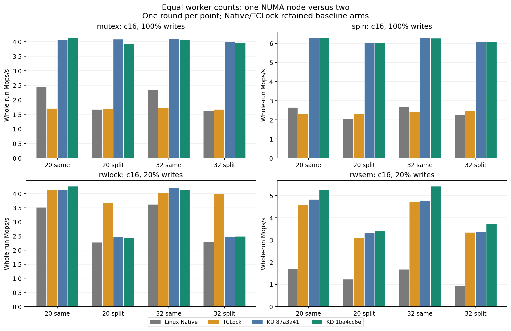

# Four-lock Nano profiling and optimization, November 1–2

The profiles locate substantial rwlock slow-reader gate traffic and rwsem admission/phase coordination. The rwsem fast-entry change recovers most of the single-worker deficit, but the measured candidates do not pass the regression requirement. Reader grouping was withdrawn. Master remains `7231ddf0963ff2cc730590c09cc81e7f96f93095`; no candidate is promoted.

## Versions and coverage

| Role | Exact source commit | Scored points | Status |
|---|---|---:|---|
| Baseline; lock code identical to master | `87a3a41f1ba3746b7716e611541068bd3ab6e975` | 288 Native/TCLock/KD | Preserved |
| Reader grouping + OSQ64 + reader-entry changes | `822036777ae5731f24c56cbf50751d6e075ed1e1` | 96 KD | Grouping withdrawn; 41 negative points |
| OSQ64 + reader-entry changes; baseline rwlock/spin restored | `1ba4cc6e59f5451eaecafcf1c3a36861d026e5d9` | 96 KD | Unaccepted; 35 negative points |
| Reader-entry component only | `252825407cd40d91a32010e82c8c111a768e7fcf` | 3 KD | Diagnostic component comparison; no full-grid acceptance |
| OSQ64 component only | `4df80e5a14d0368b07c5c0a63b49f0b79b80ca4f` | 3 KD | Diagnostic component comparison; no full-grid acceptance |

c01/c16 means 1/16 separately aligned cachelines; w001/w020 means 1%/20% writes. Mutex/spin use 100% writes. Each full grid has twelve workloads: two mutex, two spin, four rwlock and four rwsem. Readers always run locally. The focused grid is 1,8,20,32,36,60 contiguous workers plus split-node 20/32-worker points, not the historical 21-count grid. Every scored point has one two-second round. All 486 scored points are retained. Profiles are separate unscored runs.

The ten mutex/rwlock/rwsem profiles use bulk ioctl/post256; spin uses its existing shell/post64. Workloads and settings match across backends within each family. Absolute rates must not be ranked across these different shells. Whole-run throughput is exploratory evidence, not a strict peak qualification or a confidence interval.

## Why KD loses to TCLock

| Lock | Baseline observations | Evidence and source path |
|---|---|---|
| mutex | All contended points ahead; two one-worker negatives, at most −0.12% | No established TCLock-relative bottleneck at this precision. Combiner wait dominates samples. |
| spin | Ahead at all 16 points | Waiter cycles dominate both implementations; high waiting share alone does not establish an efficiency defect. |
| rwlock | 13/32 lower; worst −38.39%, c16/w20 split32 | Every slow reader physically transfers the native admission gate; TCLock can combine admission. The shared reader count also transfers between CPUs. |
| rwsem | 18/32 lower; worst −20.45%, c01/w20 at 60 | OSQ handoff and exact writer phase/ACK coordination dominate contention. One-worker losses of 5.6–7.0% instead expose fast-entry frame/release overhead. |

[Source-backed analysis](ANALYSIS.md) separates verified implementation facts, sampled bottlenecks and unresolved per-point attribution. [The negative-observation index](REGRESSIONS.md) names every affected workload/count/placement rather than assigning one generic explanation to all losses.

## Equal-worker NUMA comparisons and optimization results

The table below uses twenty workers for every row. Same-node uses CPUs 0–19; split-node uses CPUs 0–9 plus 32–41. Rates are million operations/second. The same-node baseline is the denominator for the NUMA penalty; the split-node baseline is the denominator for the optimization delta.

| Workload | KD same before | KD split before | NUMA change | TCLock split | KD split after `1ba4cc6e` | After/before split |
|---|---:|---:|---:|---:|---:|---:|
| mutex c01 w100 | 4.5740 | 4.1619 | -9.01% | 2.7127 | 4.2534 | +2.20% |
| mutex c16 w100 | 4.0696 | 4.0802 | +0.26% | 1.6691 | 3.9131 | -4.10% |
| spin c01 w100 | 6.4721 | 6.1645 | -4.75% | 3.8956 | 6.1973 | +0.53% |
| spin c16 w100 | 6.2728 | 6.0082 | -4.22% | 2.2952 | 6.0086 | +0.01% |
| rwlock c01 w001 | 8.3576 | 7.0612 | -15.51% | 6.0828 | 6.3324 | -10.32% |
| rwlock c01 w020 | 5.3907 | 3.6378 | -32.52% | 3.5208 | 3.2177 | -11.55% |
| rwlock c16 w001 | 10.4290 | 8.4487 | -18.99% | 7.1366 | 8.1957 | -3.00% |
| rwlock c16 w020 | 4.1316 | 2.4632 | -40.38% | 3.6766 | 2.4377 | -1.03% |
| rwsem c01 w001 | 8.0155 | 6.5364 | -18.45% | 5.5649 | 7.5161 | +14.99% |
| rwsem c01 w020 | 5.3307 | 3.4152 | -35.93% | 4.0272 | 3.6264 | +6.18% |
| rwsem c16 w001 | 10.0394 | 8.4373 | -15.96% | 8.5494 | 9.0229 | +6.94% |
| rwsem c16 w020 | 4.8135 | 3.3145 | -31.14% | 3.0742 | 3.3972 | +2.49% |

For rwlock c16/w20, diagnostic remote modified-line loads rise from 0.00129 per operation on one node to 3.37914 across nodes, versus TCLock 0.42099 across nodes. About 72% of KD sampled cycles are in slow-reader admission at 20 workers. For rwsem c16/w20, OSQ and writer-phase entry together account for about 62% on one node. Split-node remote-DRAM loads are KD 0.12648 versus TCLock 0.04286 per operation; however, KD remote modified-line loads are lower than TCLock in this rwsem case. The report does not claim every remote event favors TCLock.

Worker CPU-time records remain near 100% utilization. The inherited context-switch counter includes startup/collector activity and is not a waiter-park count. Significant sleeping time is not supported as the dominant explanation for these sampled gaps. Per-object page placement and address-level ownership traffic remain unmeasured. The RFO event was unavailable in this VM; supported remote-load events ran without multiplexing.

## What changed and what failed

Documentation preceded each implementation. Bounded OSQ observations check a predecessor immediately and then every 64 polls; grant, local reschedule and applicable signal tests remain on every poll, with successful acquisition first. The rwsem change outlines the failed read-entry path, keeps all eight original quick attempts and checks for queued reader-drain waiters before reading caller context. Ownership, reader locality, cancellation, downgrade and fairness are unchanged.

Reader grouping passed exact-count and live concurrent-reader checks but lost up to 23.48% on rwlock. The same candidate also lost 28.88% on rwsem c01/w1 at eight workers. It also increased locked loads despite reducing one remote-load event, and changed which arrivals reached queue-head qualification. It was withdrawn; the follow-up restores baseline rwlock/spin production bytes.

The follow-up still contains negative scores, including rwsem c01/w1 at 8 workers. It is not accepted. [Component comparisons](COMPONENTS.md) separate the two retained edits. OSQ64 alone improves the selected split-node c16/w20 point by 6.08%, but both component versions retain the eight-worker loss. Positive c16/w20 results do not erase this loss. [All follow-up points](reader-entry/ALL_POINTS.md), [all withdrawn points](grouping/ALL_POINTS.md), CSVs and returned-body counts retain every sign and `NO_JIT` observation.

## Validation and retained limits

The full follow-up passed ten unit groups, all four basic returned-JIT checks, local mutex cancellation/handoff checks, rwsem API/cancellation/downgrade checks, IRQ/BH rwlock checks and the concurrent/mixed rwlock fixture. The rwsem fixture reports 17 API checks, 10 cancellation checks, one downgrade check and three gate-signal cases, with no errors. Both component versions passed five affected unit groups, basic mutex/rwsem and local mutex/rwsem fixtures. See [correctness receipts](correctness).

Retained failures: initial profiler thread-name parsing, optional batch provider allocation, a live rwlock setup using a provider without the required counters, and the first follow-up fixture compile failure at `f0f72fcf59bf113ad9c1c7f3871d941a7e3331c4`. None is counted as a pass or throughput score. The missing fixture field is corrected by `1ba4cc6e59f5451eaecafcf1c3a36861d026e5d9`.

Linux 7.0.0-38-kdlock1, Build ID `b61c7bef25d2068f2a05ca3c31a5714c20c4aa62`, boot `3deecc38-d39f-4966-b1ff-9abecda3f029`; 64 vCPUs, 24 GiB, two 32-CPU/12 GiB nodes, one-to-one host pins. The host uses Xeon Gold 6438N CPUs and the recorded 2 GHz performance/no-turbo policy. The fixed QEMU worker pool and collector on CPU 63 are part of this cohort identity. Configured frequency does not prove exact effective frequency. TCLock upstream is `bbfb9f00a12af51dff6ca291cb9829a82960c2ef`, with the reviewed Linux 7/GCC 15 port.

Mutex total/local delegation limits remain 1024/1024; spin total remains 1024. Runtime policy receipts agree. There is no old 768 count cutoff. Terminal/context boundaries and bounded NUMA scanning still limit batches. No syscall or mmap performance claim is made by this nano-only experiment.

Raw diagnostics, binaries, generated images, logs, original records and failed attempts are archived separately by source version. [Archive receipts](archives) and [provenance](PROVENANCE.md) record hashes and locations. New candidates remain isolated; unrelated master work is preserved.

The [next iteration](NEXT_STEPS.md) targets the remaining attribution and protocol costs. All raw scores, not a favorable subset, determine the conclusions.
