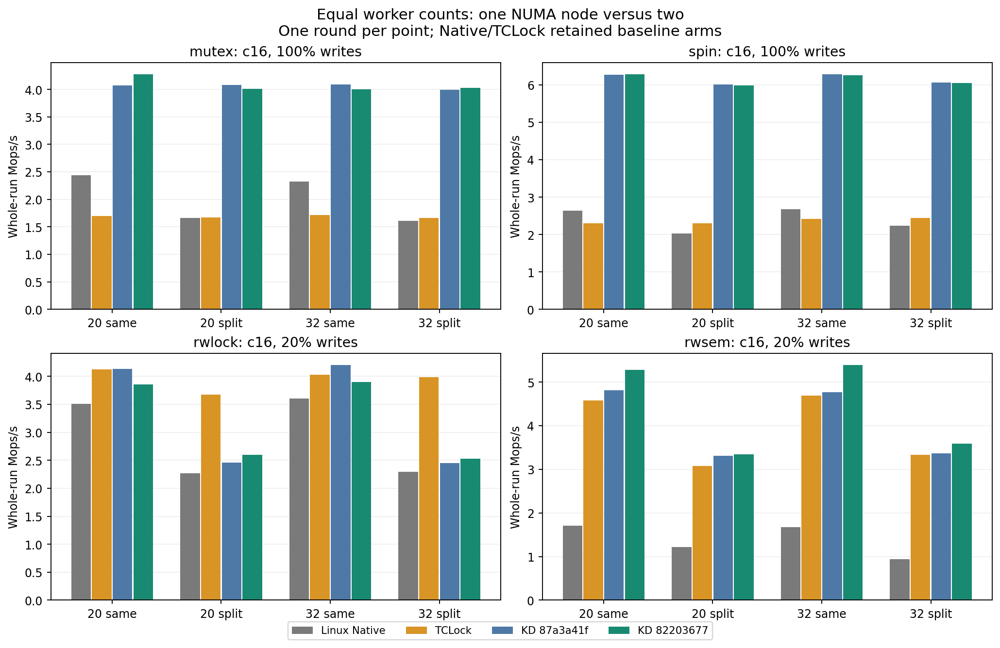
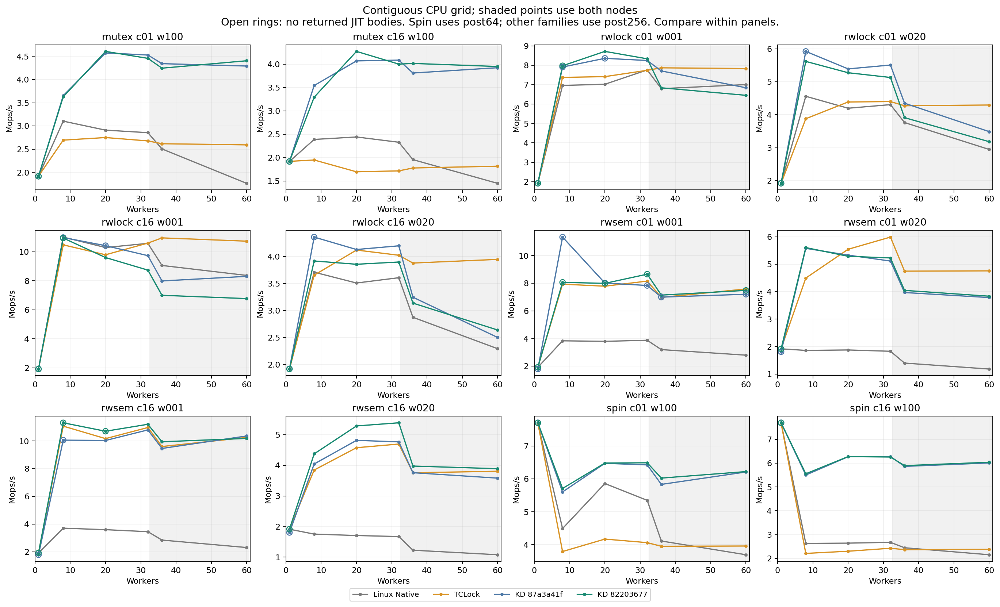

# Withdrawn reader-grouping experiment

Measured source: `822036777ae5731f24c56cbf50751d6e075ed1e1`. Baseline: `87a3a41f1ba3746b7716e611541068bd3ab6e975`, with lock code identical to master `7231ddf0963ff2cc730590c09cc81e7f96f93095`.

Functional checks passed. Performance acceptance failed. Reader grouping was subsequently withdrawn on a separate candidate. Its full score and diagnostic records remain intact.

All 96 KD points completed and drained; baseline has 288 Native/TCLock/KD points. This experiment has 41 negative KD/baseline point comparisons. A single round does not establish statistical uncertainty or causal attribution for each small change.

| Workload | Geometric mean change | Negative points | Worst point | Worst change |
|---|---:|---:|---|---:|
| mutex c01 w100 | +0.51% | 4/8 | contiguous/36 | -2.24% |
| mutex c16 w100 | +0.08% | 4/8 | contiguous/8 | -7.05% |
| rwlock c01 w001 | -4.23% | 5/8 | split32/32 | -11.31% |
| rwlock c01 w020 | -4.77% | 6/8 | contiguous/36 | -10.09% |
| rwlock c16 w001 | -11.57% | 7/8 | split32/32 | -23.48% |
| rwlock c16 w020 | -1.80% | 5/8 | contiguous/8 | -10.15% |
| rwsem c01 w001 | -0.70% | 2/8 | contiguous/8 | -28.88% |
| rwsem c01 w020 | +3.07% | 1/8 | contiguous/20 | -0.80% |
| rwsem c16 w001 | +3.93% | 2/8 | split32/32 | -3.63% |
| rwsem c16 w020 | +7.27% | 0/8 | split20/20 | +0.73% |
| spin c01 w100 | +1.00% | 1/8 | contiguous/1 | -0.02% |
| spin c16 w100 | +0.14% | 4/8 | split20/20 | -0.44% |

Geometric means summarize eight matched ratios per workload; no throughput values are pooled across source versions or placements. The underlying CPU topology is fixed throughout.

[Every point](ALL_POINTS.md), [machine-readable scores](points.csv), and [equal-worker NUMA comparisons](numa.csv) retain all signs and returned-body counts.

