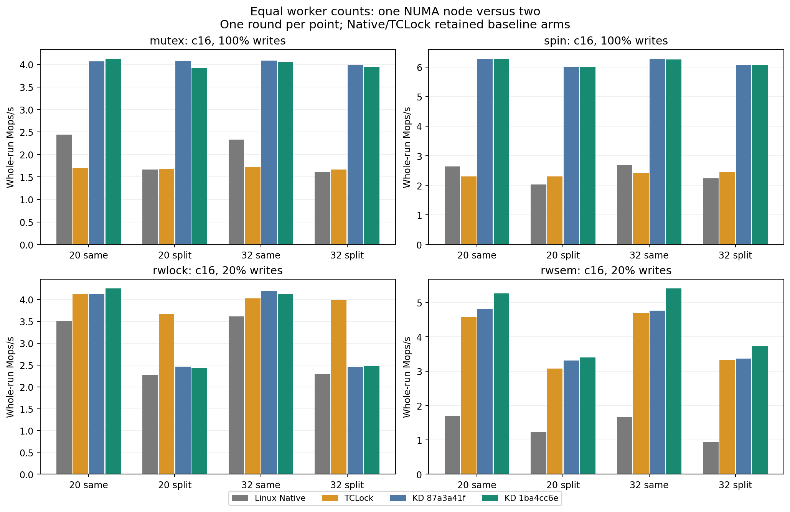
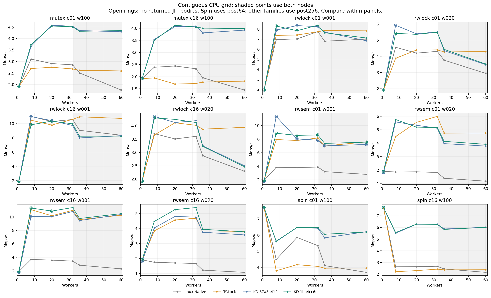

# Reader-entry and bounded OSQ follow-up

Measured source: `1ba4cc6e59f5451eaecafcf1c3a36861d026e5d9`. Production rwlock/spin code is restored to baseline. This candidate retains only the two rwsem/OSQ production edits plus affected fixtures.

All 96 scored KD points completed with correct data and final drain. Functional checks passed. Performance acceptance did not: 35 points are lower than the retained baseline. The rwsem c01/w1 eight-worker loss is −21.90%. Every result is included; single-round differences have no estimated uncertainty.

| Workload | Geometric mean change | Negative points | Worst point | Worst change |
|---|---:|---:|---|---:|
| mutex c01 w100 | +0.59% | 4/8 | contiguous/36 | -0.76% |
| mutex c16 w100 | +0.11% | 4/8 | split20/20 | -4.10% |
| rwlock c01 w001 | -0.58% | 3/8 | split20/20 | -10.32% |
| rwlock c01 w020 | -1.44% | 5/8 | split20/20 | -11.55% |
| rwlock c16 w001 | -1.65% | 5/8 | contiguous/8 | -10.49% |
| rwlock c16 w020 | -0.28% | 6/8 | contiguous/32 | -1.61% |
| rwsem c01 w001 | +2.11% | 2/8 | contiguous/8 | -21.90% |
| rwsem c01 w020 | +2.85% | 1/8 | contiguous/20 | -2.63% |
| rwsem c16 w001 | +6.08% | 0/8 | contiguous/60 | +1.16% |
| rwsem c16 w020 | +7.90% | 0/8 | split20/20 | +2.49% |
| spin c01 w100 | +0.68% | 1/8 | contiguous/60 | -0.26% |
| spin c16 w100 | +0.03% | 4/8 | contiguous/36 | -0.66% |

Geometric means summarize eight matched ratios per workload. No raw throughput is pooled across versions, topologies or shells. Unchanged-code controls also contain negative scores; direct causal attribution to the rwsem/OSQ edits is not established for those points.

[Every point](ALL_POINTS.md), [CSV](points.csv), [equal-worker NUMA table](numa.csv), [source-backed diagnosis](../ANALYSIS.md), [component comparisons](../COMPONENTS.md).

