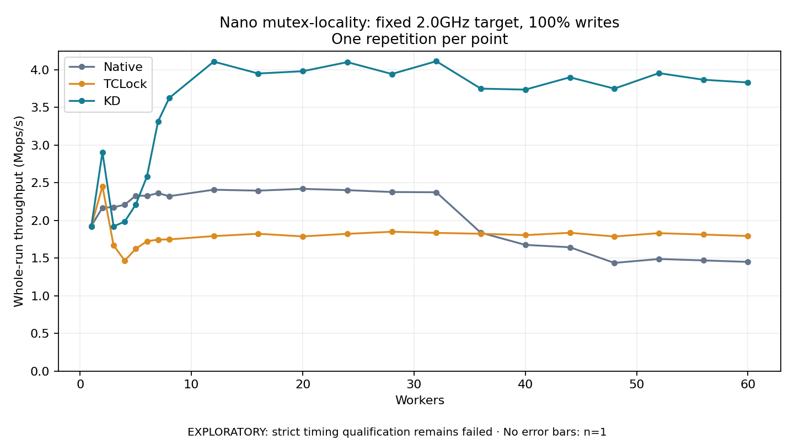

# Nano mutex-locality: fixed 2.0GHz target, 100% writes

One timed repetition per point; no repeat variability estimate.
EXPLORATORY: strict timing qualification remains failed. Rates include post-lock work. Failed/unrun cases have no plotted rate.

| Workers | Native Mops/s | TCLock Mops/s | KD Mops/s | KD execution |
| ---: | ---: | ---: | ---: | --- |
| 1 | 1.927 | 1.926 | 1.919 | NO_JIT |
| 2 | 2.170 | 2.453 | 2.905 | NO_JIT |
| 3 | 2.175 | 1.671 | 1.921 | RETURNED_JIT |
| 4 | 2.208 | 1.466 | 1.984 | RETURNED_JIT |
| 5 | 2.330 | 1.624 | 2.212 | RETURNED_JIT |
| 6 | 2.326 | 1.724 | 2.583 | RETURNED_JIT |
| 7 | 2.362 | 1.745 | 3.314 | RETURNED_JIT |
| 8 | 2.322 | 1.748 | 3.625 | RETURNED_JIT |
| 12 | 2.407 | 1.792 | 4.107 | RETURNED_JIT |
| 16 | 2.395 | 1.823 | 3.950 | RETURNED_JIT |
| 20 | 2.419 | 1.788 | 3.980 | RETURNED_JIT |
| 24 | 2.402 | 1.822 | 4.101 | RETURNED_JIT |
| 28 | 2.377 | 1.850 | 3.944 | RETURNED_JIT |
| 32 | 2.374 | 1.835 | 4.113 | RETURNED_JIT |
| 36 | 1.837 | 1.823 | 3.749 | RETURNED_JIT |
| 40 | 1.675 | 1.805 | 3.736 | RETURNED_JIT |
| 44 | 1.644 | 1.836 | 3.899 | RETURNED_JIT |
| 48 | 1.436 | 1.787 | 3.749 | RETURNED_JIT |
| 52 | 1.488 | 1.831 | 3.955 | RETURNED_JIT |
| 56 | 1.469 | 1.812 | 3.867 | RETURNED_JIT |
| 60 | 1.450 | 1.793 | 3.831 | RETURNED_JIT |

[Full receipt table](table.csv)

The shared payload is 16 independently cacheline-padded resident counters (1024 bytes); each operation uses 256 post-work rounds. The call shell is `bulk_ioctl`; these rates do not include a separate real API syscall per operation. Archive profile: `mutex-locality`.

[Exact offline replay and archive hashes](audit.json). Every warmup and measurement passed the frozen-version oracle and exact count checks. Measurements also passed exact completion classification and source/frame or TCLock worker drain checks. Warmup did not record independent JIT entry/return deltas. One round provides no variability estimate. Full byte-preserved JSON receipts remain under the raw path recorded in `audit.json`.

Source: `e5b7f84c41f33f3b15c4f3be0c87fcb943c54212`. KD provider ELF SHA256: `d41018d883e7415f12e1923888a791e20b30aab05e8028cf494a7eaa38f3754e`. Compiled mutex policy: total cap **1024**, NUMA boundary **768**, deferred handoff **8**, scan budget **64**; diagnostics **off**. Policy was checked against the plan, saved build command, saved modinfo and the actual archived ELF. [Per-count matched ratios](ratios.csv) retain all 21 points. Completed-work Jain and max/min in the CSV describe operation-count distribution, not acquisition order or wait latency.

Frequency control: all 64 host policies read back **2.0GHz minimum = maximum**, **performance** governor and **turbo disabled** before and after this workload. [Frequency and host validation](../validation.json) separately checks effective APERF/MPERF frequency and timing-environment limits. Strict host qualification remains failed.

One-worker progress-window rates (Mops/s):

| Backend | Early 0.1–1.0 s | Late 1.5–1.9 s |
|:---|---:|---:|
| native | 1.937 | 1.937 |
| tclock | 1.936 | 1.938 |
| kdlock | 1.933 | 1.913 |

[Full window accounting](single-worker-windows.csv) uses first and last recorded counter samples whose read midpoints fall in each interval. Rate is completed delta divided by midpoint elapsed time; counters publish in 256-operation batches. These windows describe within-run stationarity, not actual CPU frequency or lock latency.
