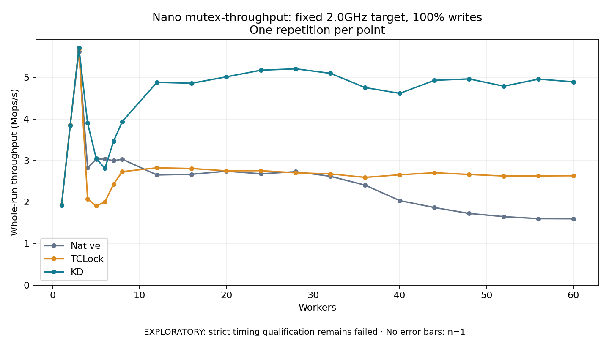

# Nano mutex-throughput: fixed 2.0GHz target, 100% writes

One timed repetition per point; no repeat variability estimate.
EXPLORATORY: strict timing qualification remains failed. Rates include post-lock work. Failed/unrun cases have no plotted rate.

| Workers | Native Mops/s | TCLock Mops/s | KD Mops/s | KD execution |
| ---: | ---: | ---: | ---: | --- |
| 1 | 1.925 | 1.929 | 1.923 | NO_JIT |
| 2 | 3.853 | 3.859 | 3.842 | NO_JIT |
| 3 | 5.621 | 5.699 | 5.713 | NO_JIT |
| 4 | 2.826 | 2.074 | 3.903 | RETURNED_JIT |
| 5 | 3.034 | 1.906 | 3.047 | RETURNED_JIT |
| 6 | 3.039 | 2.002 | 2.813 | RETURNED_JIT |
| 7 | 2.994 | 2.433 | 3.464 | RETURNED_JIT |
| 8 | 3.032 | 2.732 | 3.939 | RETURNED_JIT |
| 12 | 2.652 | 2.824 | 4.883 | RETURNED_JIT |
| 16 | 2.668 | 2.807 | 4.861 | RETURNED_JIT |
| 20 | 2.743 | 2.752 | 5.015 | RETURNED_JIT |
| 24 | 2.680 | 2.755 | 5.176 | RETURNED_JIT |
| 28 | 2.730 | 2.703 | 5.208 | RETURNED_JIT |
| 32 | 2.619 | 2.677 | 5.100 | RETURNED_JIT |
| 36 | 2.407 | 2.594 | 4.757 | RETURNED_JIT |
| 40 | 2.034 | 2.656 | 4.617 | RETURNED_JIT |
| 44 | 1.867 | 2.705 | 4.932 | RETURNED_JIT |
| 48 | 1.725 | 2.663 | 4.965 | RETURNED_JIT |
| 52 | 1.648 | 2.627 | 4.790 | RETURNED_JIT |
| 56 | 1.600 | 2.628 | 4.960 | RETURNED_JIT |
| 60 | 1.597 | 2.632 | 4.895 | RETURNED_JIT |

[Full receipt table](table.csv)

The shared payload is 1 independently cacheline-padded resident counter (64 bytes); each operation uses 256 post-work rounds. The call shell is `bulk_ioctl`; these rates do not include a separate real API syscall per operation. Archive profile: `mutex-throughput`.

[Exact offline replay and archive hashes](audit.json). Every warmup and measurement passed the frozen-version oracle and exact count checks. Measurements also passed exact completion classification and source/frame or TCLock worker drain checks. Warmup did not record independent JIT entry/return deltas. One round provides no variability estimate. Full byte-preserved JSON receipts remain under the raw path recorded in `audit.json`.

Source: `e5b7f84c41f33f3b15c4f3be0c87fcb943c54212`. KD provider ELF SHA256: `713db2f32cd697e08be18844753c5d6f629ab07beadf6ffdd424bddea9a50283`. Compiled mutex policy: total cap **1024**, NUMA boundary **768**, deferred handoff **8**, scan budget **64**; diagnostics **off**. Policy was checked against the plan, saved build command, saved modinfo and the actual archived ELF. [Per-count matched ratios](ratios.csv) retain all 21 points. Completed-work Jain and max/min in the CSV describe operation-count distribution, not acquisition order or wait latency.

Frequency control: all 64 host policies read back **2.0GHz minimum = maximum**, **performance** governor and **turbo disabled** before and after this workload. [Frequency and host validation](../validation.json) separately checks effective APERF/MPERF frequency and timing-environment limits. Strict host qualification remains failed.

One-worker progress-window rates (Mops/s):

| Backend | Early 0.1–1.0 s | Late 1.5–1.9 s |
|:---|---:|---:|
| native | 1.934 | 1.936 |
| tclock | 1.939 | 1.939 |
| kdlock | 1.933 | 1.933 |

[Full window accounting](single-worker-windows.csv) uses first and last recorded counter samples whose read midpoints fall in each interval. Rate is completed delta divided by midpoint elapsed time; counters publish in 256-operation batches. These windows describe within-run stationarity, not actual CPU frequency or lock latency.
