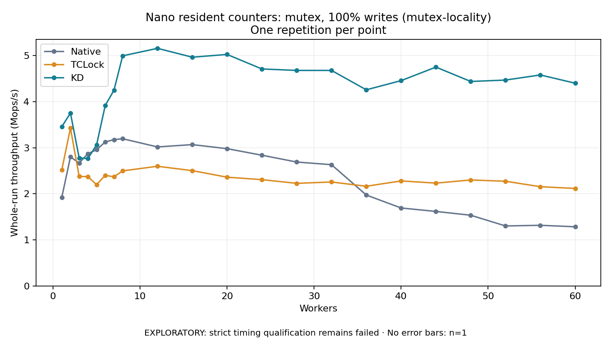

# Nano resident counters: mutex, 100% writes (mutex-locality)

One timed repetition per point; no repeat variability estimate.
EXPLORATORY: strict timing qualification remains failed. Rates include post-lock work. Failed/unrun cases have no plotted rate.

| Workers | Native Mops/s | TCLock Mops/s | KD Mops/s | KD execution |
| ---: | ---: | ---: | ---: | --- |
| 1 | 1.919 | 2.513 | 3.454 | NO_JIT |
| 2 | 2.799 | 3.426 | 3.751 | NO_JIT |
| 3 | 2.667 | 2.376 | 2.778 | RETURNED_JIT |
| 4 | 2.870 | 2.373 | 2.762 | RETURNED_JIT |
| 5 | 2.954 | 2.197 | 3.060 | RETURNED_JIT |
| 6 | 3.125 | 2.401 | 3.918 | RETURNED_JIT |
| 7 | 3.174 | 2.368 | 4.246 | RETURNED_JIT |
| 8 | 3.194 | 2.497 | 4.993 | RETURNED_JIT |
| 12 | 3.016 | 2.597 | 5.156 | RETURNED_JIT |
| 16 | 3.067 | 2.502 | 4.964 | RETURNED_JIT |
| 20 | 2.979 | 2.360 | 5.023 | RETURNED_JIT |
| 24 | 2.837 | 2.307 | 4.709 | RETURNED_JIT |
| 28 | 2.689 | 2.226 | 4.677 | RETURNED_JIT |
| 32 | 2.631 | 2.256 | 4.677 | RETURNED_JIT |
| 36 | 1.972 | 2.163 | 4.256 | RETURNED_JIT |
| 40 | 1.691 | 2.279 | 4.455 | RETURNED_JIT |
| 44 | 1.617 | 2.231 | 4.749 | RETURNED_JIT |
| 48 | 1.534 | 2.299 | 4.437 | RETURNED_JIT |
| 52 | 1.302 | 2.272 | 4.468 | RETURNED_JIT |
| 56 | 1.316 | 2.153 | 4.578 | RETURNED_JIT |
| 60 | 1.284 | 2.116 | 4.400 | RETURNED_JIT |

[Full receipt table](table.csv)

The shared payload is 16 independently cacheline-padded resident counters (1024 bytes); each operation uses 256 post-work rounds. The call shell is `bulk_ioctl`; these rates do not include a separate real API syscall per operation. Archive profile: `mutex-locality`.

[Exact offline replay and archive hashes](audit.json). Every warmup and measurement passed the frozen-version oracle and exact count checks. Measurements also passed exact completion classification and source/frame or TCLock worker drain checks. Warmup did not record independent JIT entry/return deltas. One round provides no variability estimate. Full byte-preserved JSON receipts remain under the raw path recorded in `audit.json`.

Source: `e5b7f84c41f33f3b15c4f3be0c87fcb943c54212`. KD provider ELF SHA256: `cf56d7fb397cc6d55d972ef9b725484e88b313486f81401d0750effd05aa5fec`. Compiled mutex policy: total cap **1024**, NUMA boundary **768**, deferred handoff **8**, scan budget **64**; diagnostics **off**. Policy was checked against the plan, saved build command, saved modinfo and the actual archived ELF. [Per-count matched ratios](ratios.csv) retain all 21 points. Completed-work Jain and max/min in the CSV describe operation-count distribution, not acquisition order or wait latency.
