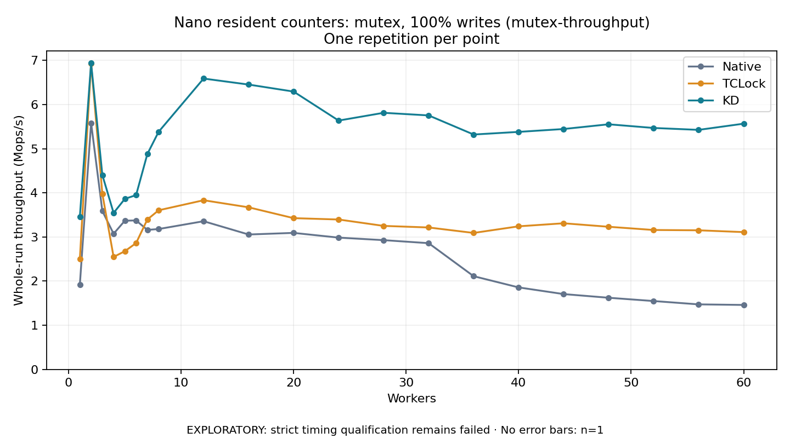

# Nano resident counters: mutex, 100% writes (mutex-throughput)

One timed repetition per point; no repeat variability estimate.
EXPLORATORY: strict timing qualification remains failed. Rates include post-lock work. Failed/unrun cases have no plotted rate.

| Workers | Native Mops/s | TCLock Mops/s | KD Mops/s | KD execution |
| ---: | ---: | ---: | ---: | --- |
| 1 | 1.921 | 2.502 | 3.459 | NO_JIT |
| 2 | 5.583 | 6.935 | 6.941 | NO_JIT |
| 3 | 3.588 | 3.978 | 4.405 | RETURNED_JIT |
| 4 | 3.073 | 2.548 | 3.545 | RETURNED_JIT |
| 5 | 3.369 | 2.678 | 3.864 | RETURNED_JIT |
| 6 | 3.375 | 2.862 | 3.949 | RETURNED_JIT |
| 7 | 3.161 | 3.396 | 4.879 | RETURNED_JIT |
| 8 | 3.180 | 3.605 | 5.382 | RETURNED_JIT |
| 12 | 3.357 | 3.833 | 6.589 | RETURNED_JIT |
| 16 | 3.057 | 3.672 | 6.453 | RETURNED_JIT |
| 20 | 3.093 | 3.427 | 6.294 | RETURNED_JIT |
| 24 | 2.986 | 3.396 | 5.637 | RETURNED_JIT |
| 28 | 2.929 | 3.251 | 5.813 | RETURNED_JIT |
| 32 | 2.860 | 3.216 | 5.754 | RETURNED_JIT |
| 36 | 2.112 | 3.092 | 5.321 | RETURNED_JIT |
| 40 | 1.858 | 3.242 | 5.381 | RETURNED_JIT |
| 44 | 1.707 | 3.311 | 5.446 | RETURNED_JIT |
| 48 | 1.624 | 3.232 | 5.553 | RETURNED_JIT |
| 52 | 1.549 | 3.159 | 5.470 | RETURNED_JIT |
| 56 | 1.474 | 3.152 | 5.427 | RETURNED_JIT |
| 60 | 1.461 | 3.111 | 5.567 | RETURNED_JIT |

[Full receipt table](table.csv)

The shared payload is 1 independently cacheline-padded resident counter (64 bytes); each operation uses 256 post-work rounds. The call shell is `bulk_ioctl`; these rates do not include a separate real API syscall per operation. Archive profile: `mutex-throughput`.

[Exact offline replay and archive hashes](audit.json). Every warmup and measurement passed the frozen-version oracle and exact count checks. Measurements also passed exact completion classification and source/frame or TCLock worker drain checks. Warmup did not record independent JIT entry/return deltas. One round provides no variability estimate. Full byte-preserved JSON receipts remain under the raw path recorded in `audit.json`.

Source: `e5b7f84c41f33f3b15c4f3be0c87fcb943c54212`. KD provider ELF SHA256: `e18c494fd9108b430d137ce4e7b81ae4e2b9499cbebeaac3219e8c0b35e0ca9b`. Compiled mutex policy: total cap **1024**, NUMA boundary **768**, deferred handoff **8**, scan budget **64**; diagnostics **off**. Policy was checked against the plan, saved build command, saved modinfo and the actual archived ELF. [Per-count matched ratios](ratios.csv) retain all 21 points. Completed-work Jain and max/min in the CSV describe operation-count distribution, not acquisition order or wait latency.
