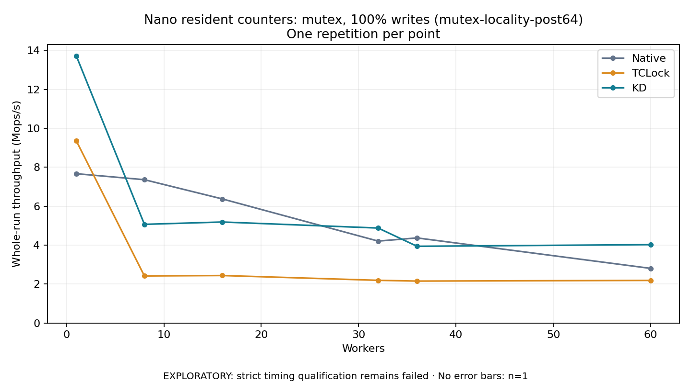

# Nano resident counters: mutex, 100% writes (mutex-locality-post64)

One timed repetition per point; no repeat variability estimate.
EXPLORATORY: strict timing qualification remains failed. Rates include post-lock work. Failed/unrun cases have no plotted rate.

| Workers | Native Mops/s | TCLock Mops/s | KD Mops/s | KD execution |
| ---: | ---: | ---: | ---: | --- |
| 1 | 7.669 | 9.362 | 13.723 | NO_JIT |
| 8 | 7.361 | 2.418 | 5.068 | RETURNED_JIT |
| 16 | 6.373 | 2.440 | 5.188 | RETURNED_JIT |
| 32 | 4.208 | 2.194 | 4.879 | RETURNED_JIT |
| 36 | 4.371 | 2.155 | 3.941 | RETURNED_JIT |
| 60 | 2.806 | 2.189 | 4.025 | RETURNED_JIT |

[Full receipt table](table.csv)

The shared payload is 16 independently cacheline-padded resident counters (1024 bytes); each operation uses 64 post-work rounds. The call shell is `bulk_ioctl`; these rates do not include a separate real API syscall per operation. Archive profile: `mutex-locality`.

[Exact offline replay and archive hashes](audit.json). Every warmup and measurement passed the frozen-version oracle and exact count checks. Measurements also passed exact completion classification and source/frame or TCLock worker drain checks. Warmup did not record independent JIT entry/return deltas. One round provides no variability estimate. Full byte-preserved JSON receipts remain under the raw path recorded in `audit.json`.
