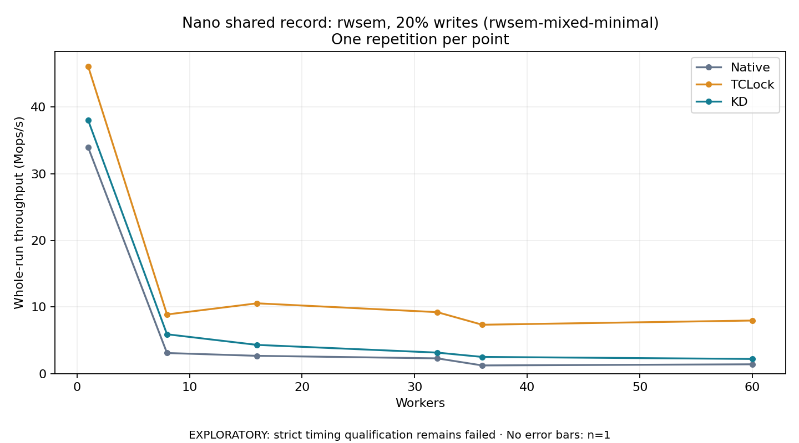

# Nano shared record: rwsem, 20% writes (rwsem-mixed-minimal)

One timed repetition per point; no repeat variability estimate.
EXPLORATORY: strict timing qualification remains failed. Rates include post-lock work. Failed/unrun cases have no plotted rate.

| Workers | Native Mops/s | TCLock Mops/s | KD Mops/s | KD execution |
| ---: | ---: | ---: | ---: | --- |
| 1 | 33.941 | 46.091 | 38.009 | NO_JIT |
| 8 | 3.096 | 8.878 | 5.910 | RETURNED_JIT |
| 16 | 2.675 | 10.553 | 4.314 | RETURNED_JIT |
| 32 | 2.295 | 9.228 | 3.158 | RETURNED_JIT |
| 36 | 1.233 | 7.339 | 2.510 | RETURNED_JIT |
| 60 | 1.403 | 7.969 | 2.205 | RETURNED_JIT |

[Full receipt table](table.csv)

The shared payload is a 64-byte resident record with 2 logical words; each operation uses 4 post-work rounds. The call shell is `bulk_ioctl`; these rates do not include a separate real API syscall per operation. Archive profile: `rwsem-mixed`.

[Exact offline replay and archive hashes](audit.json). Every warmup and measurement passed the frozen-version oracle and exact count checks. Measurements also passed exact completion classification and source/frame or TCLock worker drain checks. Warmup did not record independent JIT entry/return deltas. One round provides no variability estimate.

Full byte-preserved JSON receipts remain under the raw path recorded in `audit.json`.
