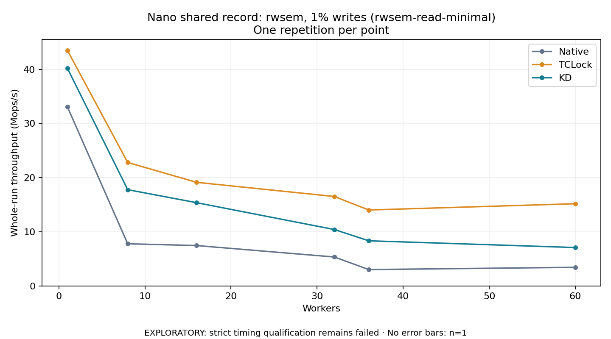

# Nano shared record: rwsem, 1% writes (rwsem-read-minimal)

One timed repetition per point; no repeat variability estimate.
EXPLORATORY: strict timing qualification remains failed. Rates include post-lock work. Failed/unrun cases have no plotted rate.

| Workers | Native Mops/s | TCLock Mops/s | KD Mops/s | KD execution |
| ---: | ---: | ---: | ---: | --- |
| 1 | 33.057 | 43.495 | 40.183 | NO_JIT |
| 8 | 7.784 | 22.799 | 17.775 | NO_JIT |
| 16 | 7.455 | 19.130 | 15.371 | NO_JIT |
| 32 | 5.344 | 16.513 | 10.416 | NO_JIT |
| 36 | 3.020 | 14.020 | 8.333 | NO_JIT |
| 60 | 3.436 | 15.178 | 7.089 | NO_JIT |

[Full receipt table](table.csv)

The shared payload is a 64-byte resident record with 2 logical words; each operation uses 4 post-work rounds. The call shell is `bulk_ioctl`; these rates do not include a separate real API syscall per operation. Archive profile: `rwsem-read`.

[Exact offline replay and archive hashes](audit.json). Every warmup and measurement passed the frozen-version oracle and exact count checks. Measurements also passed exact completion classification and source/frame or TCLock worker drain checks. Warmup did not record independent JIT entry/return deltas. One round provides no variability estimate.

Full byte-preserved JSON receipts remain under the raw path recorded in `audit.json`.
