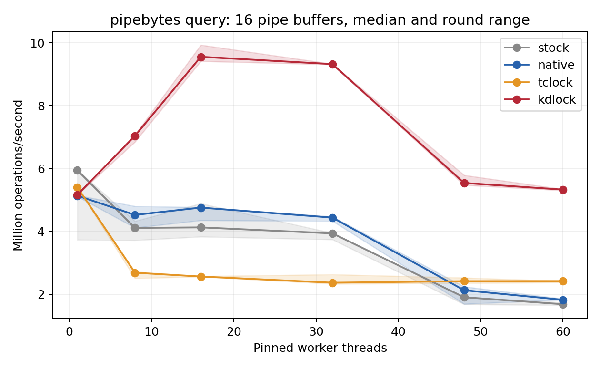
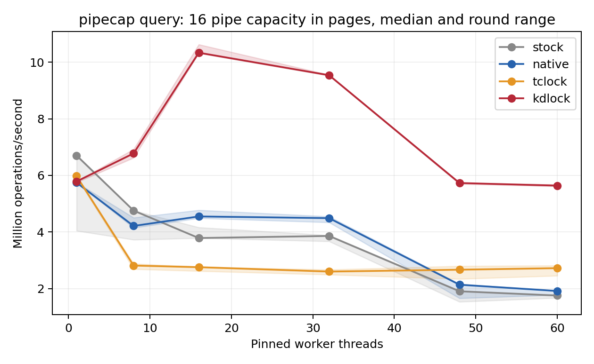
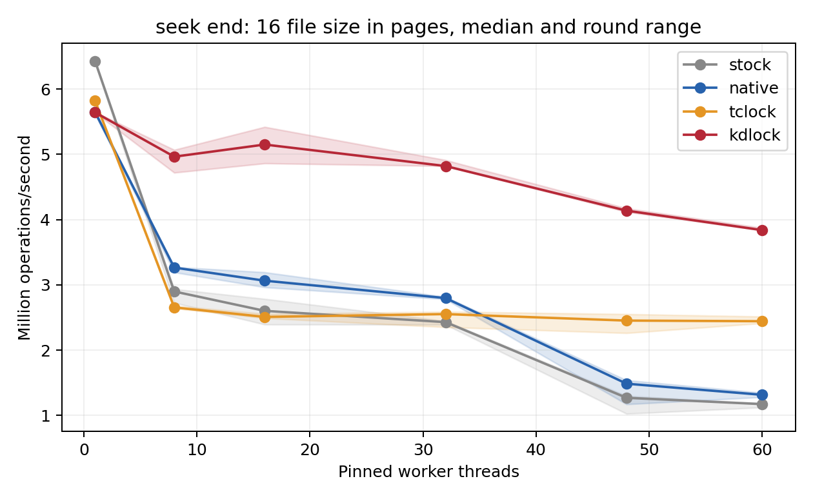
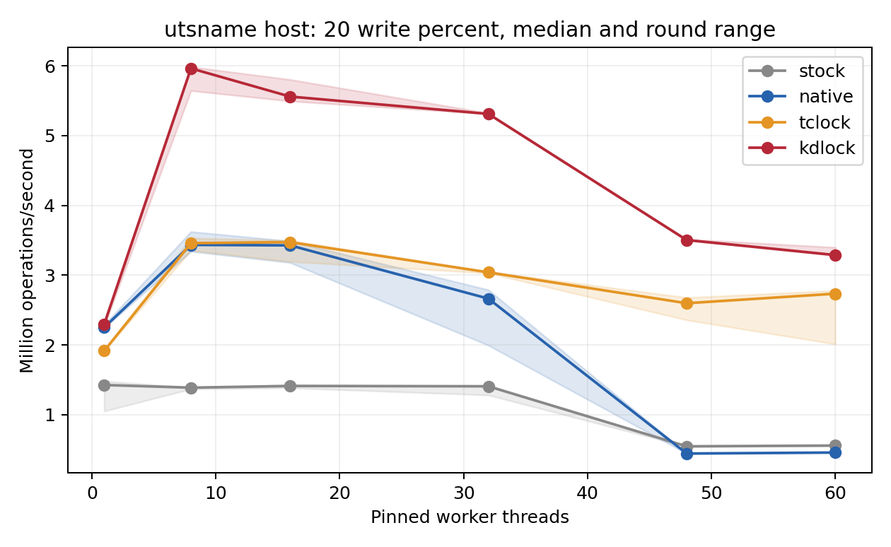

# Real API mutex and reader/writer benchmark results

This evaluation extends the [OFD and file-table spinlock results](../20261011/RESULTS.md)
with three mutex APIs and a bounded reader/writer workload on real kernel metadata.
Each test compares KDLock, TCLock, matched Linux Native and the original Stock
syscall path. The [run record](README.md) retains reproduction commands, validation,
exploratory failures and raw archive identities; the
[runner guide](../../../../../real_api/README.md) defines the supported contract.

Measured on **2026-10-11 UTC**, all **504 final sessions passed and drained**.
At 60 workers, the short pipe cases reach 5.330–5.639 Mops/s with KD, about
2.92–2.95× matched Native and 2.07–2.20× TCLock. Shared-file seeks and UTS supply
additional favorable regimes. Larger pipe traversals, single-thread overhead,
UTS CPU cost and near peak parity remain visible below.

## Test subjects and contended locks

| Subject | Measured userspace operation | Kernel helper and original lock | Protected metadata and work |
| --- | --- | --- | --- |
| Bytes available in a pipe | `ioctl(FIONREAD)` | `pipe_ioctl()`; `pipe_inode_info.mutex` | Read head/tail/ring size and sum the lengths of 16 or 128 occupied pipe buffers |
| Pipe capacity | `fcntl(F_GETPIPE_SZ)` | `pipe_fcntl()`; the same pipe mutex | Read `max_usage` and return its capacity in bytes; a short critical-section control |
| Shared file position | `lseek(SEEK_SET)` or `lseek(SEEK_END)` | `ksys_lseek()` / generic tmpfs seek; `file.f_pos_lock` | Read size limits and, for `SEEK_END`, inode size; update real `f_pos` and `f_version` |
| UTS namespace metadata | 80% `uname()`, 20% `sethostname()` or `setdomainname()` | Native syscalls use global `uts_sem`, a sleeping `rw_semaphore` | Readers copy the 390-byte `new_utsname`; writers replace one 64-byte name and its terminator |

Pipe capacity and available-byte queries exercise the same subsystem and lock
through different APIs. Seek modes and UTS fields are variants, not independent
applications. Combined with the preceding report, the suite now covers file-lock
metadata, descriptor bitmaps, pipe metadata, file positions and UTS metadata.
These are contended API stress microbenchmarks; no end-to-end application claim
is made.

The measured bodies follow the captured Linux 6.1.159 implementations in
`fs/pipe.c`, `fs/read_write.c`, `mm/shmem.c` and `kernel/sys.c`. The raw archive
saves those exact files and relevant headers with SHA256 manifests. The scoped
[mutex module](../../../../../../workload_modules/real_api/mutex.c) and
[UTS module](../../../../../../workload_modules/real_api/uts.c) select the lock
implementation at compile time. No provider, translator or admission rule was
changed for this campaign.

### Pipe queries

The client creates and unlinks a private tmpfs FIFO, sets its capacity, and fills
16 or 128 whole 4 KiB buffers before binding. Each worker opens an independent
file description referring to the same pipe, avoiding a shared `file.f_count`
bottleneck outside the selected mutex. Every available-byte result must equal
the initialized byte count; every capacity result must equal the captured capacity.
No reads, writes, resizes, closes or independent consumers are permitted while
the hook is active. The descriptors remain open until workers join and the
substitution module unloads.

FIONREAD traverses real `pipe_buffer` metadata under the mutex. Increasing the
buffer count changes protected cache work without introducing arithmetic padding
or synthetic data. F_GETPIPE_SZ is retained as the short-body control. Only its
16-page case is repeated in the final matrix; the 128-page pilot reads the same
single field and remains in the exploratory results.

### Shared-file seeks

All workers share one open file description for an anonymous tmpfs file sized
64 KiB. Each changes the offset through a 1,024-position sequence, using either
`SEEK_SET` or negative offsets from `SEEK_END`, and checks every returned position.
The pre/post oracle additionally tests zero, EOF and an invalid negative absolute
offset. File size is fixed while bound. The shared reference-counter traffic
around `fdget()`/`fdput()` stays in the timed operation.

The controlled file uses generic tmpfs seek semantics and `FMODE_ATOMIC_POS`.
The matched body preserves size checks and the real position/version update;
it specializes away unrelated whence modes and filesystem callbacks. This does
not establish a general seek replacement for arbitrary filesystems.

### UTS reads and writes

Each client creates a private `CLONE_NEWUTS` namespace. Workers use a staggered
80:20 read/write sequence. Writers alternate two distinct, fixed 64-byte names;
every reader validates a complete allowed name, its terminator and all unchanged
UTS fields. This catches torn copies under concurrent updates. The hostname and
domain-name variants exercise the same lock family with separate data fields.

All three matched backends use one **private lock for the bound namespace**:
a Linux rwsem for Native and the existing KD/TCLock reader/writer spinlock ports
for the bounded, non-sleeping copy/update body. Stock retains global `uts_sem`.
Permission checks, user copies, entropy mixing and one proc notification stay in
each update syscall. The matched arms move notification after unlock on the
original caller; Stock retains the original placement. No proc-sysctl observers,
namespace changes or independent native users of the bound namespace are allowed.
Global notifications affecting other namespaces remain present in every arm.

Consequently the UTS Native comparison controls lock scope and body, but also
compares a sleeping rwsem with spinning reader/writer admission. It is not a
general rwsem implementation. UTS namespace creation precedes client CPU pinning;
its initial allocation locality was not fixed. Pipe/file setup is pinned to CPU 0.
Hardware cache/coherence counters were not collected, so throughput differences
do not by themselves establish a cache-locality cause.

## Compared implementations

| Arm | Mutex workloads | UTS workload |
| --- | --- | --- |
| Stock | Original captured Linux syscall/helper, no substitution | Global kernel `uts_sem`, original notification placement |
| Native | Ordinary Linux mutex on the actual pipe mutex or `f_pos_lock` | Private Linux `rw_semaphore`, ordinary `down_read/down_write` |
| TCLock | Repository ordinary-mutex port using a separate aligned `komb_mutex` | Private `komb_rwlock`; concurrent readers and delegated writers |
| KDLock | Actual original mutex with mutex clobber-v1 ABI2 entry | Private `kd_rwlock_t`; concurrent readers and ABI3 translated writer entry |

The matched arms compile the same protected C work, with lock calls selected at
build time. Ftrace redirects only calls from the controlled client for the bound
object. Every timed redirected operation must produce exactly one hook count.
The normal syscall, surrounding descriptor/security work, result copying and
userspace validation remain in the measurement. Registration, translation and
drain happen outside timing. Loading a lock provider alone does not replace
ordinary Linux syscall locking.

TCLock is the repository port pinned to upstream
`bbfb9f00a12af51dff6ca291cb9829a82960c2ef`; its emitted context-switch code passes
the maintained assembly audit. NUMA handling is enabled and TCLock's batch limit
is 1024. KD uses the current provider and its recorded settings; translations
must be admitted before warmup, and the daemon stops before timing. Returned-body
counters, rather than publication alone, establish actual KD JIT execution.
TCLock mutex delegation counts are collected; its rwlock delegation share is
unmeasured.

The captured kernel has UBSAN enabled; the timed replacement and provider
modules have UBSAN disabled. **Stock is a separate control**: its comparison
includes substitution, specialization, instrumentation and, for UTS, lock scope
and notification placement. Matched Native is the appropriate baseline for the
compiled critical-section comparison. No results from these two arms are pooled.

## Measurement protocol

| Item | Configuration |
| --- | --- |
| Physical host | `10.176.26.71`; two Xeon Gold 6438N sockets, 32 physical cores each, SMT off, `ondemand` |
| VM | 64 vCPUs, 24 GiB, two NUMA nodes of 32 CPUs and 12 GiB each |
| Placement | vCPU N pinned to physical CPU N; worker prefixes 0–59; collector CPU 63 shares QEMU service threads |
| Kernel | Captured `6.1.159-kdclobber2`; `nokaslr nopvspin`, voluntary preemption; [verified identity](kernel-identity.json) |
| Matrix | Seven API/parameter combinations × six worker counts (1, 8, 16, 32, 48, 60) × four backends × three rounds = 504 sessions |
| Warmup | At least 48,000 operations and one second per worker |
| Measurement | Two-second target; actual finish-minus-start time forms the whole-run denominator |
| Peak | Best valid full-cohort window of at least 300 ms after 300 ms settling; samples every 10 ms, progress checkpoints every 256 operations |

Backend order rotates between rounds. Counts through 32 stay on NUMA node 0;
48 and 60 use both nodes. Each accepted peak requires progress from every worker.
Main tables use median whole-run Mops/s. Best-peak ratios compare each backend's
highest valid warmed peak across its three rounds. CSV/JSON retain min, median,
max and `100 * (max - min) / median` spread for both metrics, plus CPU time and
worker shares. The ranges describe these three rounds, not confidence intervals.
Throughput is not lock-acquisition latency. The governor was not fixed-frequency.

## Performance comparison

Whole-run medians are in **million operations/second**. Ratios above 1 favor KD.

| Workload | Workers | Stock | Native | TCLock | KD | KD/Native | KD/TC | Best-peak KD/Native | Best-peak KD/TC |
| --- | ---: | ---: | ---: | ---: | ---: | ---: | ---: | ---: | ---: |
| FIONREAD, 16 buffers | 16 | 4.127 | 4.757 | 2.563 | 9.556 | 2.01× | 3.73× | 2.07× | 3.85× |
| FIONREAD, 16 buffers | 60 | 1.682 | 1.823 | 2.418 | 5.330 | 2.92× | 2.20× | 2.71× | 2.20× |
| FIONREAD, 128 buffers | 16 | 4.805 | 4.478 | 2.303 | 3.793 | 0.85× | 1.65× | 0.86× | 1.62× |
| FIONREAD, 128 buffers | 60 | 1.990 | 2.106 | 2.171 | 2.746 | 1.30× | 1.26× | 1.23× | 1.25× |
| F_GETPIPE_SZ, 16 pages | 16 | 3.786 | 4.549 | 2.756 | 10.338 | 2.27× | 3.75× | 2.22× | 3.83× |
| F_GETPIPE_SZ, 16 pages | 60 | 1.753 | 1.914 | 2.721 | 5.639 | 2.95× | 2.07× | 2.81× | 2.02× |
| lseek, SEEK_SET | 60 | 1.182 | 1.385 | 2.623 | 3.839 | 2.77× | 1.46× | 2.70× | 1.43× |
| lseek, SEEK_END | 60 | 1.172 | 1.315 | 2.443 | 3.839 | 2.92× | 1.57× | 2.86× | 1.54× |
| UTS hostname, 20% writes | 16 | 1.412 | 3.427 | 3.474 | 5.561 | 1.62× | 1.60× | 1.65× | 1.66× |
| UTS hostname, 20% writes | 60 | 0.557 | 0.457 | 2.735 | 3.288 | 7.20× | 1.20× | 7.21× | 1.12× |
| UTS domain, 20% writes | 16 | 2.306 | 2.237 | 3.755 | 5.992 | 2.68× | 1.60× | 2.65× | 1.57× |
| UTS domain, 20% writes | 60 | 0.589 | 0.553 | 2.136 | 3.290 | 5.95× | 1.54× | 5.88× | 1.003× |

Across the 35 multithreaded points, KD meets both median whole-run and best-peak
parity against **both** Native and TCLock at **32 points**. The three exceptions
are FIONREAD with 128 buffers at 8, 16 and 32 workers. This is a throughput
criterion, not a count of delegation gains: the eight-worker UTS cases have no
measured JIT bodies. Near parity does not establish a robust advantage.

### Pipe mutexes

The 16-buffer traversal exceeds both alternatives on both comparison measures
at every tested contended count, 8–60 workers. At 16 workers, KD achieves
9.556 Mops/s, 2.01× Native and 3.73× TCLock; at 60, it achieves 5.330 Mops/s,
2.92× and 2.20×. The 60-worker round statistics show a consistent gain:

| Backend | Whole min | Whole median | Whole max | Whole spread | Peak min | Peak median | Best peak | Peak spread |
| --- | ---: | ---: | ---: | ---: | ---: | ---: | ---: | ---: |
| stock | 1.653 | 1.682 | 1.736 | 4.94% | 1.742 | 1.769 | 1.803 | 3.43% |
| native | 1.819 | 1.823 | 1.854 | 1.91% | 1.900 | 1.928 | 1.976 | 3.94% |
| tclock | 2.375 | 2.418 | 2.418 | 1.80% | 2.386 | 2.429 | 2.436 | 2.05% |
| kdlock | 5.305 | 5.330 | 5.342 | 0.69% | 5.326 | 5.357 | 5.360 | 0.62% |

The 128-buffer traversal is a retained counterexample: KD is 9.4%, 15.3% and
12.8% below Native's median at 8, 16 and 32 workers. It beats both alternatives
on median and peak at 48 and 60 workers; its 60-worker advantage is smaller
than the short traversal's, at 1.30× Native and 1.26× TCLock. More protected
metadata work does not guarantee a larger KD benefit. See
[all FIONREAD points](pipebytes/README.md), [128-buffer scaling](pipebytes/pipebytes-query-128-64.png),
and the [CSV](pipebytes/summary.csv) / [JSON](pipebytes/summary.json).

The short capacity query also beats both alternatives on both measures at
8–60 workers. It reaches 10.338 Mops/s at 16 workers, 2.27× Native and 3.75×
TCLock. At 60, KD is 2.95× Native and 2.07× TCLock. This is a useful short
mutex control, not another metadata-traversal application. See
[all capacity points](pipecap/README.md), [CSV](pipecap/summary.csv) and
[JSON](pipecap/summary.json).

### File-position mutex

Both seek modes beat Native and TCLock on median and peak at every tested
contended count. At 60 workers, KD reaches 3.839 Mops/s in either mode: 2.77–2.92×
Native and 1.46–1.57× TCLock. The surrounding shared file-reference traffic is
included; these rates do not isolate the mutex alone. See
[all seek points](seek/README.md), [SEEK_SET scaling](seek/seek-set-16-64.png),
[CSV](seek/summary.csv) and [JSON](seek/summary.json).

### Bounded UTS reader/writer workload

At 60 workers, KD reaches 3.288 Mops/s for the hostname mix and 3.290 for the
domain-name mix. Whole-run ratios are 7.20×/5.95× Native and 1.20×/1.54× TCLock,
respectively. These compare a sleeping private Linux rwsem with bounded spinning
read/write ports, and **most KD writes execute without delegation**. The larger
Native ratios should not be attributed to JIT cache locality.

For domain-name updates at 60 workers, KD's best peak is only **0.29% above
TCLock's**: 3.334 versus 3.324 Mops/s. Its 54% median whole-run gain coexists with
near peak parity. For hostname updates at 60, TCLock's whole-run round spread is
28.08%, versus KD's 3.56%; all samples remain in the report. Neither these ranges
nor three repetitions establish confidence intervals.

See [all UTS points](utsname/README.md), [domain-name scaling](utsname/utsname-domain-20-64.png),
[CSV](utsname/summary.csv) and [JSON](utsname/summary.json). The pure-writer pilot
is separate because it used the earlier unequal Native lock scope; its zero-JIT
outcomes and slower cases are retained in the [run record](README.md).

### Single-thread and processor costs

For the five mutex configurations, KD's single-thread median is within 1% of
matched Native, about 2.9–5.3% below TCLock and 10.2–13.7% below Stock. These
controls all have zero returned JIT bodies. Some first Stock samples, and the
first Native domain-name sample, are slower than later rounds despite warmup;
none were discarded. Their exact causes were not profiled.

The following values are median **summed worker CPU microseconds per operation**
at 60 workers. They exclude sleeping time and differ from wall time or latency.

| Workload | Native | TCLock | KD |
| --- | ---: | ---: | ---: |
| FIONREAD, 16 buffers | 31.14 | 24.80 | 11.25 |
| F_GETPIPE_SZ, 16 pages | 29.68 | 22.03 | 10.64 |
| lseek, SEEK_END | 42.36 | 24.54 | 15.61 |
| UTS hostname, 20% writes | 4.62 | 21.92 | 18.23 |
| UTS domain, 20% writes | 3.76 | 28.06 | 18.22 |

The mutex gains above also reduce processor cost. UTS makes a different tradeoff:
KD uses about 4.0× Native's CPU time per hostname operation and 4.9× per domain
operation while delivering higher aggregate throughput; the Native rwsem sleeps.
KD uses less CPU time per operation than TCLock at these points. The results
support a throughput advantage in this bounded workload, not a universal
processor-efficiency advantage. Worker-share extrema remain in the exports;
full-cohort progress is not a lock-latency or fairness guarantee.

## Execution evidence and limits

The 3,495,313,152 timed operations all passed the recorded oracles.
KD returned **811,435,879 JIT bodies in 99 of 126 sessions**. The 27
`NO_JIT` sessions are all 21 single-thread controls and all six eight-worker UTS
rounds. Publication was verified even for those zero-execution controls.

| Workload | JIT-positive KD sessions | Returned JIT bodies | JIT share at 16–60 workers |
| --- | ---: | ---: | ---: |
| FIONREAD | 30/36 | 318,593,475 | 97.84–99.78% |
| F_GETPIPE_SZ | 15/18 | 219,798,258 | 96.78–99.70% |
| lseek | 30/36 | 272,400,295 | 98.65–99.79% |
| UTS mixes | 24/36 | 643,851 | 0.01–3.16% |

Mutex shares use all measured operations; **UTS shares use writes only**.
UTS has 643,851 returned JIT bodies across 64,512,636 measured writes, about 1.00%
over all KD UTS sessions. Its performance gains are therefore not evidence that
most critical sections were delegated. The mutex cases provide much stronger
actual-delegation examples.

TCLock's measured mutex delegation count is 374,015,107, with shares of about
99.74–99.88% at 16–60 workers. Its rwlock delegation count remains unmeasured.
A high delegation share alone does not imply high throughput: both ports' shares
and full operation rates are reported independently.

Correctness includes every syscall result, pre/post oracles, worker affinity,
whole-cohort progress, exact KD source retirement and TCLock queue/context drain.
UTS additionally records zero reader/writer/gate state before unloading. Failure
records retain their original statuses even if later normal cleanup succeeds.
The archive replay recomputes throughput and peaks from raw client samples and
checks source, binary and published JIT-image hashes.

## Relation to FxMark and mmap

The [TCLocks paper, OSDI 2023, §6.1, Table 1 and Figure 3](https://www.usenix.org/system/files/osdi23-gupta.pdf)
motivates organizing results by real workload and contended kernel lock. Its
FxMark MWRM moves files from worker-private directories into a shared parent,
contending on rename synchronization; `mmap1` repeatedly maps and unmaps memory
under `mm_struct.mmap_lock`. The inspected local TCLocks checkout is the pinned
revision above, and its `mmap1` uses 128 MiB mappings. Source identities are
recorded in the run receipt.

Those complete paths need wider integration than the current experiment:
cross-directory rename combines the superblock rename mutex with inode rwsems,
and mmap/munmap includes sleeping synchronization, allocation and nested kernel
work. The current KD read/write port handles ordinary task-context spinning
locks, not a general sleeping rwsem. These workloads were inspected, not run
or presented as KD wins. UTS supplies a real bounded read/write API experiment
within the supported integration instead.

The paper measured Linux 5.14.19 on an eight-socket, 224-core machine with
30-second microbenchmark runs. Its published speedups are not measurements of
this two-NUMA-node VM or the scoped Linux 6.1.159 substitutions used here.
