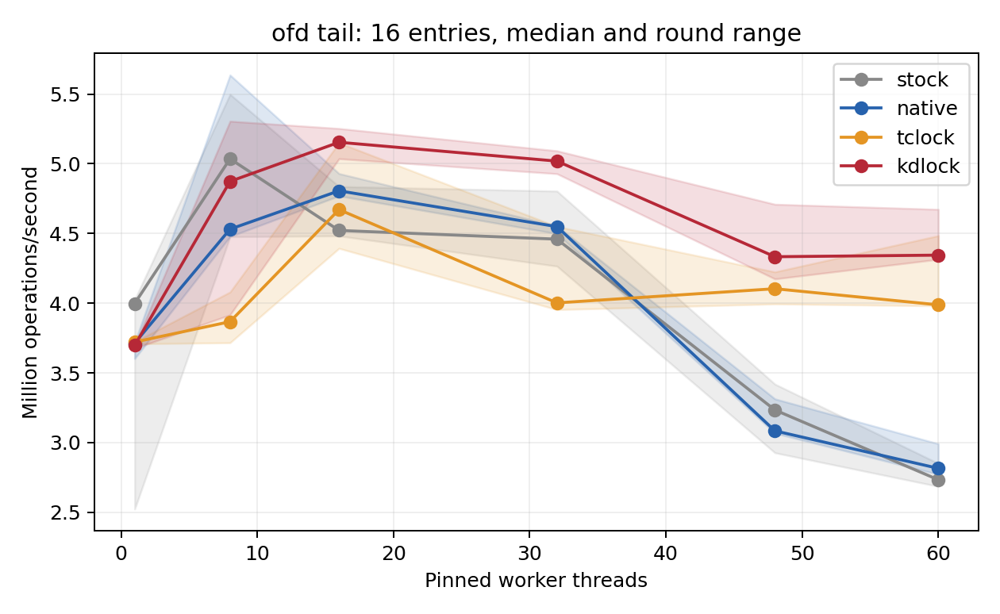
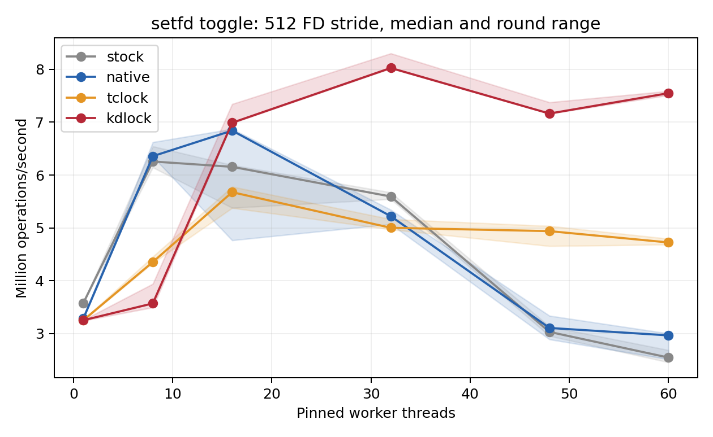

# Real kernel API contention, 2026-10-11

Two actual syscall workloads provide useful KD cases: shared-file OFD conflict
queries and concurrent close-on-exec bitmap updates. **All 288 final sessions
passed correctness and drained**, with three rounds per configuration. KD's
strongest bitmap result is 7.549 million validated operations/s at 60 threads:
**2.55× matched Native, 1.60× TCLock and 2.97× the stock kernel helper**.
The comparison also retains low-contention regressions and the rejected xattr
candidate. No KD runtime or admission rule was changed to obtain these results.

## Recommended cases and measured results

Rates below are median whole-run **million operations/s**, not lock-acquisition
latency. One OFD operation is `fcntl(F_OFD_GETLK)` with conflict-field validation.
One bitmap operation is **`F_SETFD` plus a validating `F_GETFD`**, two real syscalls.
The bitmap stride is the distance between worker FD numbers, starting at 64.

| Workload | Threads | Stock | Native | TCLock | KD | KD/Native | KD/TC | Best-peak KD/Native | Best-peak KD/TC |
| --- | ---: | ---: | ---: | ---: | ---: | ---: | ---: | ---: | ---: |
| OFD, tail conflict in 16 ranges | 32 | 4.460 | 4.549 | 4.002 | 5.019 | 1.10× | 1.25× | 1.12× | 1.11× |
| OFD, tail conflict in 16 ranges | 60 | 2.733 | 2.815 | 3.988 | 4.345 | 1.54× | 1.09× | 1.56× | 1.04× |
| Bitmap, 16-FD stride | 48 | 2.505 | 2.769 | 5.125 | 5.565 | 2.01× | 1.09× | 1.94× | 1.08× |
| Bitmap, 512-FD stride | 32 | 5.593 | 5.221 | 5.001 | 8.026 | 1.54× | 1.60× | 1.55× | 1.56× |
| Bitmap, 512-FD stride | 48 | 3.031 | 3.106 | 4.938 | 7.163 | 2.31× | 1.45× | 2.16× | 1.45× |
| Bitmap, 512-FD stride | 60 | 2.546 | 2.965 | 4.724 | 7.549 | 2.55× | 1.60× | 2.48× | 1.57× |

For the last row, KD's three whole-run samples span **7.512–7.588 Mops/s**,
TCLock spans **4.684–4.793**, and Native spans **2.513–3.001**. Their highest
valid warmed peaks are 7.623, 4.863 and 3.072 Mops/s respectively. These are
observed round ranges, not statistical confidence intervals.

The recommended OFD regime is 16 ranges at 16–60 threads. For bitmap updates,
512-FD spacing at 16–60 threads and packed 16-FD spacing at 32–60 threads both
beat matched Native and TCLock on median whole throughput and best valid peak.
Across both matrices, KD meets that measured parity criterion at **13 of 20
multithreaded points**; some remaining advantages are too small to interpret
as robust wins from three rounds alone.





Lines show medians; shading covers all three rounds. Worker counts above 32
use both NUMA nodes. Full tables, including every slower case and single-thread
control, are in the [OFD report](ofd/README.md) and [bitmap report](setfd/README.md).
Their CSV/JSON exports include whole/peak min, median, max and spread, worker
shares, CPU time per operation and JIT counts. Vector figures are also supplied:
[OFD](ofd/ofd-tail-16-64.svg), [bitmap](setfd/setfd-toggle-512-64.svg).

## What the workloads execute

The [runner and contract](../../../../../real_api/README.md) describe the scoped
integration. Userspace invokes the real syscalls separately; no ioctl batches
or artificial computation replace the kernel critical section.

- **OFD queries:** one anonymous tmpfs file contains 16 or 128 nonadjacent,
  one-byte OFD write locks. Threads share an independent querying file
  description and repeatedly check the last conflicting range. The protected
  state is the real `file_lock_context.flc_posix` list under `flc_lock`.
  The body traverses owners/ranges/types and copies the actual conflict fields.
  The bound file rejects non-OFD locks and lock-manager callbacks; its locks
  remain immutable until the module is unloaded.
- **Descriptor flags:** all threads share their real `files_struct`, but each
  owns a preallocated FD with an independent open file description. They toggle
  `FD_CLOEXEC` and verify the returned flag. The critical section is the real
  `set_close_on_exec()` bitmap update under `files_struct.file_lock`. Stride 16
  packs flags into a few cache lines; stride 512 places workers' bits in distinct
  64-byte lines. Independent file descriptions avoid a shared `file.f_count`
  bottleneck in `fdget_raw()`/`fdput()` outside this lock.

The Native/TCLock/KD arms use one matching C body and original lock storage,
with only the lock shell selected at compile time. Ftrace redirects the helper
only for the controlled file or file table. The additional **stock** arm uses
the captured kernel's original helper with no substitution module. All arms
include syscall entry, security checks, descriptor references, result copying
and userspace checking. The OFD specialization removes callback handling only
after verifying that the private locks have no callbacks.

These are API stress microbenchmarks, not whole FxMark or will-it-scale runs,
and not a general replacement of every Linux lock. Other native users may not
mutate the bound lock's data while it uses the experimental protocol. Timed
modules have UBSAN disabled; the captured kernel has UBSAN enabled. Consequently,
the stock comparison includes function-substitution/compiler/instrumentation
differences, while the matched Native arm isolates the locking change within
the selected body. Hardware cache/coherence counters were not collected, so
the measurements do not attribute a quantified speedup to cache misses alone.

## Limits and rejected candidates

Single-thread KD is about 0.4–2.0% below matched Native and 1.7–9.2% below the
stock helper across these cases. All 12 single-thread KD sessions are `NO_JIT`.
At eight threads, the 128-range OFD case is 37% below Native and 31% below TCLock
on median whole throughput; its KD round spread is 59%. The separated bitmap
is 44% below Native and 18% below TCLock at eight threads. Packed bitmap updates
at 16 threads slightly favor TCLock. The larger OFD list also slightly favors
TCLock at 32 and 60 threads. These points remain in every export.

The first stock, single-thread sample in each final matrix remained slower than
later rounds despite the minimum warmup; it was retained. The host governor is
`ondemand`, and neither fixed frequency nor bare-metal isolation is claimed.
Backend order rotates across rounds. Medians, peaks and complete ranges are
shown together rather than deleting slow samples.

| Exploratory run | Outcome retained separately |
| --- | --- |
| [screen-v1](exploratory/real-api-screen-v1/README.md) | Setup failed before module loading: this kernel's tmpfs has no `user.*` xattr handler. One failure, seven unrun sessions. The workload was changed to root-only `trusted.*`. |
| [screen-v2](exploratory/real-api-screen-v2/README.md) | Eight single-thread xattr/OFD controls passed; no KD JIT execution. |
| [contended-v1](exploratory/real-api-contended-v1/README.md) | 32 short-warmup sessions passed. OFD produced JIT bodies; xattr hit an unlearned `strcmp()` helper and completed through the native remainder with zero returned JIT bodies. Those xattr rates are fallback results. |
| [learning-v1](exploratory/real-api-learning-v1/README.md) | Runner incorrectly required zero writers while the paused daemon still held its writer lease. Session remains failed/undrained in its original record; subsequent normal retirement and unload are documented in the [manual cleanup note](exploratory/manual-drain-note.json). |
| [learning-v2](exploratory/real-api-learning-v2/README.md) | After helper learning, xattr was refused by pointer/context analysis with `CONTEXT_ADDRESS_WIDENED` / `CONTEXT_NATIVE_ONLY`. Automatic cleanup drained successfully. [Exact diagnostic excerpt](exploratory/xattr-refusal.txt). Admission safeguards were retained. |
| [setfd-screen-v1](exploratory/real-api-setfd-screen-v1/README.md) | 24 sessions passed with duplicated descriptors sharing one file description. KD lost the 48-thread cases to TCLock. These have a different reference-counter bottleneck and shorter warmup than the final bitmap test; they are not pooled with it. |

## Environment and validation

Physical host `10.176.26.71`: two Xeon Gold 6438N sockets, 32 physical cores each,
SMT off, `ondemand`. The recovery VM has 64 vCPUs and 24 GiB split across two
NUMA nodes. Guest vCPU N is pinned to physical CPU N; node 0 is CPUs 0–31,
node 1 is 32–63. Worker cohorts are prefixes of CPUs 0–59; collector CPU 63
also hosts QEMU service threads. Setup first-touches metadata on CPU 0.
See the [physical placement capture](host-environment.json).

The [kernel identity check](kernel-identity.json) verified the captured source,
config, build files and live Build ID `5ca28058e156f34a2c7fe91e8e0fbf92f4e51960`
for `6.1.159-kdclobber2`. Boot policy is `nokaslr nopvspin` with voluntary
preemption. The actual monitor snapshot `real-api-20261011-v1` was created and
confirmed before live work; it remained available after completion.
KD and TCLock use NUMA-aware spin backends with configured batch size 1024.
TCLock is the repository's port pinned to upstream
`bbfb9f00a12af51dff6ca291cb9829a82960c2ef`.

Each final matrix has two data layouts × six worker counts × four backends ×
three rounds = 144 sessions. Warmup requires at least 48,000 operations and one
second per worker; measurement lasts two seconds. Actual finishing timestamps
form the whole-run denominator. Peak selection uses a full-cohort window of at
least 300 ms after 300 ms settling, sampled every 10 ms in 256-operation batches.
Checkpoint quantization and sampling brackets remain measurement limitations.

The final runs completed **2,242,388,480 timed operations**. Every substituted
arm recorded exactly one helper redirection per operation. All syscalls passed
the per-operation and before/after oracles, all workers progressed, and each
KD session retired with zero modules, frames and writers before normal unload.
TCLock passed its queue/context quiescence check; kernel-log checks found no
session faults. The guest was independently checked idle after all runs.

There are **59 JIT-positive KD sessions out of 72**, with 529,107,216 returned
JIT bodies. The 13 `NO_JIT` sessions are the 12 single-thread controls and one
8-thread/16-range OFD round. At the recommended 16–60-thread points, the JIT
share is about 95.5–99.9%. TCLock spin delegation counts remain unmeasured;
the emitted stack-switch/continuation code passed its assembly audit.

[Two basic C programs](validation/basic.log), [four report checks](validation/report-final.log)
and [eight peak-window checks](validation/peak.log) passed in the guest. The
report checks reject failed/undrained scores and retain missing/NO_JIT cases.
All archived source and binary hashes were verified, and all 288 raw final
measurements and peak scores were independently recomputed. The
[verification receipt](evidence.json) records counts, commands, environments
and per-run manifest/binary digests. Plotting used a separate guest analysis
environment after timing; [dependency versions](plot-dependencies.txt) are saved.

## Reproduction and evidence

Follow the [VM workflow](../../../../../../docs/AGENTS.md), synchronize source
while idle, verify the kernel and physical pins, and confirm a recoverable
snapshot. Then use the pinned benchmark Python environment:

```sh
export PATH=/root/kdlock-evidence/clobber-20260918/venv/bin:$PATH
export LC_ALL=C KDLOCK_RECOVERY_CONFIRMED=1
export KDLOCK_SNAPSHOT_TAG=YOUR_CONFIRMED_SNAPSHOT
python3 bench/real_api/run.py --kinds ofd --queries tail \
  --entries 16 128 --threads 1 8 16 32 48 60 --repeats 3 \
  --backends stock native tclock kdlock --warmup 48000 --warmup-ms 1000 \
  --duration-ms 2000 \
  --output /root/kdlock-evidence/10.176.26.71/bench/real-api-ofd-new
python3 bench/real_api/run.py --kinds setfd --queries toggle \
  --entries 16 512 --threads 1 8 16 32 48 60 --repeats 3 \
  --backends stock native tclock kdlock --warmup 48000 --warmup-ms 1000 \
  --duration-ms 2000 \
  --output /root/kdlock-evidence/10.176.26.71/bench/real-api-setfd-new
```

Exact executed arguments are in `evidence.json`. The two final matrices retain
their own frozen source versions: the bitmap client gained independent file
descriptions after the OFD run. Each point compares all backends at one version;
no samples were pooled across source versions or warmup settings.
The tested inputs are working-tree snapshots based on Git `3863910`, including
pre-existing edits. Their archived bytes and hashes define the experiment;
a clean checkout of that base commit alone does not reproduce those inputs.

Guest originals remain under `/root/kdlock-evidence/10.176.26.71/bench/real-api-*`
and `tests/real-api-20261011`. A complete 46,009,122-byte archive and host receipts
are preserved on both the physical benchmark host and the source host at
`bench/results/10.176.26.71/raw/bench/real-api-20261011/`. It retains **352 accepted,
three failed and seven unrun sessions**, including source copies, ELFs, JIT
images/disassembly, commands, raw samples, kernel logs and drain records.
Raw files are ignored in Git; this directory contains the compact reports.
The archive SHA256 is
`0bd1310e4c6bea5d2499d6ee4d39de970d3c566cd9ddaa855b0d71e3d8129a24`;
[all receipt hashes](archive-sha256.json) are included.
