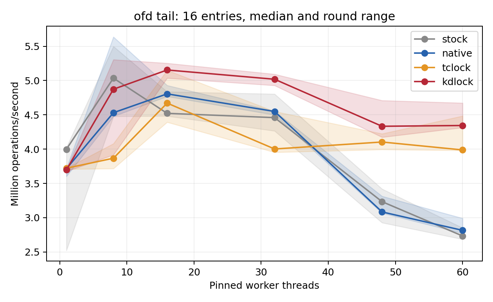
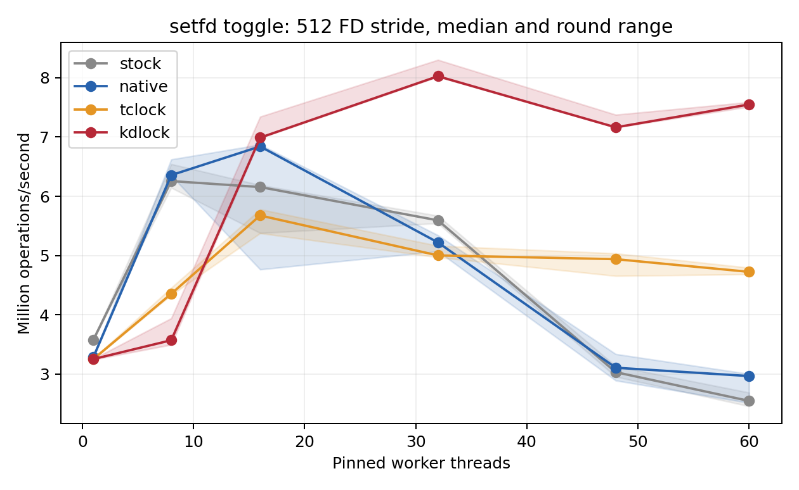

# Real kernel API benchmark results

Measured on 2026-10-11, this evaluation compares KD, TCLock and Linux Native
inside two kernel critical sections reached through real syscalls. All **288
final sessions passed correctness and drained**. At 60 threads, the strongest
descriptor-bitmap case achieves **7.549 million validated operations/s with KD**,
versus 2.965 with matched Native and 4.724 with TCLock: **2.55× and 1.60×**.
The favorable regimes, slower cases and rejected candidate are reported below.

The [run record](README.md) contains reproduction commands, environment captures,
validation logs, exploratory failures and archive identities. The
[runner guide](../../../../../real_api/README.md) defines the integration contract.
This document interprets those existing measurements; it adds no new timed runs.

## Test subjects and their locks

These workloads repeatedly access real kernel metadata through userspace APIs.
All three target locks are ordinary task-context **spinlocks**. In particular,
the internal spinlock protecting OFD metadata is distinct from the advisory
byte-range locks being queried.

| Test subject | Userspace operation | Kernel helper and native lock | Protected state and work | Evaluation status |
| --- | --- | --- | --- | --- |
| OFD conflict lookup | `fcntl(F_OFD_GETLK)` | `posix_test_lock()`; `file_lock_context.flc_lock` (`spinlock_t`) | Traverse `flc_posix`, compare owner/range/type, and copy the conflicting lock's fields | Final comparison: 16 and 128 ranges |
| Close-on-exec flag update | `fcntl(F_SETFD)`, checked with `F_GETFD` | `set_close_on_exec()`; `files_struct.file_lock` (`spinlock_t`) | Read the shared fdtable and set or clear a bit in `close_on_exec` | Final comparison: 16-FD and 512-FD spacing |
| Extended-attribute lookup | `fgetxattr()` | `simple_xattr_get()`; `simple_xattrs.lock` (`spinlock_t`) | Traverse attribute names and copy the matching value under the lock | Explored: native fallback, then JIT admission refusal |

The measured bodies are in the [scoped workload module](../../../../../../workload_modules/real_api/module.c).
Upstream implementations provide context for the
[OFD lookup](https://github.com/torvalds/linux/blob/v6.1/fs/locks.c),
[descriptor bitmap](https://github.com/torvalds/linux/blob/v6.1/fs/file.c), and
[xattr lookup](https://github.com/torvalds/linux/blob/v6.1/fs/xattr.c).
The archive preserves the exact source and headers from the tested 6.1.159 guest;
the upstream links are reference code, not its build identity.

### OFD conflict lookup

An anonymous tmpfs file contains 16 or 128 nonadjacent, one-byte OFD write-lock
ranges. Every worker queries the last conflicting range through a shared querying
file description that is independent of the lock owner's description. This
concentrates all workers on one inode's `flc_lock` and exercises the real list
search inside the critical section. The longer list increases the protected
metadata traversal. Each operation checks the returned conflict fields.

The owner remains open and the range list stays immutable until workers have
joined and the substitution module has unloaded. Timed operations query existing
advisory locks; they do not acquire and release those byte-range locks. Binding
rejects non-OFD locks and lock-manager callbacks before using the specialized
owner/overlap/conflict checks.

### Close-on-exec flag update

Threads share a `files_struct`, each with a distinct preallocated descriptor.
Worker `i` uses FD `64 + i * stride`, alternates its `FD_CLOEXEC` flag, and checks
the result with `F_GETFD`. One operation therefore means **two syscalls and one
target-lock acquisition**. No descriptors are opened, closed or duplicated while
the hook is bound. Each descriptor has an independent open file description,
avoiding contention on a single `file.f_count` outside the target lock.

All workers take the same `file_lock`, even when updating different flags. At a
stride of 16, their bits occupy a few bitmap cache lines. A stride of 512 puts
successive bits 64 bytes apart, in distinct lines. This changes the real writable
metadata footprint without adding artificial work to the kernel critical section.
Setup first-touches the metadata on CPU 0. Hardware cache/coherence counters were
not collected, so the throughput differences alone do not establish their cause.

### Relation to the TCLocks paper

The [TCLocks paper, OSDI 2023, §6.1, Table 1 and Figure 3](https://www.usenix.org/system/files/osdi23-gupta.pdf)
organizes its kernel microbenchmarks by workload, contended lock and throughput
scaling. Its Table 1 identifies `files_struct.file_lock` for will-it-scale
`lock1`; our descriptor-flag workload exercises that same lock through a different
operation. The paper also evaluates FxMark and `mmap1`, spanning spinlocks,
blocking locks and read-write semaphores. Its setup uses Linux 5.14.19 on an
eight-socket, 224-core machine with 30-second microbenchmark runs.

We follow that workload-to-lock presentation here. These measurements use the
scoped Linux 6.1.159 integration described below, on two NUMA nodes with up to
60 workers and two-second timed phases. They are API stress microbenchmarks;
FxMark, `lock1` and application benchmarks were not executed in this comparison.
The paper's published speedups are not measurements of this setup.

## Compared lock implementations

| Label | Implementation at the selected lock | Meaning of the comparison |
| --- | --- | --- |
| Stock | Original helper in the captured kernel; no substitution module | Measures the existing syscall path on this guest |
| Native | `__raw_spin_lock()` / `__raw_spin_unlock()` on the original lock's `rlock`; native qspinlock under `nopvspin` | Matched baseline for the substituted critical-section body; bypasses the custom clobber wrapper |
| TCLock | Repository spin port, `komb_spin_lock()` / `komb_spin_unlock()`, with preemption disabled across the pair | Runs waiting callers' critical sections using the port's stack-based delegation |
| KD | `KD_SPIN_DIRECT_LOCK()` / `KD_SPIN_DIRECT_UNLOCK()`, spin clobber-v1 ABI | Runs admitted translated bodies through KD's spin delegation engine |

Native, TCLock and KD compile the same C critical-section body with the lock calls
selected at build time and use the original object's lock storage. Ftrace redirects
only the helper calls for the controlled private file or file table. The measured
operation includes normal syscall entry, surrounding VFS/security and descriptor
handling, result return and userspace validation. Loading a provider alone does
not change global kernel locking.

KD and TCLock enable NUMA-aware spin handling with a configured batch size of
1024. The [TCLock port and its documented adaptations](../../../../../../tclock_backend/README.md)
use upstream commit `bbfb9f00a12af51dff6ca291cb9829a82960c2ef`. KD prepares an
admitted translation before timing; its daemon stops before the common warmup.
No KD runtime or admission rule was changed for these results.

The scoped contract excludes independent native consumers of the bound lock
while the experimental protocol is active. It does not establish that these
ports can replace every use of the lock in an arbitrary application. Also, the
captured kernel has UBSAN enabled, while timed replacement/provider modules have
UBSAN disabled. **Stock versus KD includes substitution, specialization, compiler
and instrumentation differences.** Native versus KD compares locking within the
matching compiled body. Stock and Native are consequently reported separately.

## Measurement protocol

| Item | Recorded configuration |
| --- | --- |
| Physical host | `10.176.26.71`; two Intel Xeon Gold 6438N sockets, 32 cores each; SMT off; `ondemand` governor |
| Guest | 64 vCPUs, 24 GiB RAM, two NUMA nodes with 32 CPUs and 12 GiB each |
| CPU placement | Guest vCPU N pinned to physical CPU N; worker prefixes of CPUs 0–59; collector on CPU 63 with QEMU service threads |
| Kernel | Captured `6.1.159-kdclobber2`; `nokaslr nopvspin`, voluntary preemption; exact [Build ID and inputs](kernel-identity.json) recorded |
| Matrix | Two APIs × two layouts × six thread counts (1, 8, 16, 32, 48, 60) × four backends × three rounds = 288 sessions |
| Warmup and timing | At least 48,000 operations **and** one second per worker, followed by a two-second timed phase; backend order rotates across rounds |
| Whole-run rate | Completed validated operations divided by actual finish-minus-start time; tables use the median of three rounds |
| Peak rate | Highest valid full-cohort window of at least 300 ms after 300 ms settling; 10 ms sampling and 256-operation worker checkpoints |

Counts through 32 fit on NUMA node 0; 48 and 60 workers use both nodes. Every
worker must progress in an accepted peak window. Best-peak ratios divide each
backend's **highest valid warmed peak across its three rounds**. The CSV/JSON
exports retain min, median, max and spread for both whole-run rates and per-round
peaks; spread is `100 * (max - min) / median`. Three-round ranges are descriptive,
not confidence intervals, and throughput is not lock-acquisition latency.

The first stock single-thread sample in each matrix stayed slower than later
rounds despite warmup and remains in the data. Frequency was not fixed. The two
matrices retain separate frozen source versions because the bitmap client gained
independent file descriptions after the OFD run. Each comparison point uses one
source version across all backends; samples from different versions are not pooled.

## Performance comparison

Selected rates below are whole-run medians in **million operations/s (Mops/s)**.
Ratios above 1 favor KD. OFD and bitmap operations contain different syscall work,
so their absolute rates should be compared within a workload.

| Workload | Threads | Stock | Native | TCLock | KD | KD/Native | KD/TC | Best-peak KD/Native | Best-peak KD/TC |
| --- | ---: | ---: | ---: | ---: | ---: | ---: | ---: | ---: | ---: |
| OFD, 16 ranges | 32 | 4.460 | 4.549 | 4.002 | 5.019 | 1.10× | 1.25× | 1.12× | 1.11× |
| OFD, 16 ranges | 60 | 2.733 | 2.815 | 3.988 | 4.345 | 1.54× | 1.09× | 1.56× | 1.04× |
| OFD, 128 ranges | 8 | 2.636 | 2.905 | 2.628 | 1.818 | 0.63× | 0.69× | 0.97× | 1.06× |
| Bitmap, 16-FD stride | 48 | 2.505 | 2.769 | 5.125 | 5.565 | 2.01× | 1.09× | 1.94× | 1.08× |
| Bitmap, 512-FD stride | 8 | 6.256 | 6.356 | 4.353 | 3.570 | 0.56× | 0.82× | 0.57× | 0.84× |
| Bitmap, 512-FD stride | 32 | 5.593 | 5.221 | 5.001 | 8.026 | 1.54× | 1.60× | 1.55× | 1.56× |
| Bitmap, 512-FD stride | 48 | 3.031 | 3.106 | 4.938 | 7.163 | 2.31× | 1.45× | 2.16× | 1.45× |
| Bitmap, 512-FD stride | 60 | 2.546 | 2.965 | 4.724 | 7.549 | 2.55× | 1.60× | 2.48× | 1.57× |

### OFD conflict queries

For the 16-range search, KD exceeds both matched Native and TCLock on median
whole-run throughput and best warmed peak at 16, 32, 48 and 60 workers. At 60,
the median advantage is 54% over Native and 9% over TCLock; the peak advantage
over TCLock is smaller, at 4%. At eight workers, its median leads both, but its
best peak is below Native and one KD round has no returned JIT body.

The 128-range search has mixed results: KD meets both comparison measures at
16 and 48 workers, but slightly trails TCLock's median at 32 and 60. At eight,
KD is 37% below Native and 31% below TCLock, with a 59% whole-run round spread.
Increasing protected search work does not guarantee a KD advantage.

See [all OFD comparison points](ofd/README.md), [128-range scaling](ofd/ofd-tail-128-64.png),
and the [CSV](ofd/summary.csv) / [JSON](ofd/summary.json) statistics.

### Descriptor-bitmap updates

The separated bitmap is the strongest measured case. KD exceeds both alternatives
on median whole throughput and best peak at 16, 32, 48 and 60 workers. The 32–60
worker range gives a 1.54–2.55× median ratio to Native and 1.45–1.60× to TCLock.
Packed, 16-FD updates also favor KD on both measures at 32, 48 and 60 workers,
but slightly favor TCLock at 16. At eight workers, both layouts favor Native
and TCLock; the separated layout's KD median is 44% below Native.

For the 512-FD, 60-worker point, the complete round statistics are:

| Backend | Whole min | Whole median | Whole max | Whole spread | Peak min | Peak median | Best peak | Peak spread |
| --- | ---: | ---: | ---: | ---: | ---: | ---: | ---: | ---: |
| Stock | 2.455 | 2.546 | 2.686 | 9.07% | 2.527 | 2.661 | 2.775 | 9.31% |
| Native | 2.513 | 2.965 | 3.001 | 16.45% | 2.577 | 3.029 | 3.072 | 16.36% |
| TCLock | 4.684 | 4.724 | 4.793 | 2.32% | 4.769 | 4.793 | 4.863 | 1.97% |
| KD | 7.512 | 7.549 | 7.588 | 1.01% | 7.544 | 7.583 | 7.623 | 1.04% |

KD's median is also 2.97× Stock here, subject to the instrumentation and
substitution distinction above. Both figures show medians with shading for all
three rounds. See [all bitmap comparison points](setfd/README.md),
[16-FD scaling](setfd/setfd-toggle-16-64.png), and the
[CSV](setfd/summary.csv) / [JSON](setfd/summary.json) statistics. Vector versions
of the displayed figures are available for [OFD](ofd/ofd-tail-16-64.svg) and
[bitmap updates](setfd/setfd-toggle-512-64.svg).

## Supported conclusions and limits

Across the four layouts and five multithreaded counts, KD meets both median
whole-run and best-peak parity against **both** Native and TCLock at **13 of 20
points**. Some margins are small enough that these three rounds do not establish
a robust advantage. The clearest favorable case is 512-FD bitmap updates at
32–60 workers; 16-range OFD queries and packed bitmap updates provide additional
cases. Single-thread KD is about 0.4–2.0% below matched Native and 1.7–9.2% below
Stock across the four layouts.

Actual returned-body observations establish JIT execution in **59 of 72 KD
sessions**, totaling **529,107,216 returned JIT bodies**. The 13 `NO_JIT` sessions
are all 12 single-thread controls and one eight-thread/16-range OFD round.
At the favorable 16–60-thread regimes above, the measured JIT share is about
95.5–99.9%. Publication alone is not execution evidence. TCLock's spin delegation
share was not measured; its emitted context-switch code passed the assembly audit.

The xattr candidate queried the tail of a 16- or 128-attribute list with 64-byte,
key-specific values. Initial contention runs completed through native fallback
at an unlearned `strcmp()` helper, with zero returned JIT bodies. After helper
learning, pointer/context admission refused the expanded graph with
`CONTEXT_ADDRESS_WIDENED` / `CONTEXT_NATIVE_ONLY`. It supplies no evidence of a KD
delegation gain. The [refusal excerpt](exploratory/xattr-refusal.txt) and
[all exploratory outcomes](README.md#exploratory-runs) remain available, including
the earlier shared-file-description bitmap cases that lost to TCLock at 48 threads.

The final 288 accepted sessions include per-operation validation, before/after
oracles, exact helper-call counts, worker progress, kernel-log checks and normal
retirement/unload. The [validation record](README.md#environment-and-validation)
also retains source/binary verification and independent recomputation of all final
raw rates and peaks. These results support the specified API contention regimes;
they do not measure end-to-end application performance, cold JIT startup cost,
lock wait latency or a general improvement across Linux workloads.
