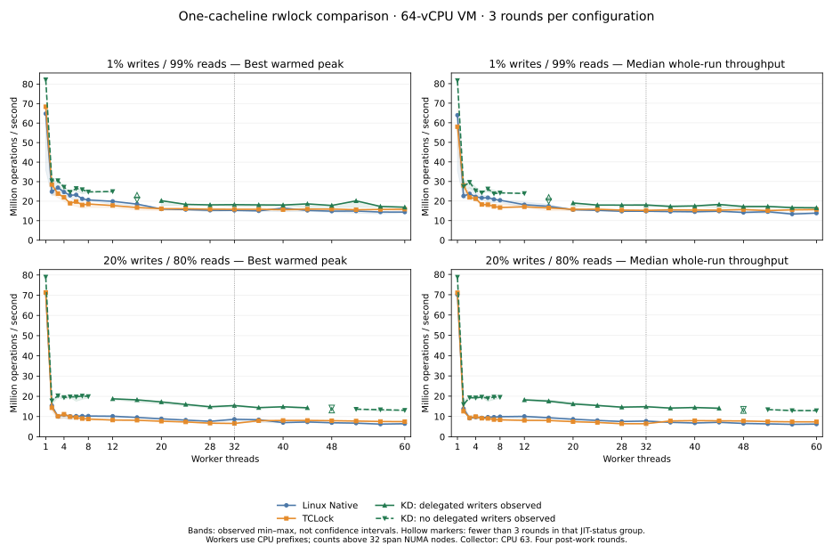

# One-cacheline rwlock comparison, 2026-10-15

This report covers the requested worker grid: 1–8 in steps of one and 12–60
in steps of four. Linux Native, TCLock and KD each run three rounds of both
standard mixes, 1% and 20% writes: 378 timed sessions. This is the spinning
rwlock API; the separately implemented sleeping rwsem has its own validation.

## Results

All **378 timed sessions passed** correctness, full-cohort progress and drain checks. The
offline audit also revalidated all warmups, 9,072 measured worker records, 249 frozen
source files, seven built binaries and 378 published-image files. No sample was discarded.

KD meets the strict best-peak **and** median-whole-run criterion against both controls
at **39 of 42 points**. At **1% writes / 2 workers**, its median is **1.86% below TCLock**
(KD/TCLock 0.9814), although its best peak is 6.66% higher. At **1% / 16 workers**
and **20% / 48 workers**, the KD rounds have mixed JIT statuses; these are complete
measurements but do not form a single three-round status group for parity. See
[the exact parity assessment](parity.json). This block therefore does not establish
uniform parity over the full requested grid.

At 60 workers, median whole-run throughput is **16.556 / 15.685 / 13.828 Mops/s**
for **KD / TCLock / Native** at 1% writes, and **12.903 / 7.385 / 6.266 Mops/s**
at 20% writes. The corresponding KD/Native median ratios are **1.197×** and
**2.059×**. The 20% / 60-worker KD samples execute locally with no observed JIT;
these gains cannot be attributed solely to delegation.

KD completed **1,553,555 delegated writers**: 828,562 in the 1% mix and 724,993
in the 20% mix. Exactly 63 of its 126 measurements observed complete delegation;
the other 63 are NO_JIT. At 60 workers and 1% writes, completed delegation accounts
for 10.19–11.18% of writes. At 20% writes, all 52-, 56- and 60-worker KD rounds
remain NO_JIT under the unchanged adaptive policy. Readers always run locally.

The largest whole-run spread is Native at 1 worker / 1% writes: **79.78%**,
including a slower first round. All three valid samples remain in the statistics;
the measurements do not identify the cause of this variation.



### Full worker grid

Each cell is **best warmed peak / median whole-run throughput**, in **Mops/s**.
Native and TCLock have three rounds per cell. KD status-group counts are explicit;
duplicate worker rows show separate JIT and NO_JIT groups, never pooled results.
Full min/median/max/spread and completed-writer shares are in [statistics.csv](statistics.csv).
Every individual measurement is in [samples.csv](samples.csv); [workers.csv](workers.csv)
retains each worker’s counts, placement, progress, checksum and operation share.

#### 1% writes / 99% reads

| Workers | Linux Native | TCLock | KD | KD status (rounds) |
| ---: | ---: | ---: | ---: | --- |
| 1 | 64.836 / 63.869 | 68.375 / 57.984 | 82.238 / 81.619 | NO_JIT (3) |
| 2 | 24.872 / 22.567 | 28.551 / 28.024 | 30.453 / 27.504 | NO_JIT (3) |
| 3 | 26.922 / 23.673 | 23.878 / 21.874 | 30.509 / 29.600 | NO_JIT (3) |
| 4 | 24.680 / 22.170 | 21.976 / 21.214 | 27.244 / 25.284 | NO_JIT (3) |
| 5 | 22.993 / 21.619 | 18.923 / 18.238 | 24.612 / 24.259 | NO_JIT (3) |
| 6 | 23.251 / 21.712 | 19.813 / 18.148 | 26.503 / 26.206 | NO_JIT (3) |
| 7 | 21.214 / 20.876 | 18.079 / 17.271 | 25.923 / 23.796 | NO_JIT (3) |
| 8 | 20.642 / 20.420 | 18.552 / 16.683 | 24.759 / 24.190 | NO_JIT (3) |
| 12 | 19.919 / 18.129 | 17.773 / 17.071 | 24.968 / 23.897 | NO_JIT (3) |
| 16 | 18.501 / 17.335 | 16.744 / 16.482 | 23.085 / 21.915 | JIT (2) |
| 16 | 18.501 / 17.335 | 16.744 / 16.482 | 20.703 / 19.899 | NO_JIT (1) |
| 20 | 15.976 / 15.597 | 16.151 / 15.794 | 20.242 / 18.999 | JIT (3) |
| 24 | 15.705 / 15.252 | 16.124 / 15.828 | 18.349 / 17.952 | JIT (3) |
| 28 | 15.330 / 14.792 | 15.881 / 15.376 | 18.096 / 17.932 | JIT (3) |
| 32 | 15.279 / 14.792 | 15.846 / 15.222 | 18.222 / 18.006 | JIT (3) |
| 36 | 15.024 / 14.668 | 15.857 / 15.529 | 18.099 / 17.251 | JIT (3) |
| 40 | 16.462 / 14.516 | 15.656 / 15.404 | 18.025 / 17.496 | JIT (3) |
| 44 | 15.264 / 14.841 | 15.919 / 15.351 | 18.615 / 18.265 | JIT (3) |
| 48 | 14.875 / 14.184 | 15.950 / 15.635 | 17.803 / 17.202 | JIT (3) |
| 52 | 14.949 / 14.565 | 15.615 / 15.130 | 20.166 / 17.246 | JIT (3) |
| 56 | 14.441 / 13.358 | 15.756 / 15.532 | 17.300 / 16.645 | JIT (3) |
| 60 | 14.405 / 13.828 | 15.876 / 15.685 | 16.912 / 16.556 | JIT (3) |

#### 20% writes / 80% reads

| Workers | Linux Native | TCLock | KD | KD status (rounds) |
| ---: | ---: | ---: | ---: | --- |
| 1 | 71.094 / 70.012 | 71.363 / 70.962 | 79.013 / 78.679 | NO_JIT (3) |
| 2 | 15.418 / 13.817 | 14.355 / 12.578 | 17.820 / 15.952 | NO_JIT (3) |
| 3 | 10.043 / 9.105 | 10.156 / 9.339 | 20.322 / 19.291 | NO_JIT (3) |
| 4 | 10.929 / 9.716 | 11.179 / 9.931 | 19.445 / 19.196 | NO_JIT (3) |
| 5 | 10.117 / 9.334 | 9.888 / 9.114 | 19.780 / 19.583 | NO_JIT (3) |
| 6 | 10.217 / 9.672 | 9.532 / 9.027 | 19.737 / 18.975 | NO_JIT (3) |
| 7 | 10.244 / 9.685 | 9.016 / 8.489 | 20.196 / 19.594 | NO_JIT (3) |
| 8 | 10.268 / 9.901 | 8.792 / 8.366 | 19.928 / 19.517 | NO_JIT (3) |
| 12 | 10.180 / 10.066 | 8.271 / 8.089 | 18.776 / 18.178 | JIT (3) |
| 16 | 9.568 / 9.394 | 8.189 / 8.051 | 18.268 / 17.575 | JIT (3) |
| 20 | 8.908 / 8.666 | 7.698 / 7.452 | 17.240 / 16.164 | JIT (3) |
| 24 | 8.246 / 8.057 | 7.334 / 7.064 | 16.014 / 15.415 | JIT (3) |
| 28 | 7.660 / 7.531 | 6.744 / 6.431 | 14.847 / 14.609 | JIT (3) |
| 32 | 8.667 / 7.749 | 6.595 / 6.458 | 15.449 / 14.812 | JIT (3) |
| 36 | 8.417 / 7.113 | 7.947 / 7.812 | 14.423 / 14.143 | JIT (3) |
| 40 | 7.012 / 6.793 | 8.077 / 7.953 | 14.837 / 14.416 | JIT (3) |
| 44 | 7.308 / 7.132 | 8.090 / 7.868 | 14.341 / 14.067 | JIT (3) |
| 48 | 6.951 / 6.568 | 7.965 / 7.794 | 14.312 / 13.611 | NO_JIT (2) |
| 48 | 6.951 / 6.568 | 7.965 / 7.794 | 13.148 / 12.876 | JIT (1) |
| 52 | 6.746 / 6.356 | 7.789 / 7.505 | 13.641 / 13.402 | NO_JIT (3) |
| 56 | 6.267 / 6.112 | 7.563 / 7.372 | 13.415 / 12.934 | NO_JIT (3) |
| 60 | 6.465 / 6.266 | 7.498 / 7.385 | 13.110 / 12.903 | NO_JIT (3) |

## Configuration

One shared 64-byte payload slot is protected by one read/write lock. A reader
loads and reloads its counter and verifies consistency; a writer increments it.
Every worker performs the selected mix with deterministic, evenly spaced writes.
The cacheline count describes payload storage, excluding the lock and metadata.
All arms perform four register-only arithmetic rounds after each unlock.

Each fresh session warms up for 48,000 operations per worker, then measures
two seconds. The warmed peak is the highest valid observed 300 ms window after
300 ms of settling, requiring progress from every worker. The collector samples
every 10 ms; workers publish progress every 256 operations. Whole-run rates
include the start, tail, collection and worker-join overhead. Backend order is
Native/TCLock/KD in rounds 0 and 2 and reversed in round 1.

The VM runs on `10.176.26.71`, with exactly 64 vCPUs pinned one-to-one to
physical host CPUs 0–63. N workers use guest CPUs 0 through N−1; the collector
uses CPU 63, with no worker overlap. Counts up to 32 fit NUMA node 0; counts
36–60 span nodes 0 and 1. Host governors are `ondemand`, and QEMU service
threads share physical CPU 63. The captured kernel is `6.1.159-kdclobber2`,
Build ID `5ca28058e156f34a2c7fe91e8e0fbf92f4e51960`, with `nokaslr`, `nopvspin`,
live native qspinlock dispatch and voluntary preemption.

KD uses rwlock ABI3, NUMA enabled, batch limit 1,024, prefetch mode 2, entry
ratio limit 2 and the normal adaptive admission policy. Readers run locally;
only writers can delegate. TCLock also uses NUMA and batch limit 1,024.
The private KD provider enables both body-entry and complete-body counters;
their KD-only observation overhead is included. TCLock delegation share is
unmeasured. All benchmark modules disable UBSAN; kernel settings are unchanged.

## Measurement and execution evidence

`PASS` in the JIT-status column means at least one pristine delegated writer
returned through its matching outer unlock during that measurement. `NO_JIT`
means no completed delegated writer was observed. Publication of a NORMAL image
alone is not counted as execution. Writer shares use the whole measurement,
not just its peak window. A small positive share does not imply delegation
accounts for most operations or explains a throughput difference.

Groups are separated by backend, write percentage, worker count and JIT status.
If the three rounds at a point have different statuses, their groups stay
separate and do not establish a three-round parity result. Min/median/max and
spread preserve every valid sample, including large variation. Min–max bands
are observed ranges, not confidence intervals; three rounds do not establish
statistical significance or acquisition latency.

The comparison uses the runner's strict descriptive parity criterion: KD's
best warmed peak and median whole-run throughput must each reach both Native
and TCLock. The run does not require that criterion to pass; slower valid
samples remain part of the requested comparison.

## Reproduction and provenance

The exact invocation is in [command.sh](command.sh). Run it only after the
documented idle, kernel, placement and fresh-snapshot checks, using a new
output directory and a newly verified snapshot tag. No implementation or
benchmark policy was changed for this rerun.

Committed source `076d4f9e2bb2c8e6b9b21fee38f6a30ad3211643` was synchronized
from an isolated worktree, preserving unrelated edits in the original checkout.
[Source identity](source-identity.json) accounts for all frozen files: 246
tracked source files match the commit, and three historical generated/fixture
files are captured but unused by the build. Each session has its own fresh
translated image. The runner rechecks frozen source and binary hashes before
every session.

The actual QEMU snapshot is recorded in [snapshot.json](snapshot.json).
[Preflight](preflight.json) and [host policy](host-policy.json) retain guest
topology, all 64 vCPU pins, host governors and QEMU service affinities.
The guest output is
`/root/kdlock-evidence/10.176.26.71/bench/rwlock-c01-grid-20261015`.

[analyze.py](analyze.py) revalidates archived warmups, measurements, exact read/write
mixes, checksums, all worker progress/placement, peak selection, payload deltas,
JIT evidence, kernel logs, retirement and backend drain. It recomputes all rates,
summary groups and parity and checks every frozen source, built binary and
published image hash. It operates only on a completed, extracted archive.
[plot.py](plot.py) renders the verified summary with Matplotlib.


## Archive and closeout

[Verification](verification.json) records the successful offline recomputation.
[Environment](environment.json) retains the exact kernel, boot policy, dependency
versions, command and placement. [Final idle state](final-idle.json) confirms no
project modules or workers remained, frozen and live inputs matched, and native
qspinlock dispatch and boot identity were unchanged. [Final host placement](host-final.json)
confirms the same QEMU process, all 64 CPU pins, service affinity and governors.

[Archive receipt](archive.json) records the matching guest/local SHA-256 and paths.
The ignored local archive is
`bench/results/10.176.26.71/raw/bench/rwlock-c01-grid-20261015.tar.gz` (30,258,420 bytes),
SHA-256 `ab9bec68d92107eced62de8113b41062643cfa2e11c679ee52bdb7e7741ed1ea`.
Its extracted sibling directory preserves the full frozen source and build tree,
all session logs, raw samples, generated images, kernel logs and final checks.
The neighboring `rwlock-c01-grid-20261015-controls` directory retains synchronization
and actual QEMU snapshot monitor logs; their hashes are included in the receipt.

Recompute the report from the extracted archive on the source host (offline analysis only):

```sh
python3 bench/results/10.176.26.71/bench/rwlock/20261015-c01/analyze.py \
  bench/results/10.176.26.71/raw/bench/rwlock-c01-grid-20261015
MPLCONFIGDIR=/tmp/kdlock-rwlock-matplotlib python3 \
  bench/results/10.176.26.71/bench/rwlock/20261015-c01/plot.py
```

Rendering used Matplotlib 3.8.3 and NumPy 1.26.4. No additional performance
confirmation block or broader functional suite was run; this report covers the
requested rerun and the checks embedded in its maintained runner.
