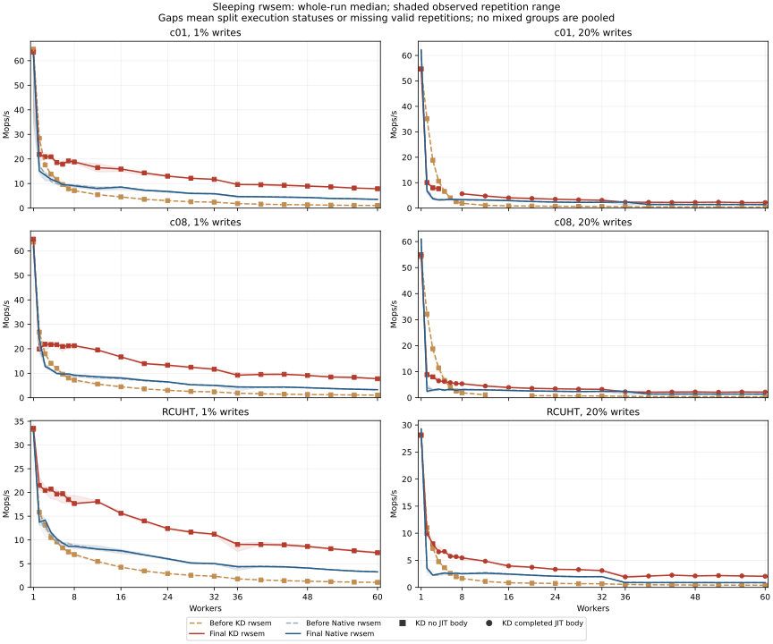
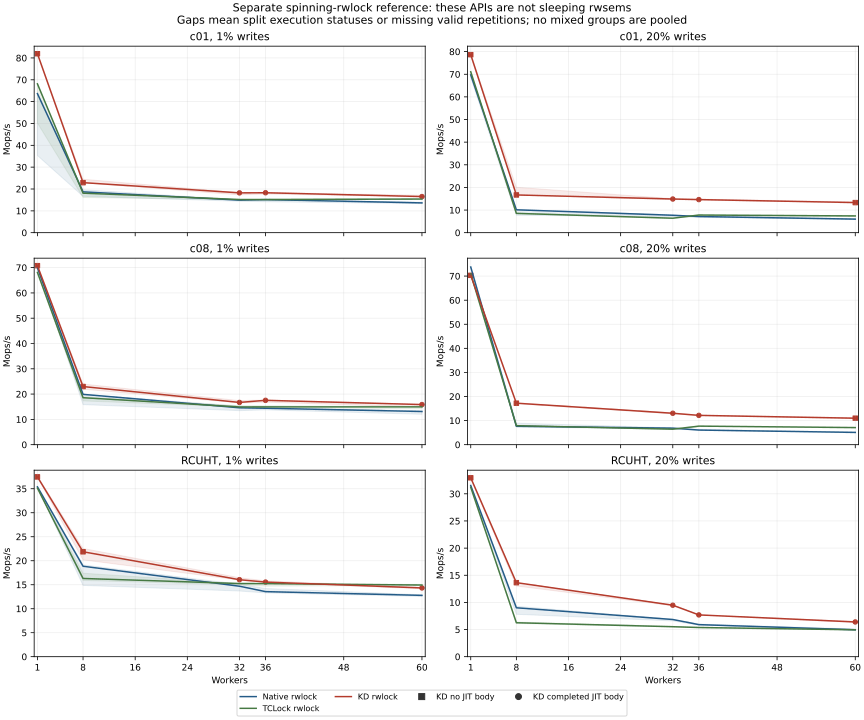

# KD rwsem optimization evidence

The selected rwsem wait path improves median whole-run throughput at 60 workers
by **5.10–7.42× over the initial KD rwsem** and **1.546–2.352× over Native**
across c01/c08/RCUHT at 1%/20% writes. It separates admission and reader-drain
queues, separates frequently written state across cachelines, and tries a finite
polling stage before sleeping. The accepted KD mutex protocol is unchanged.

**This change has substantial low-count regressions.** At two workers and 20%
writes, c01 falls from 35.137 to 10.065 Mops/s and c08 from 32.149 to
8.859 Mops/s: approximately **71–72% below the initial KD**. Three-worker
cacheline results also regress by about 57%. The additional busy contention
cost is visible in worker CPU time; the precise scheduling contribution has
not been isolated. This is a measured high-contention improvement, not a
uniform replacement-performance guarantee. All regressions remain below and
in the [targeted review](final-evidence-review.md).

The [diagnosis and code comparison](diagnosis.md) explain the waitqueue cost,
the changes, their memory cost, and TCLock's different spinning contract.
The separate Native/TCLock/KD rwlock reference does not support a blanket claim
that KD rwlock is slow: KD meets both observed throughput criteria at 29/30
points against Native and 28/30 against TCLock. This port has no sleeping
TCLock rwsem backend.

All **756 final rwsem sessions and 270 spinning-rwlock reference sessions**
completed correctly and drained. The [focused validation](../../tests/rwsem-optimization-20261018/README.md)
passed its sleeping/cancellation/downgrade probe, two basic C programs and 44
workload checks. [Independent offline replay](final-independent-replay.json)
passed for all 2,118 timed sessions across both full grids, seven separate
screens and the reference; this checks captured evidence rather than running
new kernel tests. [Provenance](provenance.md), [archive hashes](archives.json)
and the [import guide](IMPORT.md) retain the source, topology and reproduction
details. All builds and live execution ran in the recovery VM.

Rates are recomputed from raw valid records and checked against the saved runner summary. Every source version, call shell and JIT execution status remains a separate group. A three-run point is blank when statuses split, even if all sessions succeeded. PASS in a JIT field means a completed delegated body; PASS in a comparison field means both observed median-whole and best-peak ratios are at least one. These are descriptive measurements, not significance tests.

The full matrices use c01, c08 and RCUHT; 1% and 20% writes; workers 1–8 and 12–60 by four; three repetitions and two seconds per session. Fresh c01 screens use 1, 8, 32 and 60 workers. Worker CPU ns/op is the sum of measured worker thread CPU time divided by completed operations; it excludes other threads and is not elapsed lock latency.

## Run coverage

| Run | Status | Valid / expected sessions | KD JIT sessions | Source content ID |
| --- | --- | --- | --- | --- |
| baseline-grid | COMPLETE | 756/756 | {"NO_JIT":371,"PASS":7} | 03e379fc02be5ab7 |
| baseline-screen | COMPLETE | 48/48 | {"NO_JIT":24} | 03e379fc02be5ab7 |
| poll-screen | COMPLETE | 48/48 | {"NO_JIT":21,"PASS":3} | 0bf8f5d52a13269b |
| split-screen | COMPLETE | 48/48 | {"NO_JIT":21,"PASS":3} | 8e228639454f7480 |
| long-screen | COMPLETE | 48/48 | {"NO_JIT":18,"PASS":6} | 2a1a007868bdce08 |
| grant-screen | COMPLETE | 48/48 | {"NO_JIT":19,"PASS":5} | 230a1892723b3880 |
| xlong-screen | COMPLETE | 48/48 | {"NO_JIT":15,"PASS":9} | 96940efc0a925d7f |
| baseline-repeat-screen | COMPLETE | 48/48 | {"NO_JIT":24} | 03e379fc02be5ab7 |
| final-grid | COMPLETE | 756/756 | {"NO_JIT":223,"PASS":155} | 96940efc0a925d7f |
| final-reference | COMPLETE | 270/270 | {"NO_JIT":42,"PASS":48} | 96940efc0a925d7f |

The displayed source content ID is the first 16 hexadecimal characters of SHA256 over canonical JSON content (sorted keys and compact separators) of the source manifest. It is not the raw manifest-file hash. Full canonical IDs and raw `source-sha256.json` file hashes are retained separately in `analysis.json` (`source_id` and `input_sha256`). KD JIT counts in the coverage table count sessions, not status groups.

## Sixty workers: sleeping rwsem

Median whole-run Mops/s. Both Native control versions are shown separately; their drift is not normalized away.

| Workload | Writes | Before KD | Final KD | Before Native | Final Native | KD final / before | KD final / Native | KD JIT before → final |
| --- | --- | --- | --- | --- | --- | --- | --- | --- |
| c01 | 1% | 1.065 | 7.900 | 3.576 | 3.561 | 7.416× | 2.219× | NO_JIT:3 → NO_JIT:3 |
| c01 | 20% | 0.403 | 2.197 | 1.424 | 1.421 | 5.458× | 1.546× | NO_JIT:3 → PASS:3 |
| c08 | 1% | 1.070 | 7.758 | 3.259 | 3.299 | 7.250× | 2.352× | NO_JIT:3 → NO_JIT:3 |
| c08 | 20% | 0.397 | 2.183 | 1.415 | 1.412 | 5.495× | 1.546× | NO_JIT:3 → PASS:3 |
| RCUHT | 1% | 1.056 | 7.312 | 3.270 | 3.262 | 6.927× | 2.242× | NO_JIT:3 → NO_JIT:3 |
| RCUHT | 20% | 0.401 | 2.047 | 0.868 | 0.873 | 5.100× | 2.344× | NO_JIT:3 → PASS:3 |

## Full-grid outcomes

| Comparison | PASS | FAIL | INCOMPLETE |
| --- | --- | --- | --- |
| Final KD / before KD | 110 | 12 | 4 |
| Final KD / final Native | 117 | 6 | 3 |
| Final Native / before Native | 28 | 98 | 0 |

All 126 point values, whole-run ranges, warmed peaks, JIT completion ranges and CPU costs are in `points.csv`. `regressions.csv` lists every final/before KD or final/Native point below one on either throughput metric. `groups.csv` retains incomplete status-specific groups; `sessions.csv` retains individual raw rates and failures. `screen-points.csv` compares each c01 candidate separately with the original grid and fresh baseline screen, including Native drift. No candidate screen is merged with a full grid.

## Split or missing comparison points

| Workload | Writes | Workers | Before KD groups | Final KD groups | Final Native groups | Reason |
| --- | --- | --- | --- | --- | --- | --- |
| c01 | 20 | 5 | NO_JIT:3 | NO_JIT:2;PASS:1 | NATIVE:3 | MISSING_HOMOGENEOUS_GROUP |
| c01 | 20 | 6 | NO_JIT:3 | NO_JIT:1;PASS:2 | NATIVE:3 | MISSING_HOMOGENEOUS_GROUP |
| c01 | 20 | 7 | NO_JIT:3 | NO_JIT:1;PASS:2 | NATIVE:3 | MISSING_HOMOGENEOUS_GROUP |
| c08 | 20 | 16 | NO_JIT:2;PASS:1 | PASS:3 | NATIVE:3 | MISSING_HOMOGENEOUS_GROUP |

## Focused screens and baseline controls

Each candidate is compared with the fresh baseline screen. A candidate with lower rates remains in these receipts; its presence does not mean it was selected. These are the 60-worker c01 rows; the CSV also retains 1, 8 and 32 workers and comparisons with the earlier full baseline. Rates are medians with observed [min, max] ranges, not confidence intervals. The historical full baseline and fresh baseline are distinct runs even when source hashes match. Separate Native controls expose run variability; candidate/baseline ratios are not normalized by Native drift or interpreted as statistical significance. Optional experimental screen groups appear only when provided in the input map. An optional `baseline-repeat-screen` is a separate later baseline control, not a candidate or a pooled baseline. When supplied, the CSV also compares every screen with this later control to expose drift across the experiment.

| Run | Writes | KD Mops/s [range] | Native Mops/s [range] | KD / fresh baseline | Native / fresh baseline | KD execution groups |
| --- | --- | --- | --- | --- | --- | --- |
| baseline-screen | 1 | 1.069 [0.761, 1.077] | 3.455 [0.777, 3.563] | 1.000× | 1.000× | NO_JIT:3 |
| baseline-screen | 20 | 0.400 [0.399, 0.405] | 1.416 [1.381, 1.433] | 1.000× | 1.000× | NO_JIT:3 |
| poll-screen | 1 | 0.846 [0.835, 0.855] | 3.564 [0.775, 3.569] | 0.791× | 1.032× | NO_JIT:3 |
| poll-screen | 20 | 0.214 [0.214, 0.217] | 1.412 [1.373, 1.437] | 0.536× | 0.997× | NO_JIT:3 |
| split-screen | 1 | 0.864 [0.849, 0.906] | 0.766 [0.740, 0.783] | 0.809× | 0.222× | NO_JIT:3 |
| split-screen | 20 | 0.260 [0.206, 0.426] | 1.421 [1.361, 1.423] | 0.649× | 1.003× | NO_JIT:3 |
| long-screen | 1 | 1.117 [1.071, 1.126] | 0.736 [0.733, 0.736] | 1.045× | 0.213× | NO_JIT:3 |
| long-screen | 20 | — | 1.385 [1.383, 1.422] | — | 0.978× | NO_JIT:2;PASS:1 |
| grant-screen | 1 | 0.276 [0.274, 0.276] | 0.754 [0.748, 0.758] | 0.258× | 0.218× | NO_JIT:3 |
| grant-screen | 20 | 0.083 [0.083, 0.085] | 1.422 [1.374, 1.426] | 0.207× | 1.004× | NO_JIT:3 |
| xlong-screen | 1 | 7.780 [4.049, 8.016] | 3.444 [0.760, 3.613] | 7.278× | 0.997× | NO_JIT:3 |
| xlong-screen | 20 | 2.217 [2.194, 2.240] | 1.413 [1.373, 1.415] | 5.537× | 0.997× | PASS:3 |
| baseline-repeat-screen | 1 | 1.060 [0.693, 1.065] | 3.589 [0.742, 3.607] | 0.991× | 1.039× | NO_JIT:3 |
| baseline-repeat-screen | 20 | 0.405 [0.399, 0.406] | 1.417 [1.377, 1.427] | 1.012× | 1.000× | NO_JIT:3 |

## Spinning-rwlock reference

TCLock implements a spinning rwlock in this port, not a sleeping rwsem. The separate reference uses Native/TCLock/KD rwlocks at 1, 8, 32, 36 and 60 workers for the same three non-sleeping payloads and two mixes. Its rates are not scored as rwsem parity and are not pooled with rwsem runs. `rwlock-reference.csv` retains all 30 reference points. The runner labels TCLock `jit_status=NATIVE` because KD JIT witnesses do not apply to that backend; this does not establish local TCLock execution. Its delegation observation remains `UNMEASURED`. Mixed KD JIT statuses suppress only the affected KD comparison; a complete Native/TCLock comparison remains available.

| Workload | Writes | Workers | Native rwlock | TCLock rwlock | KD rwlock |
| --- | --- | --- | --- | --- | --- |
| c01 | 1 | 60 | 13.636 | 15.394 | 16.533 |
| c01 | 20 | 60 | 5.992 | 7.402 | 13.300 |
| c08 | 1 | 60 | 13.116 | 14.957 | 15.860 |
| c08 | 20 | 60 | 5.089 | 7.099 | 10.997 |
| RCUHT | 1 | 60 | 12.776 | 14.933 | 14.326 |
| RCUHT | 20 | 60 | 4.957 | 4.955 | 6.397 |

## Diagnostic profiles

Optional function-profile counts are saved separately in `diagnostics.json`. Profiling changes execution cost and includes background activity. Profiled rates never enter these performance groups or plots. Per-function calls/op may help identify an exercised path; they do not establish exclusive CPU cost. Nested function times must not be summed.

## Figures and identity

SVG lines have trailing whitespace removed; CSV records use LF. Shading is the observed three-repetition range, not a confidence interval. Connected points retain their separate status markers. Kernel identity, topology, source manifests and input hashes are retained in `analysis.json`. Cross-version ratios require equal call-shell/placement/measurement identity and kernel/config/runtime identity. Source differences are listed in `source-differences.json`; measurements are never pooled across those versions.

