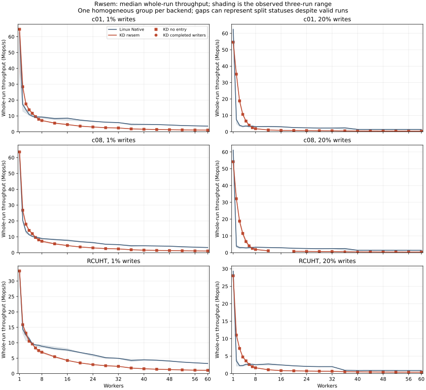
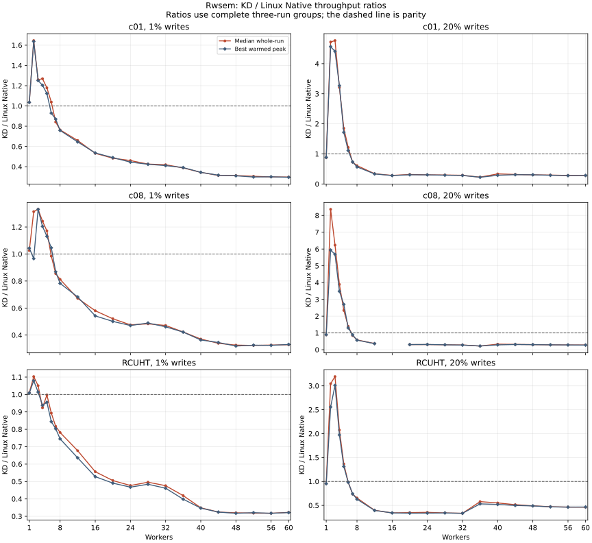

# KD rwsem writer delegation compared with Linux Native

The frozen matrix contains 756/756 valid sessions and 126 comparison points. Observed peak-and-whole parity passes at 26 points, is slower on at least one metric at 99, and has no homogeneous three-round comparison at 1.

The runner's `INCOMPLETE` parity status does not mean tests were skipped. One point has all six valid executions but split execution statuses; no point lacks valid repetitions.

The new [rwsem admission phase](../../../../../../docs/design/rwsem_implementation.md)
drains readers before entering the unchanged accepted KD mutex protocol. The
[source comparison](../../../tests/rwsem-delegation-20261018/mutex-source-equivalence.json)
keeps all 16 mutex-specific paths byte-identical to `d2a2304`. The
[focused validation](../../../tests/rwsem-delegation-20261018/README.md) records
sleeping-reader ordering, ordinary cancellation/downgrade, local/read-only
controls and four strict completed-JIT checks at different write mixes.

This timed grid completed **10,470,346,496 operations**. KD has several low-count
advantages, but reaches only 28–46% of Native throughput at 60 workers. Seven
KD timed sessions completed a total of **1,752 delegated writes**, all c08 at
20% writes: one repetition at 16 workers, and all three at 36 and 40. The other
371 KD sessions executed locally. These results establish correct writer
delegation and expose its limited use and poor high-count performance in these
read-heavy mixes; they do not establish a general rwsem performance improvement.

c01, c08 and RCUHT use 1% and 20% writes, workers 1–8 then 12–60 by four, three repetitions per backend and two-second timed intervals. Workers occupy CPU prefixes 0..N−1; collector CPU 63 is separate. Whole-run throughput includes the complete joined measurement interval. Warmed peak is the best valid 300 ms window after 300 ms settling.

Each point is comparable only when each backend has exactly one complete three-repetition execution-status group. Mixed PASS/NO_JIT/PARTIAL_JIT repetitions remain separate in `groups.csv`; their point rates/ratios are blank rather than pooled. PASS in a KD JIT field means completed delegated writer bodies, while PASS in the parity field means both observed throughput ratios are at least one. Neither outcome is a statistical significance claim.

## Inputs and reproduction

The VM has 64 vCPUs and 24 GiB RAM: CPUs 0–31 and 32–63 map to separate NUMA
nodes with 12 GiB each. Worker prefixes through 32 stay on node 0; 36 and higher
cross nodes. Each vCPU is pinned to its matching host CPU; QEMU service threads
share CPU 63. [Before](host-before.json) and [after](host-after.json) captures
and their [comparison](host-comparison.json) confirm unchanged placement and
the host's `ondemand` frequency policy. This is not a fixed-frequency run.

Kernel `6.1.159-kdclobber2`, Build ID
`5ca28058e156f34a2c7fe91e8e0fbf92f4e51960`, used `nokaslr`, `nopvspin` and
voluntary preemption. The kernel was not rebuilt or rebooted. Each fresh session
used 48,000 warmup operations per worker, post4 work, 10 ms sampling, UBSAN-off
benchmark modules and the recorded deterministic write mix. Native used ordinary
C calls; KD used the `delegated-epoch-abi2` writer shell, local readers, unchanged
mutex heat admission, NUMA-on and batch upper bound 1,024. Entry/completion and
heat counters were enabled; JIT timing instrumentation was disabled. Arm order
alternated within repetitions. These settings belong to this comparison.

The [233-file source check](source-match.json) matches all frozen runtime inputs
to the final checkout. The [archive receipt](archive.json) verifies the guest
and local archive hashes, 21,027 regular files, 756 links, all 233 source inputs
and nine binaries. Full evidence, including per-session images, caller assembly,
kernel logs and source retirement, is retained in
`bench/results/10.176.26.71/raw/bench/rwsem-delegation-20261018/guest-evidence.tar.gz`.
That ignored directory also holds extracted input JSON and local orchestration.
The validation receipt separately retains earlier failures and final guest health.

The exact invocation is the 756-session command in the
[runner guide](../../../../../rwlock_compare/README.md). Offline
[report.py](report.py) recomputes tables from the extracted evidence;
[verify-archive.py](verify-archive.py) checks archive contents without executing
captured code. Their usage is documented in the scripts. Numeric inputs remain
immutable; this narrative adds interpretation and provenance to the generated
tables. CSV line endings and SVG trailing whitespace are normalized for Git;
parsed table and SVG content is unchanged. No measurement from another source,
topology or acceptance mix is pooled.

The [126-point CSV](points.csv), [all 756 sessions](sessions.csv),
[execution groups](groups.csv), [regressions](regressions.csv),
[60-worker table](sixty-workers.csv) and [analysis receipt](analysis.json)
retain the complete comparison.

An [independent replay](independent-replay.json), using a separate
[analysis implementation](independent-replay-source.py), verified every worker's
count, deterministic mix and CPU assignment; payload deltas; all 756 selected
peak windows directly from raw samples; 253 summary groups; and all 126 parity
points. It executed no captured runner or test code. The
[diagnostics](diagnostics.md) retain exact positive-JIT counts and heat evidence.
[Local control hashes](control-sha256.json) cover orchestration and host captures
stored alongside the raw archive.

## Delegation and the high-count limit

At 60 workers and 1% writes, all CPUs remained below the initial mutex CPU-heat
threshold, with no heat checks and only 1–80 residual contention samples per CPU.
At 20% writes all CPUs became hot, but every reported per-lock state was cold at
shutdown. All 18 KD sessions at 60 workers recorded zero delegation slowpath,
combiner and JIT-success counts. The 20% logs do not retain each lock timing
window, so final sample counts alone cannot distinguish insufficient samples
from a failed rate window.

The rwsem layer may wait for reader drain or another admission phase before
reaching the mutex. Those waits do not themselves count as mutex contention.
This source-level distinction explains why overall rwsem contention need not
activate unchanged mutex heat admission. It is not a measured attribution of
time spent in admission atomics, wakeups or other paths. The data supports
profiling those costs; it does not justify silently changing the accepted mutex
policy or treating published images as completed delegation.

## Coverage

| Workload | Writes | Parity pass | Slower | Split statuses | Missing valid repeats |
| --- | --- | --- | --- | --- | --- |
| c01 | 1% | 5 | 16 | 0 | 0 |
| c01 | 20% | 5 | 16 | 0 | 0 |
| c08 | 1% | 4 | 17 | 0 | 0 |
| c08 | 20% | 5 | 15 | 1 | 0 |
| RCUHT | 1% | 3 | 18 | 0 | 0 |
| RCUHT | 20% | 4 | 17 | 0 | 0 |

Session dispositions: `{"OK": 756}`. All sessions drained: **True**.

KD execution dispositions: `{"NO_JIT": 371, "PASS": 7}`.

## Sixty workers

Throughput is Mops/s. Parentheses give the observed minimum–maximum whole-run rate across the same three repetitions.

| Workload | Writes | Native whole | KD whole | Whole ratio | Peak ratio | KD JIT | Parity |
| --- | --- | --- | --- | --- | --- | --- | --- |
| c01 | 1% | 3.576 (3.571–3.598) | 1.065 (1.051–1.070) | 0.298× | 0.296× | NO_JIT | FAIL |
| c01 | 20% | 1.424 (1.415–1.445) | 0.403 (0.401–0.410) | 0.283× | 0.283× | NO_JIT | FAIL |
| c08 | 1% | 3.259 (3.253–3.284) | 1.070 (1.070–1.075) | 0.328× | 0.331× | NO_JIT | FAIL |
| c08 | 20% | 1.415 (1.405–1.432) | 0.397 (0.391–0.398) | 0.281× | 0.274× | NO_JIT | FAIL |
| RCUHT | 1% | 3.270 (3.220–3.320) | 1.056 (1.055–1.057) | 0.323× | 0.321× | NO_JIT | FAIL |
| RCUHT | 20% | 0.868 (0.860–0.874) | 0.401 (0.401–0.405) | 0.463× | 0.466× | NO_JIT | FAIL |

## Geometric ratios within execution-status groups

These unweighted summaries cover only the listed accepted worker counts within one workload, mix and KD execution status. They are descriptive ratios, not aggregate throughput and not a substitute for the complete grid. Single-point groups are omitted.

| Workload | Writes | KD JIT | Points / 21 | Whole ratio | Peak ratio | Workers |
| --- | --- | --- | --- | --- | --- | --- |
| c01 | 1% | NO_JIT | 21 | 0.580× | 0.572× | 1, 2, 3, 4, 5, 6, 7, 8, 12, 16, 20, 24, 28, 32, 36, 40, 44, 48, 52, 56, 60 |
| c01 | 20% | NO_JIT | 21 | 0.574× | 0.556× | 1, 2, 3, 4, 5, 6, 7, 8, 12, 16, 20, 24, 28, 32, 36, 40, 44, 48, 52, 56, 60 |
| c08 | 1% | NO_JIT | 21 | 0.602× | 0.589× | 1, 2, 3, 4, 5, 6, 7, 8, 12, 16, 20, 24, 28, 32, 36, 40, 44, 48, 52, 56, 60 |
| c08 | 20% | NO_JIT | 18 | 0.703× | 0.684× | 1, 2, 3, 4, 5, 6, 7, 8, 12, 20, 24, 28, 32, 44, 48, 52, 56, 60 |
| c08 | 20% | PASS | 2 | 0.269× | 0.250× | 36, 40 |
| RCUHT | 1% | NO_JIT | 21 | 0.566× | 0.553× | 1, 2, 3, 4, 5, 6, 7, 8, 12, 16, 20, 24, 28, 32, 36, 40, 44, 48, 52, 56, 60 |
| RCUHT | 20% | NO_JIT | 21 | 0.666× | 0.647× | 1, 2, 3, 4, 5, 6, 7, 8, 12, 16, 20, 24, 28, 32, 36, 40, 44, 48, 52, 56, 60 |

## Every observed regression

A point appears below when KD is slower on median whole-run throughput or best warmed peak. No tolerance is applied. All 126 points, both backends’ ranges and JIT completion ranges are retained in `points.csv`; this table is also `regressions.csv`.

| Workload | Writes | Workers | Whole ratio | Peak ratio | KD JIT |
| --- | --- | --- | --- | --- | --- |
| c01 | 1% | 6 | 1.039× | 0.929× | NO_JIT |
| c01 | 1% | 7 | 0.841× | 0.870× | NO_JIT |
| c01 | 1% | 8 | 0.764× | 0.758× | NO_JIT |
| c01 | 1% | 12 | 0.659× | 0.645× | NO_JIT |
| c01 | 1% | 16 | 0.532× | 0.536× | NO_JIT |
| c01 | 1% | 20 | 0.484× | 0.489× | NO_JIT |
| c01 | 1% | 24 | 0.460× | 0.445× | NO_JIT |
| c01 | 1% | 28 | 0.426× | 0.424× | NO_JIT |
| c01 | 1% | 32 | 0.419× | 0.411× | NO_JIT |
| c01 | 1% | 36 | 0.388× | 0.391× | NO_JIT |
| c01 | 1% | 40 | 0.344× | 0.344× | NO_JIT |
| c01 | 1% | 44 | 0.314× | 0.316× | NO_JIT |
| c01 | 1% | 48 | 0.312× | 0.310× | NO_JIT |
| c01 | 1% | 52 | 0.305× | 0.298× | NO_JIT |
| c01 | 1% | 56 | 0.299× | 0.300× | NO_JIT |
| c01 | 1% | 60 | 0.298× | 0.296× | NO_JIT |
| c01 | 20% | 1 | 0.875× | 0.884× | NO_JIT |
| c01 | 20% | 7 | 0.725× | 0.732× | NO_JIT |
| c01 | 20% | 8 | 0.610× | 0.567× | NO_JIT |
| c01 | 20% | 12 | 0.340× | 0.333× | NO_JIT |
| c01 | 20% | 16 | 0.284× | 0.279× | NO_JIT |
| c01 | 20% | 20 | 0.315× | 0.304× | NO_JIT |
| c01 | 20% | 24 | 0.303× | 0.303× | NO_JIT |
| c01 | 20% | 28 | 0.298× | 0.291× | NO_JIT |
| c01 | 20% | 32 | 0.289× | 0.282× | NO_JIT |
| c01 | 20% | 36 | 0.227× | 0.222× | NO_JIT |
| c01 | 20% | 40 | 0.335× | 0.288× | NO_JIT |
| c01 | 20% | 44 | 0.316× | 0.308× | NO_JIT |
| c01 | 20% | 48 | 0.303× | 0.304× | NO_JIT |
| c01 | 20% | 52 | 0.296× | 0.289× | NO_JIT |
| c01 | 20% | 56 | 0.283× | 0.277× | NO_JIT |
| c01 | 20% | 60 | 0.283× | 0.283× | NO_JIT |
| c08 | 1% | 2 | 1.314× | 0.966× | NO_JIT |
| c08 | 1% | 6 | 0.984× | 1.046× | NO_JIT |
| c08 | 1% | 7 | 0.855× | 0.868× | NO_JIT |
| c08 | 1% | 8 | 0.812× | 0.782× | NO_JIT |
| c08 | 1% | 12 | 0.672× | 0.682× | NO_JIT |
| c08 | 1% | 16 | 0.580× | 0.542× | NO_JIT |
| c08 | 1% | 20 | 0.521× | 0.501× | NO_JIT |
| c08 | 1% | 24 | 0.476× | 0.471× | NO_JIT |
| c08 | 1% | 28 | 0.483× | 0.489× | NO_JIT |
| c08 | 1% | 32 | 0.471× | 0.461× | NO_JIT |
| c08 | 1% | 36 | 0.423× | 0.422× | NO_JIT |
| c08 | 1% | 40 | 0.371× | 0.364× | NO_JIT |
| c08 | 1% | 44 | 0.339× | 0.345× | NO_JIT |
| c08 | 1% | 48 | 0.326× | 0.319× | NO_JIT |
| c08 | 1% | 52 | 0.323× | 0.325× | NO_JIT |
| c08 | 1% | 56 | 0.326× | 0.324× | NO_JIT |
| c08 | 1% | 60 | 0.328× | 0.331× | NO_JIT |
| c08 | 20% | 1 | 0.888× | 0.895× | NO_JIT |
| c08 | 20% | 7 | 0.842× | 0.886× | NO_JIT |
| c08 | 20% | 8 | 0.586× | 0.567× | NO_JIT |
| c08 | 20% | 12 | 0.364× | 0.360× | NO_JIT |
| c08 | 20% | 20 | 0.304× | 0.305× | NO_JIT |
| c08 | 20% | 24 | 0.307× | 0.311× | NO_JIT |
| c08 | 20% | 28 | 0.292× | 0.292× | NO_JIT |
| c08 | 20% | 32 | 0.280× | 0.275× | NO_JIT |
| c08 | 20% | 36 | 0.219× | 0.219× | PASS |
| c08 | 20% | 40 | 0.330× | 0.286× | PASS |
| c08 | 20% | 44 | 0.316× | 0.310× | NO_JIT |
| c08 | 20% | 48 | 0.304× | 0.300× | NO_JIT |
| c08 | 20% | 52 | 0.289× | 0.290× | NO_JIT |
| c08 | 20% | 56 | 0.282× | 0.282× | NO_JIT |
| c08 | 20% | 60 | 0.281× | 0.274× | NO_JIT |
| RCUHT | 1% | 4 | 0.924× | 0.938× | NO_JIT |
| RCUHT | 1% | 5 | 0.997× | 0.955× | NO_JIT |
| RCUHT | 1% | 6 | 0.893× | 0.844× | NO_JIT |
| RCUHT | 1% | 7 | 0.817× | 0.803× | NO_JIT |
| RCUHT | 1% | 8 | 0.782× | 0.745× | NO_JIT |
| RCUHT | 1% | 12 | 0.677× | 0.636× | NO_JIT |
| RCUHT | 1% | 16 | 0.556× | 0.528× | NO_JIT |
| RCUHT | 1% | 20 | 0.505× | 0.491× | NO_JIT |
| RCUHT | 1% | 24 | 0.477× | 0.468× | NO_JIT |
| RCUHT | 1% | 28 | 0.496× | 0.484× | NO_JIT |
| RCUHT | 1% | 32 | 0.476× | 0.461× | NO_JIT |
| RCUHT | 1% | 36 | 0.419× | 0.399× | NO_JIT |
| RCUHT | 1% | 40 | 0.349× | 0.347× | NO_JIT |
| RCUHT | 1% | 44 | 0.324× | 0.324× | NO_JIT |
| RCUHT | 1% | 48 | 0.320× | 0.317× | NO_JIT |
| RCUHT | 1% | 52 | 0.318× | 0.321× | NO_JIT |
| RCUHT | 1% | 56 | 0.317× | 0.318× | NO_JIT |
| RCUHT | 1% | 60 | 0.323× | 0.321× | NO_JIT |
| RCUHT | 20% | 1 | 0.956× | 0.953× | NO_JIT |
| RCUHT | 20% | 6 | 0.984× | 0.983× | NO_JIT |
| RCUHT | 20% | 7 | 0.737× | 0.742× | NO_JIT |
| RCUHT | 20% | 8 | 0.654× | 0.629× | NO_JIT |
| RCUHT | 20% | 12 | 0.398× | 0.395× | NO_JIT |
| RCUHT | 20% | 16 | 0.343× | 0.342× | NO_JIT |
| RCUHT | 20% | 20 | 0.349× | 0.337× | NO_JIT |
| RCUHT | 20% | 24 | 0.355× | 0.338× | NO_JIT |
| RCUHT | 20% | 28 | 0.343× | 0.341× | NO_JIT |
| RCUHT | 20% | 32 | 0.335× | 0.335× | NO_JIT |
| RCUHT | 20% | 36 | 0.579× | 0.532× | NO_JIT |
| RCUHT | 20% | 40 | 0.551× | 0.521× | NO_JIT |
| RCUHT | 20% | 44 | 0.515× | 0.499× | NO_JIT |
| RCUHT | 20% | 48 | 0.491× | 0.489× | NO_JIT |
| RCUHT | 20% | 52 | 0.472× | 0.470× | NO_JIT |
| RCUHT | 20% | 56 | 0.465× | 0.464× | NO_JIT |
| RCUHT | 20% | 60 | 0.463× | 0.466× | NO_JIT |

## Points without a homogeneous three-repetition comparison

Group labels include the execution status and its number of valid repetitions. A `NO_JIT:2;PASS:1` KD point has three successful runs, but pooling them would erase a material execution difference. Such points retain the runner’s `INCOMPLETE` parity status and blank combined ratios.

| Workload | Writes | Workers | Native groups | KD groups | Reason |
| --- | --- | --- | --- | --- | --- |
| c08 | 20% | 16 | NATIVE:3 | NO_JIT:2;PASS:1 | Split statuses; all six runs valid |

These status-specific rates remain descriptive partial groups; they do not supply an accepted three-repetition KD/Native ratio. Throughput is Mops/s.

| Workload | Writes | Workers | Backend | JIT status | Repetitions | Whole median | Whole min–max | Best peak | Completed bodies min–max |
| --- | --- | --- | --- | --- | --- | --- | --- | --- | --- |
| c08 | 20% | 16 | kdlock | NO_JIT | 2 | 0.869 | 0.869–0.869 | 0.895 | 0–0 |
| c08 | 20% | 16 | kdlock | PASS | 1 | 0.887 | 0.887–0.887 | 0.897 | 3–3 |
| c08 | 20% | 16 | native | NATIVE | 3 | 2.942 | 2.765–3.028 | 3.089 | 0–0 |

## Artifacts and checks

`analysis.json` preserves input hashes, topology, kernel identity, all computed groups, point dispositions and failed sessions. This analysis recomputed rates/group membership from valid raw records and checked them against the runner’s saved summary and parity. It also required stable ABI2 mutex publication and zero translator writers/frames at the measured boundaries. It does not rerun workload oracles or kernel checks.

SVG and PNG versions are available. Whole-run shading is the observed repetition range, not a confidence interval. A gap can represent three successful KD runs split across execution statuses; it does not by itself mean a skipped or failed test. Connected points describe the same frozen source and settings; markers retain their separate KD execution statuses, and no repetitions are pooled across them.
