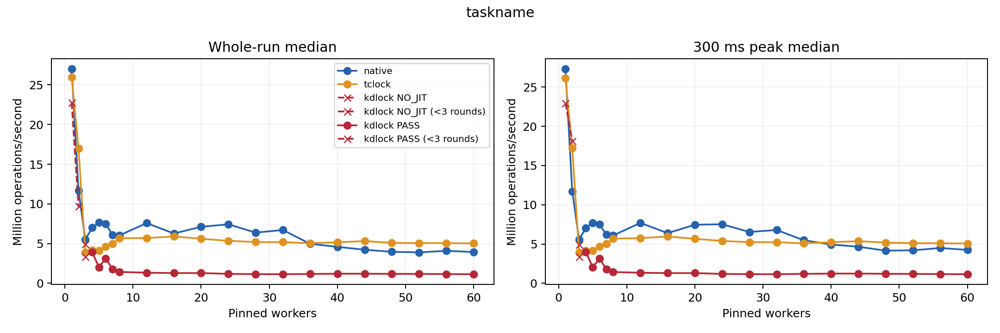
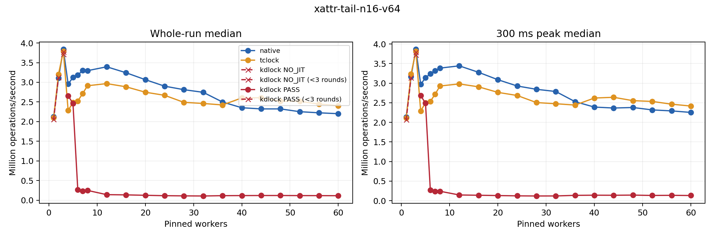
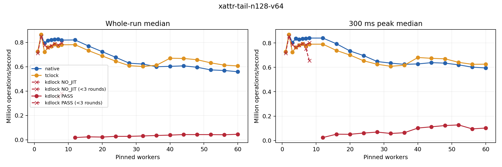

# Taskname and xattr: historical checked-helper baseline

All 567 recorded sessions passed evidence replay and drained. The checked-helper
KD baseline was substantially slower than both controls at 60 workers on all
three workloads. These results belong to frozen source
[`c79d84f9adf5b1069bd7827466ce188f7e3f2dbd`](https://github.com/hailongeric/kdlock/tree/c79d84f9adf5b1069bd7827466ce188f7e3f2dbd),
preserved locally as `archive/taskname-xattr-checked-c79d84f-20261019`. That
version checked helper code and arguments before invoking the original kernel
`strcmp()` or `strscpy_pad()`. The version 10 revision removes those checks;
its performance is not measured by this report.

Replay recalculates results from saved observations without running workloads
again. The final [replay receipt](../../raw/bench/taskname-xattr-20261018/replay-final/replay.json)
validates the complete worker grid, three repetitions, source and binary
identities, data checks, execution evidence and teardown. A valid performance
sample can still contain no delegated work; execution status is reported
separately below.

## Coverage and execution

Each case compares Linux Native, TCLock and KD at 1–8 workers in steps of one
and 12–60 in steps of four, with three measurements per configuration and a
target duration of two seconds. There are 189 sessions per case, including
63 KD sessions.

| Case | Valid / planned sessions | KD `PASS` | KD `NO_JIT` | Returned KD bodies | Address-guard exits |
| --- | ---: | ---: | ---: | ---: | ---: |
| Taskname, read-only | 189 / 189 | 56 | 7 | 113,575,711 | 0 |
| Xattr tail n16/v64 | 189 / 189 | 55 | 8 | 11,173,248 | 0 |
| Xattr tail n128/v64 | 189 / 189 | 41 | 22 | 1,306,110 | 0 |
| Total | 567 / 567 | 152 | 37 | 126,055,069 | 0 |

`PASS` means at least one generated body returned after its validated outer
unlock; it does not mean every operation delegated or that KD was faster.
`NO_JIT` means no generated body was entered during measurement. No session
was `PARTIAL_JIT`, which would mean an entry without a returned body. A `NORMAL`
image proves publication only. All 189 KD sessions had admitted images, but
37 recorded no measured JIT entry. JIT means just-in-time generated code.
TCLock execution is not classified by KD's counters.
An address-guard exit means a generated pointer check returned execution to
the original waiter; zero exits does not mean the checks had zero cost.

The three repetitions have different KD execution statuses at taskname/3
workers, xattr n16/3, and xattr n128/7 and /8. Those groups remain separate;
no pooled three-repetition KD median or comparison ratio is reported there.
[Session evidence](sessions.csv), [status-separated groups](groups.csv) and
[all 21 comparison points per case](comparison.csv) retain the full grid.

## Throughput results

Tables show selected worker counts and median whole-run throughput in millions
of operations per second (Mops/s). Ratios use unrounded values; a ratio above
one favors KD. Returned share is the median fraction of measured operations
that completed as delegated bodies. The figures also show the median 300 ms
peak rates. A dash means the three repetitions cannot be pooled because their
execution statuses differ.

### Taskname

| Workers | Native | TCLock | KD | KD / Native | KD / TCLock | KD status | KD returned share |
| ---: | ---: | ---: | ---: | ---: | ---: | --- | ---: |
| 1 | 27.022 | 25.947 | 22.766 | 0.842× | 0.877× | `NO_JIT` | 0.00% |
| 2 | 11.661 | 16.985 | 9.717 | 0.833× | 0.572× | `NO_JIT` | 0.00% |
| 4 | 6.984 | 4.144 | 3.932 | 0.563× | 0.949× | `PASS` | 0.02% |
| 8 | 6.022 | 5.659 | 1.416 | 0.235× | 0.250× | `PASS` | 98.56% |
| 16 | 6.264 | 5.892 | 1.274 | 0.203× | 0.216× | `PASS` | 99.87% |
| 32 | 6.705 | 5.180 | 1.134 | 0.169× | 0.219× | `PASS` | 99.87% |
| 60 | 3.924 | 5.007 | 1.130 | 0.288× | 0.226× | `PASS` | 99.85% |

KD's whole-run median was below both controls at every worker count with a
three-repetition comparison. At 60 workers it reached 1.130 Mops/s, 0.288 times
Native and 0.226 times TCLock, despite a 99.85% returned-body share. This is a
performance regression in an admitted, executing body.



[Vector figure](taskname.svg).

### Xattr tail: 16 attributes, 64-byte values

| Workers | Native | TCLock | KD | KD / Native | KD / TCLock | KD status | KD returned share |
| ---: | ---: | ---: | ---: | ---: | ---: | --- | ---: |
| 1 | 2.125 | 2.104 | 2.057 | 0.968× | 0.978× | `NO_JIT` | 0.00% |
| 2 | 3.106 | 3.206 | 3.127 | 1.007× | 0.975× | `NO_JIT` | 0.00% |
| 4 | 2.955 | 2.283 | 2.659 | 0.900× | 1.165× | `PASS` | 0.03% |
| 8 | 3.295 | 2.912 | 0.251 | 0.076× | 0.086× | `PASS` | 53.23% |
| 16 | 3.243 | 2.886 | 0.137 | 0.042× | 0.047× | `PASS` | 96.52% |
| 32 | 2.745 | 2.462 | 0.108 | 0.040× | 0.044× | `PASS` | 99.85% |
| 60 | 2.201 | 2.405 | 0.115 | 0.052× | 0.048× | `PASS` | 93.12% |

At 60 workers KD reached 0.115 Mops/s, 0.052 times Native and 0.048 times TCLock.
The two-worker KD/Native ratio was 1.007 with no JIT entry; that observation
cannot support a delegation-speedup claim. The four-worker KD/TCLock ratio
was 1.165, but only 0.03% of KD operations completed as delegated bodies.



[Vector figure](xattr-tail-n16-v64.svg).

### Xattr tail: 128 attributes, 64-byte values

| Workers | Native | TCLock | KD | KD / Native | KD / TCLock | KD status | KD returned share |
| ---: | ---: | ---: | ---: | ---: | ---: | --- | ---: |
| 1 | 0.723 | 0.725 | 0.712 | 0.986× | 0.983× | `NO_JIT` | 0.00% |
| 2 | 0.859 | 0.864 | 0.850 | 0.989× | 0.983× | `NO_JIT` | 0.00% |
| 4 | 0.815 | 0.758 | 0.757 | 0.929× | 0.998× | `NO_JIT` | 0.00% |
| 8 | 0.818 | 0.780 | — | — | — | Mixed | — |
| 16 | 0.769 | 0.732 | 0.025 | 0.032× | 0.034× | `PASS` | 70.99% |
| 32 | 0.622 | 0.602 | 0.032 | 0.052× | 0.053× | `PASS` | 43.09% |
| 60 | 0.559 | 0.607 | 0.046 | 0.082× | 0.076× | `PASS` | 29.23% |

All repetitions at 1–6 workers had no JIT entry. At 7 and 8 workers the execution
statuses were mixed; 12–60 workers each had three `PASS` repetitions. At 60
workers KD reached 0.046 Mops/s, 0.082 times Native and 0.076 times TCLock, with a
29.23% returned-body share. The tail lookup includes 128 original comparisons
and the real 64-byte value copy.



[Vector figure](xattr-tail-n128-v64.svg).

## Workloads and measurement conditions

The 64-CPU guest has two memory-locality groups (NUMA nodes), CPUs 0–31 and
32–63. Workers use CPUs 0 through N−1; CPU 63 collects progress. Preparation
and warmup are outside the timed interval. The [host capture](host-before.json) records
CPU placement and frequency policy, and the [recovery receipt](recovery-before.json)
records the existing VM snapshot. The [host comparison](host-comparison.json)
passed all nine before/after checks: the same VM, all 64 matching CPU pins,
service work on CPU 63 and unchanged frequency policy. The policy was
`ondemand`, with an allowed 0.8–3.6 GHz range; matching policy does not prove
identical effective frequency or host load during every sample. The
[final guest receipt](health.json) records an unchanged boot, an idle guest and
no faults in all 567 per-session kernel logs.

All KD points prepare with a separate fixed group of 16 workers on CPUs 0–15,
allowing up to eight learning rounds. This also prepares the one-worker point.
Eight syscall workers were marginal: the sampled queue-depth check on local
acquisitions requires an owner, a queue head and six linked followers, while
workers outside the critical section can leave too few queued calls. This is
not a hard minimum of eight timed workers: preparation also leaves per-CPU
records of recent contention, which a later smaller worker group can inherit.
The preparation group does not change the timed worker count or production
policy parameters.

Taskname copies a 16-byte name into a 64-byte padded buffer under a module-owned
exclusive spinlock; it is not a full procfs read or `ps` measurement. The main
timing case has no mutations. Separate mutation checks must remain correctness
evidence rather than being pooled into this read-only score. Xattr measures one
validated syscall per operation using the matched scoped lock substitutions
documented in [the API runner](../../../../real_api/README.md).

## Reproducing the comparison

Use the frozen `c79d84f` source for a baseline reproduction. Run these commands
only in the recovery VM after the focused checks and with a confirmed snapshot.
Choose new output directories. Each command spells out all 21 worker counts;
runner defaults are not the standard grid. Running current `master` instead
would measure a different implementation.

```sh
python3 bench/rwlock_compare/run.py \
  --lock-kind spin --workloads taskname --write-percent 0 \
  --backends native tclock kdlock --helper-workers 16 --helper-waves 8 \
  --threads 1 2 3 4 5 6 7 8 12 16 20 24 28 32 36 40 44 48 52 56 60 \
  --collector-cpu 63 --duration-ms 2000 --repeats 3 \
  --output /mnt/kdlock-builds/taskname-comparison-NEW

python3 bench/real_api/run.py \
  --kinds xattr --queries tail --entries 16 128 --value-size 64 \
  --backends native tclock kdlock --helper-workers 16 --helper-waves 8 \
  --threads 1 2 3 4 5 6 7 8 12 16 20 24 28 32 36 40 44 48 52 56 60 \
  --collector-cpu 63 --duration-ms 2000 --repeats 3 \
  --output /mnt/kdlock-builds/xattr-comparison-NEW
```

Keep a `run-map.json` with `taskname` and `xattr` keys. Each value names its
runner output directory or a compressed archive containing one output root;
relative paths resolve against the map. Do not combine separate source versions
under one key. The [comparison script](report.py) reads archive members without
extracting them. From this report directory, use a new output directory:

```sh
python3 report.py run-map.json replay-output
```

The script reuses the taskname value/effect checks, progress-window policy and
syscall grouping policy. It verifies their hashes against the frozen runner
sources and records them in `replay.json`. Its outputs are:

| File | Content |
| --- | --- |
| `replay.json` | Input identities, validation outcomes, coverage and grouped results |
| `sessions.csv` | Each planned session and its evidence or refusal reason |
| `groups.csv` | Repetitions grouped by case, worker count, backend and execution status |
| `comparison.csv` | Per-worker throughput, returned-body share and KD/control ratios |

Missing, failed and undrained sessions cannot contribute a performance score.
`--allow-partial` generates a diagnostic report for an incomplete matrix without
claiming completion.

Generate plots only in the benchmark VM by adding `--plots`; each case produces
a PNG and an SVG figure. Whole-run throughput is completed operations divided
by actual elapsed time, including
the time for every worker to finish its final operation batch. A session's
peak uses its highest observed window of at least 300 ms, after
300 ms of settling; every worker must make progress in that window. Both whole
and peak comparison ratios use the median of three repetitions with the same
execution status. A ratio above one favors KD. Periodic progress counters and
the collector's non-simultaneous reads retain the limitations documented in the
[shared sampling policy](../../../../spin_cacheline/README.md).

## Static cost of baseline helper checks

In `c79d84f`, complete delegation retains additional work that Native and TCLock
do not perform. Every xattr name comparison exits generated code, validates the
original CALL and helper bytes, checks both strings, invokes the original
`strcmp`, then resumes generated code. A nofault read returns an error instead
of propagating an invalid-memory fault from this validation step. A failed
preliminary check returns execution to the original waiter. These counts
describe that historical implementation, not the revised version 10 path.

The benchmark's attribute names contain 23 characters plus the terminating zero
(NUL). The two string scans make 48 one-byte nofault reads per comparison.
Checking the return word, CALL instruction and helper implementation adds three more reads.
The following counts apply to a completely delegated tail lookup:

| Static work | n16 | n128 |
| --- | ---: | ---: |
| Original `strcmp` calls and generated-code exit/resume pairs | 16 | 128 |
| Nofault reads for the listed helper checks | 816 | 6,528 |
| Acquisitions of the lock protecting loaded-code references | 48 | 384 |
| Shared helper-counter updates using atomic increments | 48 | 384 |

An atomic increment prevents concurrent counter updates from being lost.
Saved execution-state setup occurs once at the first helper boundary. The real
64-byte `memcpy` remains in the learned body. These are static source counts,
not a timing profile or an attribution of a measured percentage of runtime. The
comparison disables internal JIT timing, and overall rates also include local
execution, locking and syscall work outside the protected body. Zero failed
address checks does not mean the generated checks had zero execution cost.

## Evidence and validation

The [development record](DEVELOPMENT.md) preserves focused passes, refusals and
intermediate failures. The [archive audit](validation-archive-audit.json) checks
that earlier evidence independently. Those functional checks are not repetitions
in this performance matrix and do not validate version 10. The separate
[completed matrix archive audit](archive-audit.json) verified all archive hashes,
18,026 paths, 479 frozen source entries, 16 binary receipts, 567 session logs
and 189 KD source-retirement receipts without executing archived code.

The complete raw archives are stored outside Git under
`../../raw/bench/taskname-xattr-20261018/`. Their [manifest](archives.json) records
these SHA-256 hashes:

| Archive | SHA-256 |
| --- | --- |
| `taskname.tar.gz` | `e8560c7feb5c77297fe77c0858998f0b1a074532e5f2b854b9a4d9570049a55b` |
| `xattr.tar.gz` | `4efdd1f0ac0a168da1dc01ca5b318f3f078ed14c301ae892ec20fd6545353f0b` |
| `metadata.tar.gz` | `c61a14c7ebc2c553cb010770d76b1c8ff4f640b925ae533ceb6255d1db7d6bd9` |

The final `replay.json` hash is
`0e93a699f44412f87ed02e6cff391d899dc2286e198b8adad8bedcb8b875f4e2`.
The [successful replay command](replay-final.command.json) returned zero and
produced the tables and figures with the isolated plotting environment listed
in [plot-packages.txt](plot-packages.txt). Two earlier attempts remain recorded
in `metadata.tar.gz`: the first failed because its Python virtual environment
executable was absent (exit 127); the second reached plotting but lacked
`matplotlib` (exit 1). Those attempts are failures, not successful replay runs.
The final attempt used the same saved benchmark evidence; it did not rerun timing.

The raw benchmark archives and separately linked receipts retain:

- `plan.json`, `records.json`, environment and kernel/topology receipts,
  source hashes, frozen source files, build configuration, binary hashes and
  binaries. Taskname uses `binary-sha256.json`; xattr uses `binaries.json`.
- Every session directory with `session.json`, raw measurement/progress data,
  xattr `check-after.json`, correctness replies, publication histories and
  generated images, translator logs, retirement receipts and unload logs.
- Host affinity/frequency captures before and after timing, recovery snapshot
  confirmation, kernel logs before and after each run, and the command logs.
- Separate focused helper-completion, mutation, guard-resumption, ordinary-lock
  regression and final-drain receipts. These checks are not timing samples.

All recorded sessions completed data and drain checks. The reproduction and
replay commands above preserve this baseline identity; measurements of the
revised no-helper-check implementation require separate source hashes,
validation receipts and result groups. The checked-helper overhead counts are
a concrete cost mechanism, but no profile attributes a measured share of the
regression to any individual check.
