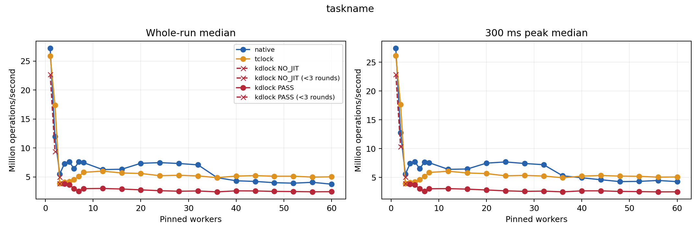
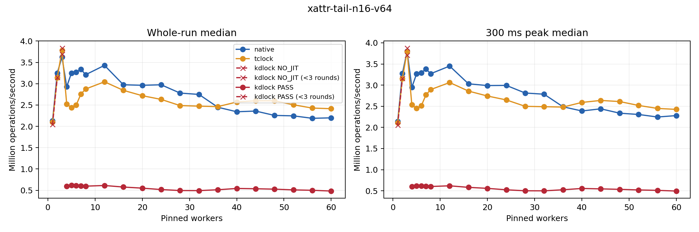
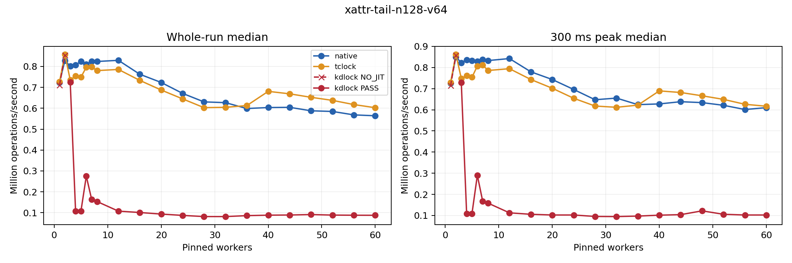

# Taskname and xattr: original kernel API revision

All **567 measurements validated and drained** for frozen source
[`88bb5a4d9b52eec8ed52982ea4039b981d0e5814`](https://github.com/hailongeric/kdlock/tree/88bb5a4d9b52eec8ed52982ea4039b981d0e5814).
At 60 workers, KD whole-run throughput improved over the checked-helper baseline
by **2.178× for taskname, 4.184× for xattr n16, and 1.910× for xattr n128**.
KD remains slower than both fresh Linux Native and TCLock controls at that worker
count. Small-worker results also include substantial regressions, described below.

This revision removes helper-specific checks around the original kernel
`strcmp()` and `strscpy_pad()` calls. The
[`c79d84f` baseline](../taskname-xattr-20261018/README.md), preserved as
`archive/taskname-xattr-checked-c79d84f-20261019`, remains a separate source version.
No baseline samples are pooled into this round. The [comparison audit](comparison-audit.json)
checks exact source changes, execution status and recorded settings before
reporting a historical ratio.

Focused functional acceptance also passed for read-only taskname, eight xattr
controls and three provider probes. The 20% mutation controls were correct and
drained but recorded zero KD JIT bodies; mutation delegation remains unaccepted.
JIT means just-in-time generated code. The [development record](DEVELOPMENT.md)
retains earlier failures and the archived broader alias-analysis experiment.

## Throughput at 60 workers

Rates are medians of three repetitions, in millions of operations per second
(Mops/s). Whole-run throughput includes the actual interval until the final
worker finishes; peak throughput uses a qualifying 300 ms window. Ratios use
unrounded rates. Returned share is the median fraction of measured operations
that completed as delegated bodies.
For xattr, `n16/v64` means 16 attributes with 64-byte values; `n128/v64` uses
128 attributes. A tail lookup searches for the last attribute.

| Workload | Native | TCLock | KD | KD / Native | KD / TCLock | KD returned share |
| --- | ---: | ---: | ---: | ---: | ---: | ---: |
| Taskname, read-only | 3.754 | 5.024 | 2.460 | 0.655× | 0.490× | 99.88% |
| Xattr tail, n16/v64 | 2.200 | 2.414 | 0.483 | 0.220× | 0.200× | 99.89% |
| Xattr tail, n128/v64 | 0.564 | 0.603 | 0.088 | 0.156× | 0.146× | 91.03% |

All nine KD repetitions in this table recorded returned delegated bodies.
Taskname stayed below both controls at every comparable worker count. The only
whole-run ratios above one elsewhere were xattr n16 against TCLock at two workers
(1.002×), and xattr n128 against Native at two workers (1.032×). Both were `NO_JIT`
groups and therefore do not demonstrate faster delegation.

### Separate historical KD comparison

| Workload, 60 workers | c79 KD | Current KD | Current / c79 | c79 returned share | Current returned share |
| --- | ---: | ---: | ---: | ---: | ---: |
| Taskname, read-only | 1.130 | 2.460 | 2.178× | 99.85% | 99.88% |
| Xattr tail, n16/v64 | 0.115 | 0.483 | 4.184× | 93.12% | 99.89% |
| Xattr tail, n128/v64 | 0.046 | 0.088 | 1.910× | 29.23% | 91.03% |

Both versions have three `PASS` repetitions at these points. Their returned
shares differ, particularly for n128, so these are whole-workload comparisons,
not measurements of the isolated cost of removing helper checks. For n128, the
60-worker peak rate was essentially unchanged: 0.102400 versus 0.102397 Mops/s
(current / c79 = 0.999977×), despite the higher whole-run median.

Across the full grid, **55 historical points are eligible and eight are excluded**.
Taskname/3 and xattr n16/3 have mixed statuses; xattr n128/7 and /8 had mixed
baseline statuses. At xattr n128/3–6, the baseline was `NO_JIT` while the current
version is `PASS`. No historical ratio is reported for those eight points.
Complete `NO_JIT` groups can describe local locking performance, but cannot
support a delegation-speedup claim.

### Small-worker regressions

| Workload | Workers | c79 KD | Current KD | Current / c79 | c79 returned share | Current returned share |
| --- | ---: | ---: | ---: | ---: | ---: | ---: |
| Taskname | 4 | 3.932 | 3.801 | 0.967× | 0.02% | 0.02% |
| Taskname | 6 | 3.113 | 2.991 | 0.961× | 10.77% | 13.72% |
| Xattr tail n16/v64 | 4 | 2.659 | 0.597 | 0.225× | 0.03% | 98.41% |
| Xattr tail n16/v64 | 5 | 2.463 | 0.615 | 0.250× | 0.03% | 99.83% |

The four-worker n16 result is a 77.54% whole-run regression against c79, even
though both groups are labelled `PASS`: the baseline performed almost all work
locally, while the current group delegated almost all work. Current KD reaches
only 0.204× Native and 0.236× TCLock there. The measurements do not establish
which part of the delegation path causes the slowdown.

At four workers, current n128 reaches 0.107 Mops/s versus Native 0.806 and TCLock
0.755, with 99.65% returned share. Its historical baseline was 0.757 Mops/s with
no JIT entry, so the historical ratio is excluded rather than mixing execution
statuses. Smaller differences at one or two workers remain in the CSVs; three
repetitions do not establish statistical significance for those differences.

## Full grid and execution evidence

Each case has 189 measurements: 21 worker counts, three backends and three
repetitions. The counts are
`1 2 3 4 5 6 7 8 12 16 20 24 28 32 36 40 44 48 52 56 60`.

| Case | Valid / planned | KD `PASS` | KD `NO_JIT` | Returned KD bodies | Address-guard exits |
| --- | ---: | ---: | ---: | ---: | ---: |
| Taskname, read-only | 189 / 189 | 55 | 8 | 234,377,917 | 0 |
| Xattr tail n16/v64 | 189 / 189 | 55 | 8 | 59,057,675 | 0 |
| Xattr tail n128/v64 | 189 / 189 | 57 | 6 | 9,798,112 | 0 |
| Total | 567 / 567 | 167 | 22 | 303,233,704 | 0 |

`PASS` means at least one generated body returned after its validated outer
unlock. `NO_JIT` means no generated entry during measurement. No session was
`PARTIAL_JIT`, which would mean entries without a returned body. A `NORMAL` image
proves publication only; preparation is also outside the measured counts.
TCLock delegation is not measured by KD counters.

Current taskname/3 and xattr n16/3 each have two `NO_JIT` repetitions and one
`PASS` repetition. Their groups remain separate, with no pooled three-run KD
median or ratio. [All whole-run and peak tables](tables.md) show every worker
count. [Current full-grid CSV](current-full-grid.csv),
[historical KD full-grid CSV](historical-kd-full-grid.csv),
[raw sessions](sessions.csv), and [status-separated groups](groups.csv) preserve
sample names, counts, minima/medians/maxima, returned shares and exclusions.
The compact [current](current-60-workers.csv) and
[historical](historical-kd-60-workers.csv) 60-worker CSVs retain unrounded values.



[Taskname vector figure](taskname.svg).



[Xattr n16 vector figure](xattr-tail-n16-v64.svg).



[Xattr n128 vector figure](xattr-tail-n128-v64.svg).

## Workloads and comparison conditions

Taskname copies a name from 16-byte storage into a padded 64-byte local output;
it is an extracted snapshot, not a full procfs or `ps` benchmark. Xattr searches
16 or 128 attributes for the last entry and copies its real 64-byte value. Each
xattr operation includes one validated syscall. Mutation testing remains separate.

The guest has 64 CPUs in two memory-locality groups, called NUMA nodes: CPUs
0–31 and 32–63. Workers use CPUs 0 through N−1; CPU 63 collects progress. Each
measurement targets two seconds. KD prepares with a separate 16-worker group
on CPUs 0–15, allowing up to eight learning rounds. Preparation and warmup are
excluded from timing. The peak policy requires at least 300 ms after 300 ms of
settling and progress from every worker.

The [comparison audit](comparison-audit.json) matched the pinned source revisions,
all four replay dependencies, kernel identity, topology, recorded runtime
settings and package versions. Intentional implementation and documentation
hash changes are listed in [comparison-policy.json](comparison-policy.json).
The taskname record identifies the baseline interpreter as
`/root/kdlock-evidence/clobber-20260918/venv/bin/python3`, and the current interpreter
as `/root/kdlock-translation-venv-20261019/bin/python3`. The old path is no longer
present; the historical claim rests on its recorded environment, not a fresh
inspection of that interpreter. Both records list `future==1.0.0`, `miasm==0.1.5`,
`pyelftools==0.27` and `pyparsing==2.4.7`. The current interpreter is recorded as
Python 3.10.12. Xattr's environment JSON has no interpreter field; its
[command receipt](xattr.command.json) records the current executable. This does
not prove identical historical Python binaries or unrecorded dependencies.

Both the [current before/after host check](host-comparison.json) and the
[baseline-to-current host check](historical-host-comparison.json) passed all nine
checks: the same VM process/arguments, all 64 matching CPU pins, service work on
CPU 63, and unchanged frequency policy. The policy permits 0.8–3.6 GHz with the
`ondemand` governor. Actual frequency and host load during the runs were not
measured. The boot ID and `6.1.159-kdclobber2` kernel remained unchanged.

## Implementation being evaluated

KD resolves and invokes the original kernel functions with their original
arguments. Translation, publication and execution do not inspect helper
instructions or perform helper-specific CALL checks. They do not scan strings
or check destination bounds at runtime. The original caller supplies valid
storage and lifetime, as it does for the native C API. There is no additional
helper-call registration table. Calls still use the existing service dispatcher;
this revision does not introduce direct native calls from generated code.

Translation retains the actual source CALL's saved return-address write.
`strcmp` has no caller-memory writes; `strscpy_pad(..., 64)` invalidates analysis
facts for all 64 destination bytes. The writer requires a statically known count
and local destination so that these effects are represented accurately. Native
padding and truncation behavior remains the original helper's responsibility.
Ordinary address/register analysis, physical ownership, frame lifetime, exact
return consumption and matching unlock remain in force. Neither helper supplies
an assumed proof about processor flags for a native continuation.

Aliasing means two accesses can refer to the same memory. Ordinary CALLs retain
conservative memory analysis. Only `strcmp` and `strscpy_pad` use a separate
reviewed-C-caller contract that records temporary return-address storage as
control state: the selected caller promises
not to inspect or overwrite it through ordinary data accesses. The source CALL,
all workload loads/stores and actual return handling remain unchanged. This
contract does not make arbitrary pointers valid. Decoded `memcpy` retains all
ordinary copy effects and its normal return dispatch, with no copy classification
or special RET path. The [focused validation below](#focused-validation-and-evidence)
covers this implementation. The broader generic partial-word refinement is an
[archived experiment](DEVELOPMENT.md#archived-alias-experiment-and-next-scope),
not the maintained design. The
[admission guide](../../../../../docs/design/admission.md#original-call-word-aliases)
defines the exact scope and remaining refusals.

Provider capability version 10 advertises the native API contract with feature
bit 9, alongside the separate read-only and writing-service features. This is
an interface version, not a source commit. Generated string-service images
remain immutable while callers use them. The allowance is 128 `strcmp` calls
plus 16 other services/continuations per delegated body. The selected KD mutex
protocol and the two-word wrapper calling interface are unchanged.

Taskname retains its ordinary `KD_SPIN_DIRECT_LOCK` shell and original
`strscpy_pad()` call. Xattr retains its original list traversal, comparisons and
real `memcpy()` value copy. Native, TCLock and KD receive the same protected
payload; changing the helper implementation or replacing the copy loop would
define another workload.

## Remaining execution work

Each delegated `strcmp` still exits generated code with saved register state and
returns through the common dispatcher. It validates the active execution record
(the frame), ownership and the saved CALL return address, then keeps the return
target's source code present until it is no longer needed. This source-pin
operation uses a shared lock and checks the source
module. These are continuation and lifetime operations, not checks of helper
instructions, strings or buffers. See the
[service preparation](../../../../../kernel_module/execution/wrapper_entry.inc)
and [source lifetime implementation](../../../../../kernel_module/kd_source.c).

The [dispatcher](../../../../../kernel_module/exe.c) invokes the original helper,
consumes the saved return word, saves the continuation and updates diagnostic
counters. The [wrapper](../../../../../include/wrapper.S) then restores register
state and reenters generated code at the admitted continuation. A fully delegated
tail lookup repeats this path 16 or 128 times. Native and TCLock use ordinary
helper calls within the same list traversal. Initial preparation of the explicit
ownership frame and final retirement occur once per delegated body; they are
not repeated for every comparison, and successful services retain the outer lock.

This describes statically visible work. It does not measure the cost of these
steps or attribute any performance difference to them; no profiling claim is
made.

## Focused validation and evidence

The final candidate 6 batch completed 17 sessions with correct results and full
drain. Basic checks and all ten affected Python drivers passed across candidates
5 and 6, covering 287 Python tests without skips. The production bytes were
unchanged between those candidates. This is focused coverage, not a full-suite
claim.

| Check | Recorded outcome |
| --- | --- |
| Original `strcmp` | Short strings and valid 300-character strings completed delegated bodies through the same image; zero guard exits. |
| Read-only taskname | All three backends completed 3,200,000 correct reads at 16 workers; KD returned 3,192,951 delegated bodies. |
| Xattr front/tail/miss/size, n16/n128, v64 | All eight 16-worker KD controls passed with matching body entries/completions and correct syscall results. Tail completions were 556,535 at n16 and 100,071 at n128. |
| Spin address guard and mutex marker | Both passed: one triggered native exit, preserved effects, no later JIT entry after the ban, and full retirement. |
| Taskname 20% mutation | All three backends completed 2,560,000 reads and 640,000 writes correctly. These used `helper_waves=0` and did not require delegation; KD recorded zero JIT entries/completions. |

The mutation control is correctness evidence only. It does not erase the earlier
strict preparation failure or establish delegated mutation performance. Taskname
checks normal copying and every padding byte but ignores the helper's return
value. The production-dispatcher unit fixture tests return propagation and
truncation through a substitute helper, not actual-kernel truncation.

The [API-image receipt](candidate6-api-images.json) covers ten KD API sessions and
14 published images. Their only requirement values are 4 for `strcmp` or 8 for
`strscpy_pad`; none includes entry or address guards. The
[host audit](candidate6-host-audit.json) independently checked these image bytes,
assembly, log markers and hashes. The [batch receipt](candidate6-live-result.json)
and [development record](DEVELOPMENT.md#final-live-acceptance) preserve exact
operation and completion counts.

All 28 archived live/diagnostic sessions drained, including 11 earlier attempts
and their failures. The [health receipt](health-through-candidate6.json) records
an idle guest and 28 kernel logs without recorded fault matches. The
[archive manifest](candidate6-archives.json) retains source snapshots, binary and
image hashes, commands and raw receipts; all four copied archive hashes matched
the independent host audit. The 13 new KD sessions retired with zero source
modules, frames and writers.

## Completed matrix validation and archives

The [raw replay receipt](../../raw/bench/taskname-xattr-native-api-20261019/replay-final/replay.json)
validated all 567 sessions, complete coverage, payload checks, worker progress,
CPU placement, source/binary identities and source retirement. Its SHA-256 is
`ca29dc4dc8595c051d13fcaf68860927e92730239dbc1c6724764aef231d5af9`.
Replay recalculates saved observations; it is not another execution of the
workloads. The replay, comparison, image audit and final health commands all
returned zero.

The [image audit](api-images.json) covers 189 KD sessions and 315 published
images, including intermediate learning images. All use only requirement value
4 for `strcmp` or 8 for `strscpy_pad`; no pointer-entry or stack-alias address
guards appear. The independent [host archive audit](archive-audit.json) checked
all 315 images and all 189 daemon logs; the 189 measured images are also covered
by raw replay. The [health receipt](health.json) records an idle guest and no
fault matches in all 567 per-session kernel logs. All 189 KD sources retired
with zero modules, frames and writers.

The host archive audit passed with no discrepancies: 18,035 archived paths,
15,501 hashed regular files, 378 symbolic links and 184 private `.inc` files.
All 263 unique source paths matched Git `88bb5a4`, with none missing. It also
checked 16 captured binaries and 6,362 replay inputs. These are preservation and
record-consistency checks; no archived code or generated image was executed on
the host.

The [archive manifest](archives.json) and
[input inventory](../../raw/bench/taskname-xattr-native-api-20261019/input-inventory.json)
identify the complete raw evidence. The source host stores it under
`bench/results/10.176.26.71/raw/bench/taskname-xattr-native-api-20261019/`.
The guest run directory was `/mnt/kdlock-builds/taskname-xattr-native-api-88bb5a4`;
its archive directory was the same path with `-archives` appended.

| Archive | Bytes | SHA-256 |
| --- | ---: | --- |
| [taskname.tar.gz](../../raw/bench/taskname-xattr-native-api-20261019/taskname.tar.gz) | 14,653,193 | `9e7f40f3e1508c92c35b4928d13009591c415c87cf71eb2e4ae6672d531f9457` |
| [xattr.tar.gz](../../raw/bench/taskname-xattr-native-api-20261019/xattr.tar.gz) | 17,606,857 | `26e814eade80b586c6cec8f1118d6201f44452c59586a99813522139c97c11a2` |
| [metadata.tar.gz](../../raw/bench/taskname-xattr-native-api-20261019/metadata.tar.gz) | 916,292 | `5b7f51993d4b76df48a9f7873d362a38daa47e1f79a46d1595622e0d0e3d467d` |

The workload archives retain original source and binary snapshots, commands,
measurements, preparation records, image bytes and kernel logs. Metadata retains
the replay, figures, historical comparison, image/health receipts and orchestration
scripts. Archive hashes and sizes matched the independent host audit.
The copied figures and tables preserve their generated bytes, including SVG
trailing spaces and the table's final blank line. These account for the Git
whitespace warnings in those four generated files; hand-written documentation
passes the whitespace check.

## Reproduction

Follow the [VM operations guide](../../../../../docs/operations/VM.md): all builds,
tests and timing run in the VM, with an idle guest and a confirmed recovery
snapshot. Use an isolated checkout of `88bb5a4`. These are the recorded commands,
run from `/root/host_fs/kdlock`; a new repetition must use new empty output paths
instead of overwriting the captured run. The [taskname](taskname.command.json)
and [xattr](xattr.command.json) receipts include execution bounds and exit status.

```sh
/root/kdlock-translation-venv-20261019/bin/python3 bench/rwlock_compare/run.py \
  --lock-kind spin --workloads taskname --write-percent 0 \
  --backends native tclock kdlock --helper-workers 16 --helper-waves 8 \
  --threads 1 2 3 4 5 6 7 8 12 16 20 24 28 32 36 40 44 48 52 56 60 \
  --collector-cpu 63 --duration-ms 2000 --repeats 3 \
  --output /mnt/kdlock-builds/taskname-xattr-native-api-88bb5a4/taskname

/root/kdlock-translation-venv-20261019/bin/python3 bench/real_api/run.py \
  --kinds xattr --queries tail --entries 16 128 --value-size 64 \
  --backends native tclock kdlock --helper-workers 16 --helper-waves 8 \
  --threads 1 2 3 4 5 6 7 8 12 16 20 24 28 32 36 40 44 48 52 56 60 \
  --collector-cpu 63 --duration-ms 2000 --repeats 3 \
  --output /mnt/kdlock-builds/taskname-xattr-native-api-88bb5a4/xattr
```

After both runs drain, the unchanged historical replay program validates the
new raw evidence. The run map, retained in `metadata.tar.gz`, names the taskname
and xattr directories. The separate comparison script reads the two successful
replays and the adjacent pinned policy; it never combines their repetitions.
The [replay](replay-final.command.json) and
[comparison](comparison-final.command.json) receipts record these commands:

```sh
/root/kdlock-plot-venv-20261019/bin/python3 \
  bench/results/10.176.26.71/bench/taskname-xattr-20261018/report.py \
  /mnt/kdlock-builds/taskname-xattr-native-api-88bb5a4/run-map.json \
  /mnt/kdlock-builds/taskname-xattr-native-api-88bb5a4/replay-final --plots

/root/kdlock-translation-venv-20261019/bin/python3 \
  /mnt/kdlock-builds/taskname-xattr-native-api-88bb5a4/compare.py \
  /mnt/kdlock-builds/taskname-xattr-main-c79d84f/replay-final/replay.json \
  /mnt/kdlock-builds/taskname-xattr-native-api-88bb5a4/replay-final/replay.json \
  /mnt/kdlock-builds/taskname-xattr-native-api-88bb5a4/comparison-final
```

The archived comparison script is also available as [compare.py](compare.py),
with [comparison-policy.json](comparison-policy.json). It rejects incomplete
replays and records incompatible source/settings or status groups explicitly.
Plotting used a separate environment, recorded in [plot-packages.txt](plot-packages.txt);
it was not the interpreter used by the timed translator. Source-level changes,
measurement conditions and execution coverage remain part of every comparison.
